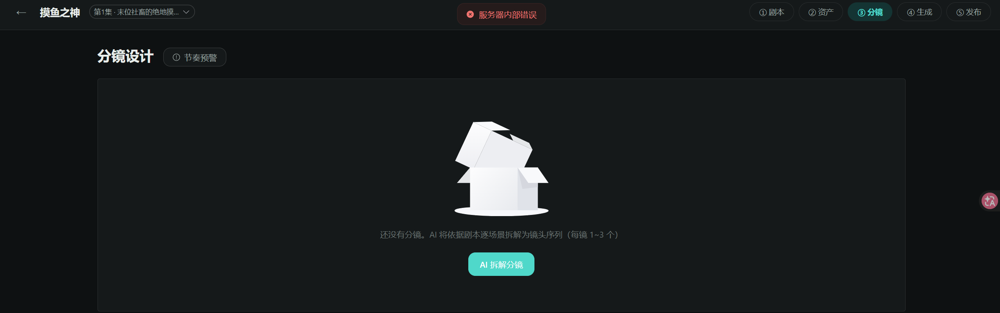
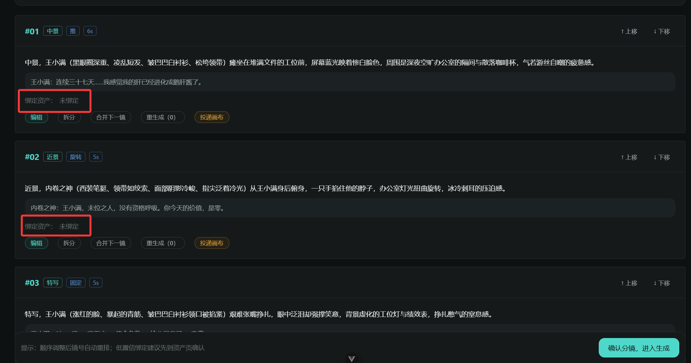
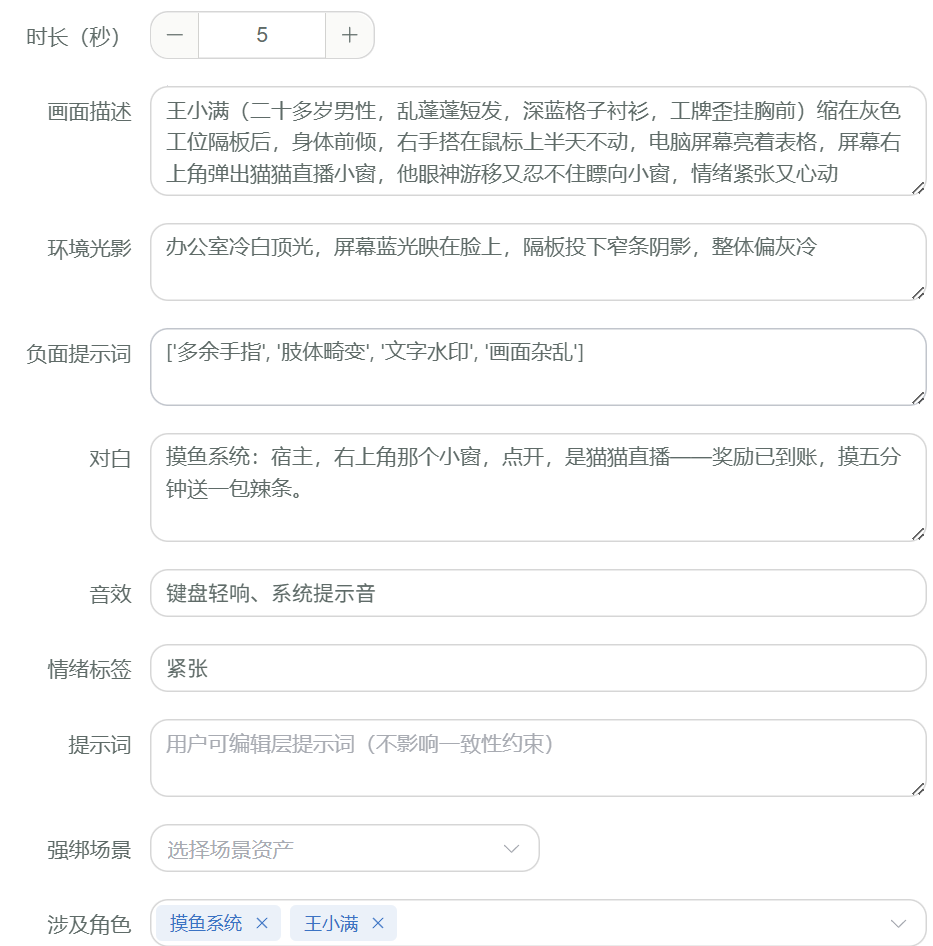
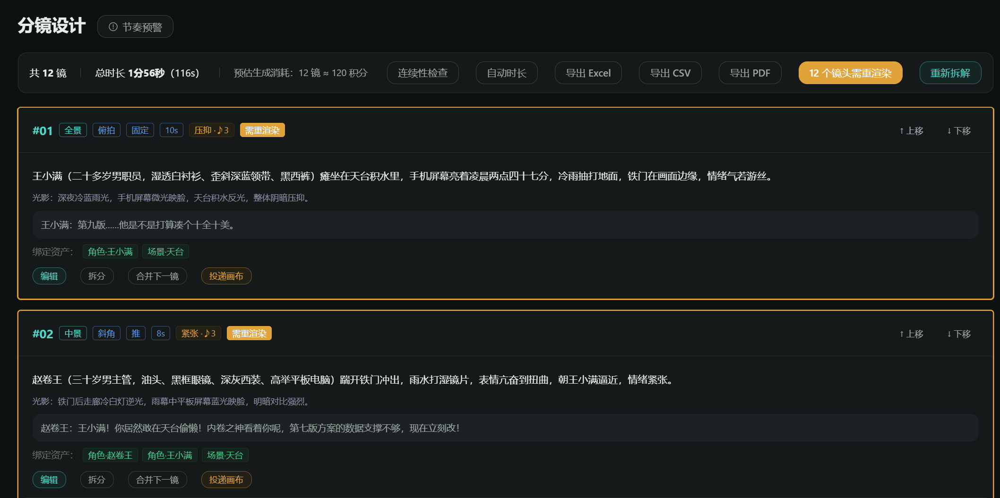
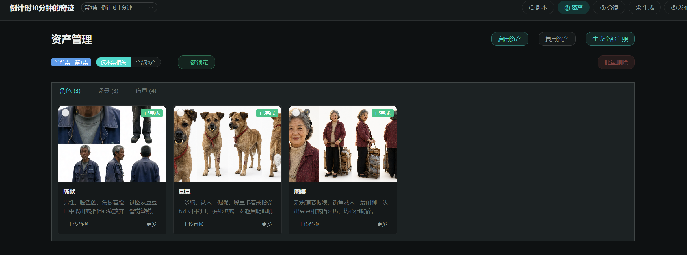
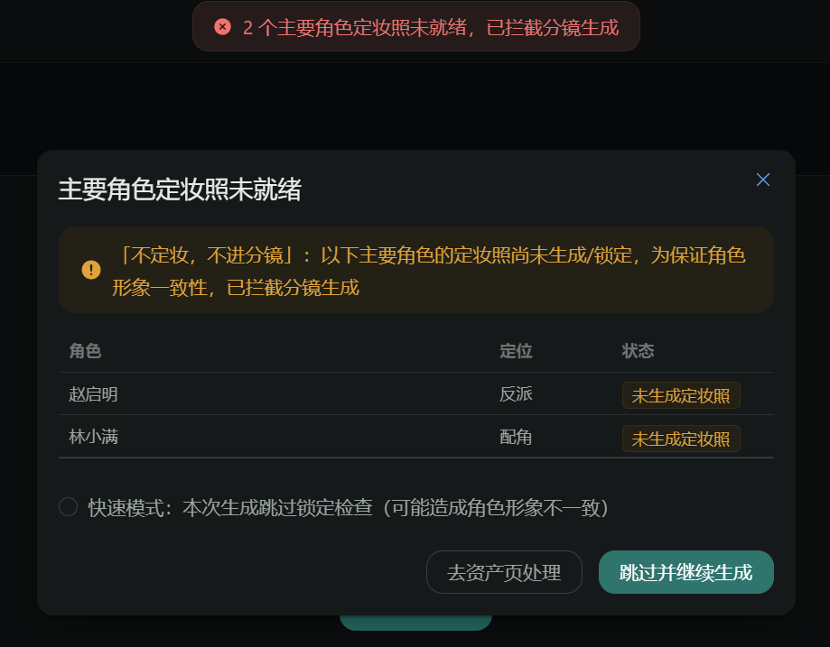

# 开发问题记录（2026-10-17 ~ 10-19 会话 · 分镜设计与生成门禁链路）

> 记录范围：本会话用户在分镜拆解、资产绑定、流程门禁联调中反馈的开发 bug。每条含提问原文、截图（如有）、根因分析、解决方法与涉及文件。
> 关联代码：`backend/app/services/storyboard_service.py`、`backend/app/services/generation_service.py`、`backend/app/tasks/runner.py`、`backend/alembic/versions/*`、`mangaflow-web/src/views/studio/StoryboardView.vue`、`mangaflow-web/src/components/script/StepEpisodeBody.vue`

---

## 问题 7：进入分镜页爆红「服务器内部错误」

**提问原文**：
> 为什么一点进分镜就会出现爆红，服务器错误

**截图**：

分镜页整体不可用，顶部报「服务器内部错误」：

**现象**：只要进入分镜设计页即报 500，分镜列表接口 `GET /storyboards` 失败。后端日志报 `字段 storyboard_props.created_at 不存在`。

**根因**：项目的 `Base` 通过 `TimestampMixin`（`app/core/database.py`）给**所有 ORM 模型**自动注入 `created_at` / `updated_at` 两列。方案 B 扩展新建 `storyboard_props` 关联表时，alembic 迁移漏建了这两列；分镜列表 `_build_out_list` 联查道具关联（`SELECT storyboard_props.created_at, ...`）即触发 `ProgrammingError`。

**解决方法**：

| 修复点 | 内容 |
|---|---|
| 存量库补列 | `ALTER TABLE storyboard_props ADD COLUMN IF NOT EXISTS created_at/updated_at TIMESTAMPTZ NOT NULL DEFAULT now()` + COMMENT 对齐 |
| 迁移文件修正 | `e9f3a1c7b5d2` 迁移的 `op.create_table` 补上两列（保证新环境部署不复发） |
| 经验沉淀 | 凡 ORM 新建表，必须带 TimestampMixin 的两个通用列；迁移与 ORM 列集需逐一比对 |

**涉及文件**：`alembic/versions/2026_10_17_2300-e9f3a1c7b5d2_storyboard_structured_fields.py`

**验证**：联查 SQL 直跑通过；重启后分镜列表 200。

---

## 问题 8：分镜全部显示「绑定资产：未绑定」

**提问原文**：
> 当前这些分镜都没有AI绑定好资产

**截图**：

镜头 #01/#02/#03 的「绑定资产：未绑定」（红框），而画面描述里明明有王小满、内卷之神：

**现象**：拆解出的分镜卡一律显示「未绑定」，角色/场景/道具均无 tag。

**根因**（两层）：
1. 这批分镜是旧代码时期的产物，绑定数据本就为空；
2. 真正的结构性缺陷：剧情节点结构改造后，节点 `title` 变成剧情概括标题（如「末位之夜的窒息」），**地点搬到了 `location` 字段**（如「写字楼工位区」），但 `_match_scene` 仍拿 `title` 去匹配场景资产名——永远匹配不上，场景绑定必然为空。

**解决方法**：

| 修复点 | 内容 |
|---|---|
| 场景匹配 | `_match_scene` 改为 `location` 优先、`title` 兜底的两轮匹配（兼容旧数据 title 即地点的形态） |
| 角色匹配 | `_match_characters` 加 `extra_text` 参数：对白说话人精确匹配之外，画面描述中的角色名子串兜底（覆盖无对白特写镜头） |
| 道具匹配 | 新增 `_match_props`：画面描述 + 对白文本对道具名（≥2 字符）包含匹配，置信度 0.6 |

**涉及文件**：`app/services/storyboard_service.py`

---

## 问题 9：重新点「AI 拆解分镜」仍无绑定（拆解一直在 500 回滚）

**提问原文**：
> 用户点击“AI拆解分镜”后，所展示出来的分镜依旧还是没有绑定好对应的资产，仍需要用户去手动绑定

**现象**：修复匹配逻辑后用户重新拆解，界面仍是旧分镜（无机位角度 tag）。数据库核对发现分镜从未被重建——拆解请求全部 500 回滚，前端却无强感知。

**根因**：按集拆解后 `_resequence_episodes` 把全项目分镜 sequence 重写为连续 1..n；`uk_sb_seq = (project_id, episode_id, sequence)` 唯一索引下，**同集内 1..n → m..k 的平移会与未改行临时撞车**（逐行 UPDATE 触发 UniqueViolation）→ 整个事务回滚 → 用户看到的永远是旧分镜。

**连带发现**：runner 死任务无限重撞——归属项目/钱包已删除的任务（#25/#26）失败退款时 `refund_frozen` 抛 404，`_fail_task` 未 commit → 任务无法落终态、retry_count 回滚 → worker 无限重领重撞。

**解决方法**：

| 修复点 | 内容 |
|---|---|
| 两阶段重排 | `_resequence_episodes` / `_resequence` / `reorder_storyboards` 三处统一改为：先全量 `sequence += 1000000` 偏移（同集内相对唯一保持）→ flush 落位 → 再按目标序赋 1..n（高位不在目标区间，落位不冲突） |
| 退款兜底 | `runner._fail_task` 两处 `refund_frozen` 包 try/except（HTTPException），钱包不存在时跳过退款继续落终态 |
| 止血 | 死任务 #25/#26 直接 SQL 置 `failed + dead_letter` |

**涉及文件**：`app/services/storyboard_service.py`、`app/tasks/runner.py`

**验证**：服务层直跑 `decompose_storyboards` 全链路成功（24 镜、机位角度 24/24、场景绑定 24/24、角色关联 52 条、道具关联 17 条）。

---

## 问题 10：角色绑定了，但场景和道具没有；负面提示词显示列表原文

**提问原文**：
> 角色资产有了，但场景和道具没有

**截图**：

编辑弹窗：机位/光影/情绪正常、涉及角色有值，但「强绑场景」为空，且负面提示词显示为 Python 列表原文 `['多余手指', '肢体畸变', ...]`：

**现象**：重新拆解后角色绑定正常，场景/道具 tag 仍缺失；部分镜头负面提示词格式异常。

**根因**：
1. **操作时序**（主因）：拆解发生在「启用资产」入池之前——三集分镜创建于 13:18:04，而「办公区」场景与全部道具入池于 13:18:22（晚 18 秒）。拆解只绑定当时池内已有的资产，拆解瞬间道具池为空。
2. **解析缺陷**（次因）：LLM 偶尔把 `negative_prompt` 返回为数组，解析时被直接 `str()` 成列表原文拼进提示词。

**解决方法**：

| 修复点 | 内容 |
|---|---|
| 流程建议 | 先在各集点「启用资产」确认入池，再点「AI 拆解分镜」；资产池齐后重拆即可全部绑定 |
| 数组容错 | `_llm_shots` 解析 `negative_prompt` 时 list → 顿号串拼接（`、`），字符串路径不变 |

**涉及文件**：`app/services/storyboard_service.py`

---

## 问题 11：没点「AI 拆解分镜」按钮，分镜就已经生成了

**提问原文**：
> 问题一：用户没有点击“AI拆解分镜”按钮，就把资产管理在资产锁定后，点进分镜就已经分镜。用户在该集首次点进分镜时应该是空的，需要让用户点击按钮才有分镜的结果。

**现象**：用户锁定资产后首次进分镜页，分镜已存在——与「拆解应由用户手动触发」的产品预期不符。

**根因**：剧本正文的「保存本集正文」在 [StepEpisodeBody.vue](../../mangaflow-web/src/components/script/StepEpisodeBody.vue) 中挂了 `syncDownstream` 钩子：保存成功后静默调用整剧 `decompose`，分镜被自动重建。

**解决方法**：删除 `syncDownstream` 自动拆解逻辑。分镜**只能**通过分镜页「AI 拆解分镜」按钮生成，首次进入某集分镜页为空态。

**涉及文件**：`mangaflow-web/src/components/script/StepEpisodeBody.vue`

---

## 问题 12：单集时长与分镜总时长不匹配

**提问原文**：
> 问题二：用户在新建项目时已经选定单集时长与当前分镜中显示的总时长不匹对

**现象**：新建项目选定单集时长（如 120s），拆解后分镜总时长与之偏差大。

**根因**：项目 `target_duration` 只是锚点，拆解时 LLM 按剧情节点自带的 `duration_sec`（30s、28s…）分配各镜时长，两者从未对齐。

**解决方法**：`decompose_storyboards` 落库后自动按项目「单集目标时长」**等比缩放**各镜时长（与手动 auto-fit-duration 同口径，单镜保底 1 秒）；按集拆解只缩放该集，不影响其他集；目标未设置时跳过。

**涉及文件**：`app/services/storyboard_service.py`

---

## 问题 13：点击「需重渲染」没有效果，标黄永不消除

**提问原文**：
> 这种情况是为什么，点击了重渲染，没有什么效果

**截图**：

12 镜全部 stale 标黄（「需重渲染」tag），工具栏显示「12 个镜头需重渲染」：

**现象**：点击批量重渲染后任务创建并执行，但镜头标黄依旧；重渲染形同虚设。

**根因**：角色定妆照在拆解后重新生成（asset_version 1→2），全部分镜引用快照（=1）与当前版本（=2）不一致 → 全部 stale。但 runner 回写 `storyboard_keyframe` 时**只更新 `keyframe_url`，不刷新版本快照**——stale 判定恒成立，标黄永远无法消除。另：点击瞬间已有全量任务在跑的镜头被自动跳过（防重复扣费），且无「已入队」即时反馈，加重「没效果」观感。

**解决方法**：runner 回写关键帧时同步刷新引用快照：`scene_version` 置为绑定场景当前 `asset_version`，并批量 `UPDATE storyboard_characters SET character_version = characters.asset_version`。P0-3 stale 闭环自此完整：**资产更新 → 标黄 → 重渲染 → 新图回写 + 快照刷新 → 标黄消除**。

**涉及文件**：`app/tasks/runner.py`

---

## 问题 14：锁定门禁误拦其他集的角色（门禁未按集隔离）

**提问原文**：
> 当前我已经对第一集的所有资产图片生成并锁定了，进入分镜中，却显示图2 这样还有角色未生成，但这些角色并不在该集中存在。我认为这一现象是分镜并没有隔离好每一集的资产

**截图**：

第 1 集资产页：本集相关 3 个角色（陈默/豆豆/周姨）全部已生成 + 已锁定：

点「AI 拆解分镜」却被 409 拦截，弹窗列出的是**其他集**的角色（赵启明-反派、林小满-配角）：

**现象**：本集资产全部就绪，拆解仍被毫不相干的角色拦截。

**根因**：`check_lock_readiness` 检查**项目内全部已启用角色**，不区分角色属于哪一集——其他集才出场、尚未定妆的角色也会拦住本集拆解。

**解决方法**：`check_lock_readiness` 增加 `scope_episode_id` 参数——按集拆解时只检查「本集涉及的角色」：
- 新增 `_episode_involved_character_ids`：取该集剧本剧情节点，对白说话人精确匹配（含别名）+ 剧情/动作/标题文本角色名包含兜底；
- 判定口径与 decompose 的实体绑定**完全一致**，保证「拆解会绑到的角色 ⊆ 门禁检查的角色」；
- scope 为 None（全量重建）时仍检查项目全部角色（此时各集分镜都会重建）。

**涉及文件**：`app/services/storyboard_service.py`

**验证**：锁定门禁与分镜测试 10 项全部通过。

---

## 附：本会话非 bug 类改进（简记）

| 改进 | 说明 |
|---|---|
| 分镜结构化扩展（方案 B） | storyboards 加 camera_angle/lighting/negative_prompt/audio 4 列 + storyboard_props 道具关联表；拆解提示词输出机位角度/环境光影/负面提示词/音效/情绪；prompt_locked 升级八要素；负面向 `task.meta.negative_prompt` 单独透传 |
| 删除「重生成 (N)」按钮 | 该按钮为纯计数器（regen_count+1），不生成任何内容，已从前端移除 |
| 生成阶段门禁 | 新增 `POST /storyboards/confirm`（storyboard→producing）；「确认分镜，进入生成」先确认再跳转；生成页六个生成动作在未确认时被前端守卫 + 后端状态校验双重拦截 |
