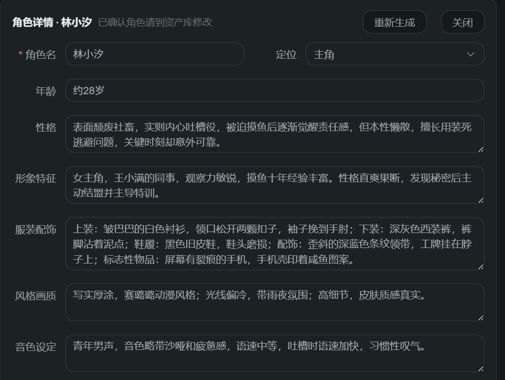
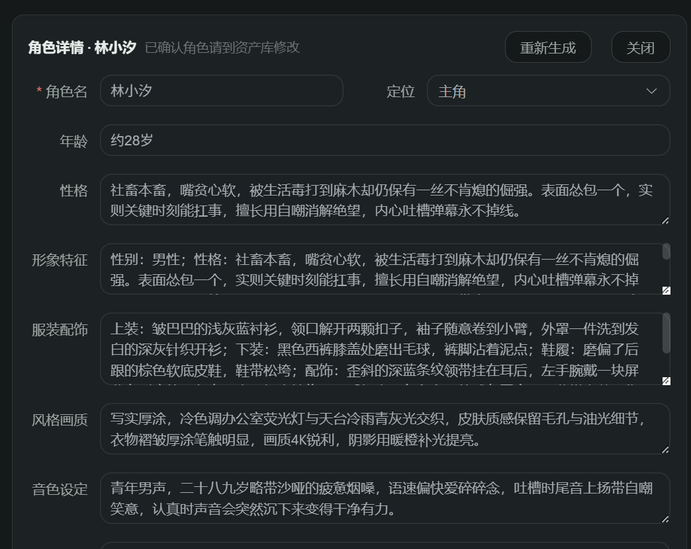

# 开发问题记录（2026-10-19 ~ 10-20 会话 · 角色音色与视觉风格）

> 记录范围：本会话用户在剧本创作（角色设定）与项目配置（新建项目）环节反馈的开发问题。每条含提问原文、截图（如有）、根因分析、解决方法与涉及文件。
> 关联文档：同目录《开发问题记录-2026-10-19_20-配音与视频生成链路》（bug1~14，本篇从 bug15 续号）。

---

## 问题 1（bug15/16）：角色音色描述模板化且性别错位——女主角林小汐被写成「青年男声」

**提问原文**：

> 这音色有点模块了，没有按照实际去描述好，像这个林小汐至少应该是女声的

**截图**：

角色详情「林小汐」（定位主角、约 28 岁）的音色设定为「青年男声，音色略带沙哑和疲惫感，语速中等，吐槽时语速加快，习惯性叹气」——性别错位且句式模板化：



**追问原文**（提示词强化一轮后复测）：

> 怎么还是男声

**截图**：

点「重新生成」后音色文本已变化（说明新提示词生效），但仍写「青年男声」；且「形象特征」字段开头暴露「**性别：男性**；性格：……」残留——问题根源浮出水面：



**现象**：

1. 女主角音色设定写成男声，且描述句式套模板（所有角色风格雷同）；
2. 按第一轮修复强化提示词后单角色重生成，音色内容变了但性别仍错。

**根因**（两层，第二层是关键）：

1. **提示词层**：`_CHARACTER_PLANNER_SYSTEM_PROMPT` 对 voice_note 仅要求「须与 gender 和人物性格自洽」——约束太弱；且 JSON 结构示例含具象值「如青年男声、低沉磁性、语速偏慢」，被 LLM 直接照抄（与此前分集大纲情绪走向全部套用「压抑→爆发→释然」是同一类教训：提示词中的示例值会被照抄）。
2. **数据层（为什么改提示词没用）**：查库确认该角色 `gender='男性'`——LLM 把**性别本身判错了**。voice_note「青年男声」与 gender「男性」是内部自洽的，「音色须与 gender 一致」的提示词约束自然拦不住一个本身就错的 gender。

**解决方法**：

| 层级 | 修复内容 |
|---|---|
| 提示词强化 | gender 升级为权威锚定：依据角色名、人称用词与人设语境判定（女性名字/女主角/「她」一律判女性）；voice_note 开头的声音性别与年龄感必须与 gender 严格一致（gender=女性 → 只能写女声，严禁错位）；音色质地/说话习惯必须结合角色职业、性格、年龄量身定制，禁止套用固定句式；JSON 示例值全部改为格式性描述，不再给具象示例 |
| 代码级兜底 | 提示词管不住 LLM 自身判定错误，`_normalize_character_candidates` 入口加两道代码校验（班底生成与单角色重生成共用，一处兜底全链路生效）：① `_infer_gender_from_name`——40 个高置信女名用字表（汐/雪/婷/雅/琳……），LLM 把含这些字的角色判成男性时强制纠正 gender=女性；② `_enforce_voice_gender`——voice_note 声音性别词与 gender 矛盾时定向替换（女性：男声→女声、男音→女音；男性：少女音→少年音、女声→男声），音色质地/说话习惯描述保留 |
| 存量数据 | 已生成角色是旧提示词产物，对角色卡点「重新生成」即按新约束刷新（voice_note、description 的「性别：」残留、角色圣经 visual_prompt 同步重建） |

兜底逻辑验证输出（模拟 LLM 判错场景）：

```text
林小汐 | 女性 | 青年女声，略带沙哑的疲惫烟嗓，语速偏快   ← gender 男→女纠正 + 男声→女声
陈默   | 男性 | 少年音，清脆                             ← 少女音→少年音
苏婷   | 女性 | 女声，温柔                               ← 名字含「婷」纠正 gender
```

**涉及文件**：`app/agents/script_pipeline.py`

**验证**：角色/流水线相关 34 项测试通过；后端重启后生效。

**经验沉淀**：

1. **提示词约束对「LLM 自身判定错误」无效**——当 LLM 把上游字段（gender）判错后，下游字段（voice_note）与它自洽，基于一致性的约束形同虚设。关键判定字段必须配代码级兜底（启发式词表 + 矛盾检测）。
2. **提示词中的 JSON 示例值会被 LLM 照抄**（本线程第二次踩坑：情绪走向模板化同类），示例应写格式描述而非具象值。
3. 中文角色名性别可用「高置信女名用字表」做单向纠偏（女性向误判率极低；男性名用字误判率高，不做反向强制）。

---

## 问题 2（bug17）：新建项目「视觉风格」缺真人写实风格

**提问原文**：

> 对于"新建项目"弹窗中的视觉风格中缺少真人写实风格，帮我新增好该风格，并补充好提示词：
> 1. 影视级写实 (Cinematic Realism / 电影质感)——极致的电影感，光影深邃，带有一点点胶片质感或质感反差，最适合悬疑、复仇、高品质短剧。
> 2. 现代都市写实 (Modern Urban Realism / 高清短剧风)——干净、明亮、色彩还原度高，人物颜值极高（微磨皮），最适合霸总、甜宠、职场题材。
> 3. 复古/年代写实 (Vintage / Period Realism)——适合民国、80/90 年代、怀旧题材。带有特定的胶片色调（如柯达金、富士绿）和年代感。
>
> （每档并附完整的正向提示词 Prefix、画面控制词、专属负面提示词 Negative）

**截图**：

新建项目弹窗「视觉风格」下拉仅 6 项动漫/插画系风格，无真人写实可选：


**现象**：视觉风格选项全部为动漫/插画/矢量系，做真人短剧题材的项目无写实风格可选。

**根因**：风格体系由两处定义——前端 `NewProjectDialog.vue` 的 STYLES 数组 + 后端 `style_prompts.py` 的 STYLE_PROMPTS 映射表（prefix 注入生图提示词最前、negative 注入尾部），初始设计只覆盖动漫/插画系，未包含实拍照片质感风格。

**解决方法**：

1. **前端选项**：STYLES 追加「影视级写实」「现代都市写实」「复古/年代写实」三项（共 9 项；`projects.style` 为自由字符串仅限长 20，无白名单校验，后端零改动即可存储）。
2. **提示词映射**：按用户提供的资料补三档 prefix/negative。取舍原则——「画面控制词」中**场景相关词**（如 business suit、luxury office background、traditional clothing）不并入全局前缀（属于画面描述层，硬带会污染所有镜头）；**普适人像质感词**（detailed skin texture、realistic hair strands、sharp focus on eyes、flawless but realistic skin、film grain 等）并入 prefix。
3. **兼容适配（隐性问题，顺带修复）**：生成管线 4 处硬编码「统一**风格插画**」（角色圣经前缀 ×3、抽取入池 visual_prompt 缺省模板 ×1）改为「统一**视觉风格**」。原因：真人写实风格的负面词含 `illustration`，而 qwen-image 能理解中文「插画」，visual_prompt 里的「插画」字样会与 photorealistic 打架，导致写实风格生成效果被稀释。

**涉及文件**：`mangaflow-web/src/components/NewProjectDialog.vue`、`app/core/style_prompts.py`、`app/api/script_pipeline.py`、`app/services/script_pipeline_service.py`、`app/services/script_service.py`

**验证**：9 档风格映射全部就位（prefix/negative 非空）；后端 18 项相关测试通过；前端 type-check + 构建 exit 0；后端重启生效。

**经验沉淀**：新增视觉风格时，除「选项数组 + 提示词映射表」两处主改动外，必须全库检索「动漫/插画」类硬编码文案——写实系风格与插画措辞在同一提示词中共存时会互相打架。

---

## 附：本会话沉淀的通用经验

1. **关键判定字段要有代码级兜底**：LLM 对上游字段（如 gender）的判定本身可能出错，出错后下游（voice_note）与之自洽，一切「保持一致」类提示词约束失效——用启发式词表 + 矛盾替换在代码层强制纠偏。
2. **提示词中的 JSON 示例值会被照抄**：示例应写格式描述与约束，不写具象值（本线程两次踩坑：情绪走向模板化、音色描述模板化）。
3. **风格类全局前缀只放普适词**：场景相关词走分镜/资产描述层，人像质感类普适词才进系统级 prefix；新增写实系风格时同步清理管线中的「插画/动漫」硬编码措辞。
