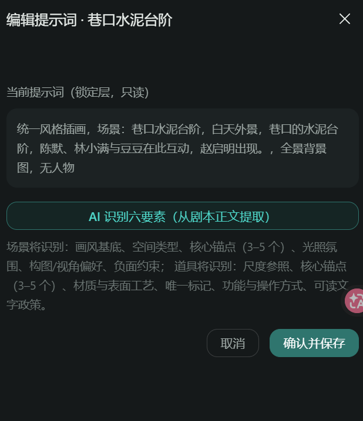
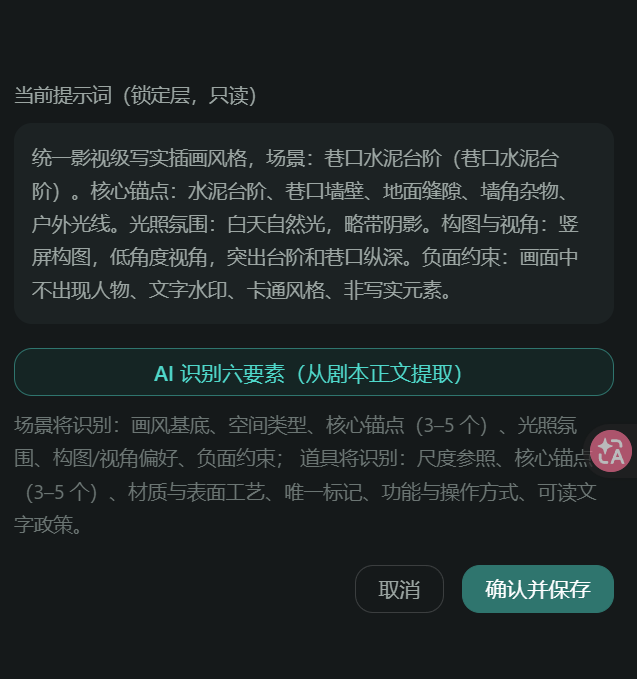

# 开发问题记录（2026-10-19 ~ 10-20 会话 · 资产管理按集工作流与提示词自动识别）

> 记录范围：本会话用户在「资产管理」模块联调中反馈的开发 bug 与行为修正。每条含提问原文、截图（如有）、根因分析、解决方法与涉及文件。会话主线：按集资产工作流（启用资产 → 确认入池 → 自动六要素识别 → 批量出图）+ 视觉风格系统级前缀 + 角色性别全链路。
> 关联代码：`backend/app/services/script_service.py`、`backend/app/services/asset_service.py`、`backend/app/api/assets.py`、`backend/app/core/style_prompts.py`、`mangaflow-web/src/views/studio/AssetsView.vue`、`mangaflow-web/src/views/studio/EntityExtractView.vue`

---

## 问题 1：角色未按分集大纲出场角色提取 + 场景提取不出来

**提问原文**：
> 资产管理中的角色目前还是全部从角色设定中一次性全部提取出来，我需要的是每集要按照对应的分集大纲中的出场角色（图片所示）提取，每集提取需要出场的角色，不是该集要出场的角色就不用提取。且还有个问题，资产管理中的场景没有提取出来，是要从剧本正文中的场景中的提取

**现象**：点击「启用资产」后，角色把角色设定里的全部角色一次性提取（不区分本集是否出场）；场景则提取不出（恒为 0）。

**根因**：

1. **角色无程序级强制**：分集大纲的出场角色清单仅注入抽取源文本作为背景，LLM 提示词无硬约束、代码无过滤，LLM 仍按全文角色输出。
2. **场景抽取源缺线索**：剧本正文改版为「剧情节点N」结构后，场景线索（地点/时段）不再以规则可识别的标记行出现，抽取源文本又未显式注入场景信息，LLM 与规则双路均抓不到。

**解决方法**：

| 修复点 | 内容 |
|---|---|
| LLM 硬约束 | `llm_extract(raw_text, cast_names=None)`：有白名单时 user 消息注入「仅可输出以下角色…未列出的角色一律不要输出」；不改 `llm.chat` 签名（测试替身兼容） |
| 程序级过滤 | `_filter_characters_by_cast`：`_match_cast_name` 双向子串归一化匹配（「林小汐」↔「小汐」），LLM 多给/错给的剔除；白名单角色 LLM 漏给时按清单兜底补齐占位条目 |
| 场景线索注入 | `build_project_extract_source` 按集注入大纲头部「出场角色：…」；正文段落显式拼接镜头的 location/time_of_day/int_ext（「（地点：…）」后缀），保证地点稳定抽成场景资产 |

**涉及文件**：`backend/app/services/script_service.py`

**验证**：`tests/test_script_extract.py` 白名单过滤用例通过（LLM 越界输出被程序级剔除、漏输出被兜底补齐）。

---

## 问题 2：切换剧集后资产不隔离（第一集资产泄漏到第二集视图）

**提问原文**：
> 修复下下面的问题，当用户启动了第一集的资产后，第一集也确实提取成功了，当切换至第二集后，本应该是显示空的，但目前是展示出了第一集所提出来的。对每一集的所提取的资产要隔离好

**现象**：第一集「启用资产」成功后，切换到未启用的第二集，资产页仍显示第一集提取的全部资产，没有空态。

**根因**：后端 `GET /assets?episode_id=` 的 `episode_enabled` 对未启用集返回 `{}`（JSON 键缺失），前端 `isEnabledInEpisode` 对键缺失一律 `return true`（无集上下文时不过滤的语义被误用到「键存在但空数组」场景），第一集资产全部透出。

**解决方法**：

- **后端**：`episode_enabled` 规范化——四键（characters/scenes/props/episodes）恒齐，空名单输出空数组而非空对象；
- **前端**：区分三态——`null`（未传 episode_id，无集上下文不过滤）/ 键存在且空数组（该集未启用，四类全隐藏显示空态）/ 非空数组（按名单过滤显示）。

**涉及文件**：`backend/app/api/assets.py`、`mangaflow-web/src/views/studio/AssetsView.vue`、`mangaflow-web/src/types/index.ts`

---

## 问题 3：场景删除后「启用资产」确认回不来 + 同一资产跨集漂移

**提问原文**：
> （场景删除后）再次点击启用资产确认，删除的场景没有恢复出来
> 每集的都会有重复的角色、场景、道具，要确保这些资产的一致性，不能同一资产出现每集不同

**现象**：①删除某场景后重新确认入池，该场景回不来（或撞同名 409）；②不同集各自确认入池时，同名资产被重复建行，各自生成图片后同一资产在不同集形象漂移。

**根因**：

1. **软删行被绕过**：`confirm_extract` 的 exist 预查带 `deleted_at IS NULL` 过滤，命中已软删行时查不到，误走新建路径——撞项目内唯一名约束 409 或再次软删歧义。
2. **无幂等复用**：按集确认以「名称不存在」为新建依据，同名资产每集各建一行，无跨集复用语义。

**解决方法**：

| 修复点 | 内容 |
|---|---|
| 软删复活 | 三类 exist 预查不过滤 `deleted_at`；命中已删行时走更新路径并置 `deleted_at = NULL` 复活（名称/描述/提示词同步刷新） |
| 跨集幂等复用 | 同名资产命中（含软删复活后）统一复用同一行，仅更新 description 等字段；`visual_prompt` 已有非空且非模板时不覆盖（`_is_default_visual_prompt` 指纹判断），保证跨集视觉一致 |
| 启用名单 union | `episodes.enabled_assets` 按集落启用名单时与既有名单 union 去重，不覆盖其他集已启用项 |

**涉及文件**：`backend/app/services/script_service.py`

---

## 问题 4：卡片选中态白色对勾不居中

**提问原文**：
> 左上角的圆圈再添加个选中的变化
> 白色对勾并没有再圆圈中心
> 把白色对勾删除了

**现象**：资产卡片左上角选择圈选中后显示白色对勾，但对勾在圆圈内偏移、不居中。

**根因**：对勾图标以绝对定位叠加在圆圈内，图标盒尺寸与圆圈不同导致视觉偏移。

**解决方法**：先改 flex 布局居中；用户最终决策删除对勾——选中态仅保留「品牌绿填充 + 浅绿光晕 + 微放大」，无文字无图标。

**涉及文件**：`mangaflow-web/src/views/studio/AssetsView.vue`

---

## 问题 5：重生成无任何加载反馈

**提问原文**：
> 对于资产管理中的重生成，没有给用户一个很好的视觉体现，当前是点击重生成之后，页面没有任何的加载效果

**现象**：点击「更多 → 重生成」提交生成任务后，卡片无任何变化，用户感知不到已在生成，容易重复点击。

**根因**：生成任务异步执行（任务队列），前端提交成功后仅弹 toast，未把「进行中任务」状态映射到卡片 UI；场景/道具无 `generation_status` 字段，仅角色有。

**解决方法**：

- 卡片叠加 `gen-overlay` 生成中遮罩（半透明 + 加载动画）；
- 角色以 `generation_status === 'generating'` 判定；场景/道具提交后记录任务 ID 轮询终态，完成/失败后刷新列表解除遮罩。

**涉及文件**：`mangaflow-web/src/views/studio/AssetsView.vue`

---

## 问题 6：各场景生成图风格漂移（画风不一致）

**提问原文**：
> 对于生成出来的各个场景没有保持风格一致，修复好这个问题

**现象**：同一项目批量生成的场景概念图，写实/动漫/水彩等画风混杂，不像同一部剧。

**根因**：两层失控——①识别层：各场景提示词由 LLM 自由发挥，画风描述各自为政；②生成层：生图提示词无系统级风格约束，项目 `style` 只存中文标签从未注入提示词。

**解决方法**：

| 修复点 | 内容 |
|---|---|
| 生成层系统级前缀 | 新建 `core/style_prompts.py`：六风格映射为英文 Style Prompt（正向前缀 prefix + 专属负面词 negative）；`create_asset_image_task` 对三类资产统一注入——前缀加最前、负面词拼尾部，不论画什么内容都强制携带 |
| 识别层画风硬约束 | `suggest_asset_prompt` 构建识别上下文时把项目风格标签注入 LLM 提示词（「画风基底必须为 XX」），六要素合成的画风段与项目风格对齐 |

**涉及文件**：`backend/app/core/style_prompts.py`（新建）、`backend/app/services/asset_service.py`

---

## 问题 7：生成图不按用户选定风格 + 角色规划 agent 无性别输出

**提问原文**：
> 用户在新建项目时选择好的视觉风格，在资产管理中生成出来的角色、场景和道具三类图片并没有按用户选择好的风格去生成图片。再在剧本创作中的角色设定中让agent设置好人物的性别，让资产管理中更好的把握人物的提示词去生成图片。下面我是我整理的视觉风格的提示词，让agent在资产管理中生成图片再加上视觉风格提示词和角色/场景/道具提示词去生成图片，视觉风格提示词（Style Prompt）必须是全局强制注入的"系统级前缀"…

**现象**：与问题 6 同源的用户视角描述；同时角色无性别字段，生图模型只能靠外貌文本猜性别，偶发男女性征错乱。

**根因**：项目 `style` 未映射为提示词（问题 6 生成层根因）；角色规划系统提示词输出结构无 `gender` 键。

**解决方法**：

- **风格全局注入**：按用户提供的六风格定义落地 `STYLE_PROMPTS` 映射（日系动漫/美式漫绘/国风水墨/影视级写实/韩系插画/赛博朋克，各含 prefix + negative），作为系统级前缀强制注入（详见问题 6）；
- **性别全链路**：`_CHARACTER_PLANNER_SYSTEM_PROMPT` 输出结构加 `"gender":"男性/女性/中性"`（不设示例值防照抄）→ `_normalize_character_candidates` 保留 → `confirm_character_entries` 落库（`characters.gender` 新列，迁移 f4a8c2d6e1b9 + init_db 补列同步）→ API 出入参透传 → `create_asset_image_task` 生成角色图时注入「角色性别：男性。」锚定行。

**涉及文件**：`backend/app/core/style_prompts.py`、`backend/app/agents/script_pipeline.py`、`backend/app/services/script_pipeline_service.py`、`backend/app/models/asset.py`、`backend/app/core/init_db.py`、`backend/alembic/versions/2026_10_18_1000-f4a8c2d6e1b9_character_gender.py`、`backend/app/api/script_pipeline.py`、`backend/app/schemas/*`

---

## 问题 8：人物小传里看不到性别设定

**提问原文**：
> 我在角色设定中的人物小传里并没有看到人物的性别设定

**现象**：问题 7 后端已支持 gender，但角色设定页的人物小传卡上没有展示，用户无法确认 agent 是否生成了性别。

**根因**：前端 `StepCharacters.vue` 小传卡字段行未加性别；编辑表单同样缺失，改性别无入口。

**解决方法**：小传卡加「性别」行（与年龄/性格并列）；编辑弹窗加性别下拉（男性/女性/中性），payload 与 confirm 请求带上 gender。

**涉及文件**：`mangaflow-web/src/components/script/StepCharacters.vue`、`mangaflow-web/src/api/scriptPipeline.ts`

---

## 问题 9：「角色与场景」总览页两连修（列表为空 → 点击跳转不对）

**提问原文**：
> 对于资产管理中的角色和场景与图片中的左侧菜单栏的"角色与场景"，实现将项目的中的角色和场景图片归类在"角色与场景"中显示。并把道具也归类在这里
> 现在"角色与场景"这里还是空的，我需要的是当用户在项目资产管理中锁定好的角色卡片、场景卡片、道具卡片可以直接显示在"角色与场景"中，并也是以卡片的形式显示
> "角色与场景"中的卡片有了，但点击的跳转不对。"角色与场景"的归类，目的是为之后在别的项目的资产管理中可以重复利用，所以在这里点击卡片应该是可以把其中的图片放大并展示提示词，而不是像现在这样跳转到对应项目的资产管理中去

**现象**：①总览页接入跨项目聚合接口后仍为空；②卡片出现后点击跳转到原项目资产页，而非预期的大图预览。

**根因**：①前端 `overviewCharacters` 直接消费响应对象，而后端返回的是分页结构 `{items, total...}`，未解包 `items` 导致渲染空数组（且默认分页 size 过小）；②卡片 click 绑定了路由跳转。

**解决方法**：

- 列表：`params page_size=200` + `r.data.items` 解包；后端 `cross_project_assets` 三类 union 输出（角色/场景/道具），只含已启用（`enabled_at` 非空）与有图资产；
- 交互：点击卡片改为**预览弹窗**——大图（el-image preview）+ 提示词展示（`visual_prompt`），不跳转；跨项目复用语义下总览只读。

**涉及文件**：`mangaflow-web/src/views/misc/CharactersView.vue`、`mangaflow-web/src/api/studio.ts`、`backend/app/services/asset_service.py`

---

## 问题 10：场景/道具提示词要手动「AI识别六要素」 + 缺一键批量生成

**提问原文**：
> 对于资产管理中的场景和道具的提示词，当前是在用户点击"启动资产"后，还需要再去更多中的编辑提示词再去点击"AI识别六要素"有点麻烦了，我需要实现和角色一样，当用户点击"启动资产"后每个卡片的提示词就已经提取出来了，省去用户再点击别的按钮的过程。并且在场景和道具中，并没有一键生成全部场景图/道具图的按钮，需要用户一个一个点击。

**现象**：确认入池后场景/道具提示词为空（或模板），必须逐卡「更多 → 编辑提示词 → AI识别六要素 → 确认保存」；出图也只能逐卡点。

**根因**：六要素识别是纯前端手动动作（`suggest-prompt` 接口只返回 elements 由前端拼装展示，不落库）；后端确认入池不会自动触发识别；批量生成无入口。

**解决方法**：

| 修复点 | 内容 |
|---|---|
| 后端合成 | `suggest_asset_prompt` 改为后端直接合成并返回 `visual_prompt`（六要素 → `compose_prompt_from_elements`），前端展示即最终文本 |
| 确认自动识别 | `confirm_extract` 对场景/道具收集 `pending_scenes/pending_props`，入池时逐个自动跑识别（局部导入避循环导入；失败降级写入模板文本不阻断确认；已有人工/识别提示词不覆盖） |
| 批量生成 | 场景/道具 Tab 工具行加「生成全部场景图/道具图」：确认框列出数量与积分 → 批量提交（跳过已有进行中任务）→ 串行轮询，失败逐条提示不中断其余 |

**涉及文件**：`backend/app/services/asset_service.py`、`backend/app/api/assets.py`、`backend/app/services/script_service.py`、`mangaflow-web/src/views/studio/AssetsView.vue`

---

## 问题 11：确认入池后提示词是模板文本，而非六要素合成文本（本会话核心 bug）

**提问原文**：
> 图1 是直接点击"启用资产"后编辑好的提示词，图2 是又再次点击"AI识别六要素"后的结果，我需要用户点击"启用资产"后就是图2 的效果

**截图**：

图1 —— 确认入池后「编辑提示词」弹窗显示的是抽取页预填模板文本（非六要素）：

图2 —— 手动点击「AI识别六要素」后正确的六要素合成文本：

**现象**：问题 10 上线后，确认入池落库的仍是模板文本（图1「统一风格插画，场景：巷口水泥台阶，白天外景，…全景背景图，无人物」），自动识别形同虚设；只有再手动点一次识别才得到图2 的六要素文本（画风基底/核心锚点/光照氛围/构图视角/负面约束）。

**根因**（前后端各一半）：

1. **前端随确认提交模板**：`EntityExtractView.toEditable` 给场景/道具预填模板 `visual_prompt`（「统一风格插画，场景：…」），`submitConfirm` 原样放入 payload——后端把模板文本当成「用户已写好的人工提示词」。
2. **后端指纹不匹配**：`_is_default_visual_prompt` 以 `DEFAULT_VISUAL_TEMPLATE` 首段「统一视觉风格」为模板指纹，但该常量前缀已被用户改为「统一视觉风格，」而抽取页模板是「统一风格插画，」——模板文本非空且不命中指纹 → 判定为人工提示词 → 自动识别被跳过。

**解决方法**：

- **前端**：`submitConfirm` 中场景/道具不再携带 `visual_prompt`（抽取页预填模板仅作预览，角色仍传 visual_prompt）；
- **后端（防御存量）**：`_is_default_visual_prompt` 补「统一风格插画」旧模板前缀命中——即使旧前端路径或存量数据把模板文本传上来，也会被自动识别覆盖；六要素合成文本（「统一影视级写实插画风格，场景：…」）与用户手写提示词不命中，跨集一致性不覆盖语义保持不变。

**涉及文件**：`mangaflow-web/src/views/studio/EntityExtractView.vue`、`backend/app/services/asset_service.py`

**验证**：`tests/test_assets.py + tests/test_script_extract.py` 共 21 项通过；`npm run build` 成功；后端重启生效。

---

## 附：本会话需求迭代一览（非 bug，简记）

| 需求 | 落点 |
|---|---|
| 删除「默认剧集」占位项，剧集切换器只列实际剧集并自动选中第 1 集 | `StudioLayout.vue` |
| 角色卡片改版：删「标签」「变体」按钮，选择圈移图片左上角（无"选择"文字），底部仅留「上传替换」+「更多」 | `AssetsView.vue` |
| 场景/道具卡片与角色卡操作统一（选择圈左上角、底部按钮一致；道具无上传替换） | `AssetsView.vue` |
| 资产管理删除风格 Tab（仅角色/场景/道具三类；后端风格数据保留作画风锚点） | `AssetsView.vue` |
| 「更多」菜单删锁定/解锁；工具行新增「一键锁定」按钮（按当前 Tab 批量锁定，先提示数量确认后逐个调用） | `AssetsView.vue` |
| 角色定妆照 16:9 横向输出（四格横向排版：1 面部特写 + 3 全身多视角，纯白无影背景） | `asset_service.py CHARACTER_PORTRAIT_SHEET_PROMPT` |
