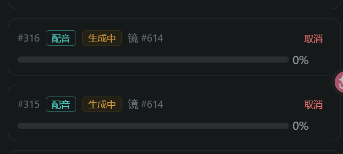
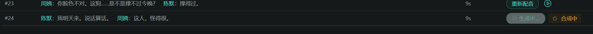
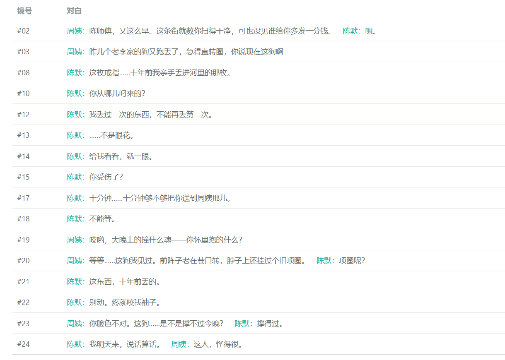
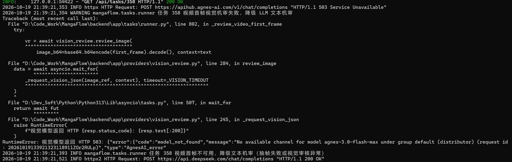

# 开发问题记录（2026-10-19 ~ 10-20 会话 · 配音与视频生成链路）

> 记录范围：本会话用户在内容生成模块联调中反馈的开发 bug。每条含提问原文、截图（如有）、根因分析、解决方法与涉及文件。
> 关联代码：`backend/app/tasks/runner.py`、`backend/app/providers/*`、`backend/app/services/generation_service.py`、`mangaflow-web/src/views/studio/ProductionView.vue`

---

## 问题 1：重新配音任务永久卡在「生成中 0%」（任务僵尸 running）

**提问原文**：
> 检查下这个重新生成，等好久了

**截图**：

任务面板中两条配音任务 #315、#316 长时间停在「生成中 0%」：

分镜配音表 #24 行同样处于「生成中 / 合成中」状态：

**现象**：同一分镜（镜 #614，2 段多说话人对白）两次提交配音任务均卡在 running、进度恒 0，对比此前单段配音任务 11~26 秒即完成。

**根因**（三层连环故障）：

1. **WAV 头占位值**：dashscope 流式合成产出的 WAV 头部 data chunk size 为占位值 `0x7FFFFFFF`（未回头改写）。多说话人拼接用标准库 `wave` 模块读取时信任该头，单段时长被算成 ~48695 秒，两段拼接得 **97391.89 秒**。
2. **数据库列溢出**：`storyboards.actual_duration` 为 `NUMERIC(6,2)`（上限 9999.99），回写 97391.89 触发 `NumericValueOutOfRangeError`，UPDATE 崩溃。
3. **失败落库二次崩溃**：`_execute_task` 异常分支 `rollback` 后原 task ORM 对象过期，`_fail_task` 访问属性触发 greenlet 外同步 IO（`MissingGreenlet`），失败终态落库也失败 → 任务永远停在 running。

**解决方法**：

| 修复点 | 内容 |
|---|---|
| WAV 头修正 | runner 新增 `_normalize_wav_bytes`：解析 RIFF chunk 链，data size 大于实际剩余字节时按实际长度重写 data/RIFF 两处 size，拼接前对每段规范化 |
| 时长钳制 | 两处 TTS 回写加 `min(dur, 9999.99)`，防异常值溢出 NUMERIC(6,2) |
| 异常兜底 | `_execute_task` except 分支改为：先取 `task.id` → rollback → `db.get(Task, task_id)` 重载 → 再 `_fail_task`，任何任务异常都能正确落终态 |
| TTS 挂死防护 | `tts_bailian` 三层：`_SYNTH_LOCK` 只保护「设置 key + 构造」（30s 获取超时拿不到直接降级）；`call()` 走独立 daemon 看门狗线程 join(80s) 硬超时；外层 `asyncio.wait_for(150s)` 兜底。关键认知：`asyncio.wait_for` 取消 `to_thread` 需等底层线程结束（`_cancel_and_wait` 语义），对线程内阻塞调用无效 |
| 进度回写 | `_run_tts` 补段级进度（10 → 每段 +70/n → 85 → 90），消除多说话人任务全程 0% 的假死观感 |

**涉及文件**：`app/tasks/runner.py`、`app/providers/tts_bailian.py`

**验证**：修复后两僵尸任务被启动恢复机制重置回队列重跑，均 `done 100%`；分镜 614 音频正常回写（时长 4.80s）；13 项生成相关测试通过。

---

## 问题 2：视频不按分镜内容生成 + 视频没有配音

**提问原文**：
> 接下来要进行视频生成。分镜的视频生成要让视频agent严格按照分镜所描述的分镜内容去实现，并按照角色说话的时刻接入好角色配音。当前我试了下生成视频，没有按照分镜内容去生成，且更没有角色配音

**现象**：生成的视频画面与分镜描述偏差大；视频 Tab 播放听不到任何配音。

**根因**：

1. **提示词弱**：旧视频提示词仅拼「拆解时的锁定层快照 + 可编辑层 + 风格锚点」，未直接携带分镜的画面描述（`visual_description`）、机位角度、光影、情绪、对白——视频 agent 拿到的画面信息不足。
2. **无配音是架构现状**：wan 图生视频产物本身无声，配音此前只在「合成」阶段才拼进成片（`compose_service._merge_clip_audio`），分镜视频 Tab 直接播放自然无声。

**解决方法**：

- **视频专项提示词重构**（`generation_service.create_video_task`）：以 `storyboard.visual_description` 为核心（用户编辑即时生效，不依赖拆解快照）+ 机位角度/环境光影/镜头情绪（`audio.emotion`）+ 角色对白（「说话角色口部自然开合」提示）+ `VIDEO_DIRECTIVE` 一致性指令（严格按画面描述与首帧生成、不得新增画面外元素）。配合关键帧首帧图生视频形成双保险。
- **前端同步配音**（`ProductionView.vue`）：视频行 `<video>` 挂 play/pause/seeked/ended 事件，播放时同步驱动该镜 `audio_url` 的 Audio 实例（currentTime 对齐、进度条拖动联动）；视频时长在任务创建时已按 `ceil(配音时长)` 对齐，音画天然同步。

**涉及文件**：`app/services/generation_service.py`、`mangaflow-web/src/views/studio/ProductionView.vue`

---

## 问题 3：画面描述被念成配音（空镜出现描述旁白）

**提问原文**：
> 分镜描述中的画面描述怎么还生成出来音频在视频中

**现象**：播放无对白的开场空镜（镜 #1）视频时，听到整段「画面描述」文字被 TTS 念出来。

**根因**：`create_tts_task` 存在老逻辑 `text = 剥离说话人后的对白 or visual_description`——**对白为空时回退把画面描述当台词配音**。镜 #1（无对白）在历史批量配音中生成了整段描述旁白，前端「视频同步播放」把它原样播出。

**解决方法**：

1. **源头移除**：`create_tts_task` 无对白直接 400（「该分镜无对白，不生成配音（画面描述不作为台词）」）——画面描述只用于看（生图/视频提示词），不用于听。
2. **存量清理**：按规则「对白为空但 audio_url 非空」清除了镜 #1 的 `audio_url` / `actual_duration` / `audio` 引用（历史任务记录保留可溯源）。
3. **前端双保险**：视频同步播放与「已配音」标签均增加 `(b.dialogue || '').trim()` 判断，无对白镜不参与配音同步。

**涉及文件**：`app/services/generation_service.py`、`mangaflow-web/src/views/studio/ProductionView.vue`

**附带发现**：`storyboards.audio` 实际列类型是 `json` 而非 ORM 声明的 `JSONB`（迁移漂移），SQL 直接操作需 `::jsonb` 中转。

---

## 问题 4：wan 视频自带角色语音，与 TTS 配音冲突

**提问原文**：
> 视频agent根据分镜描述和关键帧生成出来的视频中顺便还生成了另外的角色语音与当前配音好的语音冲突，这个要怎么解决
>
> （后续确认）让视频agent生成出来视频去掉角色的声音可以保留除人声外的声音，之后再接入配音的音频最后生成出完整的分镜视频

**现象**：视频里出现模型自己合成的角色说话声（内容/音色都不对），与平台 TTS 配音撞音。

**根因**：wan 系图生视频模型自带音频生成能力，把提示词中的「角色对白」当成要念台词的指令自行合成语音；wan 渠道没有「关闭音频生成」的开关参数。

**解决方法**（最终管线：「去角色人声、保留环境音、接入配音、产出完整分镜视频」）：

1. **提示词精细控制**：`VIDEO_DIRECTIVE` 改为「严禁生成任何人物说话的人声、语音与对白，仅可保留与画面环境匹配的自然环境音效（雨声、风声、脚步声）」。
2. **产物侧分流**（`runner._run_video`）：
   - 该镜**已有配音** → 复用 `compose_service._merge_clip_audio` 混流（环境音 0.35 + TTS 配音 1.0，时长按 max(视频,配音) 对齐，配音长时视频末帧定格），**直接产出完整带声分镜视频**，打标 `audio.video_dubbed=True`；
   - **无配音** → 全剥原生音轨（纯无声，防 wan 自配人声漏出），待配音后由合成阶段拼轨。
3. **防双声闭环**（产物约定「video 自带音轨 ⟺ 已含当前配音」）：
   - compose 拼接时 ffprobe 检测视频自带音轨则跳过 `audio_url` 混音；
   - 任一 TTS 成功回写时 `_invalidate_video_dub`：剥除 video 内嵌旧配音恢复无声 + 清标记（合成阶段拼新配音，用户重新生成视频可重新接入）；
   - 前端同步播放遇 `video_dubbed` 跳过叠加；配音状态标签四态：已接入配音 / 配音已更新待重新生成视频 / 已配音（开关叠加）/ 未配音。

**涉及文件**：`app/tasks/runner.py`、`app/services/generation_service.py`、`app/services/compose_service.py`、`mangaflow-web/src/views/studio/ProductionView.vue`

**已知局限**：后端无本地人声分离模型（Demucs 类依赖过重），无法帧级精准剥离 wan 偶发违规生成的人声；混流时环境音轨整体压 0.35 音量、配音 1.0 清晰主导，为当前架构下的最优折中。

---

## 问题 5：新分镜视频生成失败（双渠道各自报错，任务 356）

**提问原文**：
> 我又生成了个新的分镜视频生成失败，后台也报错了

**截图**：

后台日志显示两个渠道依次失败，任务重试耗尽进入死信队列：

**根因**（两个渠道各一个原因）：

1. **openai-4（Agnes 官方渠道）**：`400 "fps is a forbidden field"`——我们在 `/videos` 请求体透传了帧率参数（P-12 前端视频参数），但 Agnes 契约不接受 `fps`；同类的 `motion`（运动幅度）字段也会被拒。
2. **own-11（用户自建百炼 wan 渠道）**：`403 AllocationQuotaForFreeTier Exhausted`——百炼账号免费额度耗尽且开启「FreeTier only」模式，属账户侧问题。

**解决方法**：

- **代码修复**：`video_agnes.py` 的 `video_params` 仅透传 `resolution→size`（官方字段），`fps`/`motion_strength` 不再发请求体（仅保留在任务 meta 溯源）。
- **账户处理**（需用户操作）：到阿里云百炼管理台充值，或关闭「use free tier only」模式，自建 wan 渠道即可恢复参与降级链。

**涉及文件**：`app/providers/video_agnes.py`

---

## 问题 6：机审环节报 503（任务 358，视频实际生成成功）

**提问原文**：
> 这是为什么（附后台日志截图）

**截图**：

视频任务成功后的机审环节，Agnes 视觉模型 503 后降级 LLM 文本机审：

**现象**：视频任务本身成功，但日志出现视觉机审调用 `agnes-3.0-flash-max` 返回 `503 {"code":"model_not_found","message":"No available channel for model agnes-3.0-flash-max under group default"}` 的 traceback，随后降级 LLM 文本机审（deepseek 200）完成审核。

**根因**：Agnes 平台侧 `agnes-3.0-flash-max` 已下线（/v1/models 列表确认不在可用模型中），每次图片/视频产物机审都先白打一次 503，产生日志噪音与无效延迟。

**解决方法**：

探测平台可用模型并实测图像理解能力：

| 候选模型 | 实测结果 |
|---|---|
| **agnes-3.0-flash** | 200，正确识别测试图颜色 ✓（同系列换代，已启用） |
| agnes-3.0-pro | 200 但空回复，不采用 |
| agnes-2.5-pro-alpha | 200 但空回复，不采用 |

`config.agnes_vision_model` 默认值由 `agnes-3.0-flash-max` 更新为 `agnes-3.0-flash`，机审直接走真实视觉审核。

**涉及文件**：`app/core/config.py`

---

## 附：本会话沉淀的通用经验

1. **dashscope TTS 产物 WAV 头 data size 是占位值**——标准 `wave` 模块读取前必须规范化头部。
2. **`asyncio.wait_for` 对 `to_thread` 的取消需等底层线程结束**——线程内阻塞调用要靠独立看门狗线程兜底。
3. **SQLAlchemy rollback 后 ORM 对象过期**——访问属性会触发 greenlet 外 IO，异常处理分支须重新加载对象再落库。
4. **对外部渠道 API 发请求体字段前先验证契约**——未列明字段（fps/motion）实测被 Agnes 400 拒绝。
5. **第三方平台的模型会下线**——机审等辅助链路的模型名应可配置并定期探测可用性。
