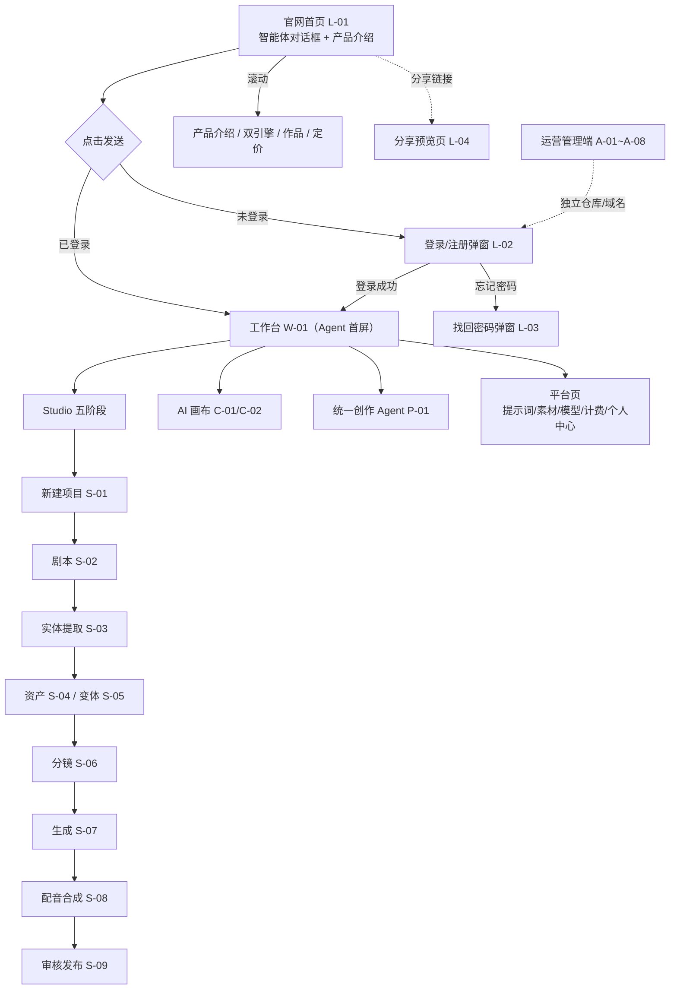
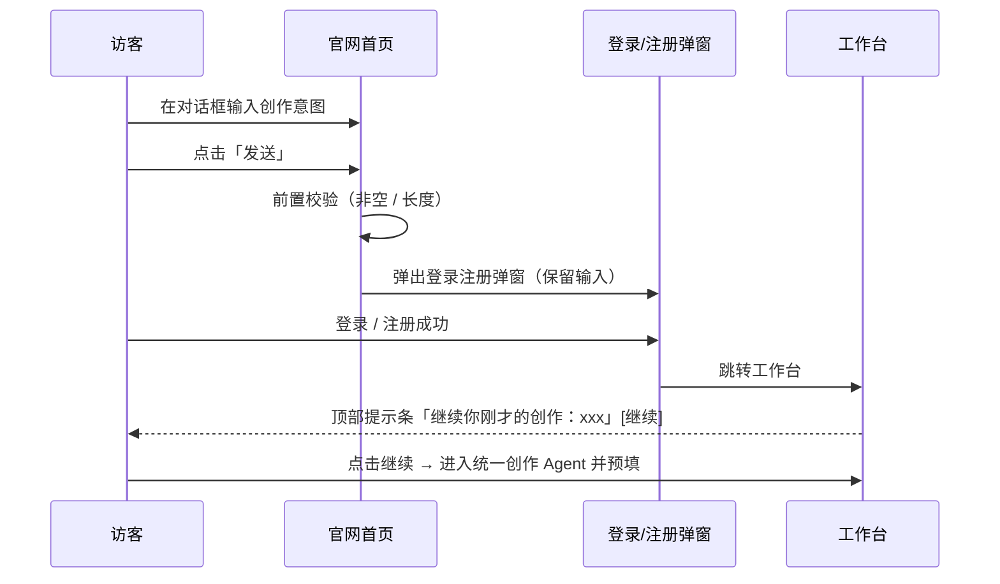

# 漫序 MangaFlow · UI 原型界面描述清单 V2.1（含线框图）

| 项目 | 内容 |
| ---- | ---- |
| 产品名称 | 漫序 MangaFlow |
| 文档版本 | V2.1 |
| 文档类型 | UI 原型界面描述清单（含线框图） |
| 编制日期 | 2026-10-08 |
| 基线文档 | 《漫序 MangaFlow 产品需求文档（PRD）V1.1》 |
| 设计基准 | 首页采用「一个入口 + 智能体对话框」的信息架构：**输入 → 发送 → 登录注册弹窗 → 登录后进入工作台**，首页向下滚动为产品介绍 |

**说明**：本文档为全部页面提供 **ASCII 线框图 + 交互说明 + 状态提示**，完整覆盖 PRD V1.1 全部功能编号（D/S/A/SB/P/R/CV/PL/C/V/AD/SYS/MA/U）。线框图为结构示意，不代表最终视觉风格。

---

## 0. 设计基准与通用规范

### 0.1 信息架构基准

产品采用**「入口即对话」**的信息架构（参考主流 AI 创作产品做法）：

| 层次 | 说明 |
| ---- | ---- |
| **未登录层（官网）** | 首屏为智能体对话框，用户直接输入创作意图；向下滚动依次为产品介绍、双引擎能力、创作者作品、定价、页脚 |
| **转化层** | 用户点击发送时弹出登录/注册弹窗；**保留已输入内容**，登录后带入工作台 |
| **登录后层（工作台）** | 进入工作台，顶部提示条承接首页输入（"继续你刚才的创作"），点击即可发起 |

**核心设计判断**：首页的对话框**不做真实生成**，只做"意图采集 + 转化"。这样避免未登录用户消耗算力，同时保证输入不丢失。

### 0.2 线框图图例

| 符号 | 含义 |
| ---- | ---- |
| `+---+` | 容器边框 |
| `[按钮]` | 可点击按钮 |
| `(•)` / `( )` | 单选（选中 / 未选） |
| `[x]` / `[ ]` | 复选（选中 / 未选） |
| `~~~` | 文本输入区 |
| `[v]` | 下拉选择 |
| `▓▓▓` | 图片 / 视频 / 音频占位 |
| `...` | 内容溢出可滚动 |
| `[!]` | **状态提示位**（加载中 / 空数据 / 异常） |
| `*` | 必填项 |
| `< >` | 可切换的 Tab |

### 0.3 全局状态提示规范

| 状态 | 规范 |
| ---- | ---- |
| 加载中 | 骨架屏或局部 loading；生成类用流式 / 进度条，**不阻塞页面** |
| 空数据 | 必须配引导文案 + 快捷操作按钮，禁止纯空白页 |
| 异常 | 明确原因 + 可执行动作（重试 / 换模型 / 精简输入）；资金相关操作二次确认 |
| 成功反馈 | 锁定、导出、支付等关键操作需明确成功提示 |
| 断点续跑 | 重新进入时提示"检测到未完成的任务，是否继续？" |

### 0.4 全局快捷键

| 快捷键 | 功能 | 适用范围 |
| ------ | ---- | -------- |
| `Ctrl/Cmd + S` | 保存 | 全局 |
| `Ctrl/Cmd + Z` / `+Shift+Z` | 撤销 / 重做 | 剧本、分镜、画布 |
| `Ctrl/Cmd + N` | 新增分镜 | 分镜页 |
| `Delete` | 删除选中 | 分镜、画布 |
| `Space` | 播放节奏预览 | 分镜页 |
| `Space + 拖拽` | 平移画布 | 画布页 |
| `Ctrl/Cmd + 滚轮` | 缩放画布 | 画布页 |
| `F` / `H` | 缩放适配 / 回中心 | 画布页 |
| `Ctrl/Cmd + G` | 编组 / 取消编组 | 画布页 |
| `Ctrl/Cmd + Enter` | 运行选中节点 | 画布页 |

### 0.5 全局约定

- 主题：明 / 暗双主题，跟随系统或手动切换。
- 响应式：桌面端优先（适配 1366px+），平板端基础可用。
- 越权保护：无权限资源统一跳 403 / 登录页。
- 影响面提示：涉及下游依赖的修改须先展示影响面（RD-08）。

### 0.6 登录后全局布局与左侧导航规范

登录后统一采用**「左侧固定导航 + 右侧内容区」**布局，全站一致。

> **硬约束（两条）**
> 1. **侧栏常驻**：左侧导航在所有登录后页面**始终显示**，不因进入项目、进入 Studio 阶段或打开画布而收起或隐藏。
> 2. **菜单定稿**：菜单项**仅限下表 10 项 + 底部「帮助」（共 11 项）**，不得随意增删。未定稿的功能不要先塞进导航。

**布局线框图**

```
+------------------+-------------------------------------------------------+
| [漫序] MangaFlow | [<] 当前页面标题        ✦ 积分   [通知] [主题] [头像▾] |
+------------------+-------------------------------------------------------+
|                  |                                                       |
| 创作             |                                                       |
|  ● Agent      |  |                    内 容 区                            |
|                  |                                                       |
| 项目             |                                                       |
|  ▸ 漫剧项目      |                                                       |
|  ▸ AI 画布       |                                                       |
|  ▸ 协作(即将开放)|                                                       |
|                  |                                                       |
| 资产             |                                                       |
|  ▸ 角色与场景    |                                                       |
|  ▸ 素材库        |                                                       |
|  ▸ 提示词库      |                                                       |
|                  |                                                       |
| 账户             |                                                       |
|  ▸ 模型配置      |                                                       |
|  ▸ 计费与配额    |                                                       |
|  ▸ 个人中心      |                                                       |
|                  |                                                       |
| ? 帮助        >  |                                          ( ? 帮助 )   |
+------------------+-------------------------------------------------------+
```

**0.6.1 菜单定稿表（10 项 + 底部帮助，共 11 项）**

> 判定依据：**「是否跨项目」**——只有"不依赖某个具体项目就能使用的全局能力"才进侧栏；项目内的阶段页一律不进（否则菜单会随项目变化，违背"菜单定稿"）。

| # | 分组 | 菜单项 | 路由 | 对应页面 | 覆盖需求编号 | 状态 |
| - | ---- | ------ | ---- | -------- | ------------ | ---- |
| 1 | 创作 | **Agent** | `/agent` | W-01 工作台（Agent 首屏）／P-01 统一创作 Agent | D-03~D-06 · PL-01~PL-06 | 生效（默认落地） |
| 2 | 项目 | 漫剧项目 | `/projects` | W-02 项目列表 | D-01~D-06 | 生效 |
| 3 | 项目 | AI 画布 | `/canvas` | C-01 画布列表（子页 C-02 编辑器） | CV-01~CV-25 | 生效 |
| 4 | 项目 | 协作 | `/collab` | —— （无页面） | V-03 / V-04 | **灰显「即将开放」**，本期不做 |
| 5 | 资产 | 角色与场景 | `/characters` | 跨项目资产总览 → 点击进入所属项目的 S-04 | A-01~A-10 | 生效 |
| 6 | 资产 | 素材库 | `/media` | P-03 素材库 | PL-16~PL-19 | 生效 |
| 7 | 资产 | 提示词库 | `/prompts` | P-02 提示词库（公共 / 我的 两个 Tab） | PL-12~PL-15 | 生效 |
| 8 | 账户 | 模型配置 | `/models` | P-04 模型配置中心 | PL-07~PL-11 · PL-26~PL-29 | 生效 |
| 9 | 账户 | 计费与配额 | `/billing` | P-05 计费中心（充值 / 订阅 / 订单 三个 Tab） | PL-20~PL-25 | 生效 |
| 10 | 账户 | 个人中心 | `/settings/profile` → 简写 `/profile` | P-06 个人中心 | U-03~U-06 · V-01 · V-02 | 生效 |
| 11 | 底部 | 帮助 | `/help`（或抽屉 / 外链） | 帮助中心 | —— | 生效 |

**设计说明（三条容易产生分歧的地方）**

1. **「Agent」而非「工作台」**：工作台的项目列表能力已拆到 W-02（漫剧项目），因此侧栏第一项用「Agent」更准确——它承载的是"发起创作"，不是"管理项目"。
2. **「角色与场景」是跨项目视图**，不是项目内的 S-04。它是资产库总览（筛选、搜索、复用），点击某个角色才带着资产 ID 跳进所属项目的 S-04。项目内的 S-04 从 W-02 进入。
3. **「协作」保留但灰显**：让用户看得见"未来会有"，而不是藏起来。点击提示"本期不做（V-03/V-04）"，不做路由。

---

**0.6.2 明确不进侧栏的页面及入口位置**

> 下表用于证明"菜单只有 11 项，但没有丢功能"。

| 页面 | 为什么不进侧栏 | 从哪里进入 |
| ---- | -------------- | ---------- |
| L-01 官网首页 / L-02 登录注册弹窗 / L-03 找回密码弹窗 | 未登录层，此时无侧栏 | 直接访问站点根路径 |
| S-01 新建项目弹窗 | 弹窗，非独立页 | W-01 / W-02 的「新建项目」按钮 |
| S-02 剧本 / S-06 分镜 / S-07 生成 / S-08 配音合成 / S-09 审核发布 | **项目内阶段页**，依赖具体项目 | W-02 打开项目后，用**顶栏五阶段步骤条**导航 |
| S-04 资产管理（项目内） | 项目内阶段页 | W-02 → 项目 → 阶段条 ②；或从侧栏「角色与场景」带资产 ID 跳入 |
| S-03 实体提取确认 / S-05 资产变体面板 | 阶段内子步骤 / 抽屉 | S-02 确认剧本后自动进入；S-04 内打开抽屉 |
| C-02 画布编辑器 | 依赖具体画布 | C-01 打开画布 |
| L-04 分享预览页 | 公开页，无需登录 | 分享链接直接访问 |
| A-01 ~ A-08 运营管理端全部页面 | 与用户端**仓库与部署隔离**（独立仓库 `mangaflow-admin-web`、独立端口/域名，见 RD-58） | 独立登录（A-01），不挂在主域 `/admin` 下 |
| P-05 的充值 / 订阅 / 订单；P-02 的「我的提示词」；P-06 的账号 / 用量 / 版本 / 日志 | 页面内的 Tab | 侧栏进入对应模块后用顶部 Tab 切换 |
| 作品广场 / 公告中心 | 本期不作为全局入口 | 公告以 W-01/W-02 的横幅呈现（D-05）；作品广场本期可隐藏 |

---

**0.6.3 菜单准入规则（后续新增功能按此判断）**

| # | 规则 | 说明 |
| - | ---- | ---- |
| 1 | **跨项目** | 只有不依赖具体项目的全局能力才可进侧栏；项目内页面一律不进 |
| 2 | **已定稿** | 需求编号尚未定稿的功能不进侧栏（要么不做，要么像「协作」一样灰显占位） |
| 3 | **高频** | 低频能力收进「个人中心」等聚合页的 Tab，不单独占菜单位 |
| 4 | **总数封顶** | 侧栏维持 **10 项菜单 + 帮助**。新增一项必须替换一项，不接受无限追加 |
| 5 | **分组归属** | 新增项必须先归入现有四组（创作 / 项目 / 资产 / 账户），不新开分组 |

---

**0.6.4 交互规范**

| 项 | 规范 |
| -- | ---- |
| 默认落地 | 登录成功 → 直接落在 **Agent**（W-01） |
| 折叠 | 顶栏左 `[<]` 折叠 / 展开侧栏；折叠态只显示图标，hover 显示 tooltip |
| 常驻 | 侧栏在所有登录后页面**始终显示**（工作台 / Studio 五阶段 / 画布 / 平台页），切换页面不隐藏 |
| 页面归属高亮 | Studio 各阶段页高亮「漫剧项目」；画布编辑器高亮「AI 画布」；工作台高亮「Agent」 |
| 未保存保护 | 在剧本 / 分镜 / 画布页切换导航时，若有未保存改动需二次确认 |
| 灰显项 | 「协作」可点击但禁用路由，点击仅提示"本期不做" |
| 响应式 | 窗口 ≤1360px 自动折叠为图标态；≤1024px 侧栏抽屉化 |

### 0.7 色彩规范（品牌色调定稿）

#### 0.7.1 竞品对标结论（2026-10 调研）

当前 AI 漫剧赛道的玩家与定位：

| 类型 | 产品 | 定位与关键设计 |
| ---- | ---- | -------------- |
| 通用 AI 视频（兼做漫剧） | **可灵 AI**（快手） | 「AI 创意生产力平台」；有**画布**模块与 **MCP / CLI**（Agent 调度批量生成）；文案强调电影级质感与原生 4K |
| | **即梦 AI**（字节） | 与剪映打通，中文理解强，首尾帧控制精准，分发至抖音 |
| | Vidu（生数 × 清华） | 2D 动画表现与本体复刻突出 |
| | 通义万相 / 海螺 / 智谱清影 / 混元 / 蒸汽机 | 分别侧重音画同步、叙事电影感、4K60、中文语境、长视频 |
| **漫剧垂直 / 工作台** | **海艺剧场**（最直接对标） | **双入口：短剧 Agent（走流程）+ 自由画布（灵感探索）**；统一资产库；多模型切换；团队协作与算力管理 |
| | 幻舟 AI | 定位为国内唯一专注 AI 漫剧的垂直平台 |
| | LibTV | 一站式工作台 + 无限画布 + 多模型集成 |
| | 万兴剧厂 | 剧本 / 资产 / 分镜 / 剪辑一体，面向传统剪辑团队 |
| | Mantur | 11 个 AI 智能体覆盖选题到剪辑全流程，出海能力强 |
| | 魔因漫创 / 可梦 / PixVerse / Catimind | 合规商用 / 一条龙 / 2D 赛璐璐还原 / 百集并发 |

**三条对漫序有直接影响的结论**

1. **「流水线 + 画布」双入口已是赛道共识**（海艺剧场最典型）。所以漫序的差异化**不能只停在"我也有两个入口"**，必须落在**共享同一资产底座 + 双向联动**上——这正是 CV-23 / CV-24 要解决的问题。
2. **多模型切换、统一资产库、团队协作已是标配**，不是加分项（对应 PL-07~PL-11 / A-01~A-10 / V-03）。
3. **品类视觉基调是"专业电影级"**（可灵官网文案大量出现"电影色调""胶片质感""原生 4K"）。这意味着 **UI 必须退后，让画面成为主角**。

#### 0.7.2 选色推导（四条约束 → 取色）

| # | 约束 | 推导结果 |
| - | ---- | -------- |
| 1 | **画面是主角** | 大面积区域只用中性色（墨灰阶）；品牌色只出现在交互点（按钮 / 选中 / 进度 / 链接） |
| 2 | **长时程创作** | 编剧、分镜、生成都是长时间操作 → **创作端以深色为默认**，降低眼部疲劳 |
| 3 | **需要记忆点** | 赛道产品高度同质化（都是深色工具界面）→ 强调色必须有辨识度，且能承载中文品牌名 |
| 4 | **双引擎需要色彩语言** | 「有序创作 / 漫无止境」两端要有可区分的色彩标识 |

**为什么不是蓝紫**：蓝紫是 AI 工具最拥挤的色相区间，用户无法把颜色和品牌对上号。漫序取**东方色系**——既与中文名「漫序」契合，也与漫剧题材（古风、都市、水墨）的气质一致。

#### 0.7.3 品牌色

| 角色 | 名称 | 色值 | 用途 |
| ---- | ---- | ---- | ---- |
| **主色** | **墨青 Ink Cyan** | `#12B3A6` | 主按钮、选中态、进度条、链接、聚焦环；对应 **Studio 引擎 · 有序创作** |
| **辅色** | **藤紫 Wisteria** | `#7C6BF0` | **仅用于 Canvas 引擎**：画布节点、连线高亮、探索类操作、A/B 对比的第二序列 |

> 命名说明：「墨」呼应漫画 / 水墨与产品中文名「漫序」；「青」取东方玉色——在深色底上辨识度高，又与漫剧常见的暖调画面（古风暖光、日常场景）形成冷暖互补，不抢画面。

#### 0.7.4 中性色

**深色主题（创作端默认）**

| 用途 | 色值 |
| ---- | ---- |
| 页面底 | `#0E1112` |
| 卡片 / 面板 | `#15191A` |
| 面提升（悬浮 / 输入框 / 抽屉） | `#1C2223` |
| 分割线 | `rgba(255,255,255,.09)`；强调 `rgba(255,255,255,.16)` |
| 主文字 | `#E8EDEA` |
| 次文字 | `#9BA5A2` |
| 弱文字 / 占位 | `#6B7573` |

**浅色主题（官网 / 管理端默认）**

| 用途 | 色值 |
| ---- | ---- |
| 页面底 | `#F5F7F6` |
| 卡片 / 面板 | `#FFFFFF` |
| 分割线 | `rgba(0,0,0,.09)`；强调 `rgba(0,0,0,.16)` |
| 主文字 | `#14181A` |
| 次文字 | `#5F6B68` |
| 弱文字 / 占位 | `#8E9A97` |

#### 0.7.5 语义色（全站统一）

| 语义 | 名称 | 浅色主题 | 深色主题 | 用在哪里 |
| ---- | ---- | -------- | -------- | -------- |
| 成功 · 通过 · 已锁 | 苔绿 | `#1E9E6A` | `#4CC38A` | 审核通过、资产已锁、生成成功、已保存 |
| 警告 · 疑似 · 差异 | 琥珀 | `#B87100` | `#E0A33A` | 疑似违规、一致性差异、时长超限、模型降级 |
| 危险 · 违规 · 失败 | 朱红 | `#CE4343` | `#F0736F` | 违规终止、任务失败、删除、资损告警 |
| 信息 · 引用 | 靛蓝 | `#3B73C4` | `#5E9BE8` | 说明提示、资产引用标记、外链 |

> **两条禁令**：语义色**不得**用作装饰或品牌表达；品牌色**不得**用于表达状态。

#### 0.7.6 主题策略

| 端 | 默认主题 | 理由 |
| -- | -------- | ---- |
| 官网（L-01 ~ L-04） | **浅色** | 转化场景需要亲和力与可读性 |
| **创作端（W / S / C / P）** | **深色** | 画面为主角；长时间创作降低眼疲劳 |
| 运营管理端（A-01 ~ A-08） | **浅色** | 长时间阅读表格与报表，浅色更清晰 |
| 全站 | 支持明暗切换 | 顶栏可切换，偏好本地记忆 |

#### 0.7.7 使用规则

| 规则 | 说明 |
| ---- | ---- |
| 60-30-10 | 中性色 60%、面层级 30%、品牌色 ≤10% |
| 品牌色克制 | 一个视图内主色按钮 **≤1 个**；同屏品牌色出现 **≤3 处** |
| 对比度 | 正文文字与背景 ≥4.5:1；大字号与图标 ≥3:1 |
| 不用纯黑纯白 | 深色底不用 `#000`；浅色底不用纯白做页面底（用 `#F5F7F6`） |
| 双引擎不混用 | 同一视图内不同时用墨青和藤紫表达"当前态"，避免语义打架 |
| 状态色不作装饰 | 见 0.7.5 两条禁令 |

#### 0.7.8 原型同步记录（已完成）

原型已按本规范完成替换，涉及 **5 个文件**：`全站原型-一/二/三`、`W01-工作台-Agent首屏-交互原型`、`S02-剧本创作-交互原型`。

| 替换项 | 原值 | 新值 |
| ------ | ---- | ---- |
| `--accent`（浅色主题） | `#5B5BD6` | `#12B3A6` |
| `--accent`（深色主题） | `#8F8DF7` | `#4FD8CA` |
| `--accent-soft` | `rgba(91,91,214,.10)` | `rgba(18,179,166,.10)`（深色 `.18`） |
| 品牌渐变副色（Logo / 头像） | `#8E7BF0` | `#7C6BF0` |
| 新增 `--brand2` / `--brand2-soft` | —— | `#7C6BF0` / `#9A8CF5`（深色） |
| 中性色（浅色主题） | `#F6F6F3` / `#F1F1ED` / `#1A1A17` / `#6C6C66` / `#9C9C95` | `#F5F7F6` / `#EFF2F1` / `#14181A` / `#5F6B68` / `#8E9A97` |
| 中性色（深色主题） | `#141417` / `#1D1D21` / `#242429` / `#191A1D` / `#ECECE8` / `#A2A29B` / `#6F6F69` | `#0E1112` / `#15191A` / `#1C2223` / `#111516` / `#E8EDEA` / `#9BA5A2` / `#6B7573` |
| 占位图渐变 | `#2B2A4A` / `#3B2340` | `#12332F` / `#2E2450`（对齐品牌调性） |
| **创作端默认主题** | 浅色 | **深色**（主题跟随页面类型：公开页浅色 / 创作端深色，顶栏可手动覆盖） |

**藤紫（`--brand2`）的落地位置**：官网「Canvas 引擎 · 漫无止境」标识标签、画布编辑器中**被选中节点的描边**。后续凡是标识 Canvas 引擎或画布交互选中态的地方，统一使用该变量。

> 验证：5 个文件替换后跑全量渲染自检，**31 个页面全部正常，无 JS 错误**；并人工抽检了 L-01（官网浅色 + 墨青）、S-01（创作端深色 + 墨青）、C-02（画布 + 藤紫选中态）三张截图确认。

---

## 1. 全站信息架构



**主流程（首页 → 登录 → 工作台）**



---

## 2. 官网（未登录态）

### L-01 官网首页

**用途**：唯一公开入口。首屏以智能体对话框承接创作意图，向下滚动介绍产品。

**线框图**

```
+--------------------------------------------------------------------------+
| [漫序]        首页  功能  AI画布  定价  文档            [登录] [免费开始] |
+--------------------------------------------------------------------------+
|                                                                          |
|                        有序创作，漫无止境                                 |
|              一句话到成片 · 流水线做量产 · 画布做探索                      |
|                                                                          |
|    +----------------------------------------------------------------+    |
|    |  描述你想创作的漫剧…                                          |    |
|    |                                                                |    |
|    |  [上传参考图]                          [0 / 2000]      [发送]   |    |
|    +----------------------------------------------------------------+    |
|    | (•)智能模式  ( )剧本  ( )角色  ( )视频  ( )配音                 |    |
|    +----------------------------------------------------------------+    |
|                                                                          |
|    试试： [把这句话做成漫剧：深夜便利店的相遇]  [上传小说改编漫剧]          |
|           [生成一个赛博朋克少女角色]            [打开 AI 画布]            |
|                                                                          |
|    - - - - - - - - - - - - - 向下滚动 - - - - - - - - - - - - - - - -    |
|                                                                          |
|    简单四步，创意即刻落地                                                 |
|    [01 选择场景]  [02 输入需求]  [03 生成内容]  [04 审核发布]             |
|                                                                          |
|    双引擎，两种创作方式                                                   |
|    +----------------------------+  +----------------------------+        |
|    |  Studio 引擎 · 有序创作     |  |  Canvas 引擎 · 漫无止境     |        |
|    |  剧本→资产→分镜→生成→发布   |  |  无限画布节点自由编排       |        |
|    |  [了解流水线 ->]           |  |  [了解画布 ->]             |        |
|    +----------------------------+  +----------------------------+        |
|                                                                          |
|    灵感作品展示            < 全部 | 视觉 | 短剧 | 插画 | 角色 >          |
|    +--------+ +--------+ +--------+ +--------+                          |
|    |  ▓▓▓▓  | |  ▓▓▓▓  | |  ▓▓▓▓  | |  ▓▓▓▓  |                          |
|    | 作品名 | | 作品名 | | 作品名 | | 作品名 |                          |
|    +--------+ +--------+ +--------+ +--------+   [查看更多作品 ->]        |
|    [!] 作品加载中 / 暂无作品                                              |
|                                                                          |
|    [100+ 创作模板] [多模型协同] [长任务不中断] [企业级存储]                |
|                                                                          |
|    开启你的 AI 创作工作流                                                 |
|                          [免费开始创作]                                   |
+--------------------------------------------------------------------------+
| 漫序 MangaFlow · 关于我们 · 用户协议 · 隐私政策 · 帮助中心 · 备案号         |
+--------------------------------------------------------------------------+
```

**覆盖需求**：D-03（入口）、PL-01 / PL-02（意图入口示意）

**功能区块与交互**

| 区块 | 交互 |
| ---- | ---- |
| 顶部导航 | 锚点滚动；「登录」打开 L-02（登录态）；「免费开始」打开 L-02（注册态） |
| **对话框（核心）** | 输入内容后点「发送」→ **未登录则弹出登录注册弹窗并保留输入**；≤2000 字实时计数；`Enter` 发送 / `Shift+Enter` 换行 |
| 上传参考图 | 点击唤起文件选择；上传后生成缩略图 chip，可删除。**仅采集，不做真实上传**（登录后带入） |
| 模式切换 | 单选，切换仅影响提示文案与登录后的跳转目标（如选"剧本"→ 登录后进剧本阶段） |
| 快捷示例 chips | 点击即填入输入框（不直接发送），降低起步门槛 |
| 双引擎介绍 | 卡片跳转对应功能介绍锚点 |
| 作品展示 | 分类 Tab 切换；作品卡点击进入公开详情（登录后可见） |
| 页脚 | 静态链接 |

**状态提示**

| 状态 | 表现 |
| ---- | ---- |
| 加载中 | 作品区骨架屏；首屏文字立即可见（不阻塞 LCP） |
| 空数据 | 作品区显示"作品正在征集中"，隐藏查看全部入口 |
| 异常 | 作品接口失败 → 作品区降级为隐藏，**不影响对话框与发送流程** |
| 校验失败 | 输入为空点发送 → 输入框抖动 + 提示"说说你想创作什么"；超长 → 计数变红并禁用发送 |

---

### L-02 登录 / 注册弹窗

**用途**：完成身份认证，是"首页输入 → 工作台"的转化节点。

**线框图**

```
+--------------------------------------------------------------------------+
|                                                                    [×]   |
|   +------------------------------------------------------------------+   |
|   |  [漫序] 登录后开始你的创作                                        |   |
|   |                                                                  |   |
|   |  < 验证码登录 | 密码登录 >                                        |   |
|   |                                                                  |   |
|   |  手机号 / 邮箱 *                                                  |   |
|   |  +------------------------------------------------------------+  |   |
|   |  |                                                            |  |   |
|   |  +------------------------------------------------------------+  |   |
|   |                                                                  |   |
|   |  验证码 *                            [获取验证码]（60s 倒计时）   |   |
|   |  +------------------------------------------------------------+  |   |
|   |  |                                                            |  |   |
|   |  +------------------------------------------------------------+  |   |
|   |                                                                  |   |
|   |  [ ] 我已阅读并同意《用户协议》《隐私政策》                        |   |
|   |                                                                  |   |
|   |  [                        登  录                        ]         |   |
|   |                                                                  |   |
|   |  忘记密码？            还没有账号？ 立即注册                       |   |
|   |                                                                  |   |
|   |  - - - 登录后将保留你刚才的创作意图 - - -                          |   |
|   |  [+ 继续：把这句话做成漫剧：深夜便利店的相遇            ] [继续]   |   |
|   |                                                                  |   |
|   |  [!] 错误提示区                                                   |   |
|   +------------------------------------------------------------------+   |
+--------------------------------------------------------------------------+
```

**覆盖需求**：U-01 / U-02

**功能区块与交互**

| 区块 | 交互 |
| ---- | ---- |
| 登录方式 Tab | 验证码 / 密码切换，**不丢失已填账号** |
| 获取验证码 | 点击后 60s 倒计时；未填账号时提示先填 |
| 协议勾选 | 未勾选时提交按钮禁用 |
| 登录按钮 | 提交 loading，禁用重复点击；成功关闭弹窗并跳转 |
| **意图承接区** | 从 L-01 带过来的输入内容以只读 chip 展示；登录成功后进入工作台，顶部提示条承接该内容 |
| 切换注册 | 弹窗内切换为注册表单（账号 + 验证码 + 密码 + 协议），注册成功自动登录 |
| 忘记密码 | 打开 L-03 |
| 关闭 | 关闭弹窗，**回到首页且保留输入框内容** |

**状态提示**

| 状态 | 表现 |
| ---- | ---- |
| 加载中 | 按钮 loading + 禁用；验证码按钮倒计时 |
| 空数据 | 不适用 |
| 异常 | 账号不存在 / 密码错误 / 验证码失效（分别提示）；账号被禁用（提示联系客服）；网络异常（可重试）；异地登录触发站内提醒（U-02） |

---

### L-03 找回密码弹窗

**线框图**

```
+--------------------------------------------------------------------------+
|                                                                    [×]   |
|   +------------------------------------------------------------------+   |
|   |  找回密码                                                        |   |
|   |                                                                  |   |
|   |  步骤： (1)验证账号 —— (2)设置新密码                              |   |
|   |                                                                  |   |
|   |  账号 *             +----------------------------------------+   |   |
|   |                     |                                        |   |   |
|   |                     +----------------------------------------+   |   |
|   |  验证码 *           +--------------------------+  [获取验证码]   |   |
|   |                     |                          |               |   |
|   |                     +--------------------------+               |   |
|   |  新密码 *           +----------------------------------------+   |   |
|   |                     |                                        |   |   |
|   |                     +----------------------------------------+   |   |
|   |  确认新密码 *       +----------------------------------------+   |   |
|   |                     |                                        |   |   |
|   |                     +----------------------------------------+   |   |
|   |                                                                  |   |
|   |  [ 重置密码 ]                        [ 返回登录 ]                 |   |
|   |  [!] 错误提示区                                                   |   |
|   +------------------------------------------------------------------+   |
+--------------------------------------------------------------------------+
```

**覆盖需求**：U-03

**交互**：验证成功后才解锁新密码输入；密码强度实时校验（长度 / 复杂度）；提交成功后自动跳转登录态。

**状态提示**：加载中（提交 loading）；空数据（不适用）；异常（账号不存在 / 验证码失效 / 两次密码不一致 / 重置失败可重试）。

---

### L-04 分享预览页

**用途**：无需登录即可预览成片，带有效期与访问密码。

**线框图**

```
+--------------------------------------------------------------------------+
| [漫序]                                        分享作品            [举报]  |
+--------------------------------------------------------------------------+
|                                                                          |
|   +------------------------------------------------------------------+   |
|   |                     ▓▓▓▓  视频播放器  ▓▓▓▓                        |   |
|   |     [▶]  ─────●───────────────────────────  01:24 / 02:30         |   |
|   |     [1.0x] [音量] [全屏]                                          |   |
|   +------------------------------------------------------------------+   |
|                                                                          |
|   作品标题：深夜便利店的相遇                                               |
|   作者：小漫  ·  时长 02:30  ·  比例 9:16  ·  发布于 2026-10-08           |
|                                                                          |
|   +------------------------------------------------------------------+   |
|   |  此作品受密码保护                                                 |   |
|   |  访问密码 [____________]  [查看]                                  |   |
|   +------------------------------------------------------------------+   |
|                                                                          |
|   手机扫码观看  [▓▓ 二维码 ▓▓]        [复制链接]                          |
|   [!] 状态提示区                                                          |
+--------------------------------------------------------------------------+
| 由 漫序 MangaFlow 生成 · 本页面内容由创作者发布                            |
+--------------------------------------------------------------------------+
```

**覆盖需求**：R-06 / RD-38

**交互**：未设密码直接播放；设密码则先校验（限次）；页面自带水印、默认不被搜索引擎索引；作者可随时撤回（撤回后展示失效页）。

**状态提示**：加载中（播放器骨架屏）；空数据（作品不存在 / 已被撤回）；异常（密码错误限次 / 链接已过期 / 视频加载失败可重试）。

---

## 3. 用户工作台

### W-01 工作台（Agent 首屏）

**用途**：登录后的**默认落地页**。以智能体对话框为第一屏，向下依次为「最近生成」与「项目与任务」；承接官网带入的创作意图。对齐截图所示的信息架构。

**线框图**

```
+--------------------------------------------------------------------------+
| [<] Agent                          * 1,832   [通知] [主题] [头像v]         |
+--------------------------------------------------------------------------+
| [!] 继续你刚才的创作：把这句话做成漫剧：深夜便利店的相遇   [继续] [忽略]   |
+--------------------------------------------------------------------------+
|                                                                          |
|                       漫序 MangaFlow 创作 Agent                           |
|                           从一个想法开始                                   |
|                                                                          |
|        +--------------------------------------------------------+        |
|        | [+]   输入你的创作想法、剧本要求或画布编排需求           |        |
|        |                                                        |        |
|        |                                                        |        |
|        |   [Agent v]  [@ 引用]  [使用技能]  [优化]     ( ^ 发送 )|        |
|        +--------------------------------------------------------+        |
|                                                                          |
|    [漫剧脚本] [角色定妆照] [分镜画面] [画风试验] [图片动起来] [短剧策划]    |
|                                                                          |
|  ----------------------------------------------------------------------  |
|   最近生成                                      查看优秀作品 >            |
|   点击图片或视频可直接放大查看                                             |
|   +--------+ +--------+ +--------+ +--------+                            |
|   |  ▓▓▓  | |  ▓▓▓  | |  ▓▓▓  | |  ▓▓▓  |                            |
|   +--------+ +--------+ +--------+ +--------+                            |
|   [!] 完成一次图片或视频生成后，结果会出现在这里                            |
|                                                                          |
|  ----------------------------------------------------------------------  |
|   项目与任务                                              [新建项目]       |
|   +------------------------------------------------------------------+   |
|   | ▓  深夜便利店的相遇    资产中 · 60%     10-08 14:20        [打开] |   |
|   | ▓  赛博少女造型试验    分镜中 · 35%     10-08 12:05        [打开] |   |
|   | ▓  便利店宣传片        已完成           10-07 20:11        [打开] |   |
|   +------------------------------------------------------------------+   |
|   [!] 还没有项目，点「新建项目」开始                                       |
|                                                                          |
+--------------------------------------------------------------------------+
|                                                            ( ? 帮助 )     |
+--------------------------------------------------------------------------+
```

**覆盖需求**：D-03 ~ D-06 / PL-01 ~ PL-06

**功能区块与交互**

| 区块 | 交互 |
| ---- | ---- |
| 顶部工具 | 左 `[<]` 折叠侧栏；右依次为积分余额（点击进计费中心）、通知、主题切换、头像菜单 |
| **意图承接条** | 官网带入的输入以提示条展示；点「继续」→ 下方输入框**自动预填并聚焦**；点「忽略」关闭（本会话不再提示） |
| **Agent 输入框（核心）** | 居中大输入框；左侧 `[+]` 上传参考素材；底部能力条 `Agent ▾`（选择技能）/ `@ 引用`（引用角色资产·素材·提示词）/ `使用技能` / `优化`；右下圆形发送按钮；`Enter` 发送 / `Shift+Enter` 换行；≤2000 字并计数 |
| 分类快捷 chips | 「漫剧脚本 / 角色定妆照 / 分镜画面 / 画风试验 / 图片动起来 / 短剧策划」——点击填入输入框并切换对应 Skill，降低起步门槛 |
| 最近生成 | 展示最近生成的图片 / 视频（点击放大查看）；「查看优秀作品」跳作品广场（本期可隐藏） |
| 项目与任务 | 展示最近 3-5 个项目（名称 / 阶段与进度 / 更新时间 / 打开）；「新建项目」打开 S-01 弹窗；「更多」跳 W-02 |
| 帮助悬浮球 | 右下角常驻 |

**状态提示**

| 状态 | 表现 |
| ---- | ---- |
| 加载中 | 最近生成与项目区骨架屏；**输入框立即可用**，不被数据加载阻塞 |
| 空数据 | 最近生成 → "完成一次图片或视频生成后，结果会出现在这里"；项目区 → "还没有项目，点「新建项目」开始" |
| 异常 | 生成失败 → 明确原因 + 重试 / 换模型 / 精简输入；积分不足 → 阻断提交 + 充值入口；意图不明 → **反问澄清**（RD-54）；接口异常 → 分区降级，**不阻塞输入** |

---

### W-02 项目列表页

**用途**：管理全部漫剧项目（从左侧导航「漫剧项目」进入），支持搜索、筛选、排序与批量操作。

**线框图**

```
+--------------------------------------------------------------------------+
| [<] 漫剧项目   [搜索...]  [筛选▾] [排序▾]  [卡片|列表]      [+ 新建项目] |
+--------------------------------------------------------------------------+
| [!] 继续你刚才的创作：把这句话做成漫剧：深夜便利店的相遇     [继续] [忽略] |
+--------------------------------------------------------------------------+
|                                                                          |
|  今日创作  项目 3   |  图片 128  |  视频 12 分钟  |  消耗积分 2,340        |
|  本月创作  项目 11  |  图片 892  |  视频 96 分钟  |  消耗积分 18,700       |
|  [!] 系统公告：模型服务将于 10-10 02:00 维护，异常模型标红                 |
|                                                                          |
|  [ + 新建项目 ]                 [卡片视图] [列表视图]     [筛选▾] [排序▾] |
|                                                                          |
|  最近编辑                                                                |
|  +--------+ +--------+ +--------+                                        |
|  |  ▓▓▓▓  | |  ▓▓▓▓  | |  ▓▓▓▓  |   卡片信息：封面 / 标题 / 状态 /       |
|  |  项目A | |  项目B | |  项目C |   更新时间 / 进度条 / 悬浮操作           |
|  | 资产中 | | 分镜中 | | 已完成 |                                        |
|  +--------+ +--------+ +--------+                                        |
|                                                                          |
|  全部项目                                                                |
|  +--------+ +--------+ +--------+ +--------+                             |
|  |  ▓▓▓▓  | |  ▓▓▓▓  | |  ▓▓▓▓  | |  ▓▓▓▓  |                             |
|  +--------+ +--------+ +--------+ +--------+                             |
|  ...                                                                     |
|  [!] 空状态 / 加载中 / 加载失败                                           |
|                                                                          |
|                                     < 1 2 3 ... 8 >                      |
+--------------------------------------------------------------------------+
```

**覆盖需求**：D-01 ~ D-06

**功能区块与交互**

| 区块 | 交互 |
| ---- | ---- |
| 统计卡 | 展示今日 / 本月数据（D-04），分档展示；点击下钻明细 |
| 公告条 | 置顶公告 + 模型状态；异常模型标红（D-05） |
| 新建项目 | 打开 S-01 弹窗（D-03） |
| 视图切换 | 卡片 / 列表，保持筛选条件（D-01） |
| 筛选 / 排序 | 按状态 / 时间 / 体裁筛选，按创建 / 更新时间排序（D-02） |
| 项目卡 | hover 显示快捷操作（打开 / 复制 / 重命名 / 导出 / 删除）；点击进入对应阶段页（按项目状态定位） |
| 分页 | 支持 100+ 项目流畅滚动（D-01） |

**状态提示**

| 状态 | 表现 |
| ---- | ---- |
| 加载中 | 统计卡骨架屏 + 列表骨架屏 |
| 空数据 | 无项目 → 引导卡片"从一句话开始你的第一部漫剧" + [新建项目] |
| 异常 | 列表加载失败 → 错误占位 + [重试]；统计失败 → 局部降级（显示"—"），不阻塞列表；模型异常 → 公告条标红 |

---

## 4. Studio 五阶段

### S-01 新建项目弹窗

**线框图**

```
+--------------------------------------------------------------------------+
|                                                                    [×]   |
|   +------------------------------------------------------------------+   |
|   |  新建项目                                                        |   |
|   |                                                                  |   |
|   |  < 一句话创意 | 上传小说 | 粘贴大纲 >                             |   |
|   |  +------------------------------------------------------------+  |   |
|   |  |  说说你想做一个什么样的漫剧…                                |  |   |
|   |  |                                                            |  |   |
|   |  +------------------------------------------------------------+  |   |
|   |  或 拖拽文件到此处（支持 .txt / .epub，≤20MB）  [选择文件]        |   |
|   |                                                                  |   |
|   |  --------------- 项目信息 ---------------                         |   |
|   |  标题 *      [________________________________]                   |   |
|   |  体裁 *      [都市 ▾]        风格 *   [二次元 ▾]                  |   |
|   |  忠实度 *    ( )自由创作  (•)大纲遵循  ( )高度还原                |   |
|   |               ^ 上传原著时默认选中「高度还原」，可改                |   |
|   |  目标时长    [ 3 ] 分钟/集     集数  [ 1 ]                        |   |
|   |  输出比例 *  (•)9:16  ( )16:9  ( )1:1                            |   |
|   |                                                                  |   |
|   |  预估消耗：约 120 积分                   [取消]  [创建并生成剧本]  |   |
|   |  [!] 校验提示区                                                   |   |
|   +------------------------------------------------------------------+   |
+--------------------------------------------------------------------------+
```

**覆盖需求**：D-03 / S-01 / S-02 / RD-01

**交互**：切换输入模式保留其他表单；上传后展示解析进度与章节预览，可调整切分；选原著类输入自动切「高度还原」；提交前后置校验（格式 / 大小 / 必填）；输出比例确定后**关键帧阶段不再变更**（RD-37）。

**状态提示**：加载中（上传解析进度条）；空数据（不适用）；异常（格式不支持即时拦截 / 超限 / 解析失败可重试或改为粘贴 / 提交失败保留表单）。

---

### S-02 剧本创作页

**用途**：生成、优化、编辑结构化剧本，产出下游数据源；支持流式生成与中断续跑。

> 本页为登录后页面，**左侧常驻导航**（见 0.6）固定显示在页面左侧并高亮「漫剧项目」；下方线框图省略侧栏，以突出主区结构。

**线框图**

```
+--------------------------------------------------------------------------+
| [←] 深夜便利店的相遇         ①剧本 ②资产 ③分镜 ④生成 ⑤发布    [设置][导出]|
+--------------------------------------------------------------------------+
|                                                                          |
|  +---------------------------+  +--------------------------------------+  |
|  | 原始输入                  |  | AI 生成（流式）                       |  |
|  | ~~~~                      |  | ~~~~                                  |  |
|  | 深夜便利店的相遇…          |  | ▍ 正在生成第 3 场…                    |  |
|  |                           |  |                                      |  |
|  | [暂停] [继续] [取消]      |  |                                      |  |
|  +---------------------------+  +--------------------------------------+  |
|  状态：生成中 38%   [中断] [取消]                                         |
+--------------------------------------------------------------------------+
|  生成完成 → 进入编辑态                                                    |
+--------------------------------------------------------------------------+
|  +--------------+  +--------------------------------+  +--------------+  |
|  | 大纲导航      |  | 剧本正文（富文本编辑）           |  | AI 助手      |  |
|  | > 第1场 便利  |  | ┌──────────────────────────┐   |  | 优化指令     |  |
|  |   店 夜       |  | │ 场景：24h便利店 内 夜      │   |  | ~~~~~~       |  |
|  | > 第2场 …    |  | │                          │   |  |              |  |
|  | > 第3场 …    |  | │ 小林：（低头看手机）      │   |  | 粒度：       |  |
|  | > 第4场 …    |  | │ 「麻烦…一杯热美式。」     │   |  | (•)整篇      |  |
|  |               |  | │                          │   |  | ( )本场      |  |
|  | [+ 新增场次]  |  | │ 店员：…（动作描述）       │   |  | ( )本段      |  |
|  |               |  | └──────────────────────────┘   |  | ( )单字段    |  |
|  | 结构化面板    |  | [!] 字段同步提示：              |  | [生成建议]   |  |
|  | [角色卡]      |  |   「小林」性格描述与正文不一致  |  |              |  |
|  | [场景卡]      |  |    [同步] [忽略]                |  | diff 预览区  |  |
|  | [场次]        |  |                                |  | (接受/拒绝)  |  |
|  +--------------+  +--------------------------------+  +--------------+  |
|                                                                          |
|  体检：[!] 第2场连续 5 轮对白无动作描写 [定位]  第6场无高潮点 [定位]        |
+--------------------------------------------------------------------------+
|  [上一步]              [同步到画布]  [导出]        [确认剧本 → 进入资产]   |
+--------------------------------------------------------------------------+
```

**覆盖需求**：S-01 ~ S-09 / RD-02 / RD-03 / RD-07

**交互**

| 操作 | 交互 |
| ---- | ---- |
| 生成 / 中断 | 流式输出；可暂停 / 继续 / 取消；中断后内容保留，重新进入可续跑 |
| 编辑正文 | 富文本所见即所得；改动后**标出受影响的结构化字段**，点「同步」才落库（RD-03） |
| 结构化面板 | 直接在面板改字段（角色 / 场景 / 场次增删改、拆分合并） |
| AI 助手优化 | 选粒度 + 写指令 → 生成 **diff 预览** → 逐条接受 / 拒绝；**禁止一键覆盖全篇**（RD-07） |
| 体检面板 | 点击问题定位跳转对应场次（RD-02） |
| 确认剧本 | 先展示影响面预览（RD-08），确认后进入实体提取 |

**状态提示**：加载中（流式打字机 + 进度）；空数据（未生成时给输入引导）；异常（生成失败 → 展示原因 + 重试/换模型/精简输入三选一；JSON 校验失败 → 保留原始文本；断线重连 → 检测未完成任务并提示续跑）。

---

### S-03 实体提取确认页

**线框图**

```
+--------------------------------------------------------------------------+
| [←] 深夜便利店的相遇         ①剧本 ②资产 ③分镜 ④生成 ⑤发布               |
+--------------------------------------------------------------------------+
|  正在从剧本中提取角色与场景…  [▓▓▓▓▓▓░░░░] 68%                            |
+--------------------------------------------------------------------------+
|  < 角色 (3) | 场景 (2) | 道具 (1) >                                      |
|                                                                          |
|  +------------------------------------------------------------------+   |
|  | [x] ▓▓▓ 小林      主角 · 出场 12 场 · 置信度 高                    |   |
|  |     别名归并：小林 / 她 / 那女孩            [展开] [拆开]          |   |
|  |     外貌：黑色短发 / 白色卫衣  ·  性格：内敛                        |   |
|  |     [!] 冲突：第1场「黑色短发」 vs 第5场「金色卷发」                |   |
|  |         裁决： (•)以首次出现为准  ( )以最高频为准  ( )手动指定      |   |
|  +------------------------------------------------------------------+   |
|  | [x] ▓▓▓ 店员      配角 · 出场 4 场 · 置信度 高                      |   |
|  +------------------------------------------------------------------+   |
|  | [ ] ▓▓▓ 人群      疑似误抽（非独立角色）      [删除] [合并到…]      |   |
|  +------------------------------------------------------------------+   |
|  | 低置信项 [!]「少年」 置信度 低 —— 是否为独立角色？ [确认新增] [合并]|
|  +------------------------------------------------------------------+   |
|                                                                          |
|  [+ 手动新增角色]        [重新提取]                                       |
+--------------------------------------------------------------------------+
|  已选 3 个角色 · 2 个场景 · 0 个道具   预估消耗：约 15 张图 = 300 积分     |
|                        [跳过提取]        [确认并生成资产 →]                |
+--------------------------------------------------------------------------+
```

**覆盖需求**：S-10 / A-01 / RD-04 / RD-05 / RD-06

**交互**

| 操作 | 交互 |
| ---- | ---- |
| 勾选生成范围 | **控成本的关键**：只勾选的资产生成；实时显示预估积分 |
| 别名归并 | 点「展开」看归并依据；点「拆开」把某指称拆为独立角色（RD-05） |
| 冲突裁决 | **必须裁决**才能提交，未裁决项阻断并定位（RD-06） |
| 低置信项 | 标黄，需确认新增 / 合并 |
| 误抽处理 | 删除或合并到已有角色 |
| 重新提取 | 剧本改动后可重跑；建议支持增量（只提新增） |
| 确认并生成 | 触发资产生成任务，进入 S-04 |

**状态提示**：加载中（提取进度条）；空数据（未提取到实体 → 给手动新增入口）；异常（提取失败可重试 / 部分失败标注失败项其余可继续 / 未裁决冲突阻断提交并定位）。

---

### S-04 资产管理页

**线框图**

```
+--------------------------------------------------------------------------+
| [←] 深夜便利店的相遇         ①剧本 ②资产 ③分镜 ④生成 ⑤发布    [发送到画布]|
+--------------------------------------------------------------------------+
|  < 角色 (3) | 场景 (2) | 道具 (1) | 风格 (1) >         [批量分类] [搜索]  |
|                                                                          |
|  生成进度：█▓▓▓▓▓▓░░░ 4/6    [暂停] [取消]                                |
|                                                                          |
|  +----------------------+  +----------------------+  +----------------+  |
|  | 小林            [锁定]|  | 店员                  |  | 24h便利店      |  |
|  | +------+ +------+    |  | +------+              |  | +------------+ |  |
|  | | 正面 | | 侧面 |    |  | | 正面 |              |  | |   全景     | |  |
|  | | ▓▓▓ | | ▓▓▓ |    |  | | ▓▓▓ |              |  | |   ▓▓▓     | |  |
|  | +------+ +------+    |  | +------+              |  | +------------+ |  |
|  | | 半身 |              |  |                       |  |  光线：(夜景)  |  |
|  | | ▓▓▓ |              |  |                       |  |                |  |
|  | +------+              |  |                       |  |                |  |
|  | 面部已锁 · 日常装 3 套 |  | 待确认                |  | 待确认         |  |
|  | [满意锁定][重生成]     |  | [确认][重生成]        |  | [确认][重生成] |  |
|  | [改提示词][上传替换]   |  | [改提示词][上传替换]  |  | [变体][替换]   |  |
|  +----------------------+  +----------------------+  +----------------+  |
|                                                                          |
|  一致性校验：                                                             |
|  +-----------------------+  +-----------------------+                    |
|  | 小林 · 正面           |  | 小林 · 侧面           |  差异高亮：         |
|  | ▓▓▓▓▓▓▓▓▓▓            |  | ▓▓▓▓▓▓▓▓▓▓            |  眼型 / 发际线      |
|  |                       |  |                       |  [重生成] [接受差异]|
|  +-----------------------+  +-----------------------+                    |
|  [!] 提示：相似度仅用于内部判定，界面以视觉对比呈现                        |
+--------------------------------------------------------------------------+
```

**覆盖需求**：A-01 ~ A-10 / RD-10 ~ RD-19

**交互**

| 操作 | 交互 |
| ---- | ---- |
| **生成顺序** | 先出 1 张主定妆照 → 用户确认 → 再派生其他角度（RD-10），避免 3 张脸各长各的 |
| 满意锁定 | **分两层**：面部层锁定（全项目一致）+ 服饰层可切变体（RD-12） |
| 重生成 | 保留或修改提示词；记录可追溯 |
| 改提示词 | 抽屉内分**系统锁定层（只读）** + **用户可编辑层**（RD-04 分层） |
| 上传替换 | 支持自备图，自动适配尺寸 |
| 一致性校验 | **并排放大对比 + 差异高亮**，不给相似度数字（RD-13） |
| 批量操作 | 批量生成 / 删除 / 分类 |
| 删除保护 | 被下游引用的资产禁止删除，仅可停用（PL-19） |
| 联动 | 发送到画布 / 接收画布沉淀 |

**状态提示**：加载中（画廊骨架 + 逐项生成进度）；空数据（无资产 → 引导"从剧本提取"）；异常（生成失败单张重试 / 一致性不达标给重生成或替换 / 删除被引用提示引用位置 / 语义检索无结果给相近推荐）。

---

### S-05 资产变体面板

**线框图**

```
+--------------------------------------------------------------------------+
|                                                                    [×]   |
|   +------------------------------------------------------------------+   |
|   |  小林 · 造型与变体                                                |   |
|   |                                                                  |   |
|   |  当前： [日常装 ▾]                                                |   |
|   |                                                                  |   |
|   |  +--------+ +--------+ +--------+ +--------+                     |   |
|   |  |  日常  | |  战斗  | |  礼服  | |  + 新增|                     |   |
|   |  |  ▓▓▓  | |  ▓▓▓  | |  ▓▓▓  | |        |                     |   |
|   |  |  [✓]  | |       | |       | |        |                     |   |
|   |  +--------+ +--------+ +--------+ +--------+                     |   |
|   |                                                                  |   |
|   |  ---------- 新增变体 ----------                                   |   |
|   |  变体名称 *  [______________]                                     |   |
|   |  变体类型 *  (•)服饰  ( )年龄  ( )阵营  ( )其他                   |   |
|   |                                                                  |   |
|   |  继承声明 *（决定与基础资产共享哪些特征）                          |   |
|   |  [x] 面部特征（脸型 / 五官 / 发色）  ← 换装必继承                  |   |
|   |  [ ] 体型                                                         |   |
|   |  [x] 画风                                                         |   |
|   |  说明：不勾选的项将作为独立特征生成                                |   |
|   |                                                                  |   |
|   |  [取消]                                   [生成变体]              |   |
|   +------------------------------------------------------------------+   |
+--------------------------------------------------------------------------+
```

**覆盖需求**：A-02 / RD-14 / RD-19

**交互**：新增变体**必须先做继承声明**（RD-14）；切换当前变体会同步更新下游引用提示；场景变体按"光线 / 时段"命名（如"教室-夜景"）（RD-19）。

**状态提示**：加载中（变体缩略图骨架）；空数据（仅基础资产 → 提示"可新增造型 / 光线变体"）；异常（变体生成失败可重试 / 未做继承声明阻断提交）。

---

### S-06 分镜设计页

**线框图**

```
+--------------------------------------------------------------------------+
| [←] 深夜便利店的相遇   ①剧本 ②资产 ③分镜 ④生成 ⑤发布   [导出][投递画布]   |
+--------------------------------------------------------------------------+
| 密度 [标准▾]  总时长 02:28 / 目标 02:30   预估消耗 42 镜 = 1,260 积分      |
+--------------------------------------------------------------------------+
|  +----------------+  +---------------------------------+  +-----------+  |
|  | 剧本原文        |  | 分镜卡片（可拖拽排序）           |  | 单镜编辑   |  |
|  | ┌────────────┐ |  | ┌─────────────────────────────┐ |  | 编号 #03   |  |
|  | │ 第1场 便利店 │ |  | │ #01 [▓▓] 全景 · 固定 · 5s   │ |  | 景别[近景▾]|  |
|  | │ 夜 内         │ |  | │      小林走入店内           │ |  | 运镜[推镜▾]|  |
|  | │              │ |  | ├─────────────────────────────┤ |  | 时长[ 6 ]s |  |
|  | │ 小林：（低头） │ |  | │ #02 [▓▓] 近景 · 推镜 · 6s   │ |  | 画面描述   |  |
|  | │ 「麻烦…」     │ |  | │      小林低头看手机         │ |  | ~~~~~~~~   |  |
|  | │              │ |  | ├─────────────────────────────┤ |  | 对白       |  |
|  | │ 店员：…       │ |  | │ #03 [▓▓] 中景 · 固定 · 4s   │ |  | ~~~~~~~~   |  |
|  | └────────────┘ |  | │ [!] 角色：小林 [低置信标黄]   │ |  | 涉及角色   |  |
|  |                |  | ├─────────────────────────────┤ |  | [小林 ×][+]|  |
|  | 当前定位：#01  |  | │ #04 ...                     │ |  | 场景       |  |
|  |                |  | └─────────────────────────────┘ |  | [便利店 ▾] |  |
|  |                |  | [+ 新增]  [拆分]  [合并]        |  | 提示词     |  |
|  |                |  |                                 |  | 锁定层(只读)|  |
|  |                |  |                                 |  | 可编辑层   |  |
|  |                |  |                                 |  | ~~~~~~~~   |  |
|  +----------------+  +---------------------------------+  +-----------+  |
|                                                                          |
|  节奏预警：[!] 第2场连续 5 镜均为 3s，节奏偏平 [定位] [合并建议]           |
|  连续性：  [!] 第7镜 小林服装与第3镜不一致 [定位] [修正建议]               |
+--------------------------------------------------------------------------+
|  [上一步]       [生成关键帧 →]         [确认分镜 → 进入生成]               |
+--------------------------------------------------------------------------+
```

**覆盖需求**：SB-01 ~ SB-09 / RD-20 ~ RD-25

**交互**

| 操作 | 交互 |
| ---- | ---- |
| 成本可见 | 顶部实时显示镜头数与预估积分，**拆解阶段就感知成本**（RD-20） |
| 拖拽调序 | 顺序变更后编号自动重排 |
| 拆分 / 合并 | 支持**文字级操作**（在原文上切开一句对白）（RD-21） |
| 实体链接 | 分镜涉及角色 / 场景**强绑资产 ID**；低置信标黄提示确认（RD-24） |
| 提示词 | 分两层：锁定层只读 + 可编辑层；改可编辑层不影响一致性约束 |
| 节奏预警 | **文字化时长预警**替代曲线（RD-22） |
| 连续性检查 | 只报高置信度问题，点击定位（RD-23） |
| 投递画布 | 同一分镜重生成 ≥3 次时自动弹提示（RD-25） |

**状态提示**：加载中（分镜卡片骨架 + 生成进度）；空数据（未生成 → 提示"一键拆解剧本"）；异常（拆解失败重试或手动新增 / 总时长超目标预警并给建议 / 实体链接失败标黄 / 导出失败重试）。

---

### S-07 内容生成页

**线框图**

```
+--------------------------------------------------------------------------+
| [←] 深夜便利店的相遇   ①剧本 ②资产 ③分镜 ④生成 ⑤发布   [参数][任务面板]   |
+--------------------------------------------------------------------------+
|  < 关键帧 | 视频片段 >            模式：(•)关键帧→图生视频  ( )直接生成视频 |
|                                                                          |
|  [!] 打样阶段：已试生 3 张，请确认风格后放开全量批量                       |
|  +--------+ +--------+ +--------+              [确认风格，全量生成]        |
|  | 试生1  | | 试生2  | | 试生3  |                                        |
|  |  ▓▓▓  | |  ▓▓▓  | |  ▓▓▓  |     [重新打样]  [调整提示词]            |
|  +--------+ +--------+ +--------+                                        |
|                                                                          |
|  分镜生成总览（缩略图嵌入分镜）                                           |
|  +--------+ +--------+ +--------+ +--------+ +--------+                  |
|  | #01 ✓  | | #02 ✓  | | #03 ⟳  | | #04 ⌛  | | #05 ✗  |                  |
|  |  ▓▓▓  | |  ▓▓▓  | |  ▓▓▓  | |  ░░░  | |  ░░░  |                  |
|  +--------+ +--------+ +--------+ +--------+ +--------+                  |
|  [#01 生成中]  hover 放大预览                                             |
|                                                                          |
|  全局任务面板                                                             |
|  +------------------------------------------------------------------+   |
|  | # 分镜  类型  状态      进度        预计剩余      操作             |   |
|  | 03 #03  视频  生成中    ████░░ 62%  约 2 分钟     [暂停][取消]    |   |
|  | 04 #04  视频  排队中    —           约 5 分钟     [取消][置顶]    |   |
|  | 05 #05  视频  失败      —           —            [重试][详情]     |   |
|  | [!] #05 失败原因为平台服务异常，重试不额外扣费                     |   |
|  +------------------------------------------------------------------+   |
|  [批量重试失败任务]  [全部暂停]                                           |
+--------------------------------------------------------------------------+
|  已用 1,180 / 预估 1,260 积分             [上一步]     [进入配音与合成 →]  |
+--------------------------------------------------------------------------+
```

**覆盖需求**：P-01 ~ P-12 / RD-26 ~ RD-29 / RD-33

**交互**

| 操作 | 交互 |
| ---- | ---- |
| 打样 | 首批强制试生 1-3 张，确认风格后才放开全量（RD-27） |
| 默认路径 | 关键帧 → 图生视频；选"直接生成视频"需二次提示更贵更不可控（RD-26） |
| 提交 | 前置校验 + 成本确认弹窗；提交后**不阻塞**，可继续编辑其他分镜（RD-33） |
| 任务面板 | 显示**预估剩余时间**而非百分比（RD-29）；支持暂停 / 取消 / 重试 / 批量重试 |
| 失败归属 | 平台故障提示"重试不额外扣费"；违规终止提示定位与不计费（RD-28） |
| 离开页面 | 完成后站内 + 浏览器双通知 |
| 单张操作 | 重生成 / 改提示词重生成 / 上传替换 |

**状态提示**：加载中（进度条 + 预估剩余时间）；空数据（未生成 → 提示先确认分镜）；异常（积分不足阻断 + 充值入口 / 参数非法提交前拦截 / 平台故障自动重试并注明不扣费 / 违规终止定位镜头 / 超时标记失败可重试）。

---

### S-08 配音与合成页

**线框图**

```
+--------------------------------------------------------------------------+
| [←] 深夜便利店的相遇   ①剧本 ②资产 ③分镜 ④生成 ⑤发布               [导出] |
+--------------------------------------------------------------------------+
|  < 配音 | 背景音乐 | 字幕 | 转场 >                                        |
|                                                                          |
|  角色音色映射                                                             |
|  +------------------------------------------------------------------+   |
|  | 小林   [音色：清冷少女 ▾]  语速 [——●——] 1.0x  语调 [——●——]        |   |
|  |        [试听 ▶]   时长 6.2s                                       |   |
|  | 店员   [音色：温和男声 ▾]  语速 [——●——] 1.0x  语调 [——●——]        |   |
|  |        [试听 ▶]   时长 3.8s                                       |   |
|  +------------------------------------------------------------------+   |
|                                                                          |
|  [!] 时长差异：#03 配音 6.2s，超出分镜预计 5s                             |
|      处理方式： (•)延长镜头至 6.2s  ( )压缩语速  ( )截断对白               |
|                                                                          |
|  背景音乐  [平台免版权曲库 ▾]  音量 [——●——] -12dB   [上传自定义]          |
|           [!] 曲库均为平台授权免版权音乐，可放心发布                       |
|                                                                          |
|  字幕      字体[思源黑体▾] 大小[24▾] 颜色[■] 描边[■] 位置[底部▾]         |
|           [x] 显示双语字幕                                                |
|                                                                          |
|  转场      [淡入淡出 ▾]  时长 [0.5]s   [x] 自动适配场景切换                |
+--------------------------------------------------------------------------+
|  [增量合成]（仅重合成改动片段，约 8 秒）   [全量合成]（约 2 分钟）         |
|  合成进度： ████████░░ 82%  正在叠加字幕…                                 |
+--------------------------------------------------------------------------+
```

**覆盖需求**：P-13 ~ P-17 / RD-30 ~ RD-32

**交互**

| 操作 | 交互 |
| ---- | ---- |
| 音色映射 | 角色 → 音色；试听不满意可换；语速语调滑杆实时生效 |
| **时长差异处理** | 配音生成后**自动回写实际时长**到分镜；超出时让用户选处理方式（RD-31） |
| BGM | 仅平台免版权曲库 + 用户自带；音量自动 ducking（RD-30） |
| 字幕 | 样式可调 + 双语；与对白时间轴对齐 |
| 转场 | 默认自动适配，可手动指定 |
| **合成** | 默认**增量合成**（仅重合成改动片段），提供全量合成入口（RD-32） |

**状态提示**：加载中（合成进度条 + 分阶段提示）；空数据（未生成视频片段 → 提示先完成生成）；异常（配音失败重试或换音色 / BGM 上传失败 / 合成失败**定位失败片段**可跳转 / 存储空间不足阻止导出并保留草稿）。

---

### S-09 审核与发布页

**线框图**

```
+--------------------------------------------------------------------------+
| [←] 深夜便利店的相遇   ①剧本 ②资产 ③分镜 ④生成 ⑤发布               [返回] |
+--------------------------------------------------------------------------+
|  +--------------------------------------+  +---------------------------+  |
|  |            ▓▓▓▓ 播放器 ▓▓▓▓           |  | 审核结果                  |  |
|  |  [▶] ─────●─────────────  01:24/02:30|  | ✓ 生成级：通过            |  |
|  |  [1.0x][音量][全屏]                   |  | ⚠ 合成级：疑似 1 项       |  |
|  +--------------------------------------+  |   #12 画面疑似暴力         |  |
|                                            |   [定位][修改][申诉]      |  |
|  分镜级跳转                                 | ✓ 导出版：待校验          |  |
|  +--------------------------------------+  +---------------------------+  |
|  | #01 ▓ #02 ▓ #03 ▓ #04 ▓ #05 ▓ #06 ▓  |  | 成片版本                  |  |
|  |      ↑ 当前播放                       |  | v3 (当前) 2026-10-08 14:30|  |
|  +--------------------------------------+  | v2 2026-10-08 13:10 [对比]|  |
|                                            | v1 2026-10-08 11:02 [回退]|  |
|  不满意片段                                 +---------------------------+  |
|  ! #12 画面与分镜不符  [重生成该片段]                                     |
|                                                                          |
|  ---------------- 导出与分享 ----------------                             |
|  比例 ( )9:16 (•)16:9 ( )1:1   分辨率 ( )720P (•)1080P ( )2K             |
|  码率 [ 8 ] Mbps                                                          |
|  [!] 提示：比例已在关键帧阶段确定，此处为降级裁剪，可能裁掉主体             |
|                                                                          |
|  [导出 MP4]   [生成分享链接]   [分享设置: 有效期 7天 密码 已设 撤回]        |
|  发布到平台 [即将开放]  ← 本期不提供                                      |
+--------------------------------------------------------------------------+
```

**覆盖需求**：R-01 ~ R-09 / RD-34 ~ RD-40

**交互**

| 操作 | 交互 |
| ---- | ---- |
| 播放器 | 进度 / 音量 / 0.5x-2x 倍速 / 全屏；与分镜列表**双向联动**（点击分镜跳对应时间点，误差 <0.1s） |
| 审核结果 | 展示**三级闸门**结果（生成 / 合成 / 导出）；疑似与违规项**定位到具体镜头 + 可操作建议 + 申诉入口**（RD-34/35/36） |
| 局部重生成 | 一键回退重生成并自动定位；重生成后**增量更新**成片 |
| 成片版本 | 保留最近 N 版，可对比 / 回退（RD-40） |
| 导出 | 分辨率 / 码率 / 比例；比例变更提示为降级裁剪（RD-37） |
| 分享 | 生成链接 + 二维码；有效期 / 密码 / 撤回（RD-38） |
| 发布 | 标注"即将开放"，本期不提供（RD-39） |

**状态提示**：加载中（播放器骨架 + 导出进度）；空数据（未合成 → 提示先完成合成）；异常（审核未通过**具体到镜头 + 建议 + 申诉** / 机审服务不可用进人工队列不静默放行 / 导出失败可重试 / 分享链接过期可重新生成）。

---

## 5. AI 画布

### C-01 画布列表

**线框图**

```
+--------------------------------------------------------------------------+
| [漫序]   工作台  AI画布  提示词  素材库  模型                     [头像▾]  |
+--------------------------------------------------------------------------+
|  AI 画布                        [搜索画布...]        [导入 JSON] [+ 新建]  |
+--------------------------------------------------------------------------+
|  从模板开始                                                               |
|  +----------------+ +----------------+ +----------------+                |
|  | 剧本→分镜图     | | 角色三视图      | | 风格试验        |                |
|  | 铺好剧本解析、   | | 一次出正面/侧面/ | | 同提示词多风格   |                |
|  | 分镜、生图节点   | | 半身并对比      | | 批量对比        |                |
|  | [使用模板]      | | [使用模板]      | | [使用模板]      |                |
|  +----------------+ +----------------+ +----------------+                |
|                                                                          |
|  我的画布                                                                 |
|  +----------------+ +----------------+ +----------------+                |
|  |  ▓▓▓ 缩略图     | |  ▓▓▓ 缩略图     | |  ▓▓▓ 缩略图     |                |
|  |  小林造型探索   | |  便利店分镜精修  | |  画风对比       |                |
|  |  来自：项目A    | |  来自：分镜#12  | |  独立画布       |                |
|  |  10-08 14:20   | |  10-08 13:05   | |  10-07 20:11   |                |
|  |  [打开][重命名] | |  [打开][重命名] | |  [打开][重命名] |                |
|  |  [复制][导出]   | |  [复制][导出]   | |  [复制][导出]   |                |
|  |  [归档][删除]   | |  [归档][删除]   | |  [归档][删除]   |                |
|  +----------------+ +----------------+ +----------------+                |
|  [!] 空状态：还没有画布，试试从模板开始                                   |
+--------------------------------------------------------------------------+
```

**覆盖需求**：CV-01 ~ CV-03 / RD-42

**交互**：点模板直接创建**带预设节点**的画布（RD-42 门槛三件套之一）；从 Studio 投递来的画布带来源标记（CV-23）；导入 JSON 完整还原；删除需二次确认。

**状态提示**：加载中（卡片骨架）；空数据（**不给空白页**，展示模板引导卡片）；异常（缩略图失败占位 / 导入失败格式错误 / 删除失败存在引用）。

---

### C-02 画布编辑器

**线框图**

```
+--------------------------------------------------------------------------+
| [←] 小林造型探索    [撤销][重做]  缩放 80%▾  [适配F]  ● 已保存 14:32       |
|  运行：(运行选中) (助手驱动) (全图DAG)      [投递来源: 分镜#12]  [沉淀回流] |
+--------------------------------------------------------------------------+
|   +----+  +--------------------------------------------------------+  +--+ |
|   |节点|  |                                                        |  |检| |
|   |----|  |      +-------------+                                   |  |查| |
|   |文本|  |      | 资产引用     |                                   |  |器| |
|   |图像|  |      | 小林(面部锁) |                                   |  |--| |
|   |视频|  |      +------+------+                                   |  |小| |
|   |音频|  |             |                                          |  |林| |
|   |生成|  |             v                                          |  |--| |
|   |资产|  |      +-------------+        +-------------+            |  |模| |
|   |分镜|  |      | 生成节点    |------->| 生成节点    |            |  |型| |
|   |合成|  |      | 文生图      |        | 图生图      |            |  |[v]| |
|   |逻辑|  |      | ● 已重算    |        | ○ 复用缓存  |            |  |参| |
|   |分组|  |      +-------------+        +------+------+            |  |数| |
|   +----+  |                                    |                   |  |--| |
|           |                             +------v------+            |  |循| |
|           |                             | 图像节点    |            |  |环| |
|           |                             | ▓▓▓▓▓▓▓▓▓▓  |            |  |[ ]| |
|           |                             +-------------+            |  +--+ |
|           |                                                        |      |
|           |   +------------------+                                 |  +--+ |
|           |   | 小地图           |                                 |  |助| |
|           |   | +-----+          |                                 |  |手| |
|           |   | | ▓▓  |          |                                 |  |--| |
|           |   | +-----+          |                                 |  |对| |
|           |   +------------------+                                 |  |话| |
|           +--------------------------------------------------------+  |  |~~| |
|                                                                      |  |  | |
|  节点 6  ·  连线 5  ·  运行中 1                    自动保存 14:32     |  +--+ |
+--------------------------------------------------------------------------+
```

**覆盖需求**：CV-04 ~ CV-25 / RD-41 ~ RD-48

**交互**

| 操作 | 交互 |
| ---- | ---- |
| 节点操作 | 双击空白 / 右键 / 左侧面板添加；拖拽、缩放、多选、对齐吸附、编组、折叠 |
| 连线 | 端口连线做**类型校验与成环检测**（RD-48）；非法连线拒绝并提示 |
| 执行 | 三种模式；**增量执行**：改一个节点只重算该节点与下游（RD-45） |
| 画布助手 | 围绕选中节点 + 上游对话；结果插回为新节点；**生成子图先预览后落地**（RD-44） |
| 沉淀回流 | 产物登记为资产 / 回填分镜；**回流自动补特征提取**（RD-47） |
| 快捷键 | `Space+拖拽` 平移、`Ctrl+滚轮` 缩放、`F` 适配、`H` 回中心、`Ctrl+G` 编组、`Ctrl+Enter` 运行 |
| 自动保存 | 防抖 2s + 手动保存；顶部显示保存状态与时间 |

**状态提示**：加载中（画布骨架 + 节点执行转圈）；空数据（空画布展示助手引导输入框 + 节点示例）；异常（非法连线拒绝并提示 / 成环高亮拒绝 / 节点执行失败标红 + 原因 + 重试 / 断线重连自动恢复并明确提示 / 插件未授权展示权限清单要求显式授权（RD-46））。

---

## 6. 平台功能页

### P-01 统一创作 Agent

**线框图**

```
+--------------------------------------------------------------------------+
| [漫序]   工作台  AI画布  提示词  素材库  模型                     [头像▾]  |
+--------------------------------------------------------------------------+
|  +----------------------------+  +-------------------------------------+  |
|  |  会话区                    |  |  参数与能力                          |  |
|  |                            |  |  Skill  [分镜生成 ▾]                |  |
|  |  ┌──────────────────────┐  |  |  风格   [二次元 ▾]                   |  |
|  |  │ 帮我生成一个赛博朋克   │  |  |  比例   (•)9:16 ( )16:9 ( )1:1      |  |
|  |  │ 风格的少女角色        │  |  |  时长   [5]s   清晰度 [1024 ▾]      |  |
|  |  └──────────────────────┘  |  |  [ ] 保存为默认偏好                  |  |
|  |                            |  |  ----------------------------------  |  |
|  |  ┌──────────────────────┐  |  |  本次消耗：8 积分                    |  |
|  |  │ ▓▓▓ 结果卡片          │  |  |  剩余额度：1,832 积分                |  |
|  |  │ 生成完成 · 12s        │  |  |  [!] 点击上方可查看完整计价说明        |  |
|  |  │ [预览][下载][存素材]  │  |  |                                      |  |
|  |  │ [继续创作][发送到画布]│  |  |  ----------------------------------  |  |
|  |  └──────────────────────┘  |  |  引用： [提示词库] [资产库] [素材库]  |  |
|  |                            |  +-------------------------------------+  |
|  |  +----------------------+  |                                        |
|  |  | 输入…                |  |                                        |
|  |  | [上传][发送]         |  |                                        |
|  |  +----------------------+  |                                        |
|  +----------------------------+  +-------------------------------------+  |
|  [!] 意图不明确时弹反问：「你是想生成图片还是视频？」                      |
+--------------------------------------------------------------------------+
```

**覆盖需求**：PL-01 ~ PL-06 / RD-51 / RD-54

**交互**：多模态输入（文本 / 图片 / 视频 / 音频）；意图由系统自动判定并分派，**不展示 Agent 名称与编排细节**（RD-53）；意图不明**反问澄清**而非猜测（RD-54）；成本只展示"本次消耗 + 剩余额度"（RD-51）；结果卡片直达后续动作。

**状态提示**：加载中（流式打字机 + 进度）；空数据（首次进入展示能力示例 chips）；异常（积分不足阻断 + 充值入口 / 意图不明给反问选项 / 生成失败重试或换模型 / 长任务开始前给时长与积分预估（RD-57））。

---

### P-02 提示词库

**线框图**

```
+--------------------------------------------------------------------------+
| [漫序]   工作台  AI画布  提示词  素材库  模型                     [头像▾]  |
+--------------------------------------------------------------------------+
|  < 公共提示词 | 我的提示词 >          分类 [全部▾]  标签 [全部▾]  [搜索]   |
|                                                                          |
|  +----------------+ +----------------+ +----------------+                |
|  | 角色定妆 · 清冷 | | 分镜画面 · 电影感| | 运镜 · 推拉摇移  |                |
|  | ~~~~~~~~~~~~~~ | | ~~~~~~~~~~~~~~ | | ~~~~~~~~~~~~~~ |                |
|  | 使用 1,240 次  | | 使用 890 次    | | 使用 512 次    |                |
|  | [收藏][应用]   | | [收藏][应用]   | | [收藏][应用]   |                |
|  +----------------+ +----------------+ +----------------+                |
|                                                                          |
|  [+ 新建提示词]   [从 JSON 来源导入]   [批量分类]                          |
|                                                                          |
|  应用目标： [统一 Agent]  [画布]  [Studio]                                |
|  [!] 空状态：还没有提示词，从公共库收藏或新建一个                          |
+--------------------------------------------------------------------------+
```

**覆盖需求**：PL-12 ~ PL-15

**交互**：公共库只读 + 可收藏；我的库可增删改查；应用时跳转对应入口并预填；支持标准 JSON 来源导入。

**状态提示**：加载中（列表骨架）；空数据（"创建第一个提示词"或"从公共库收藏"）；异常（检索无结果给相近推荐 / 导入失败提示 JSON 格式错误 / 删除失败提示被引用）。

---

### P-03 素材库

**线框图**

```
+--------------------------------------------------------------------------+
| [漫序]   工作台  AI画布  提示词  素材库  模型                     [头像▾]  |
+--------------------------------------------------------------------------+
|  < 图片 | 视频 | 音频 | 文本 >     来源 [全部▾]（AI生成/上传/画布/Studio） |
|  视图 [网格▾]                                        [上传素材]  [搜索]   |
|                                                                          |
|  +--------+ +--------+ +--------+ +--------+ +--------+                  |
|  |  ▓▓▓  | |  ▓▓▓  | |  ▓▓▓  | |  ▓▓▓  | |  ▓▓▓  |                  |
|  | 来源:AI| | 来源:画布| | 来源:上传| | 来源:AI| | 来源:Studio|            |
|  +--------+ +--------+ +--------+ +--------+ +--------+                  |
|                                                                          |
|  选中 2 项：  [发送到 Agent] [发送到画布] [发送到 Studio]  [删除]          |
|  [!] 删除被引用的素材会提示引用位置，可选择「停用」而非删除                |
+--------------------------------------------------------------------------+
```

**覆盖需求**：PL-16 ~ PL-19 / RD-47

**交互**：类型与**来源筛选**（画布产物带来源标记，便于追溯，RD-47）；批量操作；删除前检查引用，被引用仅可停用（PL-19）。

**状态提示**：加载中（网格骨架）；空数据（引导"去创作或上传"）；异常（预览失败可下载 / 删除被引用提示引用位置 / 上传失败提示格式或大小不符）。

---

### P-04 模型配置中心

**线框图**

```
+--------------------------------------------------------------------------+
| [漫序]   工作台  AI画布  提示词  素材库  模型                     [头像▾]  |
+--------------------------------------------------------------------------+
|  < 文本 | 图像 | 视频 | 语音 >                                            |
|  配置层级： ( )全局默认  (•)本项目覆盖                                    |
|                                                                          |
|  +------------------------------------------------------------------+   |
|  | 模型            厂商   适用场景      价格/次    速度     文档      |   |
|  | (•)模型 A       甲     通用文本创作  1 积分   快        [查看]    |   |
|  | ( )模型 B       乙     长文本/解析   3 积分   中        [查看]    |   |
|  | ( )模型 C(自有) 自定义 自备 Key      基础费0.2 取决于  [配置]    |   |
|  +------------------------------------------------------------------+   |
|                                                                          |
|  效果对比  [模型A ▓] vs [模型B ▓]   [切换至此模型]                        |
|                                                                          |
|  [!] 降级提示：主渠道异常，当前使用备用模型，效果可能略有差异 [重试主渠道]  |
|                                                                          |
|  自有 Key 管理                                                            |
|  +------------------------------------------------------------------+   |
|  | 渠道 [自定义 ▾]  地址 [https://________]  Key [••••••••••]        |   |
|  | [测试连通性]  ✓ 连通正常                                           |   |
|  | 说明：自有 Key 免生成积分，仍按基础费计费（存储/带宽/编排）          |   |
|  +------------------------------------------------------------------+   |
+--------------------------------------------------------------------------+
```

**覆盖需求**：PL-07 ~ PL-11 / PL-26 ~ PL-29 / RD-49 / RD-50

**交互**：模型库按能力分类（PL-26）；详情展示适用场景 / 价格 / 速度 / 文档（PL-27）；三级配置（任务级 > 项目级 > 全局，PL-09）；自有 Key 输入后**立即测试连通性**，加密保存、**永不明文展示**；**降级时明确提示用户**（RD-50）；自有 Key 计费口径按 RD-49 展示。

**状态提示**：加载中（模型列表骨架）；空数据（无自有 Key → 提示"内置官方模型已可用"（PL-28））；异常（Key 验证失败指明原因 / 渠道不健康标红并建议切换 / 成本估算失败提示稍后重试）。

---

### P-05 计费中心

**线框图**

```
+--------------------------------------------------------------------------+
| [漫序]   工作台  AI画布  提示词  素材库  模型                     [头像▾]  |
+--------------------------------------------------------------------------+
|  +------------------------------------------------------------------+   |
|  |  可用积分 1,832    冷冻积分 40     本月消耗 18,700               |   |
|  |  [!] 剩余额度低于 20%，建议充值                                    |   |
|  +------------------------------------------------------------------+   |
|                                                                          |
|  < 积分充值 | 订阅套餐 | 我的订单 >                                       |
|                                                                          |
|  积分商品                                                                 |
|  +-------------+ +-------------+ +-------------+                        |
|  | 1,000 积分  | | 5,000 积分  | | 20,000 积分 |                        |
|  | ¥ 49        | | ¥ 199       | | ¥ 699       |                        |
|  | [立即购买]  | | [立即购买]  | | [立即购买]  |                        |
|  +-------------+ +-------------+ +-------------+                        |
|                                                                          |
|  订阅套餐对比                                                             |
|  +----------------+----------------+----------------+                    |
|  | 免费版          | 专业版(推荐)    | 企业版          |                    |
|  | 每日 200 积分   | 每月 30,000    | 多租户定制      |                    |
|  | [当前]          | [¥ 99/月]      | [联系我们]      |                    |
|  +----------------+----------------+----------------+                    |
|                                                                          |
|  [!] 提示：配额耗尽时已提交的任务会继续完成，仅新任务受限                  |
+--------------------------------------------------------------------------+
```

**覆盖需求**：PL-20 ~ PL-25 / RD-52

**交互**：下单 → 支付 → 回调确认 → 积分入账；支付失败可重试；可取消自动续费；展示"已提交任务继续完成"的软着陆说明（RD-52）。

**状态提示**：加载中（支付中 loading，防重复提交）；空数据（无订单 → 展示引导）；异常（支付失败 / 支付取消 / 回调超时 → 主动查询对账并提示 / 订阅取消失败）。

---

### P-06 个人中心

**线框图**

```
+--------------------------------------------------------------------------+
| [漫序]   工作台  AI画布  提示词  素材库  模型                     [头像▾]  |
+--------------------------------------------------------------------------+
|  < 账号与安全 | 用量统计 | 导入导出 | 版本与日志 >                        |
|                                                                          |
|  账号与安全                                                               |
|  头像  [▓] [更换]     用户名  小漫                                        |
|  邮箱  xiaoman@example.com  [修改]                                        |
|  手机  138****8888          [修改]                                        |
|  密码  [重置密码]          第三方  [绑定微信] [绑定 QQ]                    |
|                                                                          |
|  用量统计                         日 / 周 / 月  < 周 >                    |
|  +------------------------------------------------------------------+   |
|  | API 调用 1,204 次 | 图片 892 张 | 视频 96 分钟 | 存储 3.2 GB      |   |
|  | 剩余配额 1,832 积分                                               |   |
|  +------------------------------------------------------------------+   |
|                                                                          |
|  项目导入 / 导出                                                          |
|  [导出项目 ZIP]  [导入项目 ZIP]    最近导出：project_A_20261008.zip [下载] |
|                                                                          |
|  版本快照                                                                 |
|  +------------------------------------------------------------------+   |
|  | 时间            阶段    摘要              操作                    |   |
|  | 10-08 14:30     发布    成片 v3 · 42 镜   [回退]                  |   |
|  | 10-08 12:05     生成    关键帧 42 张      [回退]                  |   |
|  | [!] 回退前将展示影响面（受影响资产 / 分镜数量）                    |   |
|  +------------------------------------------------------------------+   |
|                                                                          |
|  操作日志  [查看全部]                                                     |
+--------------------------------------------------------------------------+
```

**覆盖需求**：U-03 ~ U-06 / V-01 / V-02

**交互**：密码重置走邮箱 / 手机验证；导出为异步任务，完成后下载；**回退版本须二次确认并展示影响面**（RD-08）；操作日志可按项目 / 时间筛选。

**状态提示**：加载中（用量图表骨架 + 导出进度）；空数据（无日志 → "暂无操作记录"）；异常（导出失败可重试 / 导入包不合规说明原因 / 回退失败保留当前版本）。

---

## 7. 运营管理端

### A-01 管理端登录

**线框图**

```
+--------------------------------------------------------------------------+
|                                                                          |
|                        [漫序] 运营管理后台                                |
|                                                                          |
|                  +------------------------------------+                  |
|                  |  管理员账号 *                      |                  |
|                  |  [________________________________]|                  |
|                  |  密码 *                            |                  |
|                  |  [________________________________]|                  |
|                  |  二次验证码（如启用）               |                  |
|                  |  [________________________________]|                  |
|                  |  [           登  录            ]   |                  |
|                  |  [!] 错误提示区                     |                  |
|                  +------------------------------------+                  |
|                                                                          |
+--------------------------------------------------------------------------+
```

**覆盖需求**：AD 权限 / SYS-03

**交互**：与用户端入口隔离；非管理员账号登录被拒。

**状态提示**：加载中（提交 loading）；空数据（不适用）；异常（账号无管理权限 / 密码错误 / 账号被禁用）。

---

### A-02 经营分析看板

**线框图**

```
+--------------------------------------------------------------------------+
| [漫序] 管理后台   看板  用户  审核  模型  订单  内容  系统       [管理员▾]  |
+--------------------------------------------------------------------------+
|  时间范围 < 今日 | 近7天 | 近30天 >                                        |
|                                                                          |
|  +----------+ +----------+ +----------+ +----------+ +----------+          |
|  | 用户数   | | 收入     | | 积分负债 | | 订单数   | | 生成量   |          |
|  | 1,284    | | ¥12,340  | | 1.2M     | | 342      | | 8,921    |          |
|  +----------+ +----------+ +----------+ +----------+ +----------+          |
|                                                                          |
|  收入趋势                                         生成健康度               |
|  +--------------------------------------+  +-------------------------+  |
|  |      ▁▂▃▅▆▇█▇▆▅▃▂▁                     |  | 成功率 96.2%            |  |
|  |                                      |  | 平均耗时 3m12s          |  |
|  +--------------------------------------+  | 队列积压 12             |  |
|                                            | 失败原因分布 [▓▓▓▓░░]   |  |
|                                            +-------------------------+  |
|                                                                          |
|  [!] 资损与告警                                                           |
|  +------------------------------------------------------------------+   |
|  | 重复扣费 0  ·  异常退款 1  ·  负余额 0   ·  P95 延迟 420ms       |   |
|  | ⚠ 有 1 条异常退款待核查                                  [查看]   |   |
|  +------------------------------------------------------------------+   |
+--------------------------------------------------------------------------+
```

**覆盖需求**：AD-05 / SYS-02

**交互**：时间维度切换；指标卡可下钻明细；资损指标任一异常即标红并推送告警。

**状态提示**：加载中（图表骨架）；空数据（新平台 → "数据积累中"）；异常（指标拉取失败局部降级 + 重试 / 告警项标红）。

---

### A-03 用户管理

**线框图**

```
+--------------------------------------------------------------------------+
| [漫序] 管理后台   看板  用户  审核  模型  订单  内容  系统       [管理员▾]  |
+--------------------------------------------------------------------------+
|  [搜索用户名/邮箱/手机号]   状态[全部▾]  套餐[全部▾]   [导出]             |
|                                                                          |
|  +------------------------------------------------------------------+   |
|  | 用户       邮箱            套餐   状态   项目  积分   操作        |   |
|  | 小漫       xxxx@xx.com     专业   正常   11    1,832  [详情]      |   |
|  | 老白       xxxx@xx.com     免费   正常   3     120    [详情]      |   |
|  | 老王       xxxx@xx.com     免费   禁用   0     -40    [详情]      |   |
|  +------------------------------------------------------------------+   |
|                                                                          |
|  用户详情抽屉                                                             |
|  创建用户  角色[用户▾]  状态[启用▾]  套餐[专业▾]  积分调整 [+/- ____]      |
|  [!] 高危操作：调整积分 / 禁用账号需二次确认并填写原因，操作写入审计日志    |
|                                                                          |
|                                              < 1 2 3 ... 64 >             |
+--------------------------------------------------------------------------+
```

**覆盖需求**：AD-01 / RD-56

**交互**：支持创建 / 启禁用 / 角色与套餐调整 / **积分调整**；高危操作**二次确认 + 填写原因 + 写审计日志**（RD-56），建议支持双人复核。

**状态提示**：加载中（列表骨架）；空数据（无匹配用户）；异常（操作失败原因提示并回滚 / 权限不足）。

---

### A-04 项目与内容审核

**线框图**

```
+--------------------------------------------------------------------------+
| [漫序] 管理后台   看板  用户  审核  模型  订单  内容  系统       [管理员▾]  |
+--------------------------------------------------------------------------+
|  < 待审 (12) | 已通过 | 已驳回 >   闸门[全部▾] 类型[全部▾]  [刷新]        |
|                                                                          |
|  +---------------------------+  +-------------------------------------+ |
|  | 待审队列                  |  | 待审详情                             | |
|  | ▸ 项目A · 合成级 · 视频   |  | 项目：深夜便利店的相遇               | |
|  |   #12 画面疑似暴力        |  | 闸门：合成级 · 视频片段 #12          | |
|  | ▸ 项目B · 生成级 · 图片   |  | 命中原因：疑似暴力                        | |
|  |   命中原因：武器特写      |  | 预览： [▓▓▓▓▓▓▓▓▓▓ 视频片段 ▓▓▓▓▓▓]  | |
|  | ▸ 项目C · 导出版 · 成片   |  | 定位：第 12 镜（02:14 - 02:21）      | |
|  |   ...                     |  |                                      | |
|  |                           |  | 处置：                               | |
|  |                           |  | ( ) 通过   (•) 驳回                  | |
|  |                           |  | 驳回建议 *（将展示给用户，须具体）    | |
|  |                           |  | [_________________________________]  | |
|  |                           |  | 例如：第 12 镜画面疑似暴力，建议调整   | |
|  |                           |  |       提示词或替换该关键帧           | |
|  |                           |  | [ 提交处置 ]                         | |
|  +---------------------------+  +-------------------------------------+ |
|                                                                          |
|  [!] 说明：疑似内容仅锁定「导出」，用户仍可继续编辑其他部分                |
+--------------------------------------------------------------------------+
```

**覆盖需求**：AD-02 / C-03 / C-04 / RD-35 / RD-36

**交互**：疑似内容**仅锁导出、不锁编辑**（RD-35）；驳回**必须填写具体到镜头的建议**（RD-36）；处置结果实时同步用户端；记录用户违规次数用于分级处罚（C-04）。

**状态提示**：加载中（队列骨架）；空数据（"待审队列为空"）；异常（待审内容加载失败可重试 / 处置失败保留待审状态）。

---

### A-05 模型配置管理

**线框图**

```
+--------------------------------------------------------------------------+
| [漫序] 管理后台   看板  用户  审核  模型  订单  内容  系统       [管理员▾]  |
+--------------------------------------------------------------------------+
|  < 渠道管理 | 逻辑模型 | 健康探测 >                        [+ 新增渠道]   |
|                                                                          |
|  +------------------------------------------------------------------+   |
|  | 渠道    协议    Base URL              健康      模型数  操作      |   |
|  | 甲厂    OpenAI  https://api.a.com     ● 健康    12     [编辑]     |   |
|  | 乙厂    OpenAI  https://api.b.com     ● 降级    8      [编辑]     |   |
|  | 丙厂    自定义  https://api.c.com     ○ 不可用  3      [编辑]     |   |
|  +------------------------------------------------------------------+   |
|                                                                          |
|  逻辑模型配置                                                             |
|  +------------------------------------------------------------------+   |
|  | 能力    逻辑模型名   渠道优先级          是否默认   操作           |   |
|  | 文本    通用文本     甲厂 > 乙厂 > 丙厂   ✓ 默认     [调整]         |   |
|  | 图像    通用图像     甲厂 > 乙厂          —          [调整]         |   |
|  | 视频    通用视频     乙厂 > 甲厂          ✓ 默认     [调整]         |   |
|  +------------------------------------------------------------------+   |
|                                                                          |
|  [测试连通性]  [立即健康探测]      [!] 探测异常渠道会自动降级并提示用户     |
+--------------------------------------------------------------------------+
```

**覆盖需求**：AD-03 / PL-07 / PL-08

**交互**：Key 加密录入（AES-256），仅调用时解密；优先级调整后立即生效；健康异常自动降级并在用户端提示（RD-50）。

**状态提示**：加载中（列表骨架）；空数据（未配置渠道 → 引导初始化）；异常（连通性测试失败给原因与建议 / 模型目录同步失败可重试）。

---

### A-06 订单与计费管理

**线框图**

```
+--------------------------------------------------------------------------+
| [漫序] 管理后台   看板  用户  审核  模型  订单  内容  系统       [管理员▾]  |
+--------------------------------------------------------------------------+
|  < 订单 | 积分规则 | 支付渠道 | 财务流水 | 对账 >                          |
|                                                                          |
|  [搜索订单号/用户]  状态[全部▾]  时间[近7天▾]                    [导出]    |
|  +------------------------------------------------------------------+   |
|  | 订单号      用户   类型   金额      状态    时间         操作      |   |
|  | MF20261008 小漫   积分   ¥199     已支付  10-08 14:02 [详情]      |   |
|  | MF20261007 老白   订阅   ¥99      待支付  10-07 20:11 [完成][关闭]|   |
|  | MF20261006 老王   积分   ¥49      已退款  10-06 09:30 [详情]      |   |
|  +------------------------------------------------------------------+   |
|                                                                          |
|  [!] 高危操作：退款 / 人工完成订单需二次确认并填写原因，写入财务流水        |
|                                                                          |
|  对账视图                                                                 |
|  +------------------------------------------------------------------+   |
|  | 日期       平台流水   渠道对账   差异      状态                   |   |
|  | 10-08      ¥12,340    ¥12,340    0         正常                   |   |
|  | 10-07      ¥9,820     ¥9,760     ⚠ -60     [查看差异明细]         |   |
|  +------------------------------------------------------------------+   |
+--------------------------------------------------------------------------+
```

**覆盖需求**：AD-04 / PL-22 / PL-25 / RD-56

**交互**：退款 / 人工完成等**高危操作二次确认 + 留痕**（RD-56）；对账差异标红并可下钻；**资金三件套不可绕过**（RD-55）。

**状态提示**：加载中（列表骨架）；空数据（无订单）；异常（退款失败给原因可重试 / 对账差异标红提示处理）。

---

### A-07 内容运营（公告 / 提示词）

**线框图**

```
+--------------------------------------------------------------------------+
| [漫序] 管理后台   看板  用户  审核  模型  订单  内容  系统       [管理员▾]  |
+--------------------------------------------------------------------------+
|  < 公告管理 | 公共提示词 >                                [+ 新建公告]    |
|                                                                          |
|  +------------------------------------------------------------------+   |
|  | 标题                   置顶  状态      发布时间       操作         |   |
|  | 模型维护通知            ✓   已发布    10-08 09:00    [编辑][下线]  |   |
|  | 新功能：AI 画布上线      —   草稿      —             [编辑][发布]  |   |
|  +------------------------------------------------------------------+   |
|                                                                          |
|  公共提示词管理                                                           |
|  [+ 新建]  分类[全部▾]  标签[全部▾]  [搜索]                              |
|  +------------------------------------------------------------------+   |
|  | 标题                 能力        状态     使用次数   操作          |   |
|  | 角色定妆 · 清冷      角色        已上架   1,240      [编辑][下架]  |   |
|  | 分镜画面 · 电影感    分镜        已下架   890        [编辑][上架]  |   |
|  +------------------------------------------------------------------+   |
|  [!] 公告置顶后将即时展示在用户工作台顶部                                  |
+--------------------------------------------------------------------------+
```

**覆盖需求**：D-05 / PL-12 / AD

**交互**：公告支持置顶并即时同步用户工作台（D-05）；提示词上下架影响用户端展示。

**状态提示**：加载中（列表骨架）；空数据（无公告 / 提示词 → 创建引导）；异常（发布失败保留草稿 / 下线失败可重试）。

---

### A-08 系统设置与存储备份

**线框图**

```
+--------------------------------------------------------------------------+
| [漫序] 管理后台   看板  用户  审核  模型  订单  内容  系统       [管理员▾]  |
+--------------------------------------------------------------------------+
|  < 站点资料 | 基础设置 | 存储配置 | 数据备份 | 监控告警 | 注销申请 >       |
|                                                                          |
|  站点资料                                                                 |
|  站点名称 [漫序 MangaFlow      ]   Logo [▓] [上传]                        |
|  SEO 标题 [____________________]   SEO 描述 [____________________]        |
|                                                                          |
|  基础设置                                                                 |
|  注册策略 [开放 ▾]   SMTP [已配置 ▾]   并发上限 [ 20 ]                     |
|  安全     [x] 异地登录提醒  [x] 登录失败锁定  [ ] 强制二次验证              |
|                                                                          |
|  存储配置                                                                 |
|  当前 (•)本地存储  ( )S3 兼容对象存储                                      |
|  Endpoint [________________]  Bucket [________]  [测试连通性] ✓ 正常       |
|                                                                          |
|  数据备份                                                                 |
|  [立即备份]  最近备份：2026-10-08 03:00 (自动)  [下载] [恢复]             |
|  [x] 每日自动备份  保留 [7] 天                                            |
|                                                                          |
|  [!] 保存配置前建议先测试连通性，切换存储不会删除已有文件                   |
+--------------------------------------------------------------------------+
```

**覆盖需求**：AD / SYS-02

**交互**：存储切换前做连通性检测；备份为异步任务；监控阈值可配置；配置保存失败回滚原值。

**状态提示**：加载中（保存 loading / 备份进度）；空数据（未配置存储 → 提示默认本地存储）；异常（连通性检测失败 / 备份失败可重试 / 保存失败回滚）。

---

## 8. 页面总览与覆盖度自检

### 8.1 页面总览

| 编号 | 页面 | 编号 | 页面 |
| ---- | ---- | ---- | ---- |
| L-01 | 官网首页 | C-01 | 画布列表 |
| L-02 | 登录 / 注册弹窗 | C-02 | 画布编辑器 |
| L-03 | 找回密码弹窗 | P-01 | 统一创作 Agent |
| L-04 | 分享预览页 | P-02 | 提示词库 |
| W-01 | 工作台（Agent 首屏） | P-03 | 素材库 |
| W-02 | 项目列表页 | P-04 | 模型配置中心 |
| S-01 | 新建项目弹窗 | P-05 | 计费中心 |
| S-02 | 剧本创作页 | P-06 | 个人中心 |
| S-03 | 实体提取确认页 | A-01 | 管理端登录 |
| S-04 | 资产管理页 | A-02 | 经营分析看板 |
| S-05 | 资产变体面板 | A-03 | 用户管理 |
| S-06 | 分镜设计页 | A-04 | 项目与内容审核 |
| S-07 | 内容生成页 | A-05 | 模型配置管理 |
| S-08 | 配音与合成页 | A-06 | 订单与计费管理 |
| S-09 | 审核与发布页 | A-07 | 内容运营 |
| | | A-08 | 系统设置与存储备份 |

**合计 31 个界面**（官网 4 + 工作台 2 + Studio 9 + 画布 2 + 平台 6 + 管理端 8）。

### 8.2 覆盖度自检

| 需求段 | 覆盖页面 | 状态 |
| ------ | -------- | ---- |
| D-01 ~ D-06 | W-01 / S-01 / A-07 | ✅ |
| S-01 ~ S-10 | S-01 / S-02 / S-03 | ✅ |
| A-01 ~ A-10 | S-03 / S-04 / S-05 | ✅ |
| SB-01 ~ SB-09 | S-06 | ✅ |
| P-01 ~ P-17 | S-07 / S-08 | ✅ |
| R-01 ~ R-09 | L-04 / S-09 / A-04 | ✅ |
| CV-01 ~ CV-25 | C-01 / C-02 | ✅ |
| PL-01 ~ PL-29 | L-01 / P-01 ~ P-05 | ✅ |
| C-01 ~ C-04 | S-09 / A-04 | ✅ |
| V-01 ~ V-04 | P-06（V-03/V-04 本期不做） | ✅ |
| AD-01 ~ AD-05 | A-01 ~ A-08 | ✅ |
| SYS-01 ~ SYS-03 | A-02 / A-08 | ✅ |
| MA-01 ~ MA-20 | P-01 / S-02 / S-07 / C-02（内部能力，用户侧不可见，RD-53） | ✅ |
| U-01 ~ U-06 | L-02 / L-03 / P-06 | ✅ |

---

*本方案为产品设计参考，具体实施请结合公司合规与法务要求确认。*

*— 文档结束 —*
