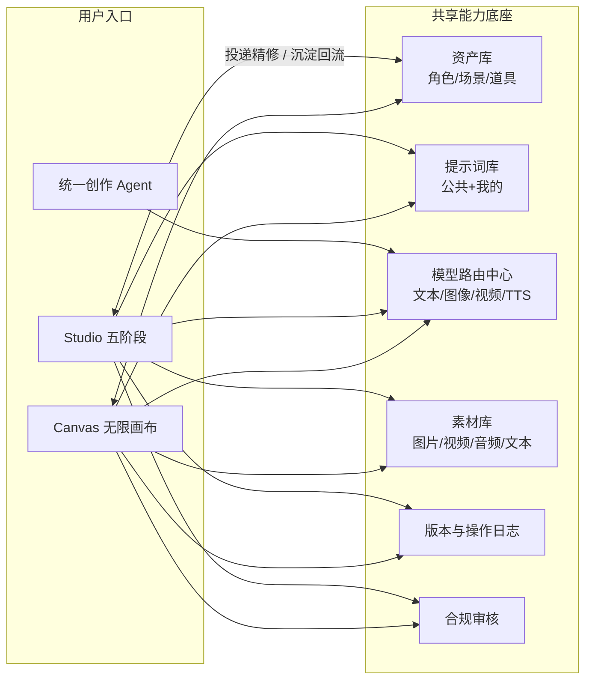
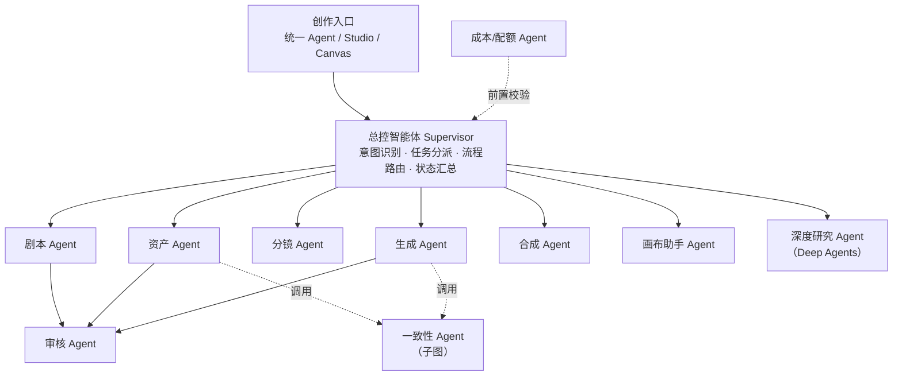
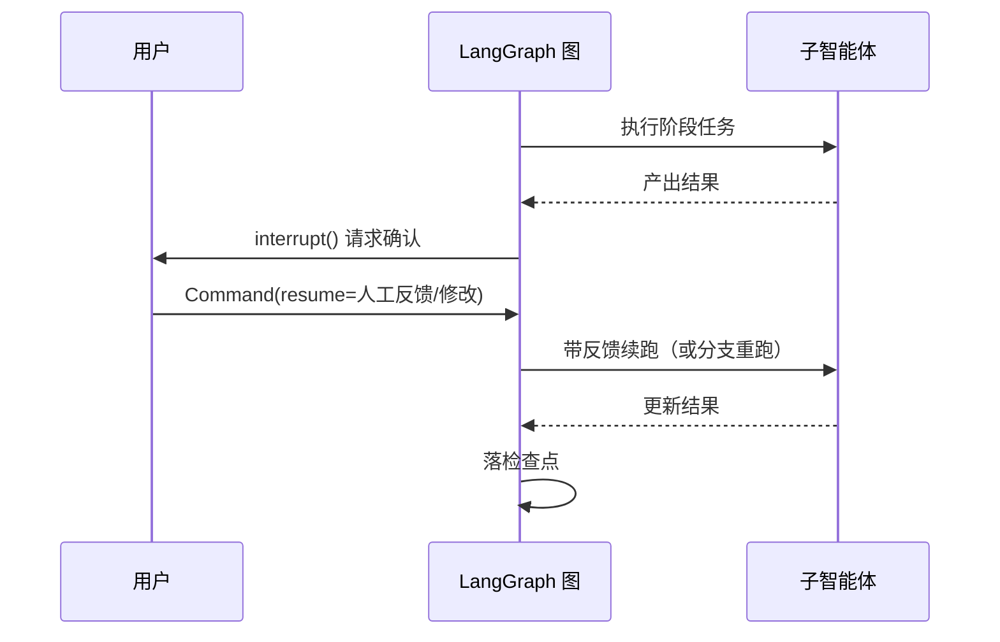
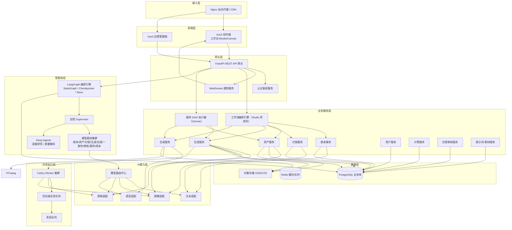
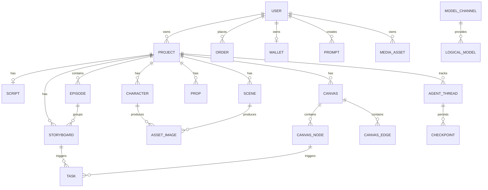
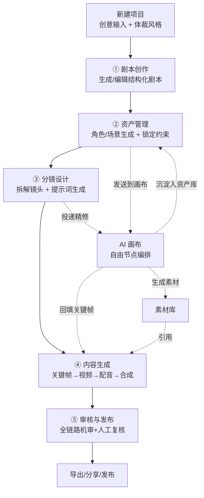
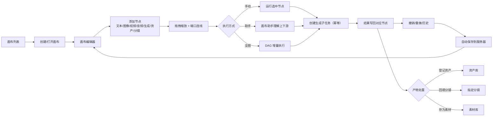
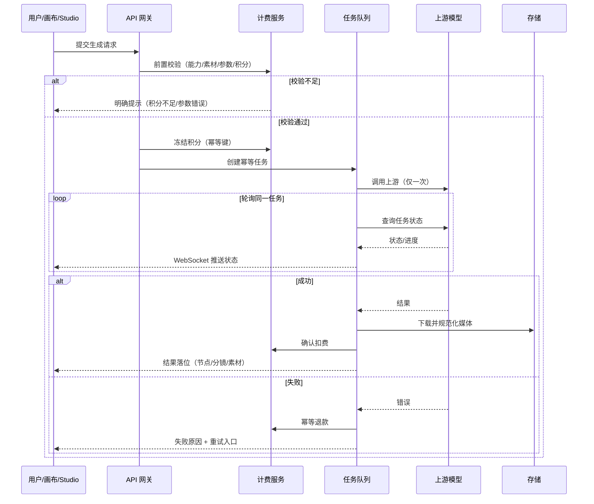

# 漫序 MangaFlow · 产品设计方案

> **有序创作，漫无止境。**

| 项目 | 内容 |
| ---- | ---- |
| 产品名称 | 漫序 MangaFlow |
| 文档版本 | V1.3 |
| 文档类型 | 产品设计方案（架构 + 模块 + 技术 + 路线图） |
| 编制日期 | 2026-10-08 |
| 文档状态 | 待评审 |
| 基线文档 | 《AI漫剧制作平台产品需求文档（PRD）优化版》V1.1 |
| 设计参考 | VOZEB-PRO（平台化 AI 创作工作台）、infinite-canvas（AI 无限画布） |

**版本记录**

| 版本 | 日期 | 变更范围 | 说明 |
| ---- | ---- | -------- | ---- |
| V1.0 | 2026-10-08 | 全新设计 | 品牌升级为「漫序 MangaFlow」；确立双引擎架构；新增「AI 画布」核心模块；引入统一创作 Agent、模型路由中心、提示词库、素材库、积分计费、运营管理后台等平台化能力 |
| V1.1 | 2026-10-08 | 架构升级 | 明确底层 AI 能力为**基于最新版本 LangGraph 的多智能体协作系统**；新增第六章「多智能体协作架构」（智能体角色、图拓扑、共享状态、检查点与记忆、人机协同、子图与并行、SSE 契约、可观测治理）；技术栈与系统架构图补充智能体编排层 |
| V1.2 | 2026-10-08 | 框架细化 | 明确**三框架分层协同**：LangGraph 负责编排、LangChain 负责组件（模型/工具/检索/解析，最小化使用）、Deep Agents 负责深度任务（长程规划、子智能体、虚拟文件系统）；新增 6.1.1 三框架分工、扩展能力映射表、新增「深度研究 Agent」角色（MA-16~MA-20） |
| V1.3 | 2026-10-08 | 评审决议并入 | 新增附录 D「评审决议记录（技术影响项）」：沉淀逐模块评审中对**架构与实现有直接约束**的决议（数据模型、执行器、计费、安全等）；补齐 S-10、PL-26~PL-29、C/V/AD/SYS 编号段；完整 57 条决议见 PRD 附录 D（单一事实源） |

**设计参考声明**：本方案参考项目的方法论、通用交互模式与信息架构（如节点式画布、流水线阶段划分、统一 Agent 入口等公共设计范式），不复制任何项目的源代码、专有文案、视觉资产与商标。文中示例数据均为虚构。

---

## 一、产品概述

### 1.1 命名与品牌释义

**漫序 / MangaFlow**

| 拆解 | 释义 |
| ---- | ---- |
| **漫** | 漫剧、动态漫画（Motion Comics），产品的内容形态 |
| **序** | 秩序、序列、序章 —— 工业化流水线的**有序** |
| **Manga** | 漫画 / 漫剧的国际化表达 |
| **Flow** | 心流与流水线 —— 创作如流、生产成流 |

**Slogan：有序创作，漫无止境。**

一句话点破产品双引擎内核：

- **有序创作** —— 剧本 → 资产 → 分镜 → 生成 → 发布，五阶段工业化流水线，让创作有章法、可量产、能交付。
- **漫无止境** —— 一张无限画布，节点自由编排、灵感不受边界，让创作有空间、可探索、能延展。

> 设计洞察：参考项目 VOZEB-PRO 同时提供「短剧流水线」与「Canvas 画布」两条入口，infinite-canvas 则专注「无限画布」的极致自由。漫序的设计取向是把二者**从"并列功能"升级为"共享底座的双引擎"**——同一套资产、提示词、模型、计费与审核能力向两条链路同时开放，并支持双向联动（画布产物可沉淀回流流水线，流水线分镜可投递画布精修）。

### 1.2 产品定位

漫序是面向内容创作者、独立作者、MCN 机构与教育/企业场景的 **一体化 AI 漫剧生产平台**。以「双引擎」承载从灵感到成片的全链路：

- **漫剧工坊（Studio 引擎）**：结构化五阶段流水线，擅长**批量、可控、可交付**的工业化生产。
- **AI 画布（Canvas 引擎）**：无限画布节点编排，擅长**探索、试错、精修**的创作式生产。

两条引擎共享统一的能力底座，用户可在同一项目内自由切换，实现"先探索后量产，先量产再精修"的混合工作流。

### 1.3 产品愿景

让每一个创意都能在**流水线里有序成片、在画布里自由生长**——把漫剧制作周期从数周压缩到小时级，综合成本降低 70% 以上，实现漫剧创作的**平民化、工业化与可探索化**。

### 1.4 核心价值主张

| 价值点 | 说明 |
| ------ | ---- |
| **双引擎创作** | 流水线保证交付效率与可控性，画布保证探索自由度与精修能力，同一项目内无缝切换 |
| **全流程自动化** | 从创意到成片，AI 驱动每个核心环节，用户仅需少量确认与微调 |
| **零门槛创作** | 无需绘画、编剧、剪辑技能，自然语言即可完成制作 |
| **角色一致性** | 资产强约束 + 特征注入 + 生成后校验三重保障，多镜头、多剧集形象统一 |
| **灵活可控** | 每个节点可回溯修改、局部重生成，下游增量更新而非全量重算 |
| **模型可插拔** | 文本/图像/视频/TTS 环节可独立选型，支持接入自有 API Key，规避厂商锁定 |

### 1.5 目标用户

| 用户类型 | 典型场景 | 核心需求 |
| -------- | -------- | -------- |
| 独立创作者 | 个人 IP 漫剧、短视频账号更新 | 低成本、高效率、易上手、风格可定制 |
| 小说作者 | 网文改编漫剧、原著可视化 | 忠实还原、批量生产、多剧集管理 |
| MCN 机构 | 短视频批量生产、账号矩阵运营 | 工业化流水线、成本可控、团队协作 |
| 教育/企业 | 教学案例、产品演示、企业宣传 | 快速产出、可视化、品牌风格统一 |
| 视觉探索者 | 概念图、分镜草图、风格试验 | 自由画布、快速试错、素材沉淀 |

### 1.6 差异化优势

1. **双引擎融合（产品级差异化）**：行业内少有的「流水线 + 无限画布」共享资产底座的架构，兼顾工业化效率与创作自由度，并支持双向联动回流。
2. **三框架协同的多智能体架构（技术级差异化）**：AI 能力由 **LangGraph 编排**（多智能体图、状态、检查点、人工中断）+ **LangChain 组件**（模型 / 工具 / 检索 / 解析的最小化封装）+ **Deep Agents 深度任务**（长程规划、子智能体、虚拟文件系统）三层协同承载，具备有状态流转、断点续跑、记忆与并行等工程能力，而非零散的单次模型调用。
3. **资产强约束机制**：角色/场景资产全生命周期管理，从定妆照到最终渲染全程绑定视觉特征，从根源治理角色崩坏。
4. **统一创作 Agent**：全平台统一智能入口，自动识别文本/图像/视频/音频意图，由总控智能体分派到对应子智能体执行，用户无需理解技术细节。
5. **模型路由中心**：上游模型渠道统一托管、逻辑模型自动路由、优先级与默认模型可配，故障自动降级。
6. **全链路可编辑 + 版本回流**：每个节点可回溯修改，修改后下游增量更新，版本快照支持一键回退（与 LangGraph 检查点同源）。

### 1.7 设计来源与借鉴说明（合规）

| 参考对象 | 借鉴内容 | 不借鉴内容 |
| -------- | -------- | ---------- |
| VOZEB-PRO | 平台化分层思路（统一创作 Agent、模型渠道托管、逻辑模型路由、积分计费、运营后台信息架构）；短剧多阶段生产流程的通用范式 | 源代码、专有文案、视觉资产、商标、商业授权条款 |
| infinite-canvas | 无限画布的通用交互范式（节点拖拽缩放连线、小地图、撤销重做、画布助手、插件式节点、本地 Agent/MCP 思路） | 源代码、页面标识、专有实现、依赖的具体第三方接口 |
| 《AI漫剧制作平台 PRD》V1.1 | 五阶段流水线、资产一致性方案、非功能指标、数据模型基线 | ——（自有文档，可直接演进） |

---

## 二、设计理念

### 2.1 双引擎设计哲学

```
                   ┌─────────────────────────────────────────┐
   有序创作 ───────▶│   漫剧工坊 Studio（结构化流水线引擎）      │
  （工业化）         │   剧本 → 资产 → 分镜 → 生成 → 发布        │
                   └─────────────────────────────────────────┘
                                        ▲           │
                          沉淀回流/投递精修 │           │ 引用资产
                                        │           ▼
                   ┌─────────────────────────────────────────┐
   漫无止境 ───────▶│   AI 画布 Canvas（无限画布编排引擎）       │
  （创作式）         │   节点编排 · 画布助手 · 本地 Agent · 插件   │
                   └─────────────────────────────────────────┘
```

- **Studio 引擎**回答"如何把想法批量、可靠地做成成片"——强结构、强约束、强流程。
- **Canvas 引擎**回答"如何把想法画出来、试出来、改到满意"——弱结构、高自由、可组合。
- **共享底座**回答"两套引擎如何不重复造轮子"——资产 / 提示词 / 模型 / 素材 / 计费 / 审核 / 版本 全部打通。

**双向联动设计（关键）**

| 方向 | 场景 | 机制 |
| ---- | ---- | ---- |
| Studio → Canvas | 某分镜关键帧不满意，想自由堆节点精修 | 「投递到画布」：以该分镜为种子节点生成子画布，保留上下文与资产约束 |
| Canvas → Studio | 画布里探索出一套满意的角色/风格/构图 | 「沉淀入资产库 / 回填分镜」：把画布节点产物登记为项目资产，或替换指定分镜的关键帧 |
| 双向共享 | 提示词、素材、模型配置 | 统一提示词库、素材库、模型路由，两端一致生效 |

### 2.2 三层架构哲学

| 层 | 名称 | 职责 | 典型构成 |
| -- | ---- | ---- | -------- |
| L1 | **创作层** | 用户直接操作的界面与流程 | 工作台、Studio 五阶段、Canvas 画布、提示词库、素材库、个人中心 |
| L2 | **能力层** | 可复用的 AI 与业务能力 | **三框架协同的多智能体层**：LangGraph 编排（总控/剧本/资产/分镜/生成/合成/一致性/审核/画布/成本）+ LangChain 组件（模型/工具/检索）+ Deep Agents 深度任务（原著解析/深度研究）；另含模型路由中心、检查点与记忆、任务调度、计费 |
| L3 | **平台层** | 支撑运营与规模化 | 运营管理后台、渠道托管、积分计费、数据看板、监控告警、存储备份 |

### 2.3 数据资产化理念

漫序的核心资产不是"一部成片"，而是**可复用的视觉资产与提示词沉淀**：

- 每一次生成的结果都可登记为**素材**；满意的角色/场景升级为**项目资产**；
- 有效的提示词沉淀进**提示词库**；确认的资产**锁定**为下游强制约束；
- 最终形成"越用越顺、越用越稳"的资产飞轮，降低边际创作成本。

---

## 三、功能架构总览

### 3.1 功能地图

```mermaid
flowchart TB
    MF["漫序 MangaFlow<br/>有序创作，漫无止境"]

    MF --> L1["创作层"]
    MF --> L2["能力层"]
    MF --> L3["平台层"]

    L1 --> DASH["工作台 Dashboard<br/>项目/统计/快捷入口"]
    L1 --> STUDIO["漫剧工坊 Studio"]
    L1 --> CANVAS["AI 画布 Canvas"]
    L1 --> LIB["提示词库 / 我的提示词"]
    L1 --> ASSETLIB["素材库 / 我的素材"]
    L1 --> PROFILE["个人中心<br/>账号/配额/订单/导入导出"]

    STUDIO --> S1["① 剧本创作 Script"]
    STUDIO --> S2["② 资产管理 Assets"]
    STUDIO --> S3["③ 分镜设计 Storyboard"]
    STUDIO --> S4["④ 内容生成 Production"]
    STUDIO --> S5["⑤ 审核与发布 Publish"]

    CANVAS --> C1["画布项目管理"]
    CANVAS --> C2["节点编排（文本/图像/视频/音频/生成/资产/合成）"]
    CANVAS --> C3["画布助手 Canvas Agent"]
    CANVAS --> C4["本地 Agent（MCP）"]
    CANVAS --> C5["插件系统（URL 安装）"]

    L2 --> MAS["多智能体协作层<br/>LangGraph 编排 · LangChain 组件 · Deep Agents 深度任务"]
    MAS --> AGS["总控 Supervisor<br/>意图识别/分派/路由"]
    MAS --> AGD["创作域 Agent<br/>剧本/资产/分镜/生成/合成"]
    MAS --> AGQ["质量域 Agent<br/>一致性/合规审核"]
    MAS --> AGC["画布助手 Agent"]
    MAS --> AGM["成本/配额 Agent"]
    MAS --> AGX["深度研究 Agent<br/>Deep Agents"]
    L2 --> ROUTER["模型路由中心"]
    L2 --> MEM["检查点与长期记忆<br/>Checkpoint + Store"]
    L2 --> TASKQ["任务调度与队列"]
    L2 --> BILL["计费与配额引擎"]

    L3 --> ADMIN["运营管理后台<br/>经营分析/商品/财务/用户/生成"]
    L3 --> CHANNEL["模型渠道与 Skills 托管"]
    L3 --> MONITOR["监控告警 / 存储备份"]
```



### 3.2 双引擎与共享底座关系



### 3.3 六大核心模块总览

| # | 模块 | 英文 | 定位 | 引擎 | 需求编号前缀 |
| - | ---- | ---- | ---- | ---- | ------------ |
| 1 | 剧本创作 | Script | 把创意变成结构化剧本 | Studio | S-xx |
| 2 | 资产管理 | Assets | 建立统一的视觉资产库 | Studio | A-xx |
| 3 | 分镜设计 | Storyboard | 把剧本拆成镜头脚本 | Studio | SB-xx |
| 4 | 内容生成 | Production | 把分镜变成视频素材 | Studio | P-xx |
| 5 | 审核与发布 | Publish | 预览、微调、导出分发 | Studio | R-xx |
| 6 | AI 画布 | Canvas | 无限画布自由编排创作 | Canvas | CV-xx |

> 平台支撑能力编号前缀为 `PL-xx`（统一 Agent、模型中心、提示词库、素材库、计费）；运营管理后台为 `AD-xx`，内容合规审核为 `C-xx`，版本与协作为 `V-xx`，系统基础能力为 `SYS-xx`；均详见第五章。

---

## 四、核心模块详细设计

### 4.1 模块一：剧本创作（Script）

**定位**：把用户的创意（一句话 / 小说 / 大纲 / 已有剧本）转化为结构化剧本，产出角色设定、场景描述与分场对话，作为下游全链路的结构化数据源。

**需求清单**

| 编号 | 需求描述 | 优先级 | 验收标准 |
| ---- | -------- | ------ | -------- |
| S-01 | 支持三种输入模式：①一句话创意 ②上传 .txt/.epub 小说（自动解析章节） ③粘贴大纲/现有剧本 | P0 | 支持 20MB 以内文件，章节解析准确率 ≥90% |
| S-02 | 配置项目元信息：标题、体裁（科幻/古风/都市/悬疑…）、风格（写实/二次元/赛博朋克/水墨…）、目标时长与集数、输出画幅 | P0 | 体裁风格内置预设且支持自定义 |
| S-03 | 调用文本模型生成结构化剧本：角色设定（外貌/性格/服饰）、场景描述、分场对话与动作 | P0 | 首 Token < 3s，流式输出，贴合体裁风格 |
| S-04 | 剧本以结构化 JSON 存储，字段含角色列表、场景列表、场次数组、对话与动作标注 | P0 | 格式规范，下游可直接解析 |
| S-05 | 剧本在线富文本编辑，支持大纲导航 + 详情编辑双栏，改动实时同步结构化数据 | P0 | 编辑无卡顿，撤销/重做 ≥20 步 |
| S-06 | 多集/多剧集管理，同一项目下多剧集数据隔离、资产复用 | P1 | 剧集数量无上限，支持跨剧集复制分镜 |
| S-07 | 剧本质量智能评分：对话密度、节奏起伏、角色出场均衡性三维打分 + 优化建议 | P2 | 评分维度可解释，建议可落地 |
| S-08 | 剧本一键同步到「统一创作 Agent」或「画布」继续创作 | P1 | 同步保留上下文，失败可重试 |
| S-09 | 生成失败展示具体原因，支持重试 / 换模型 / 精简输入三种解决路径 | P0 | 失败 10s 内反馈，重试成功率 ≥80% |
| **S-10** | **角色 / 场景 / 道具自动提取**：实体识别、别名归一（指代消解）、描述冲突标记，人工确认后生成资产卡 | P0 | 提取准确率 ≥90%，别名合并关系可视化，冲突项须人工裁决，确认后才生成资产 |

**交互说明**：创意输入后右侧实时流式展示生成进度，左侧保留原始输入；生成完成进入分栏编辑；确认后自动提取角色/场景列表，一键进入资产管理。

---

### 4.2 模块二：资产管理（Assets）

**定位**：基于剧本自动构建统一视觉资产库，通过「资产强约束」保障后续画面的角色一致性与场景统一性——这是漫序治理"角色崩坏"的核心阵地。

**资产类型**

| 资产类型 | 说明 | 典型产物 |
| -------- | ---- | -------- |
| 角色（Character） | 角色定妆照 + 多套造型 + 特征向量 | 正面/侧面/半身多角度 |
| 场景（Scene） | 场景概念图 | 全景/中景/多光线氛围 |
| 道具（Prop） | 可插入画面的道具素材 | 武器/信物/标志物 |
| 风格（Style） | 全局视觉风格锚点（LoRA/参考图/提示词） | 风格预设与参考图 |

**需求清单**

| 编号 | 需求描述 | 优先级 | 验收标准 |
| ---- | -------- | ------ | -------- |
| A-01 | 基于角色描述自动生成定妆照，默认输出正面/侧面/半身 3 角度，面部特征统一 | P0 | 同角色不同角度面部相似度 ≥90% |
| A-02 | 支持同角色多套造型（日常/战斗/礼服等），保留面部核心特征 | P1 | 换装后人物识别准确率 ≥85% |
| A-03 | 基于场景描述生成概念图，输出全景/中景 2 视角，支持光线氛围切换 | P0 | 场景元素与描述匹配度 ≥90% |
| A-04 | 支持上传参考图作为视觉锚点，启用图生图模式生成角色/场景 | P1 | 参考图风格还原度 ≥80% |
| A-05 | 资产以画廊视图展示，支持增删改、标签搜索、批量删除与批量分类 | P0 | 支持 100+ 资产流畅浏览 |
| A-06 | 为每个角色/场景生成标准化视觉提示词与特征标签，下游自动作为约束注入 | P0 | 提示词可编辑，修改后全链路同步生效 |
| A-07 | 道具资产管理：上传、分类、标注，生成时可插入画面 | P1 | 支持按类别筛选 |
| A-08 | 资产一致性校验：检测同角色不同资产的面部差异，超阈值预警 | P1 | 阈值可配，预警准确率 ≥80% |
| A-09 | **资产锁定**：确认后的资产自动锁定为下游强制约束，锁定态不可被下游无意覆盖 | P0 | 锁定后下游生成默认引用该约束 |
| A-10 | **双向联动**：接收画布「沉淀入资产库」的产物；支持把资产「发送到画布」继续探索 | P1 | 联动保留来源标记与版本 |

**一致性三层机制**（继承并强化 PRD 方案）

1. **约束层**：资产确认后提取核心特征向量（人脸/发型/服饰），存储为特征标签并锁定。
2. **注入层**：生图时自动以高权重注入角色特征提示词，并传入参考图作为结构约束。
3. **校验层**：生成后自动做人脸相似度比对，低于阈值自动重生成。

---

### 4.3 模块三：分镜设计（Storyboard）

**定位**：把剧本拆解为详细镜头脚本，规划每个镜头的视觉内容、景别、运镜与叙事节奏，是"文字 → 画面"的桥梁。

**需求清单**

| 编号 | 需求描述 | 优先级 | 验收标准 |
| ---- | -------- | ------ | -------- |
| SB-01 | AI 自动将剧本拆解为分镜序列：镜头编号、画面描述、景别、运镜、预计时长、对白/旁白、涉及角色、对应场景 | P0 | 符合影视语言规范，时长总和误差 ±10% |
| SB-02 | 分镜表支持网格/列表视图切换，支持拖拽调整镜头顺序 | P0 | 拖拽流畅，顺序变更后编号自动重排 |
| SB-03 | 手动编辑分镜全字段，支持新增/删除/拆分/合并分镜 | P0 | 编辑后实时更新总时长统计 |
| SB-04 | 自动为每个分镜生成优化提示词，融合角色资产 + 场景资产 + 运镜信息 | P0 | 提示词含主体/场景/风格/镜头/光影 5 类要素 |
| SB-05 | 节奏预览：基于分镜时长生成叙事节奏曲线，标注高潮点与平缓点 | P1 | 曲线可交互，点击分镜高亮 |
| SB-06 | 连续性检查：检测相邻分镜的角色站位、场景方位、服装逻辑矛盾并给建议 | P2 | 检测准确率 ≥70% |
| SB-07 | 设定目标总时长与镜头密度，自动调整分镜数量与单镜时长 | P1 | 调整后总时长误差 <5% |
| SB-08 | 批量导出分镜表为 PDF/Excel | P2 | 格式规范，含全部字段 |
| SB-09 | **投递到画布**：单个/多个分镜一键投递为画布子图精修，产物可回填 | P1 | 投递保留资产约束与上下文，回填定位准确 |

**交互说明**：三栏布局——左侧剧本原文对照、中间分镜卡片列表、右侧单镜编辑面板；快捷键 `Ctrl+N` 新增、`Delete` 删除、`空格` 播放节奏预览。

---

### 4.4 模块四：内容生成（Production）

**定位**：把分镜脚本转化为实际视频素材，含关键帧、视频片段、配音与最终合成。

#### 4.4.1 关键帧生成

| 编号 | 需求描述 | 优先级 | 验收标准 |
| ---- | -------- | ------ | -------- |
| P-01 | 基于提示词 + 角色资产约束 + 场景资产约束，批量生成关键帧 | P0 | 与定妆照一致性 ≥85% |
| P-02 | 支持单张 / 选中批量 / 全量批量三种生成模式 | P0 | 批量走任务队列，不阻塞页面 |
| P-03 | 支持首帧 + 尾帧双关键帧，为视频生成提供起止约束 | P1 | 首尾帧画面连贯一致 |
| P-04 | 结果以缩略图嵌入分镜表，hover 放大预览 | P0 | 缩略图加载 <500ms |
| P-05 | 单张/批量重生成，可保留或修改原提示词 | P0 | 重生成记录可追溯 |
| P-06 | 支持上传自定义图片替换 AI 结果，自动适配尺寸与风格 | P1 | 支持常见格式，≤20MB |

#### 4.4.2 视频片段生成

| 编号 | 需求描述 | 优先级 | 验收标准 |
| ---- | -------- | ------ | -------- |
| P-07 | 基于关键帧 + 运镜描述生成 4-12s 视频片段，默认 24fps | P0 | 画面流畅无闪烁，运镜符合描述 |
| P-08 | 两种模式：①图生视频（单帧起始） ②首尾帧约束生成 | P0 | 首尾帧模式起止还原度 ≥90% |
| P-09 | **异步任务队列**：提交后可离开页面，完成后站内 + 浏览器双通知 | P0 | 支持优先级、暂停/取消 |
| P-10 | 任务状态实时展示：排队/生成/完成/失败 + 进度百分比 | P0 | 状态更新延迟 <3s |
| P-11 | 失败自动重试（默认 3 次，指数退避），超限展示原因并支持人工介入 | P0 | 自动重试成功率 ≥60% |
| P-12 | 视频参数配置：分辨率、帧率、运动幅度 | P1 | 参数修改对后续任务生效 |

#### 4.4.3 配音与合成

| 编号 | 需求描述 | 优先级 | 验收标准 |
| ---- | -------- | ------ | -------- |
| P-13 | 基于对白/旁白生成配音，多角色音色区分，语速语调可调 | P0 | 音色贴合人设，吐字清晰 |
| P-14 | BGM 自动匹配（按风格推荐）+ 支持上传自定义音频 | P1 | 音量自动 ducking，不盖人声 |
| P-15 | 自动剪辑合成：按分镜顺序拼接片段，叠加配音/字幕/转场，输出成片 | P0 | 音画同步误差 <100ms |
| P-16 | 自定义字幕样式：字体/大小/颜色/描边/位置，支持双语 | P1 | 字幕与对白时间轴精准对齐 |
| P-17 | 转场特效：淡入淡出/叠化/闪黑，默认自动适配场景切换 | P2 | 转场时长可配，默认 0.5s |

**交互说明**：批量提交后展示全局任务进度面板；生成期间可切页或切项目；片段就绪后一键合成并实时展示进度。

---

### 4.5 模块五：审核与发布（Publish）

**定位**：成片预览、审核微调与多格式导出分发。

| 编号 | 需求描述 | 优先级 | 验收标准 |
| ---- | -------- | ------ | -------- |
| R-01 | 集成视频播放器：进度控制、音量、倍速、全屏 | P0 | 播放流畅，支持 0.5x-2x |
| R-02 | 分镜级跳转：点击分镜列表跳到对应视频时间点 | P1 | 跳转误差 <0.1s |
| R-03 | 单个片段不满意一键回退重生成，自动定位对应分镜 | P0 | 重生成后自动更新成片，无需全量合成 |
| R-04 | 导出 MP4，分辨率 720P/1080P/2K，码率可配 | P0 | 无水印，画质清晰 |
| R-05 | 三种输出比例：9:16 竖屏 / 16:9 横屏 / 1:1 方形 | P0 | 智能裁剪，主体居中 |
| R-06 | 生成分享链接与预览二维码，支持有效期与访问密码 | P2 | 分享页无需登录可预览 |
| R-07 | 一键发布到抖音/视频号等平台（API 对接） | P2 | 发布成功返回链接 |
| R-08 | **全链路合规审核**：文本/图片/视频三重机审 + 疑似内容人工复核队列 | P0 | 违规内容拦截率 ≥99%，审核通过方可导出 |
| R-09 | 成片添加**隐形溯源水印**，满足《生成式AI服务管理暂行办法》留存要求 | P0 | 水印不影响观感且可溯源 |

---

### 4.6 模块六：AI 画布（Canvas）★ 本次新增重点

**定位**：面向 AI 创作的**无限画布编排工作台**，把节点、连线、AI 生成、助手对话、素材沉淀放进同一张无边界画布，承载探索、试错、精修的创作式生产，并与 Studio 引擎共享资产底座。

**设计理念**：画布不是"画画的工具"，而是**可视化的工作流编排器**——每个节点是一步创作，每条连线是一次数据流，画布助手是可对话的协作者。

#### 4.6.1 画布项目管理

| 编号 | 需求描述 | 优先级 | 验收标准 |
| ---- | -------- | ------ | -------- |
| CV-01 | 多画布项目：创建、搜索、重命名、删除、复制、归档 | P0 | 支持 50+ 画布流畅管理 |
| CV-02 | 画布与项目/剧集关联，可作为独立创作空间或 Studio 精修子画布 | P1 | 关联关系清晰，可双向跳转 |
| CV-03 | 画布导入/导出（JSON 结构），支持迁移与备份 | P1 | 导出可完整还原节点与连线 |

#### 4.6.2 节点类型体系

| 节点类型 | 图标语义 | 作用 | 输入 | 输出 |
| -------- | -------- | ---- | ---- | ---- |
| **文本节点** | T | 剧本片段、提示词、说明文字 | 手动输入/上游 | 文本 |
| **图像节点** | 🖼 | 承载关键帧、定妆照、概念图 | 生成/上传/上游 | 图像 |
| **视频节点** | 🎬 | 承载视频片段 | 生成/上传/上游 | 视频 |
| **音频节点** | 🎵 | 承载配音、BGM、音效 | 生成/上传/上游 | 音频 |
| **生成节点** | ⚡ | 文生图 / 图生图 / 文生视频 / 图生视频 / TTS | 文本+图像/资产 | 图像/视频/音频 |
| **资产引用节点** | 🔗 | 引用资产库角色/场景/道具，注入约束 | 资产库 | 约束上下文 |
| **分镜节点** | 🎞 | 承载一个镜头（画面+运镜+时长+对白） | 剧本/手动 | 镜头数据 |
| **合成节点** | 🧩 | 拼接多路输入并合成输出 | 视频/音频/字幕 | 成片 |
| **逻辑节点** | ⚙ | 条件分支 / 批量循环 / 参数聚合（进阶） | 任意 | 任意 |
| **分组 / 批注节点** | 📝 | 视觉分组与画布笔记 | —— | —— |

**需求清单**

| 编号 | 需求描述 | 优先级 | 验收标准 |
| ---- | -------- | ------ | -------- |
| CV-04 | 支持上表全部节点类型，双击添加、右键菜单添加、快捷面板添加 | P0 | 添加路径 ≤2 步 |
| CV-05 | 节点支持拖拽、缩放、多选、对齐吸附、编组、折叠 | P0 | 操作流畅，60fps |
| CV-06 | 节点端口连线定义数据流，支持一对多/多对一，连线合法性校验 | P0 | 非法连线（类型不匹配）给出提示 |
| CV-07 | 生成节点接收上游文本/图像/资产约束，结果自动写回对应节点 | P0 | 结果落位准确，可追溯来源 |
| CV-08 | 资产引用节点实时同步资产库锁定态约束 | P0 | 资产更新后画布节点自动提示刷新 |

#### 4.6.3 画布交互与导航

| 编号 | 需求描述 | 优先级 | 验收标准 |
| ---- | -------- | ------ | -------- |
| CV-09 | 无限画布：平移、缩放（10%-400%）、小地图导航、缩放适配 | P0 | 大画布（500+ 节点）流畅 |
| CV-10 | 撤销 / 重做 / 历史记录（≥50 步） | P0 | 操作可逆，历史可视化 |
| CV-11 | 自动保存（防抖 2s）+ 手动保存，断线重连恢复 | P0 | 不丢数据，恢复提示明确 |
| CV-12 | 画布内搜索与定位节点、批量选择与批量操作 | P1 | 搜索响应 <500ms |
| CV-13 | 框选、复制粘贴、跨画布复制节点子树 | P1 | 复制保留连线关系 |

**画布快捷键规范**

| 快捷键 | 功能 | 快捷键 | 功能 |
| ------ | ---- | ------ | ---- |
| `Space + 拖拽` | 平移画布 | `Ctrl/Cmd + Z` | 撤销 |
| `Ctrl/Cmd + 滚轮` | 缩放画布 | `Ctrl/Cmd + Shift + Z` | 重做 |
| `Ctrl/Cmd + A` | 全选节点 | `Ctrl/Cmd + C / V` | 复制 / 粘贴 |
| `Delete / Backspace` | 删除选中节点 | `Ctrl/Cmd + S` | 保存 |
| `Ctrl/Cmd + G` | 编组 / 取消编组 | `Ctrl/Cmd + Enter` | 运行选中节点 |
| `双击空白` | 快捷添加节点面板 | `F` | 缩放适配全部（Fit） |
| `H` | 回到画布中心 | `1 / 2 / 3` | 切换 100% / 适配 / 选区聚焦 |

#### 4.6.4 画布助手（Canvas Agent）

| 编号 | 需求描述 | 优先级 | 验收标准 |
| ---- | -------- | ------ | -------- |
| CV-14 | 围绕**选中节点 + 其上游节点**进行对话，理解上下文 | P0 | 助手能读取上游节点内容并引用 |
| CV-15 | 助手可执行生成（生图/生视频/配音）并把结果**插回画布**为新节点 | P0 | 结果节点自动连线到相关上游 |
| CV-16 | 支持"一句话生成子图"：描述需求后自动生成一组节点与连线 | P1 | 生成结构合法，可继续编辑 |
| CV-17 | 助手支持引用提示词库与资产库作为生成依据 | P1 | 引用后提示词自动补全 |
| CV-18 | 助手操作全程留痕（谁、何时、改了什么），可回退 | P1 | 操作日志可查 |

> 助手定位：画布里的**协作者**而非自动机——AI 提出方案，人工确认落位，保持一致可控。

#### 4.6.5 本地 Agent（MCP）与插件系统

| 编号 | 需求描述 | 优先级 | 验收标准 |
| ---- | -------- | ------ | -------- |
| CV-19 | 提供本地 Agent 桥接（MCP 协议），允许外部 Agent（如编程助手）操作当前画布 | P2 | 连接成功后可读写节点 |
| CV-20 | 插件系统：通过 URL 动态安装 / 启用 / 更新 / 卸载节点插件 | P2 | 安装后节点类型自动注册 |
| CV-21 | 提供节点插件 SDK（TypeScript），支持自定义节点开发 | P2 | SDK 文档完整，示例可跑通 |
| CV-22 | 插件沙箱与权限声明，防止恶意插件越权 | P2 | 高风险权限需显式授权 |

#### 4.6.6 画布与 Studio 的双向联动（差异化核心）

| 编号 | 需求描述 | 优先级 | 验收标准 |
| ---- | -------- | ------ | -------- |
| CV-23 | **投递精修**：Studio 分镜一键生成子画布，携带资产约束与上下文 | P1 | 子画布保留原分镜提示词与资产引用 |
| CV-24 | **沉淀回流**：画布满意产物一键登记为项目资产 / 回填指定分镜关键帧 | P1 | 回流后 Studio 侧同步更新并记录来源 |
| CV-25 | 画布与 Studio 共享同一套提示词库、素材库、模型路由与配额 | P0 | 两端配置一致生效，用量统一计量 |

---

## 五、平台支撑层

### 5.1 统一创作 Agent（PL-AGENT）

全平台统一智能入口：用户只描述意图（文字或参考素材），由总控智能体判定能力类型并分派到对应子智能体执行。

> 该入口是**多智能体协作层**（三框架协同，详见第六章）的对外门面；底层图编排、共享状态、检查点、长期记忆与人机中断机制详见第六章。

| 编号 | 需求 | 说明 |
| ---- | ---- | ---- |
| PL-01 | 统一输入：文本 / 图片 / 视频 / 音频混合输入 | 一个输入框承载多模态意图 |
| PL-02 | 意图路由：自动判定文本/图像/视频/音频能力并选择逻辑模型 | 用户无需理解技术细节 |
| PL-03 | Skill 选择：支持选择创作技能（如"分镜生成""角色定妆"） | Skill 可在后台配置 |
| PL-04 | 参数偏好：生成前设置风格、比例、时长、清晰度等 | 支持保存为默认偏好 |
| PL-05 | 前置校验：能力 / 素材 / 参数 / 积分四重校验 | 不足时明确提示 |
| PL-06 | 结果处理：预览、下载、保存为素材、继续创作、发送到画布/Studio | 一站式后续动作 |

### 5.2 模型路由中心（PL-MODEL）

参考 VOZEB-PRO 的"模型渠道 + 逻辑模型"双层设计，实现模型可插拔与故障降级。

| 层 | 说明 |
| -- | ---- |
| **模型渠道层** | 后台托管上游渠道：协议、Base URL、API Key（AES-256 加密）、模型目录 |
| **逻辑模型层** | 面向业务的能力抽象：一个逻辑模型可绑定多个渠道，按优先级路由 |
| **默认与覆盖** | 全局默认 → 项目级覆盖 → 任务级覆盖，三级优先级 |
| **自有 Key** | 用户可接入自有 API Key，验证连通性后加密存储，永不明文展示 |

| 编号 | 需求 | 说明 |
| ---- | ---- | ---- |
| PL-07 | 渠道托管与健康检测 | 后台配置渠道并定期探测可用性 |
| PL-08 | 逻辑模型路由 + 优先级 | 主渠道故障自动降级备用渠道 |
| PL-09 | 三级配置优先级 | 任务级 > 项目级 > 全局默认 |
| PL-10 | 成本估算 | 提交前预估消耗积分，用户确认后执行，误差 <10% |
| PL-11 | 模型效果对比 | 提供模型效果速查与切换引导 |
| PL-26 | 模型库展示 | 按能力分类（文本/图像/视频/TTS），含名称、厂商、版本 |
| PL-27 | 模型详情 | 适用场景、风格偏向、价格、生成速度、官方文档链接 |
| PL-28 | 官方默认模型内置 | 新用户无需配置即可使用，兼顾效果与成本 |
| PL-29 | 模型配置内嵌 | 内嵌于各创作环节，无需跳转独立页面即可切换，切换即生效 |

### 5.3 提示词库（PL-PROMPT）

| 编号 | 需求 | 说明 |
| ---- | ---- | ---- |
| PL-12 | 公共提示词库 | 官方/社区沉淀的提示词，支持分类、标签、关键词检索 |
| PL-13 | 我的提示词 | 用户创建/编辑/分类/收藏/删除，可一键保存为文本素材 |
| PL-14 | 一键应用于 Agent / 画布 / Studio | 提示词可在三端复用 |
| PL-15 | 标准 JSON 来源导入 | 支持从标准 JSON 源导入提示词集 |

### 5.4 素材库（PL-ASSET）

| 编号 | 需求 | 说明 |
| ---- | ---- | ---- |
| PL-16 | 全类型素材：图片 / 视频 / 音频 / 文本统一管理 | 按类型筛选、预览、下载 |
| PL-17 | 素材来源标记：AI 生成 / 用户上传 / 画布产物 / Studio 产物 | 可追溯来源任务 |
| PL-18 | 发送到 Agent / 画布 / Studio | 素材即用 |
| PL-19 | 引用保护删除 | 删除前检查业务引用，避免断链 |

### 5.5 计费与配额（PL-BILL）

| 编号 | 需求 | 说明 |
| ---- | ---- | ---- |
| PL-20 | 配额体系：免费每日额度，订阅提升额度并解锁高级功能 | 分级权益 |
| PL-21 | 积分充值：按积分充值，不同模型消耗不同积分，明细可查 | 账单透明 |
| PL-22 | 订阅管理：月卡/年卡，权益对比，自动续费与取消 | —— |
| PL-23 | 订单管理：充值/订阅订单，支持发票申请 | —— |
| PL-24 | 配额预警：剩余 <20% 提醒，耗尽自动降级免费版 | —— |
| PL-25 | **资金底线三件套**：幂等（生成任务幂等键 + 唯一上游扣费）、对账（每日充值/扣费/退款对账）、资损监控（重复扣费/异常退款/负余额告警） | 不可砍 |

### 5.6 运营管理后台（PL-ADMIN）

| 模块 | 能力 |
| ---- | ---- |
| **经营分析看板** | 用户、收入、积分负债、订单、生成量等核心指标 |
| **用户运营** | 用户创建、角色、状态、套餐、积分调整 |
| **生成运营** | 任务查询、取消、失败记录、重试 |
| **商品运营** | 套餐管理：价格、权益、支付类型、上下架 |
| **订单管理** | 查询、人工完成、关闭、退款 |
| **财务** | 积分规则（免费额度/模型单价/参数倍率）、支付渠道、CDK 兑换、财务流水 |
| **上游配置** | 模型渠道、逻辑模型同步与优先级、Agent Skills |
| **系统管理** | 站点资料、基础设置（注册/SMTP/并发/安全）、注销申请、版本更新 |
| **存储与备份** | 本地媒体、S3 兼容对象存储、数据备份导入导出 |
| **内容运营** | 公告管理、提示词管理、内容审核队列 |

**运营管理端需求编号（AD）**

| 编号 | 需求 | 优先级 | 验收标准 |
| ---- | ---- | ------ | -------- |
| AD-01 | 用户管理：创建用户、角色、状态、套餐、积分调整 | P0 | 操作留痕，权限受控 |
| AD-02 | 项目审核：项目/内容审核队列、受理、驳回、备注 | P0 | 与 C-03 共用审核队列 |
| AD-03 | 模型配置管理：渠道托管、逻辑模型同步、优先级与默认模型 | P0 | 配置生效可验证 |
| AD-04 | 订单与计费管理：订单查询、人工完成、关闭、退款、积分规则、支付渠道 | P0 | 资金操作留痕，支持对账 |
| AD-05 | 运营数据看板：用户、收入、积分负债、订单、生成指标 | P1 | 数据按日/周/月维度 |

### 5.7 内容合规审核（C）

平台级合规能力体系；与发布环节的审核动作（R-08）互为支撑——R-08 管"导出这道闸门"，C 管"全链路能力建设"。

| 编号 | 需求 | 优先级 | 说明 |
| ---- | ---- | ------ | ---- |
| C-01 | 全链路内容审核 | P0 | 输入文本、生成图片、生成视频均经合规检测 |
| C-02 | 违规内容拦截 | P0 | 检测到色情/暴力/政治敏感等立即终止并提示 |
| C-03 | 人工审核后台 | P1 | 疑似违规进入人工队列，通过后方可导出（与 AD-02 共用队列） |
| C-04 | 用户违规记录与分级处罚 | P1 | 多次违规按分级采取限流、封禁 |

### 5.8 版本管理与协作（V）

| 编号 | 需求 | 优先级 | 说明 |
| ---- | ---- | ------ | ---- |
| V-01 | 项目版本快照 | P1 | 每阶段确认后自动落快照，支持一键回退；由 LangGraph 检查点实现（与 MA-06 同源） |
| V-02 | 操作日志 | P1 | 记录所有编辑与生成操作，可追溯操作人与时间 |
| V-03 | 团队协作（企业版） | P2 | 多成员协作与角色权限；**本期不做**，记入后续版本 |
| V-04 | 实时协作 | P2 | 多人同时编辑实时同步；**本期不做**，记入后续版本 |

### 5.9 系统基础能力（SYS）

| 编号 | 需求 | 优先级 | 说明 |
| ---- | ---- | ------ | ---- |
| SYS-01 | 任务调度与队列 | P0 | 优先级队列、失败重试、死信队列、幂等控制（详见 7.3.4） |
| SYS-02 | 监控与告警 | P0 | 生成成功率、队列积压、模型错误率、资损指标、P95 延迟 |
| SYS-03 | 系统级安全与审计 | P0 | 越权防护、操作审计留痕、密钥加密管理 |

---

## 六、多智能体协作架构（LangGraph 编排 · LangChain 组件 · Deep Agents 深度任务）

### 6.1 设计定位与三框架分工

漫序的 AI 能力不是"一次模型调用"，而是一套**多智能体协作系统**承载的工程化能力。Studio 五阶段、Canvas 画布、统一创作 Agent 三个入口，底层共用同一套智能体集群与记忆底座。

#### 6.1.1 三框架分工（分层协同）

| 框架 | 层位 | 职责 | 使用原则 |
| ---- | ---- | ---- | -------- |
| **LangGraph** | 编排层（核心） | 多智能体图编排、共享状态、条件路由、子图、人工中断、检查点、并行 Send | **主力**：所有跨步骤协作、有状态流程、可中断可回滚能力均由它承载 |
| **LangChain** | 组件层（最小化） | 统一 ChatModel / Tool / Retriever / OutputParser / Runnable 封装 | **最小化**：只做"零件库"，不承担流程编排，避免与上层编排职责重叠 |
| **Deep Agents** | 深度任务层（按需） | 长程规划（规划-执行-纠偏）、子智能体派生、虚拟文件系统 | **限定场景**：仅用于原著长文本解析、风格 / 趋势深度研究等长时程子模块 |

#### 6.1.2 为什么这样分工

1. **职责不重叠**：LangGraph 管"怎么流转"，LangChain 管"单个动作怎么做"，Deep Agents 管"长任务怎么规划到底"——三者分层互补而非相互替代。
2. **复杂度与成本可控**：LangChain 保持最小化，只提供稳定的模型 / 工具抽象；Deep Agents 只在真正需要长程规划的场景启用，避免为简单任务引入过重的规划开销。
3. **与既有技术栈一致**：与团队在既有项目中「LangGraph 核心 + LangChain 最小化 + Deep Agents 深度研究子模块」的分层策略保持统一，降低跨项目维护成本。
4. **可替换性**：模型 / 工具经 LangChain 抽象，编排层只依赖统一接口，更换厂商或新增模型不影响智能体图。

### 6.2 能力映射（三框架各司其职）

| 平台诉求 | 对应框架能力 | 落地场景 |
| -------- | ------------ | -------- |
| 多阶段有状态流程 | `StateGraph` + 共享 State（reducer / 注解） | 剧本→资产→分镜→生成→发布全流程状态 |
| 多智能体分工协作 | Supervisor 模式 + 子图（Subgraph） | 总控分派 + 各域智能体执行 |
| 人工确认节点 | `interrupt()` + `Command(resume=...)` | 各阶段确认、画布产物落位确认 |
| 断点续跑 / 版本回溯 | Checkpointer（PostgresSaver）+ Time Travel | 阶段快照、一键回退、失败续跑 |
| 长期记忆 | `Store`（持久化 + 语义检索） | 资产特征、提示词、风格、用户偏好 |
| 批量并行生成 | `Send` API / map-reduce | 分镜批量生成、多角色定妆照并行 |
| 流式输出 | `stream_mode`（messages/updates/custom） | 剧本流式、进度推送、SSE 契约 |
| 工具调用 | ToolNode / 预置 ReAct Agent | 生图/生视频/TTS/检索/审核工具 |
| 可观测与评测 | LangSmith 追踪 + 评测集 | 智能体链路追踪、成本与质量度量 |
| 模型统一封装 | **LangChain** ChatModel / Runnable | 多厂商文本 / 图像 / 视频 / TTS 接入的统一抽象 |
| 工具统一封装 | **LangChain** Tool / ToolNode 契约 | 生图 / 生视频 / TTS / 检索 / 审核工具标准化 |
| 结构化输出 | **LangChain** OutputParser + Pydantic | 剧本 JSON、分镜表、一致性报告结构化产出 |
| 检索增强 | **LangChain** Retriever + 向量库 | 资产 / 提示词 / 原著素材检索 |
| 长程规划 | **Deep Agents** Planning（规划-执行-纠偏） | 原著长文本解析、长剧集分镜长程规划 |
| 子智能体协作 | **Deep Agents** SubAgents | 深度研究任务派生并行子智能体 |
| 长任务上下文 | **Deep Agents** 虚拟文件系统 | 中间稿、世界观设定、关系图谱的文件式管理 |

### 6.3 智能体角色设计（Agent Roster）



| # | 智能体 | 职责 | 主要工具 | 输出 |
| - | ------ | ---- | -------- | ---- |
| 1 | **总控 Supervisor** | 意图识别、任务分派、流程路由、状态汇总、异常兜底 | 路由决策、状态查询 | 分派指令 |
| 2 | **剧本 Agent** | 创意→结构化剧本、角色/场景提取、质量评分 | 文本模型、剧本校验工具 | 结构化剧本 JSON |
| 3 | **资产 Agent** | 定妆照/概念图生成、多造型、特征提取与锁定 | 图像模型、特征提取、图生图 | 资产与特征标签 |
| 4 | **分镜 Agent** | 剧本拆解镜头、提示词生成、节奏与连续性检查 | 文本模型、运镜规则库 | 分镜表 |
| 5 | **生成 Agent** | 关键帧、视频片段、配音编排与任务调度 | 图像/视频/TTS 工具、任务队列 | 媒体片段 |
| 6 | **合成 Agent** | 剪辑合成、字幕、转场、输出成片 | FFmpeg 工具、字幕工具 | 成片 |
| 7 | **一致性 Agent**（子图） | 跨镜头/跨剧集角色一致性守护，比对并触发重生成 | 人脸相似度、特征向量比对 | 一致性报告 |
| 8 | **画布助手 Agent** | 理解选中节点与上游、生成子图、结果插回画布 | 画布读写、生成工具 | 节点/连线操作 |
| 9 | **审核 Agent** | 文本/图片/视频三重合规检测、分级处置 | 内容安全模型、规则库 | 审核结论 |
| 10 | **成本/配额 Agent** | 生成前成本估算、配额校验、扣费建议 | 计价规则、钱包查询 | 成本预估与校验 |
| 11 | **深度研究 Agent**（Deep Agents） | 原著长文本解析、世界观 / 人物关系抽取、风格与趋势调研 | Deep Agents 规划 / 子智能体 / 虚拟文件系统、检索工具 | 世界观设定、人物关系图谱、风格报告 |

> **实现分层**：深度研究 Agent 采用 **Deep Agents**（长程规划 + 子智能体 + 虚拟文件系统）；其余域智能体以 **LangGraph 节点** 实现，其内部的模型调用、工具调用与输出解析统一复用 **LangChain** 组件。

### 6.4 图拓扑与执行模式

| 模式 | 说明 | 典型场景 |
| ---- | ---- | -------- |
| **Supervisor 路由** | 总控按意图与阶段分派到域智能体，完成后回到总控 | 跨阶段任务、混合意图 |
| **子图（Subgraph）** | 复杂能力封装为独立子图被多方调用 | 一致性校验、审核流水线 |
| **人机协同（HITL）** | `interrupt()` 暂停等待人工确认，`Command(resume)` 注入反馈继续 | 五阶段确认点、画布落位 |
| **Map-Reduce 并行** | `Send` 把分镜/角色批量分发并行执行，再 reduce 汇总 | 批量关键帧、多角色资产 |
| **时间旅行（Time Travel）** | 基于检查点回到任意历史状态并分支重跑 | 版本回退、A/B 试探 |
| **深度任务（Deep Agents）** | 长程任务由 Deep Agents 的「规划-执行-纠偏」循环驱动，内部可派生并行子智能体 | 原著长文本解析、风格调研、长剧集规划 |

### 6.5 共享状态设计（State Schema）

单个创作会话是一个 `thread`，共享状态（TypedDict / Pydantic）贯穿全图：

| 字段 | 类型 | 说明 |
| ---- | ---- | ---- |
| thread_id | str | 会话标识（project_id 或 project_id + stage） |
| project_id / episode_id | str | 项目与剧集 |
| stage | Literal | 当前阶段（script/asset/storyboard/produce/publish） |
| script | ScriptModel | 结构化剧本 |
| assets | list[Asset] | 角色/场景/道具资产与特征 |
| storyboard | list[Shot] | 分镜序列 |
| tasks | list[TaskRef] | 生成任务引用与状态 |
| messages | list[BaseMessage] | 对话与工具调用消息 |
| cost / points | int | 累计成本与积分消耗 |
| pending_approval | Approval? | 待人工确认项（interrupt 载体） |
| errors / retries | list / int | 异常与重试计数 |

> 状态采用「追加型 / 覆盖型」分治：`messages`、`tasks` 用 reducer 追加，`stage`、`script` 用覆盖写，避免并发写冲突。

### 6.6 检查点与记忆

| 层 | 载体 | 生命周期 | 用途 |
| -- | ---- | -------- | ---- |
| 短期状态 | LangGraph State | 单次会话 | 图内流转 |
| 检查点 | PostgresSaver（thread 级） | 长期 | 断点续跑、版本快照、时间旅行 |
| 长期记忆 | Store（+ 向量检索） | 长期 | 资产特征、提示词、风格、用户偏好跨项目复用 |

- **检查点 = 版本快照**：每次阶段确认自动落检查点，与需求 V-01「版本快照 / 一键回退」同源；Time Travel 支持回到任一历史分支重跑。
- **Store = 资产飞轮**：角色特征向量、优质提示词、风格预设写入长期记忆并支持语义检索，供各智能体跨会话调用。

### 6.7 人机协同（Human-in-the-loop）



- 五阶段各设确认点，未确认不进入下游（对应 PRD 的「人工确认节点」）。
- 确认反馈以 `Command(resume=...)` 注入，无需从头重跑。

### 6.8 流式与前端契约（SSE）

| stream_mode | 内容 | 前端用途 |
| ----------- | ---- | -------- |
| messages | LLM Token 流 | 剧本 / 助手流式打字机 |
| updates | 节点级状态更新 | 阶段进度、步骤高亮 |
| custom | 自定义事件（任务进度 / 成本） | 生成进度条、积分消耗 |

统一 SSE 事件契约：`event: message | stage | task | cost | error | approval`，前端按事件类型更新 UI（与第五章 WebSocket 推送互补——SSE 用于单向流式，WebSocket 用于双向通知）。

### 6.9 工具与技能（Tools & Skills）

| 类别 | 工具示例 |
| ---- | -------- |
| 生成工具 | text_generate / image_generate / image_edit / video_generate / tts / compose |
| 检索工具 | asset_search（向量）、prompt_search、reference_lookup |
| 计算工具 | cost_estimate、duration_calc、shot_split |
| 校验工具 | consistency_check、continuity_check、compliance_check |
| 画布工具 | canvas_read / canvas_add_node / canvas_connect / canvas_write_result |

- 工具统一走**模型路由中心**与**积分前置校验**，工具调用遵循幂等任务模型。
- **Skill 层**：后台可配置的创作技能（对应运营后台 Agent Skills），控制智能体可用工具与参数约束。

### 6.10 可观测与治理

| 项 | 措施 |
| -- | ---- |
| 链路追踪 | LangSmith 全链路追踪（节点耗时、Token、失败原因） |
| 成本埋点 | 每节点 Token / 积分埋点，写入成本 Agent 与财务流水 |
| 失败与降级 | 节点级重试（指数退避）+ 模型路由故障降级 + 死信队列 |
| 权限与沙箱 | 工具按 Skill 授权；画布插件沙箱；数据权限随租户隔离 |
| 质量评测 | 建立评测集（剧本质量 / 一致性 / 合规）定期回归 |

### 6.11 需求清单（MA）

| 编号 | 需求 | 优先级 | 验收标准 |
| ---- | ---- | ------ | -------- |
| MA-01 | 基于最新版 LangGraph `StateGraph` 构建多智能体协作图 | P0 | 图可编排、可视化、可追踪 |
| MA-02 | 总控 Supervisor 意图识别与任务分派 | P0 | 意图识别准确率 ≥90%，分派正确 |
| MA-03 | 11 类域智能体角色落地 | P0 | 各智能体职责清晰、可独立测试 |
| MA-04 | 共享状态 Schema 与 reducer 分治 | P0 | 并发写无冲突，状态可追溯 |
| MA-05 | Checkpointer（PostgresSaver）持久化与断点续跑 | P0 | 中断后可恢复，不丢状态 |
| MA-06 | 检查点 = 版本快照，支持一键回退与 Time Travel | P1 | 可回到任一历史状态并分支重跑 |
| MA-07 | Store 长期记忆（资产 / 提示词 / 风格）与语义检索 | P1 | 跨会话可检索复用 |
| MA-08 | `interrupt()` 人工确认点与 `Command(resume)` 反馈注入 | P0 | 各阶段确认可暂停 / 恢复 |
| MA-09 | 子图封装（一致性、审核）可被多阶段复用 | P1 | 子图可独立调用与测试 |
| MA-10 | `Send` map-reduce 并行批量生成 | P0 | 批量任务并行执行并正确汇总 |
| MA-11 | 三种 stream_mode → SSE 前端契约 | P0 | 流式 / 进度 / 成本事件正确推送 |
| MA-12 | 工具与 Skill 授权体系，接入模型路由与积分校验 | P0 | 工具调用幂等且计费准确 |
| MA-13 | LangSmith 链路追踪与成本埋点 | P1 | 全链路可追踪、成本可归因 |
| MA-14 | 智能体失败重试与降级策略 | P0 | 超阈值进死信队列，可人工介入 |
| MA-15 | 画布助手 Agent 与画布工具集成 | P1 | 能读写画布并插回结果 |
| MA-16 | **LangChain 组件层**：统一 ChatModel / Tool / Retriever / OutputParser 封装 | P0 | 多厂商模型与工具可插拔，编排层只依赖统一接口 |
| MA-17 | **Deep Agents 深度任务**：原著长文本解析与世界观 / 人物关系抽取 | P1 | 支持长文本，产出结构化世界观与关系图谱 |
| MA-18 | Deep Agents 子智能体派生与虚拟文件系统接入 | P1 | 长任务中间稿可管理、可回溯 |
| MA-19 | 三框架统一工具与记忆口径（工具 / Skill / Store 共用） | P0 | 三框架共享同一工具契约与记忆口径 |
| MA-20 | 深度研究任务的可观测与成本归因 | P1 | 长任务链路可追踪、成本可归因 |

---

## 七、技术架构

### 7.1 技术栈

| 层级 | 选型 | 说明 |
| ---- | ---- | ---- |
| 前端 | Vue 3 + Vite + TypeScript | 组合式 API，性能优异 |
| UI 组件库 | Element Plus | 企业级组件，生态完善 |
| 状态管理 | Pinia | Vue 3 官方推荐 |
| 画布引擎 | 自研节点画布（可基于 Canvas/WebGL） | 节点拖拽、缩放、连线、小地图 |
| 富文本/剧本编辑 | Tiptap / ProseMirror | 结构化富文本编辑 |
| 后端 | Python 3.13 + FastAPI | 高性能异步 API，自动文档 |
| ORM | SQLAlchemy 2.0（异步） | 支持事务与 JSON 字段 |
| 数据库 | PostgreSQL 16 | 关系型 + JSONB，适配结构化剧本/画布数据 |
| 缓存 / 队列 | Redis 7.0 | 缓存 + 消息队列 + 分布式锁 |
| 任务调度 | Celery + Flower | 异步任务，优先级 / 重试 / 监控 |
| 对象存储 | 阿里云 OSS / 腾讯云 COS / S3 兼容 | 媒体存储 + CDN |
| AI 能力层 | 多模型适配层（模型路由中心） | 统一封装文本/图像/视频/TTS |
| 视频处理 | FFmpeg 6.0 | 拼接、转码、字幕、水印 |
| **多智能体编排** | **LangGraph（最新版）** | 多智能体协作 StateGraph、Supervisor、子图、interrupt、Checkpointer、Store、Send |
| **组件层（最小化）** | **LangChain** | 统一 ChatModel / Tool / Retriever / OutputParser / Runnable 封装 |
| **深度任务层** | **Deep Agents** | 长程规划、子智能体、虚拟文件系统（原著解析 / 深度研究子模块） |
| 多智能体可观测 | LangSmith | 智能体链路追踪、评测与成本归因 |
| 向量检索 | pgvector / Milvus | 资产特征、提示词语义检索（Store 长期记忆底座） |
| 工作流编排 | 状态机引擎 + 画布 DAG 执行器 | Studio 状态流转 + Canvas 节点图执行 |
| 实时推送 | WebSocket + SSE | WebSocket 双向通知；SSE 承载 LangGraph 流式输出（token / 进度 / 成本） |
| 可观测性 | Prometheus + Grafana + Loki | 指标 / 日志 / 告警 |
| 部署 | Docker + Nginx | 容器化，反向代理 |

> 数据库选型说明：相较基线 PRD 的 MySQL，本方案推荐 PostgreSQL——剧本、画布节点/连线、模型配置等均为强 JSON 结构，PostgreSQL 的 JSONB 与索引能力更契合；同时与团队其他项目技术栈保持一致，降低维护成本。

### 7.2 系统架构图



### 7.3 核心技术方案

#### 7.3.1 多智能体编排实现（三框架协同）

**实现要点**

1. **图构建**：`StateGraph(State)` 注册各智能体节点与工具节点，用 `add_conditional_edges` 实现 Supervisor 路由与人工确认分支。
2. **状态定义**：`State` 用 TypedDict + `Annotated[list, add]` 声明追加型字段（`messages`、`tasks`），其余为覆盖写字段。
3. **持久化**：`compile(checkpointer=PostgresSaver(pool), store=PostgresStore(pool))`；`thread_id` 取 `project_id` 或 `project_id:stage`。
4. **人工中断**：确认点调用 `interrupt(payload)` 暂停并向 SSE 推 `approval` 事件；恢复用 `Command(resume=feedback)` 续跑。
5. **并行扇出**：批量生成用 `Send("generate_shot", {...})` 扇出，结果以 `operator.add` 归并（map-reduce）。
6. **入口复用**：统一 Agent、Studio、Canvas 三入口复用同一 compiled graph 的不同起始节点 / 子图。
7. **与任务队列衔接**：图内以 `stream()/astream_events()` 驱动流式；重任务（视频/合成）下沉 Celery，以「提交任务 + 回调/查询」方式回写节点状态。
8. **幂等**：工具节点内的生成调用统一走幂等任务模型（见 7.3.4），失败重试不重复扣费。
9. **三框架衔接**：LangGraph 节点内部通过 **LangChain** Runnable 装配模型 / 工具 / 解析器；深度研究类任务以 **Deep Agents** 作为独立子图挂载（`add_node("deep_research", deep_agent_graph)`），其产物（世界观、人物关系图谱、风格报告）写回共享状态与 Store，供后续 Agent 复用。

**骨架示意（伪代码）**

```python
from langgraph.graph import StateGraph, START, END
from langgraph.types import Send, Command, interrupt
from langgraph.checkpoint.postgres import PostgresSaver
from langgraph.store.postgres import PostgresStore

builder = StateGraph(CreationState)
builder.add_node("supervisor", supervisor_node)          # 总控：意图识别/分派
builder.add_node("script_agent", script_agent)
builder.add_node("asset_agent", asset_agent)
builder.add_node("storyboard_agent", storyboard_agent)
builder.add_node("production_agent", production_agent)
builder.add_node("compose_agent", compose_agent)
builder.add_node("consistency_subgraph", consistency_graph)  # 子图：一致性校验
builder.add_node("audit_subgraph", audit_graph)              # 子图：合规审核
builder.add_node("human_confirm", human_confirm_node)        # interrupt 确认点
builder.add_conditional_edges("supervisor", route_fn, {
    "script": "script_agent", "asset": "asset_agent",
    "storyboard": "storyboard_agent", "produce": "production_agent",
    "compose": "compose_agent", "confirm": "human_confirm",
})
builder.add_edge(START, "supervisor")

graph = builder.compile(checkpointer=PostgresSaver(pool), store=PostgresStore(pool))

# 断点续跑 / 人工恢复
graph.invoke(Command(resume=human_feedback), config={"configurable": {"thread_id": project_id}})
```

#### 7.3.2 角色一致性保障（三层机制）

1. **资产约束层**：锁定资产 → 提取特征向量（人脸/发型/服饰）→ 存为特征标签。
2. **生成注入层**：生图时高权重注入角色提示词 + 传入参考图作结构约束。
3. **校验层**：生成后人脸相似度比对，低于阈值自动重生成。

#### 7.3.3 画布 DAG 执行器（新增）

- 画布是一张**有向无环图（DAG）**：节点 = 计算单元，连线 = 数据依赖。
- 执行策略：拓扑排序 + 增量执行——只重算"脏节点"及其下游，未变更上游直接复用缓存结果。
- 生成类节点转为异步任务；纯文本/连线变更即时执行。
- 循环引用检测：连线时做环检测，禁止成环（逻辑节点提供显式循环语义）。
- **与 LangGraph 的分工**：LangGraph 编排「智能体协作」，画布 DAG 执行器编排「用户可见的节点图」；画布中需要智能体介入的节点（如画布助手节点）内部再调用 LangGraph 子图，二者通过统一任务模型衔接。

#### 7.3.4 异步任务调度

1. Celery 多队列：紧急（单张）、普通（批量）、后台（合成/转码）。
2. 支持优先级、超时控制、失败重试（指数退避）。
3. 超阈值任务进死信队列，人工排查。
4. WebSocket 实时推送状态，前端无需轮询。
5. **幂等**：一次生成任务只调一次上游创建接口，轮询只查同一任务；失败且用户点击重试才创建新 attempt，避免重复消耗。

#### 7.3.5 工作流编排（Studio）

- 状态机定义项目阶段状态与流转规则。
- 支持正向流转、回退、分支异常处理，所有状态变更记操作日志。
- 阶段切换自动触发数据校验与前置依赖检查。

---

## 八、数据模型

### 8.1 核心实体关系



### 8.2 核心表设计（增量，基线见 PRD）

> 统一字符集 utf8mb4，引擎 InnoDB（或 PostgreSQL 对应配置）。以下为在基线 PRD 表结构之上的**新增/变更**表。

#### 8.2.1 画布表（canvases）

| 字段 | 类型 | 说明 |
| ---- | ---- | ---- |
| id | BIGINT | 主键 |
| project_id | BIGINT | 关联项目（可空，独立画布） |
| user_id | BIGINT | 拥有者 |
| title | VARCHAR(100) | 画布名称 |
| type | ENUM | standalone / studio_linked（Studio 投递子画布） |
| viewport | JSON | 视口状态（缩放/位移） |
| thumbnail_url | VARCHAR(255) | 画布缩略图 |
| created_at / updated_at | DATETIME | 时间戳 |

#### 8.2.2 画布节点表（canvas_nodes）

| 字段 | 类型 | 说明 |
| ---- | ---- | ---- |
| id | BIGINT | 主键 |
| canvas_id | BIGINT | 外键 → canvases.id |
| node_type | ENUM | text/image/video/audio/generate/asset_ref/shot/compose/logic/group |
| position_x / position_y | DOUBLE | 画布坐标 |
| size_w / size_h | DOUBLE | 节点尺寸 |
| z_index | INT | 层级 |
| data | JSON | 节点内容（文本/提示词/引用/参数/结果 URL） |
| config | JSON | 节点配置（模型/参数/资产引用） |
| status | ENUM | idle/queued/running/done/failed |
| parent_group_id | BIGINT | 分组父节点 |
| created_at / updated_at | DATETIME | 时间戳 |
| **索引** | | idx_canvas(canvas_id), idx_type(node_type) |

#### 8.2.3 画布连线表（canvas_edges）

| 字段 | 类型 | 说明 |
| ---- | ---- | ---- |
| id | BIGINT | 主键 |
| canvas_id | BIGINT | 外键 → canvases.id |
| source_node_id | BIGINT | 源节点 |
| target_node_id | BIGINT | 目标节点 |
| source_port | VARCHAR(20) | 源端口（输出类型） |
| target_port | VARCHAR(20) | 目标端口（输入类型） |
| **索引** | | idx_canvas(canvas_id), idx_source(source_node_id), idx_target(target_node_id) |

#### 8.2.4 剧集表（episodes）

| 字段 | 类型 | 说明 |
| ---- | ---- | ---- |
| id / project_id | BIGINT | 主键 / 关联项目 |
| title | VARCHAR(100) | 剧集标题 |
| sequence | INT | 剧集序号 |
| script_snapshot | JSON | 该剧集剧本快照 |
| status | ENUM | 状态 |
| created_at / updated_at | DATETIME | 时间戳 |

#### 8.2.5 媒体素材表（media_assets）

| 字段 | 类型 | 说明 |
| ---- | ---- | ---- |
| id / user_id / project_id | BIGINT | 主键 / 归属 |
| media_type | ENUM | image/video/audio/text |
| source | ENUM | ai_generated/upload/canvas/studio |
| url | VARCHAR(255) | 稳定地址 |
| meta | JSON | 尺寸/时长/来源任务/引用关系 |
| created_at | DATETIME | 时间戳 |

#### 8.2.6 提示词表（prompts）

| 字段 | 类型 | 说明 |
| ---- | ---- | ---- |
| id | BIGINT | 主键 |
| user_id | BIGINT | NULL 为公共提示词 |
| title / content | VARCHAR | 标题 / 内容 |
| category / tags | JSON | 分类与标签 |
| scope | ENUM | public / private |
| created_at / updated_at | DATETIME | 时间戳 |

#### 8.2.7 模型渠道与逻辑模型（model_channels / logical_models）

| 表 | 关键字段 | 说明 |
| -- | -------- | ---- |
| model_channels | id, protocol, base_url, api_key_encrypted, models(JSON), enabled, health_status | 上游渠道托管 |
| logical_models | id, capability(llm/image/video/tts), name, channel_priority(JSON), is_default | 能力抽象与路由优先级 |

#### 8.2.8 钱包与流水（wallets / wallet_transactions）

| 表 | 关键字段 | 说明 |
| -- | -------- | ---- |
| wallets | user_id, points_balance, frozen_points, updated_at | 余额 |
| wallet_transactions | id, user_id, type(recharge/consume/refund), amount, ref_task_id, idempotency_key, created_at | 流水（幂等键唯一） |

#### 8.2.9 智能体检查点表（langgraph_checkpoints / langgraph_checkpoint_writes）

| 表 | 关键字段 | 说明 |
| -- | -------- | ---- |
| langgraph_checkpoints | thread_id, checkpoint_ns, checkpoint_id, parent_checkpoint_id, state(JSONB), created_at | LangGraph 检查点（= 阶段版本快照） |
| langgraph_checkpoint_writes | thread_id, checkpoint_id, task_id, channel, value(JSONB) | 节点写入缓冲 |

> 由 LangGraph `PostgresSaver` 自动维护；`thread_id = project_id`（或 `project_id:stage`），支撑断点续跑、Time Travel 与需求 V-01 版本回退。

#### 8.2.10 长期记忆表（langgraph_store / asset_embeddings）

| 表 | 关键字段 | 说明 |
| -- | -------- | ---- |
| langgraph_store | namespace, key, value(JSONB), embedding(vector) | LangGraph Store 长期记忆（资产特征 / 提示词 / 风格 / 偏好） |
| asset_embeddings | asset_id, embedding(vector), model, updated_at | 资产 / 参考图特征向量，支撑相似检索与一致性比对 |

> 向量列由 pgvector 扩展提供；敏感记忆按租户命名空间隔离。

> 其余表（users/projects/scripts/characters/scenes/storyboards/tasks/orders/operation_logs/version_snapshots/review_records）沿用并扩展基线 PRD 设计，此处不重复。

---

## 九、关键业务流程

### 9.1 全流程总览（含双引擎）



### 9.2 画布编排与执行流程



### 9.3 异步生成任务流（幂等 + 退款）



---

## 十、非功能需求（增量）

| 类别 | 需求项 | 指标 |
| ---- | ------ | ---- |
| 性能 | 页面首屏加载 | < 2s |
| 性能 | 剧本生成首 Token | < 3s（流式） |
| 性能 | 图像生成 | 单张 < 30s（1024） |
| 性能 | 视频生成 | 4-12s 片段 < 5min（异步） |
| 性能 | 成片合成 | < 3min |
| 性能 | **画布交互** | 500+ 节点拖动/缩放 ≥50fps |
| 性能 | **画布自动保存** | 防抖 2s，不丢数据 |
| 并发 | 同时创作 | 100+ 并发创作，1000+ 在线 |
| 可用性 | 系统可用性 | ≥ 99.5%（排除第三方 AI 不可用） |
| 可用性 | 数据备份 | 每日全量 + 每小时增量，保留 7 天 |
| 可用性 | 故障恢复 | RTO < 30min，RPO < 1h |
| 安全 | API Key | AES-256 加密，仅调用时解密 |
| 安全 | 数据隔离 | 多租户物理隔离，隐私内容默认私有 |
| 安全 | 传输 | 全站 HTTPS，TLS 1.3 |
| 合规 | 生成式 AI 合规 | 符合《生成式人工智能服务管理暂行办法》《网络安全法》 |
| 合规 | 内容水印 | 生成内容添加隐形溯源水印 |
| 兼容 | 浏览器 | Chrome/Edge 100+、Safari 15+、Firefox 100+ |
| 扩展 | 模型可插拔 | 新增模型无需改造核心业务 |

---

## 十一、里程碑与路线图

总周期 **16 周**（4 个月），8 个阶段迭代交付。相较基线 PRD，新增 **AI 画布** 独立阶段（Phase 7），并将平台化能力并入 Phase 8。

| 阶段 | 周期 | 核心交付物 | 依赖 |
| ---- | ---- | ---------- | ---- |
| **Phase 1 基础架构** | 1-2 周 | 脚手架、数据库、认证、前端框架、**LangGraph 多智能体骨架（图 / 状态 / 检查点）**、部署流水线 | 无 |
| **Phase 2 剧本创作** | 3-4 周 | 创意输入、AI 剧本生成（含 Deep Agents 原著深度解析）、编辑器、角色场景提取 | 文本模型对接 |
| **Phase 3 资产管理** | 5-6 周 | 定妆照/概念图生成、资产库、一致性校验、锁定约束 | 图像模型对接 |
| **Phase 4 分镜设计** | 7-8 周 | AI 分镜拆解、分镜表编辑、提示词生成、节奏预览 | Phase 2/3 |
| **Phase 5 内容生成** | 9-11 周 | 关键帧、视频异步生成、任务队列、TTS、自动合成 | 视频模型 + FFmpeg |
| **Phase 6 审核与发布** | 12 周 | 成片预览、分段跳转、局部重生成、多格式导出 | Phase 5 |
| **Phase 7 AI 画布** ★ | 13-14 周 | 无限画布、节点体系、画布助手、DAG 执行器、双向联动 | Phase 3/4/5（复用资产与生成能力） |
| **Phase 8 平台化与上线** | 15-16 周 | 统一创作 Agent、多智能体协作层完善（子图 / 工具治理 / LangSmith）、模型路由中心、提示词库、素材库、计费配额、运营后台、内容审核、优化上线 | 支付渠道对接 |

**MVP 切分建议**：MVP = Phase 1-6（先跑通 Studio 单用户全流程闭环）；AI 画布与平台化能力作为 v1.1 迭代，形成"先量产、再探索、后规模化"的演进节奏。**多智能体骨架在 Phase 1 即落地**，各域智能体随对应 Phase 逐域接入（剧本 Agent 随 Phase 2、资产 Agent 随 Phase 3，以此类推），避免后期返工。

---

## 十二、风险与应对

| # | 风险 | 等级 | 应对措施 |
| - | ---- | ---- | -------- |
| 1 | 第三方 AI API 不稳定/限流 | 高 | 模型路由中心多渠道备选 + 故障自动降级 + 指数退避重试 + 热点缓存 |
| 2 | 角色一致性难保证 | 中 | 资产强约束 + 参考图结构约束 + 生成后相似度校验自动重生成 |
| 3 | 画布交互性能瓶颈（大图） | 中 | 增量渲染 + 视口裁剪 + WebGL 加速 + 虚拟化 |
| 4 | 画布 DAG 执行复杂度与死循环 | 中 | 连线环检测 + 增量执行 + 执行超时与资源上限 |
| 5 | 生成质量不达预期导致留存低 | 中 | 环节人工确认节点 + 局部重生成 + 风格模板 + 新手引导 |
| 6 | 内容合规风险 | 高 | 全链路机审（文本/图片/视频）+ 人工复核 + 违规分级处罚 + 溯源水印 |
| 7 | 算力成本超支 | 中 | 配额计费体系 + 提示词优化 + 错峰调度 + 分层定价 |
| 8 | 数据安全与隐私泄露 | 高 | 加密存储 + 多租户隔离 + 安全审计 + 最小权限 |
| 9 | 双引擎资产/版本不一致 | 中 | 统一资产与版本底座 + 联动来源标记 + 冲突提示 |
| 10 | 多智能体编排复杂度高（状态膨胀、链路难调试） | 中 | 子图分层 + 状态分治 + 单智能体可独立测试 + LangSmith 链路追踪 |
| 11 | 智能体误判导致错误分派 / 越权调用工具 | 中 | 工具按 Skill 授权 + 参数校验 + 幂等任务 + 人工确认节点兜底 |

---

## 附录 A：需求追踪矩阵（RTM 摘要）

| 模块 | 需求编号段 | 对应章节 | 引擎 |
| ---- | ---------- | -------- | ---- |
| 剧本创作 | S-01 ~ S-10 | 4.1 | Studio |
| 资产管理 | A-01 ~ A-10 | 4.2 | Studio |
| 分镜设计 | SB-01 ~ SB-09 | 4.3 | Studio |
| 内容生成 | P-01 ~ P-17 | 4.4 | Studio |
| 审核与发布 | R-01 ~ R-09 | 4.5 | Studio |
| AI 画布 | CV-01 ~ CV-25 | 4.6 | Canvas |
| 多智能体协作 | MA-01 ~ MA-20 | 第六章 | 共享（底层） |
| 平台支撑 | PL-01 ~ PL-29 | 第五章 | 共享 |
| 运营管理后台 | AD-01 ~ AD-05 | 5.6 | 共享 |
| 内容合规审核 | C-01 ~ C-04 | 5.7 | 共享 |
| 版本与协作 | V-01 ~ V-04 | 5.8 | 共享 |
| 系统基础能力 | SYS-01 ~ SYS-03 | 5.9 | 共享 |

## 附录 B：术语表

| 术语 | 说明 |
| ---- | ---- |
| 漫剧 | 动态漫画，静态画面 + 动态效果 + 配音的短视频形式 |
| 关键帧 | 分镜核心静态画面，作为视频生成的起止参考 |
| 定妆照 | 角色标准参考图像，用于约束后续形象一致性 |
| 分镜 | 剧本拆解后的单镜头脚本，含画面/运镜/时长/对白 |
| Studio 引擎 | 漫序的结构化五阶段流水线引擎 |
| Canvas 引擎 | 漫序的无限画布节点编排引擎 |
| DAG | 有向无环图，画布的节点-连线执行模型 |
| 逻辑模型 | 面向业务的能力抽象，可绑定多个上游渠道并路由 |
| MCP | Model Context Protocol，本地 Agent 与画布交互的桥接协议 |
| 资产锁定 | 确认资产后固定为下游强制约束、防止被覆盖的状态 |
| LangGraph | 多智能体协作编排框架，本项目采用最新版本 |
| Supervisor | 总控智能体模式，负责意图识别、任务分派与流程路由 |
| Subgraph 子图 | 可被复用的子图，如一致性校验、合规审核 |
| 检查点 Checkpoint | 图状态持久化快照，等同阶段版本快照，支撑断点续跑与 Time Travel |
| Store | LangGraph 长期记忆存储，支撑跨会话语义检索（资产/提示词/风格） |
| interrupt | LangGraph 人工中断原语，用于人工确认节点 |
| Send | LangGraph 并行扇出原语，用于批量 map-reduce |
| HITL | Human-in-the-loop，人机协同（人工确认后继续） |
| LangChain | 组件层框架，提供模型 / 工具 / 检索 / 解析的最小化封装 |
| LCEL / Runnable | LangChain 组合式调用表达，用于拼装单个智能体的内部动作 |
| Deep Agents | 深度任务框架，提供长程规划、子智能体与虚拟文件系统 |
| Deep Agent 虚拟文件系统 | 长任务中间产物的文件式上下文管理（世界观 / 关系图谱 / 草稿） |
| 子智能体 SubAgent | Deep Agents 在长程任务中派生的并行执行单元 |

## 附录 C：待确认事项（评审关注）

| # | 事项 | 建议 |
| - | ---- | ---- |
| 1 | 数据库最终选型（PostgreSQL vs MySQL） | 推荐 PostgreSQL（JSONB 契合与团队一致性） |
| 2 | 画布引擎自研 vs 引入开源图编辑器内核 | 建议自研轻量内核 + 参考通用交互范式 |
| 3 | MVP 是否包含 AI 画布 | 建议 MVP 先做 Studio，画布放 v1.1 |
| 4 | 支付渠道与计费口径 | 待商务确定后补资金三件套细节 |
| 5 | 画布本地 Agent/插件系统优先级 | 建议 P2，视用户需求后置 |
| 6 | LangGraph 版本锁定与编排边界（三入口是否共用一张图） | 建议锁定最新稳定版；三入口共用 compiled graph，以起始节点 / 子图区分 |
| 7 | 多智能体与既有 Celery 任务队列的职责边界 | 建议 LangGraph 负责编排与状态，Celery 负责重任务执行，二者以任务模型衔接 |

---

## 附录 D：评审决议记录（技术影响项）

> **完整 57 条决议见 PRD 附录 D（单一事实源，避免双份漂移）**。本附录只列出对**架构、数据模型与实现**有直接约束的决议，供研发对照落地。

| 决议编号 | 关联需求 | 决议 | 对架构/实现的约束 |
| -------- | -------- | ---- | ----------------- |
| RD-03 | S-05 | 文本↔结构化字段级来源标记 + 差异确认 | 结构化字段需带 `source`（ai/user）标记，重抽时跳过 user 字段 |
| RD-08 | S-05 / V-01 | 影响面预览 | 需维护「资产 → 分镜 → 生成」的下游依赖关系（可复用 DAG 依赖图） |
| RD-09 | S-06 / A-10 | 剧集级资产覆盖（**待确认**） | 资产表需支持「项目级基础 + 剧集级派生覆盖」两层结构 |
| RD-10 | A-01 | 先主照后派生角度 | 资产生成任务改为两阶段串行（主照确认 → 派生），非并行三张 |
| RD-12 | A-09 | 锁定分两层 | 资产锁定字段拆分为 `face_locked` 与 `outfit_variant`，下游注入策略按层取用 |
| RD-15 | A-05 | 资产语义检索 | 依赖 pgvector + LangGraph Store，资产/参考图需写入 embedding |
| RD-19 | A-03 | 场景多光线挂变体 | 场景表支持变体结构，同场景不重复建实体 |
| RD-24 | SB-01 | 分镜强绑资产 ID | 分镜的 `character_ids` / `scene_id` 为外键约束（非自由文本），需实体链接步骤 |
| RD-27 | P-02 | 批量前打样 | 生成任务支持「试生阶段 → 全量阶段」两段式编排 |
| RD-28 | P-11 | 失败成本归属 | 钱包流水需区分承担方；幂等键 + 退款类型区分「平台故障退款 / 违规不计费 / 用户取消释放」 |
| RD-31 | P-13 / P-16 | 配音时长回写分镜 | 分镜表新增 `actual_duration`；与预估 `duration` 的差异需触发用户选择 |
| RD-32 | P-15 | 增量合成 | FFmpeg 合成需支持分段合成 + 增量拼接，避免全量重合成 |
| RD-34 | R-08 / C-01 | 三级审核闸门 | 审核服务需在生成、合成、导出三处埋点，并共用审核记录表 |
| RD-37 | R-05 | 多比例前置 | 关键帧生成参数需含 `aspect_ratio`，事后裁剪仅作降级路径 |
| RD-40 | R-03 / V-01 | 成片版本留档 | 需成片版本表（保留最近 N 版），与检查点体系并存 |
| RD-45 | CV-07 | DAG 增量执行 | 画布执行器需脏节点标记 + 结果缓存 + 拓扑排序（见 7.3.3） |
| RD-46 | CV-20/21/22 | 插件沙箱与授权 | 前端插件运行时需沙箱隔离 + 权限清单声明；后端需插件注册与审核链路 |
| RD-47 | CV-24 | 回流补特征提取 | 画布产物入库流程内嵌特征提取工具调用，并标记 `source=canvas` |
| RD-48 | CV-04 | 循环用逻辑节点 | DAG 执行器需支持显式循环语义（迭代/重试），同时保留环检测 |
| RD-51 | PL-10 / PL-25 | 积分极简暴露 | 前台接口只返回 `total_cost`，计价规则不出后端 |
| RD-52 | PL-20 / PL-24 | 配额软着陆 | 配额校验在任务提交时执行，运行中任务不因配额耗尽被中断 |
| RD-53 | MA-01~MA-20 | 不暴露多智能体 | SSE 事件口径使用业务语言（如"正在生成画面"），不输出 Agent 名称 |
| RD-55 | PL-25 | 资金三件套不可砍 | 幂等 + 对账 + 资损监控为排期红线（见 5.5） |
| RD-56 | AD-01 / AD-04 | 高危操作留痕 | 管理端改积分/退款需审计日志 + 二次确认 |
| RD-57 | MA-17 | 长任务预估 | Deep Agents 任务提交前需返回预估时长与积分（基于 token 估算） |

> 技术影响项合计 **24 条**，其余 33 条为产品口径类决议，见 PRD 附录 D。

---

*本方案为产品设计参考，具体实施请结合公司合规与法务要求确认。*

*— 文档结束 —*
