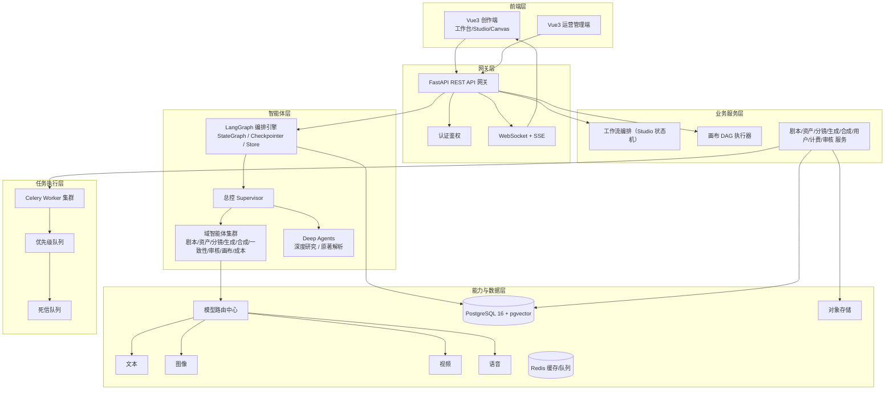
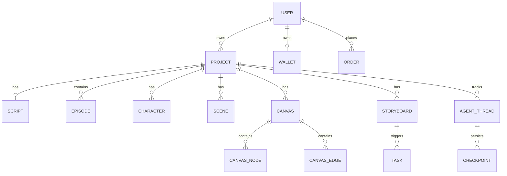

# PRD：漫序 MangaFlow · AI 漫剧制作平台

> **有序创作，漫无止境。**

---

## 0. 文档信息

| 项目 | 内容 |
| ---- | ---- |
| 产品名称 | 漫序 MangaFlow |
| 文档版本 | v1.1 |
| 创建日期 | 2026-10-08 |
| 文档类型 | 产品需求文档（PRD） |
| 作者 | 产品经理（司南） |
| 评审人 | 待定（研发负责人 / 算法负责人 / 测试负责人） |
| 状态 | 评审中 |
| 关联文档 | 《漫序 MangaFlow 产品设计方案 V1.2》（架构与详细设计） |
| 基线文档 | 《AI漫剧制作平台产品需求文档（PRD）优化版》V1.1 |

**变更记录**

| 版本 | 日期 | 变更内容 | 作者 |
| ---- | ---- | -------- | ---- |
| v1.0 | 2026-10-08 | 初稿：整合双引擎架构、六大核心模块、三框架多智能体能力，形成可评审 PRD | 司南 |
| v1.1 | 2026-10-08 | 新增附录 D「评审决议记录」：逐模块评审（剧本/资产/分镜/生成/审核/画布/平台）共 57 条决议留痕，关联需求编号，不改动既有编号体系；补齐 S-10、PL-26~PL-29、C/V/AD/SYS 编号段 | 司南 |
| v1.2 | 2026-10-08 | 追加 RD-58：运营管理端从主仓库 `/admin/*` 拆为**独立 Vue3 仓库**，独立端口/域名部署，与创作端共用 `@mangaflow/design` 设计系统包 | 司南 |

**评审记录**

| 轮次 | 日期 | 参与角色 | 结论 |
| ---- | ---- | -------- | ---- |
| 第 1 轮 | 待定 | 产品 / 研发 / 算法 / 测试 | 待评审 |

---

## 1. 需求摘要

| 项 | 内容 |
| -- | ---- |
| 产品名称 | 漫序 MangaFlow |
| 一句话定位 | 面向内容创作者与机构的一体化 AI 漫剧生产平台，以「流水线 + 无限画布」双引擎承载从灵感到成片的全链路 |
| 目标用户 | 独立创作者、小说作者、MCN 机构、教育/企业、视觉探索者 |
| 核心场景 | ①一句话创意 → 成片；②小说批量改编；③画布自由探索与精修 |
| 业务目标 | 漫剧制作周期从数周压缩至小时级，综合成本降低 70% 以上 |
| 优先级 | P0（MVP 跑通 Studio 单用户全流程闭环） |
| 期望上线 | MVP：第 12 周；完整版：第 16 周 |
| 核心模块 | 剧本创作、资产管理、分镜设计、内容生成、审核与发布、AI 画布 |

**双引擎一句话说明**

- **Studio 引擎（有序创作）**：结构化五阶段流水线，强约束、可批量、可交付。
- **Canvas 引擎（漫无止境）**：无限画布节点编排，自由探索、可试错、可精修。
- 二者共享资产 / 提示词 / 模型 / 素材 / 计费 / 审核 / 版本底座，并支持双向联动。

---

## 2. 背景与目标

### 2.1 背景

漫剧（动态漫画）已成为短视频平台的重要内容形态，但当前制作链路存在三个结构性痛点：

| 痛点 | 现状 | 影响 |
| ---- | ---- | ---- |
| **周期长、成本高** | 编剧、分镜、原画、配音、剪辑多工种串联，一部剧集成片需数周 | 中小创作者与机构难以规模化产出 |
| **技能门槛高** | 需同时具备编剧、绘画、剪辑能力 | 有创意的人做不出成片 |
| **角色一致性难控** | 多镜头/多剧集下角色形象易崩坏 | 成片质量不稳定，返工率高 |

同时，现有 AI 工具存在**能力割裂**：文本、图像、视频、配音分散在不同工具中，缺乏统一资产约束与工作流编排，无法形成"从创意到成片"的闭环。

**机会点**：以大模型能力为基础，用「工业流水线 + 自由画布」双形态承接不同创作诉求，并以统一的资产强约束机制解决角色一致性问题。

### 2.2 目标

**业务目标**

1. 跑通「创意 → 剧本 → 资产 → 分镜 → 生成 → 发布」单用户全流程闭环。
2. 形成可复用的视觉资产飞轮，降低边际创作成本。
3. 建立平台化能力（模型可插拔、计费配额、运营后台、内容合规），为规模化做准备。

**用户价值**

| 用户 | 获得的价值 |
| ---- | ---------- |
| 独立创作者 | 零门槛、低成本、快速出片，风格可定制 |
| 小说作者 | 原著忠实还原、批量生产、多剧集管理 |
| MCN 机构 | 工业化流水线、成本可控、团队协作 |
| 教育/企业 | 快速产出、可视化展示、品牌风格统一 |
| 视觉探索者 | 自由画布、快速试错、素材沉淀 |

### 2.3 成功指标与口径

| 编号 | 指标 | 口径定义 | 目标值 | 统计周期 |
| ---- | ---- | -------- | ------ | -------- |
| M-01 | 注册→首片转化率 | 完成一次成片导出的新用户数 ÷ 新注册用户数 | ≥ 35% | 周 |
| M-02 | 核心闭环完成率 | 完成全部五阶段的项目数 ÷ 新建项目数 | ≥ 60% | 周 |
| M-03 | 首生成满意度 | 用户对首次生成结果执行「满意/锁定」的比例（不含重生成） | ≥ 70% | 周 |
| M-04 | 角色一致性投诉率 | 一致性相关投诉工单数 ÷ 生成任务总数 | ≤ 5% | 月 |
| M-05 | 单集成片耗时 | 从项目创建到首次导出成片的中位时长 | ≤ 2 小时（估算） | 周 |
| M-06 | 7 日留存 | 第 7 日仍有活跃行为的用户 ÷ 首周新增用户 | ≥ 30% | 周 |
| M-07 | 付费转化率 | 产生付费的用户 ÷ 活跃用户 | ≥ 3%（估算） | 月 |

> 说明：标注「估算」的为立项期预估目标，上线后依据真实数据校准。

---

## 3. 名词与术语定义

| 术语 | 定义 |
| ---- | ---- |
| 漫剧 | 动态漫画（Motion Comics），静态画面 + 动态效果 + 配音的短视频形式 |
| Studio 引擎 | 漫序的结构化五阶段流水线引擎（有序创作） |
| Canvas 引擎 | 漫序的无限画布节点编排引擎（漫无止境） |
| 关键帧 | 分镜中的核心静态画面，作为视频生成的起止参考 |
| 定妆照 | 角色标准参考图像，用于约束后续生成中角色形象一致性 |
| 分镜 | 剧本拆解后的单镜头脚本，含画面、景别、运镜、时长、对白 |
| 资产锁定 | 资产确认后固定为下游强制约束、防止被无意覆盖的状态 |
| DAG | 有向无环图，画布的节点-连线执行模型 |
| 逻辑模型 | 面向业务的能力抽象，可绑定多个上游渠道并按优先级路由 |
| LangGraph | 多智能体协作编排框架（本项目主力编排层） |
| LangChain | 组件层框架，提供模型 / 工具 / 检索 / 解析的最小化封装 |
| Deep Agents | 深度任务框架，提供长程规划、子智能体与虚拟文件系统 |
| 检查点 Checkpoint | 图状态持久化快照，等同阶段版本快照，支撑断点续跑与回退 |
| Store | LangGraph 长期记忆存储，支撑跨会话语义检索 |
| HITL | Human-in-the-loop，人机协同（人工确认后继续） |
| 积分 | 平台计费单位，不同模型消耗不同积分 |

---

## 4. 用户场景

### 4.1 目标用户画像

| 画像 | 身份背景 | 核心目标 | 典型痛点 | 能力水平 |
| ---- | -------- | -------- | -------- | -------- |
| **小漫（独立创作者）** | 个人 IP 运营者，1 人运营 2-3 个账号 | 低成本、高频出片 | 没绘画/剪辑功底，工具链割裂 | 新手 |
| **老白（小说作者）** | 网文作者，拥有长篇原著 | 原著可视化、忠实还原 | 原著长文本难结构化，人物关系复杂 | 熟练 |
| **MCN 制作组** | 5-10 人团队，运营账号矩阵 | 工业化批量生产、成本可控 | 角色一致性差，返工率高 | 熟练 |
| **教务/品牌方** | 教育机构、企业市场部 | 快速产出教学/宣传漫剧 | 不懂影视语言，模板化需求强 | 新手 |
| **阿探（视觉探索者）** | 概念设计师、AI 绘画爱好者 | 快速试验风格与构图 | 现有工具无法编排多步流程 | 熟练 |

### 4.2 用户故事

| 编号 | 用户故事 | 验收标准（Given/When/Then） |
| ---- | -------- | --------------------------- |
| US-01 | 作为**独立创作者**，我想输入一句话创意就得到完整剧本，以便快速验证选题 | Given 我在新建项目页，When 我输入一句话并选择体裁风格，Then 系统流式生成含角色/场景/分场对话的结构化剧本 |
| US-02 | 作为**小说作者**，我想上传小说自动解析章节与人物，以便忠实改编 | Given 我上传 ≤20MB 的 txt/epub，When 解析完成，Then 输出章节列表与角色/场景清单，准确率 ≥90% |
| US-03 | 作为**MCN 制作组**，我想批量生成角色定妆照并锁定，以便后续镜头形象统一 | Given 剧本已确认，When 我触发批量资产生成并点击「锁定」，Then 下游生成默认引用该约束且面部相似度 ≥90% |
| US-04 | 作为**独立创作者**，我想让剧本一键拆成专业分镜，以便省去影视语言学习成本 | Given 剧本已确认，When 我点击「生成分镜」，Then 输出含景别/运镜/时长/对白的分镜表，时长误差 ±10% |
| US-05 | 作为**MCN 制作组**，我想批量生成关键帧与视频片段，以便规模化生产 | Given 分镜已确认，When 我提交批量生成，Then 任务进入队列、页面不阻塞、失败自动重试 3 次 |
| US-06 | 作为**独立创作者**，我想对不满意的片段单独重生成，以便不必全量重做 | Given 成片已合成，When 我点击某分镜「重生成」，Then 系统定位该片段重生成并自动更新成片，无需全量合成 |
| US-07 | 作为**视觉探索者**，我想在无限画布上自由编排节点试错，以便探索视觉方案 | Given 我进入画布，When 我添加节点并连线执行，Then 结果写回对应节点，支持撤销/重做与自动保存 |
| US-08 | 作为**视觉探索者**，我想把画布里的满意产物存回项目，以便在流水线中复用 | Given 画布产物已生成，When 我点击「沉淀入资产库」，Then 产物登记为项目资产并记录来源 |
| US-09 | 作为**教务/品牌方**，我想确认成片合规后再导出，以便规避内容风险 | Given 成片已合成，When 我点击导出，Then 系统执行文本/图片/视频三重机审，通过后输出无水印 MP4 |
| US-10 | 作为**所有用户**，我想在生成前知道要花多少积分，以便控制成本 | Given 我提交生成任务，When 系统完成前置校验，Then 展示积分预估并要求我确认后执行，误差 <10% |

### 4.3 使用场景

**场景 1：小漫的"一句话到成片"（主流程）**

- **触发条件**：小漫刷到热门漫剧，想快速做一条同类内容。
- **用户行为**：新建项目 → 输入一句话创意 + 选「都市/二次元」→ 流式生成剧本 → 一键确认 → 批量生成并锁定角色/场景 → 一键生成分镜 → 拖拽微调 → 批量生成关键帧与视频 → 一键合成 → 预览确认 → 导出 9:16 MP4。
- **预期结果**：2 小时内拿到可发布的无水印成片。

**场景 2：MCN 的批量与团队协作**

- **触发条件**：制作组需为一部长篇原著产出 30 集漫剧。
- **用户行为**：多剧集管理 → 复用已锁定资产 → 批量生成分镜与镜头 → 任务队列并行执行 → 失败任务集中排查重试 → 逐集审核发布。
- **预期结果**：资产复用降低返工，批量任务并行执行，单集边际成本显著下降。

**场景 3：阿探的画布精修与回流**

- **触发条件**：流水线某项关键帧效果不满意，需要更自由的调整。
- **用户行为**：分镜「投递到画布」→ 在子画布中编排节点（资产引用 + 生成 + 合成）→ 反复试错 → 满意后「回填关键帧」。
- **预期结果**：画布产物回填分镜，流水线侧同步更新，无需重做整条流程。

---

## 5. 需求范围

### 5.1 本期包含（In Scope）

| 分类 | 内容 |
| ---- | ---- |
| 创作端 | 工作台、Studio 五阶段（剧本/资产/分镜/生成/发布）、AI 画布、提示词库、素材库、个人中心 |
| 平台能力 | 统一创作 Agent、模型路由中心、多智能体协作层、任务队列、计费配额、内容合规审核 |
| 管理端 | 运营管理后台（经营分析、用户、生成、商品、订单、财务、上游配置、系统、存储、内容） |
| 基础能力 | 认证鉴权、版本快照与回退、操作日志、监控告警 |

### 5.2 本期不包含（Out of Scope）

| 内容 | 说明 | 后续安排 |
| ---- | ---- | -------- |
| 团队实时协作（多人同编辑） | 本期仅支持单用户与版本快照 | 后续版本 |
| 资产交易市场 / 创作者社区 | 生态化能力 | 6-12 个月 |
| 一键发布到抖音/视频号 | 依赖第三方平台 API 审批 | P2，视商务进展 |
| 定制化模型训练 | 需算法与算力储备 | 后续版本 |
| 移动端 App | 本期桌面端优先，平板端基础可用 | 后续版本 |
| 画布插件市场与本地 Agent 深度集成 | 插件体系先跑通 SDK | P2 |

### 5.3 范围边界说明

- 本期**不承诺**任何具体成片质量分级标准，只承诺"环节可确认、可重生成、可回退"的可控性。
- 视频生成时长为异步任务，受第三方模型服务影响，**不承诺**固定完成时间，只承诺状态可查、失败可重试。
- 涉及资金与配额的能力按「幂等 + 对账 + 资损监控」三件套执行，不可削减。

---

## 6. 方案对比与选型说明

### 6.1 创作形态选型

| 方案 | 实现成本 | 开发复杂度 | 用户体验 | 风险 | 上线时间 | 综合评价 |
| ---- | -------- | ---------- | -------- | ---- | -------- | -------- |
| A. 纯流水线 | 低 | 低 | 中（可控但缺自由） | 低 | 快 | 备选（无法承接探索类需求） |
| B. 纯画布 | 中 | 高 | 中（自由但门槛高） | 中（新手易迷失） | 中 | 备选（无法保证批量交付） |
| **C. 双引擎共享底座（推荐）** | 中高 | 高 | 高（按需切换） | 中 | 中 | **推荐**：兼顾工业化效率与创作自由度，双方共享资产/提示词/模型/计费，边际成本低 |

**推荐理由**：漫剧生产的核心矛盾是"批量交付"与"自由创作"并存。方案 C 用同一套底座支撑两种形态，并支持双向联动（投递精修 / 沉淀回流），是竞品少有的组合。
**不选 A/B 的原因**：单一形态只能覆盖一半用户诉求，后期补齐需重构，代价更高。

### 6.2 AI 框架选型

| 方案 | 说明 | 评价 |
| ---- | ---- | ---- |
| A. 单 Agent + 直接调用 | 简单 | 无法编排跨阶段流程，无状态、无回滚，不可用 |
| B. 仅 LangGraph 多智能体 | 完整编排 | 可行，但模型/工具抽象与长任务规划能力需自建 |
| **C. 三框架分层（推荐）** | LangGraph 编排 + LangChain 组件（最小化）+ Deep Agents 深度任务 | **推荐**：职责不重叠、复杂度可控、可替换性强 |

**推荐理由**：LangGraph 管"怎么流转"，LangChain 管"单个动作怎么做"，Deep Agents 管"长任务怎么规划到底"，三者分层互补。与团队既有项目技术路线一致，可复用经验。

### 6.3 数据库选型

| 方案 | 优势 | 劣势 | 结论 |
| ---- | ---- | ---- | ---- |
| MySQL 8.0 | 生态成熟、运维熟悉 | JSON 处理能力弱 | 备选 |
| **PostgreSQL 16（推荐）** | JSONB 索引强、契合剧本/画布强 JSON 结构；支持 pgvector 承载记忆检索；与团队其他项目一致 | 运维需适配 | **推荐** |

### 6.4 画布引擎选型

| 方案 | 说明 | 结论 |
| ---- | ---- | ---- |
| 自研轻量内核 | 完全可控，交互范式参考通用做法 | **推荐**（长期可控、可深度定制） |
| 引入开源图编辑器内核 | 上手快 | 备选（定制受限、依赖风险） |

---

## 7. 功能需求

### 7.1 功能清单（总览）

| 模块 | 编号段 | 功能点数 | 主要优先级 |
| ---- | ------ | -------- | ---------- |
| 工作台 Dashboard | D-01 ~ D-06 | 6 | P0/P1/P2 |
| 剧本创作 Script | S-01 ~ S-10 | 10 | 以 P0 为主 |
| 资产管理 Assets | A-01 ~ A-10 | 10 | P0/P1/P2 |
| 分镜设计 Storyboard | SB-01 ~ SB-09 | 9 | P0/P1/P2 |
| 内容生成 Production | P-01 ~ P-17 | 17 | P0/P1/P2 |
| 审核与发布 Publish | R-01 ~ R-09 | 9 | P0/P1/P2 |
| AI 画布 Canvas | CV-01 ~ CV-25 | 25 | P0/P1/P2 |
| 平台支撑 Platform | PL-01 ~ PL-29 | 29 | P0/P1/P2 |
| 多智能体协作 Multi-Agent | MA-01 ~ MA-20 | 20 | P0/P1 |
| 用户与系统 User | U-01 ~ U-06 | 6 | P0/P1/P2 |
| 内容合规审核 Compliance | C-01 ~ C-04 | 4 | P0/P1 |
| 版本管理与协作 Version | V-01 ~ V-04 | 4 | P1/P2 |
| 运营管理后台 Admin | AD-01 ~ AD-05 | 5 | P0/P1 |
| 系统基础能力 System | SYS-01 ~ SYS-03 | 3 | P0/P1 |

### 7.2 工作台（Dashboard）

| 编号 | 需求描述 | 优先级 | 验收标准 |
| ---- | -------- | ------ | -------- |
| D-01 | 项目列表，支持卡片/列表视图，展示名称、状态、时间、封面 | P0 | 加载 <1s，100+ 项目流畅滚动 |
| D-02 | 项目搜索、筛选（状态/时间/体裁）、排序（创建/更新时间） | P1 | 搜索响应 <500ms，多条件组合 |
| D-03 | 「新建项目」快速入口 | P0 | 入口醒目，点击 1s 内进入创建页 |
| D-04 | 今日/本月创作统计（项目数、图片数、视频时长、消耗配额） | P2 | 数据误差 <5% |
| D-05 | 系统公告与模型状态提醒，异常模型标红 | P2 | 支持置顶，状态更新 <1min |
| D-06 | 最近编辑项目置顶，一键继续创作 | P1 | 记录最近 3 个编辑项目 |

**关键功能详情：新建项目（D-03）**

- **需求描述**：用户从工作台发起新项目，完成创意输入与元信息配置，进入剧本创作阶段。
- **交互流程**：
  1. 点击「新建项目」→ 弹出创意输入对话框；
  2. 选择输入模式（一句话 / 上传文件 / 粘贴大纲）；
  3. 配置标题、体裁、风格、目标时长/集数、输出画幅；
  4. 提交 → 进入剧本阶段，流式展示生成过程。
- **页面元素**：

| 元素 | 类型 | 说明 | 校验规则 |
| ---- | ---- | ---- | -------- |
| 输入模式切换 | Tab | 三选一 | 必选 |
| 创意输入框 | 文本域 | 一句话或大纲 | 1-2000 字；模式①必填 |
| 文件上传 | 上传 | .txt/.epub | ≤20MB；模式②必填 |
| 标题 | 输入框 | 项目名 | 1-100 字，必填 |
| 体裁/风格 | 下拉 | 内置预设 + 自定义 | 必选 |
| 目标时长/集数 | 数字输入 | 时长（分钟）/集数 | 时长 1-60；集数 1-100 |
| 输出画幅 | 单选 | 9:16 / 16:9 / 1:1 | 默认 9:16 |

- **异常处理**：
  - 文件格式不支持 → 前端即时拦截并提示支持格式；
  - 文件超限 → 提示大小上限并阻止上传；
  - 提交时模型不可用 → 提示并允许稍后重试或更换模型。
- **埋点需求**：
  - `project_create_dialog_open`：点击新建入口时；
  - `project_create_submit`：提交创建时（上报 input_mode、genre、style、aspect_ratio）。

### 7.3 模块一：剧本创作（Script）

| 编号 | 需求描述 | 优先级 | 验收标准 |
| ---- | -------- | ------ | -------- |
| S-01 | 三种输入模式：一句话创意 / 上传 .txt·.epub 小说 / 粘贴大纲剧本 | P0 | 支持 20MB 以内文件，章节解析准确率 ≥90% |
| S-02 | 配置项目元信息：标题、体裁、风格、目标时长/集数、画幅 | P0 | 体裁风格内置预设且支持自定义 |
| S-03 | 调用文本模型生成结构化剧本（角色设定/场景描述/分场对话与动作） | P0 | 首 Token <3s，流式输出，贴合体裁风格 |
| S-04 | 剧本以结构化 JSON 存储（角色列表/场景列表/场次数组/对话与动作） | P0 | 格式规范，下游可直接解析 |
| S-05 | 剧本在线富文本编辑，大纲导航 + 详情编辑双栏，改动实时同步结构化数据 | P0 | 编辑无卡顿，撤销/重做 ≥20 步 |
| S-06 | 多集/多剧集管理，剧集间数据隔离、资产复用 | P1 | 剧集数无上限，支持跨剧集复制分镜 |
| S-07 | 剧本质量智能评分（对话密度、节奏起伏、角色出场均衡性）+ 优化建议 | P2 | 评分维度可解释，建议可落地 |
| S-08 | 剧本一键同步到统一创作 Agent 或画布继续创作 | P1 | 保留上下文，失败可重试 |
| S-09 | 生成失败展示具体原因，支持重试/换模型/精简输入三种解决路径 | P0 | 失败 10s 内反馈，重试成功率 ≥80% |
| **S-10** | **角色 / 场景 / 道具自动提取**：实体识别、别名归一、描述冲突标记，人工确认后生成资产卡 | P0 | 提取准确率 ≥90%，别名合并关系可视化，冲突项须人工裁决 |

**关键功能详情：结构化剧本生成（S-03/S-04）**

- **需求描述**：调用文本模型（经 LangChain 统一封装、由剧本 Agent 执行）生成结构化剧本，作为全链路下游的数据源。
- **交互流程**：
  1. 提交生成 → 右侧流式展示生成过程，左侧保留原始输入；
  2. 生成完成 → 自动渲染为结构化视图（角色卡 / 场景卡 / 分场对话）；
  3. 用户确认 → 自动提取角色与场景列表，进入资产管理。
- **业务规则**：
  - 角色名在同一项目内必须唯一；
  - 场景名可复用，同一场景多次出现合并为一条场景记录；
  - 剧本 JSON 必须通过 Schema 校验，校验失败触发模型重试（最多 3 次）。
- **异常处理**：
  - 模型输出非法 JSON → 自动修复/重试，仍失败则提示并保留原始文本；
  - 生成中断（断网/超时）→ 从检查点续跑，已生成内容不丢失；
  - 输入内容过长 → 提示精简或启用 Deep Agents 长文本解析。
- **埋点需求**：
  - `script_generate_start`（上报 input_mode、model、genre）；
  - `script_generate_success` / `script_generate_fail`（上报耗时、token、失败原因）；
  - `script_confirm`。

### 7.4 模块二：资产管理（Assets）

| 编号 | 需求描述 | 优先级 | 验收标准 |
| ---- | -------- | ------ | -------- |
| A-01 | 基于角色描述自动生成定妆照（正面/侧面/半身 3 角度），面部特征统一 | P0 | 同角色不同角度面部相似度 ≥90% |
| A-02 | 同角色多套造型（日常/战斗/礼服等），保留面部核心特征 | P1 | 换装后识别准确率 ≥85% |
| A-03 | 基于场景描述生成概念图（全景/中景 2 视角），支持光线氛围切换 | P0 | 场景元素与描述匹配度 ≥90% |
| A-04 | 支持上传参考图作为视觉锚点，图生图生成角色/场景 | P1 | 参考图风格还原度 ≥80% |
| A-05 | 资产画廊视图，支持增删改、标签搜索、批量删除与分类 | P0 | 100+ 资产流畅浏览 |
| A-06 | 为每个资产生成标准化视觉提示词与特征标签，下游自动约束 | P0 | 提示词可编辑，修改后全链路同步 |
| A-07 | 道具资产管理：上传、分类、标注，生成时可插入画面 | P1 | 支持按类别筛选 |
| A-08 | 资产一致性校验：检测同角色不同资产面部差异，超阈值预警 | P1 | 阈值可配，预警准确率 ≥80% |
| A-09 | **资产锁定**：确认后锁定为下游强制约束，防止被无意覆盖 | P0 | 锁定后下游生成默认引用该约束 |
| A-10 | **双向联动**：接收画布「沉淀入资产库」；支持资产「发送到画布」 | P1 | 联动保留来源标记与版本 |

**关键功能详情：资产批量生成与锁定（A-01/A-09）**

- **需求描述**：系统识别剧本中的角色与场景，批量生成资产；用户逐项确认后锁定为下游约束。
- **交互流程**：
  1. 自动识别角色/场景 → 按顺序批量生成，展示进度；
  2. 每张资产可执行「满意（锁定）/ 重生成 / 编辑提示词 / 上传替换」；
  3. 确认后自动锁定，作为后续所有画面生成的强制约束。
- **业务规则**：
  - 面部相似度低于阈值（默认 90%）自动重生成，最多 2 次；
  - 锁定资产在下游不可被无意覆盖，需显式解锁；
  - 资产提示词修改后，未生成的下游节点自动同步生效。
- **异常处理**：
  - 生成失败 → 单张重试，连续失败进入人工介入提示；
  - 一致性校验不通过 → 提示差异并提供重生成/上传替换；
  - 资产删除被下游引用 → 阻止删除并提示引用位置。
- **埋点需求**：
  - `asset_batch_generate`（上报角色数/场景数）；
  - `asset_lock` / `asset_unlock`；
  - `asset_consistency_warn`（上报差异值、角色 ID）。

### 7.5 模块三：分镜设计（Storyboard）

| 编号 | 需求描述 | 优先级 | 验收标准 |
| ---- | -------- | ------ | -------- |
| SB-01 | AI 将剧本拆解为分镜序列（编号/画面描述/景别/运镜/时长/对白/涉及角色/场景） | P0 | 符合影视语言规范，时长总和误差 ±10% |
| SB-02 | 分镜表网格/列表视图切换，拖拽调整顺序 | P0 | 拖拽流畅，顺序变更后编号自动重排 |
| SB-03 | 手动编辑分镜全字段，支持新增/删除/拆分/合并 | P0 | 编辑后实时更新总时长统计 |
| SB-04 | 自动生成分镜绘图提示词，融合角色资产 + 场景资产 + 运镜信息 | P0 | 提示词含主体/场景/风格/镜头/光影 5 类要素 |
| SB-05 | 节奏预览：基于时长生成叙事节奏曲线，标注高潮与平缓点 | P1 | 曲线可交互，点击分镜高亮 |
| SB-06 | 连续性检查：检测相邻分镜站位/方位/服装矛盾并给建议 | P2 | 检测准确率 ≥70% |
| SB-07 | 设定目标总时长与镜头密度，自动调整分镜数量与单镜时长 | P1 | 调整后总时长误差 <5% |
| SB-08 | 批量导出分镜表为 PDF/Excel | P2 | 格式规范，含全部字段 |
| SB-09 | **投递到画布**：分镜一键投递为画布子图精修，产物可回填 | P1 | 保留资产约束与上下文，回填定位准确 |

**关键功能详情：分镜拆解与提示词生成（SB-01/SB-04）**

- **需求描述**：将剧本场次拆解为镜头，并自动生成融合资产约束的绘图提示词。
- **交互流程**：剧本确认 → 点击「生成分镜」→ 输出分镜表 → 三栏编辑（左剧本原文/中分镜卡片/右单镜面板）→ 拖拽与微调 → 确认。
- **业务规则**：
  - 提示词必须包含角色资产视觉特征与场景资产引用；
  - 分镜时长总和与目标时长误差需在 ±10% 内，超出给出提示；
  - 分镜新增/删除后自动重排编号并更新总时长。
- **异常处理**：
  - 剧本信息不足（缺场景/对白）→ 提示补充或由模型补全并标注；
  - 分镜数量为 0 → 提示拆解失败并提供手动新增入口。
- **埋点需求**：`storyboard_generate`、`storyboard_edit`、`storyboard_to_canvas`（投递画布）。

### 7.6 模块四：内容生成（Production）

**7.6.1 关键帧生成**

| 编号 | 需求描述 | 优先级 | 验收标准 |
| ---- | -------- | ------ | -------- |
| P-01 | 基于提示词 + 角色约束 + 场景约束批量生成关键帧 | P0 | 与定妆照一致性 ≥85% |
| P-02 | 单张 / 选中批量 / 全量批量三种模式 | P0 | 批量走任务队列，不阻塞页面 |
| P-03 | 支持首帧 + 尾帧双关键帧 | P1 | 首尾帧画面连贯一致 |
| P-04 | 结果缩略图嵌入分镜表，hover 放大预览 | P0 | 缩略图加载 <500ms |
| P-05 | 单张/批量重生成，可保留或修改原提示词 | P0 | 重生成记录可追溯 |
| P-06 | 上传自定义图片替换 AI 结果，自动适配尺寸与风格 | P1 | 支持常见格式，≤20MB |

**7.6.2 视频片段生成**

| 编号 | 需求描述 | 优先级 | 验收标准 |
| ---- | -------- | ------ | -------- |
| P-07 | 基于关键帧 + 运镜描述生成 4-12s 片段，默认 24fps | P0 | 画面流畅无闪烁，运镜符合描述 |
| P-08 | 图生视频 / 首尾帧约束生成两种模式 | P0 | 首尾帧模式起止还原度 ≥90% |
| P-09 | 异步任务队列：提交后可离开页面，完成后站内 + 浏览器双通知 | P0 | 支持优先级、暂停/取消 |
| P-10 | 任务状态实时展示（排队/生成/完成/失败 + 进度） | P0 | 状态更新延迟 <3s |
| P-11 | 失败自动重试（默认 3 次，指数退避），超限展示原因并支持人工介入 | P0 | 自动重试成功率 ≥60% |
| P-12 | 视频参数配置：分辨率、帧率、运动幅度 | P1 | 参数修改对后续任务生效 |

**7.6.3 配音与合成**

| 编号 | 需求描述 | 优先级 | 验收标准 |
| ---- | -------- | ------ | -------- |
| P-13 | 基于对白/旁白生成配音，多角色音色区分，语速语调可调 | P0 | 音色贴合人设，吐字清晰 |
| P-14 | BGM 自动匹配（按风格推荐）+ 支持上传自定义音频 | P1 | 音量自动 ducking，不盖人声 |
| P-15 | 自动剪辑合成：按分镜顺序拼接，叠加配音/字幕/转场，输出成片 | P0 | 音画同步误差 <100ms |
| P-16 | 自定义字幕样式（字体/大小/颜色/描边/位置），支持双语 | P1 | 字幕与对白时间轴精准对齐 |
| P-17 | 转场特效（淡入淡出/叠化/闪黑），默认自动适配场景切换 | P2 | 转场时长可配，默认 0.5s |

**关键功能详情：批量生成与任务队列（P-02/P-09/P-10/P-11）**

- **需求描述**：批量生成任务异步执行，状态实时可查，失败自动重试。
- **交互流程**：选择生成范围 → 提交 → 前置校验（能力/素材/参数/积分）→ 展示积分预估并确认 → 任务入队 → 全局任务面板展示进度 → 完成后通知。
- **业务规则**：
  - 一次生成任务只调用一次上游创建接口，轮询只查同一任务（**幂等**）；
  - 只有上游明确失败且用户点击重试，才创建新 attempt，避免重复消耗；
  - 失败自动重试 3 次（指数退避），超阈值进入死信队列。
- **异常处理**：
  - 积分不足 → 阻断提交并给出充值入口；
  - 参数非法 → 提交前拦截并指明字段；
  - 任务超时 → 标记失败并支持重试；
  - 上游限流 → 排队降级 + 备用渠道路由。
- **埋点需求**：`generate_submit`（类型/数量/预估积分）、`generate_task_status`、`generate_retry`、`generate_fail`。

### 7.7 模块五：审核与发布（Publish）

| 编号 | 需求描述 | 优先级 | 验收标准 |
| ---- | -------- | ------ | -------- |
| R-01 | 集成视频播放器（进度/音量/倍速/全屏） | P0 | 播放流畅，支持 0.5x-2x |
| R-02 | 分镜级跳转：点击分镜列表跳到对应时间点 | P1 | 跳转误差 <0.1s |
| R-03 | 单片段一键回退重生成，自动定位对应分镜 | P0 | 重生成后自动更新成片，无需全量合成 |
| R-04 | 导出 MP4（720P/1080P/2K），码率可配 | P0 | 无水印，画质清晰 |
| R-05 | 三种输出比例：9:16 / 16:9 / 1:1 | P0 | 智能裁剪，主体居中 |
| R-06 | 生成分享链接与预览二维码，支持有效期与访问密码 | P2 | 分享页无需登录可预览 |
| R-07 | 一键发布到抖音/视频号等平台（API 对接） | P2 | 发布成功返回链接 |
| R-08 | **全链路合规审核**：文本/图片/视频三重机审 + 人工复核队列 | P0 | 违规拦截率 ≥99%，通过后方可导出 |
| R-09 | 成片添加**隐形溯源水印** | P0 | 不影响观感且可溯源 |

**关键功能详情：合规审核与导出（R-08/R-09/R-04）**

- **需求描述**：导出前执行全链路合规检测，通过后输出带溯源水印的成片。
- **交互流程**：点击导出 → 三重机审（文本/图片/视频）→ 通过则输出；疑似进入人工复核队列 → 复核通过后输出 → 添加隐形水印。
- **业务规则**：
  - 检测到色情、暴力、政治敏感等内容立即终止并提示；
  - 多次违规用户按分级处罚（限流 / 封禁）；
  - 所有导出成片均添加隐形溯源水印。
- **异常处理**：
  - 机审服务不可用 → 进入人工队列，不静默放行；
  - 审核中驳回 → 明确告知原因与可修改点。
- **埋点需求**：`publish_review_pass` / `publish_review_reject`（上报违规类型）、`publish_export`。

### 7.8 模块六：AI 画布（Canvas）

**7.8.1 画布管理**

| 编号 | 需求描述 | 优先级 | 验收标准 |
| ---- | -------- | ------ | -------- |
| CV-01 | 多画布项目：创建、搜索、重命名、删除、复制、归档 | P0 | 50+ 画布流畅管理 |
| CV-02 | 画布与项目/剧集关联，可作为独立空间或 Studio 精修子画布 | P1 | 关联清晰，可双向跳转 |
| CV-03 | 画布导入/导出（JSON），支持迁移与备份 | P1 | 导出可完整还原节点与连线 |

**7.8.2 节点与连线**

| 编号 | 需求描述 | 优先级 | 验收标准 |
| ---- | -------- | ------ | -------- |
| CV-04 | 10 类节点：文本/图像/视频/音频/生成/资产引用/分镜/合成/逻辑/分组 | P0 | 添加路径 ≤2 步 |
| CV-05 | 节点拖拽、缩放、多选、对齐吸附、编组、折叠 | P0 | 操作流畅，60fps |
| CV-06 | 端口连线定义数据流，支持一对多/多对一，非法连线校验 | P0 | 类型不匹配给出提示 |
| CV-07 | 生成节点接收上游约束，结果自动写回对应节点 | P0 | 落位准确，可追溯来源 |
| CV-08 | 资产引用节点实时同步资产库锁定态约束 | P0 | 资产更新后提示刷新 |

**7.8.3 交互与导航**

| 编号 | 需求描述 | 优先级 | 验收标准 |
| ---- | -------- | ------ | -------- |
| CV-09 | 无限画布：平移、缩放（10%-400%）、小地图、缩放适配 | P0 | 500+ 节点流畅 |
| CV-10 | 撤销/重做/历史记录（≥50 步） | P0 | 操作可逆，历史可视化 |
| CV-11 | 自动保存（防抖 2s）+ 手动保存，断线重连恢复 | P0 | 不丢数据，恢复提示明确 |
| CV-12 | 画布内搜索与定位、批量选择与批量操作 | P1 | 搜索响应 <500ms |
| CV-13 | 框选、复制粘贴、跨画布复制节点子树 | P1 | 复制保留连线关系 |

**7.8.4 画布助手与扩展**

| 编号 | 需求描述 | 优先级 | 验收标准 |
| ---- | -------- | ------ | -------- |
| CV-14 | 围绕选中节点 + 上游节点对话，理解上下文 | P0 | 能读取上游节点内容并引用 |
| CV-15 | 助手执行生成并把结果插回画布为新节点 | P0 | 自动连线到相关上游 |
| CV-16 | 一句话生成子图（自动生成一组节点与连线） | P1 | 结构合法，可继续编辑 |
| CV-17 | 助手支持引用提示词库与资产库 | P1 | 引用后提示词自动补全 |
| CV-18 | 助手操作全程留痕，可回退 | P1 | 操作日志可查 |
| CV-19 | 本地 Agent 桥接（MCP），外部 Agent 可操作当前画布 | P2 | 连接成功后可读写节点 |
| CV-20 | 插件系统：URL 动态安装/启用/更新/卸载节点插件 | P2 | 安装后节点类型自动注册 |
| CV-21 | 节点插件 SDK（TypeScript），支持自定义节点开发 | P2 | SDK 文档完整，示例可跑通 |
| CV-22 | 插件沙箱与权限声明，防恶意插件越权 | P2 | 高风险权限需显式授权 |

**7.8.5 与 Studio 双向联动**

| 编号 | 需求描述 | 优先级 | 验收标准 |
| ---- | -------- | ------ | -------- |
| CV-23 | **投递精修**：Studio 分镜生成子画布，携带资产约束与上下文 | P1 | 子画布保留原提示词与资产引用 |
| CV-24 | **沉淀回流**：画布产物登记为资产 / 回填指定分镜关键帧 | P1 | Studio 侧同步更新并记录来源 |
| CV-25 | 画布与 Studio 共享提示词库/素材库/模型路由/配额 | P0 | 两端配置一致生效，用量统一计量 |

**关键功能详情：画布执行（CV-06/CV-07）**

- **需求描述**：画布为有向无环图（DAG），节点为计算单元、连线为数据依赖，支持增量执行。
- **交互流程**：添加节点 → 端口连线 → 选择执行方式（手动运行选中 / 画布助手 / 全图 DAG 执行）→ 生成类节点转异步任务 → 结果写回节点 → 自动保存。
- **业务规则**：
  - 连线时做**环检测**，禁止成环（逻辑节点提供显式循环语义）；
  - **增量执行**：只重算"脏节点"及其下游，未变更上游复用缓存结果；
  - 需要智能体介入的节点内部调用 LangGraph 子图。
- **异常处理**：
  - 非法连线 → 提示类型不匹配并拒绝连接；
  - 节点执行失败 → 节点标红，展示原因并支持重试；
  - 画布过大导致卡顿 → 视口裁剪 + 增量渲染保障流畅。
- **埋点需求**：`canvas_create`、`canvas_node_add`（上报 node_type）、`canvas_run`、`canvas_agent_invoke`、`canvas_sink_asset`（沉淀回流）。

### 7.9 平台支撑（Platform）

| 编号 | 需求描述 | 优先级 |
| ---- | -------- | ------ |
| PL-01 | 统一输入：文本/图片/视频/音频混合输入 | P0 |
| PL-02 | 意图路由：自动判定能力类型并选择逻辑模型 | P0 |
| PL-03 | Skill 选择：选择创作技能（如"分镜生成""角色定妆"） | P1 |
| PL-04 | 参数偏好：风格、比例、时长、清晰度等，可保存为默认 | P1 |
| PL-05 | 前置校验：能力/素材/参数/积分四重校验 | P0 |
| PL-06 | 结果处理：预览/下载/存为素材/继续创作/发送到画布或 Studio | P0 |
| PL-07 | 模型渠道托管与健康检测 | P0 |
| PL-08 | 逻辑模型路由 + 优先级 + 故障自动降级 | P0 |
| PL-09 | 三级配置优先级：任务级 > 项目级 > 全局默认 | P1 |
| PL-10 | 成本估算：提交前预估积分，确认后执行，误差 <10% | P1 |
| PL-11 | 模型效果对比与切换引导 | P2 |
| PL-12 | 公共提示词库（分类/标签/关键词检索） | P1 |
| PL-13 | 我的提示词（增删改查/分类/收藏，可存为文本素材） | P1 |
| PL-14 | 提示词一键应用于 Agent / 画布 / Studio | P1 |
| PL-15 | 标准 JSON 来源导入提示词集 | P2 |
| PL-16 | 全类型素材管理（图片/视频/音频/文本） | P0 |
| PL-17 | 素材来源标记（AI 生成/用户上传/画布/Studio） | P1 |
| PL-18 | 素材发送到 Agent / 画布 / Studio | P1 |
| PL-19 | 引用保护删除（删除前检查引用） | P1 |
| PL-20 | 配额体系：免费每日额度，订阅提升额度并解锁高级功能 | P0 |
| PL-21 | 积分充值：按积分充值，不同模型消耗不同积分，明细可查 | P0 |
| PL-22 | 订阅管理：月卡/年卡，权益对比，自动续费与取消 | P1 |
| PL-23 | 订单管理：充值/订阅订单，支持发票申请 | P1 |
| PL-24 | 配额预警：剩余 <20% 提醒，耗尽自动降级免费版 | P1 |
| PL-25 | 资金底线三件套：幂等（幂等键 + 唯一上游扣费）、对账（每日）、资损监控（重复扣费/异常退款/负余额告警） | P0 |
| PL-26 | 模型库展示：按能力分类（文本/图像/视频/TTS） | P0 |
| PL-27 | 模型详情：适用场景、风格偏向、价格、生成速度、官方文档链接 | P0 |
| PL-28 | 官方默认模型内置，新用户无需配置即可使用 | P0 |
| PL-29 | 模型配置内嵌于各创作环节，无需跳转独立页面即可切换 | P1 |

### 7.10 多智能体协作（Multi-Agent）

> 本节为面向研发的能力型需求，产品侧体现为"统一 Agent 的智能路由与可控执行"。

| 编号 | 需求描述 | 优先级 | 验收标准 |
| ---- | -------- | ------ | -------- |
| MA-01 | 基于最新版 LangGraph StateGraph 构建多智能体协作图 | P0 | 图可编排、可视化、可追踪 |
| MA-02 | 总控 Supervisor 意图识别与任务分派 | P0 | 意图识别准确率 ≥90%，分派正确 |
| MA-03 | 11 类域智能体角色落地 | P0 | 各智能体职责清晰、可独立测试 |
| MA-04 | 共享状态 Schema 与 reducer 分治 | P0 | 并发写无冲突，状态可追溯 |
| MA-05 | Checkpointer 持久化与断点续跑 | P0 | 中断后可恢复，不丢状态 |
| MA-06 | 检查点 = 版本快照，支持一键回退与 Time Travel | P1 | 可回到任一历史状态并分支重跑 |
| MA-07 | Store 长期记忆（资产/提示词/风格）与语义检索 | P1 | 跨会话可检索复用 |
| MA-08 | interrupt 人工确认点与 Command(resume) 反馈注入 | P0 | 各阶段确认可暂停/恢复 |
| MA-09 | 子图封装（一致性、审核）可被多阶段复用 | P1 | 子图可独立调用与测试 |
| MA-10 | Send map-reduce 并行批量生成 | P0 | 批量并行执行并正确汇总 |
| MA-11 | 三种 stream_mode → SSE 前端契约 | P0 | 流式/进度/成本事件正确推送 |
| MA-12 | 工具与 Skill 授权体系，接入模型路由与积分校验 | P0 | 工具调用幂等且计费准确 |
| MA-13 | LangSmith 链路追踪与成本埋点 | P1 | 全链路可追踪、成本可归因 |
| MA-14 | 智能体失败重试与降级策略 | P0 | 超阈值进死信队列，可人工介入 |
| MA-15 | 画布助手 Agent 与画布工具集成 | P1 | 能读写画布并插回结果 |
| MA-16 | LangChain 组件层：统一 ChatModel/Tool/Retriever/OutputParser 封装 | P0 | 多厂商模型与工具可插拔 |
| MA-17 | Deep Agents 深度任务：原著长文本解析与世界观/人物关系抽取 | P1 | 支持长文本，产出结构化世界观与关系图谱 |
| MA-18 | Deep Agents 子智能体派生与虚拟文件系统接入 | P1 | 长任务中间稿可管理、可回溯 |
| MA-19 | 三框架统一工具与记忆口径 | P0 | 三框架共享同一工具契约与记忆口径 |
| MA-20 | 深度研究任务的可观测与成本归因 | P1 | 长任务链路可追踪、成本可归因 |

### 7.11 用户与系统管理（User）

| 编号 | 需求描述 | 优先级 | 验收标准 |
| ---- | -------- | ------ | -------- |
| U-01 | 邮箱/手机号注册登录，支持验证码与密码登录 | P0 | 注册 ≤3 步，登录成功率 ≥99% |
| U-02 | JWT 认证，过期自动刷新，接口权限校验 | P0 | Token 有效期 7 天，无感刷新 |
| U-03 | 用户信息修改、密码重置、绑定第三方账号 | P1 | 重置支持邮箱/手机验证 |
| U-04 | 项目数据导出（结构化数据 + 媒体打包 ZIP） | P2 | 可导入恢复，完整度 100% |
| U-05 | 项目数据导入（ZIP 恢复，支持跨账号） | P2 | 结构完整，资产可复用 |
| U-06 | 用量统计（API 调用、图片/视频数量、存储、剩余配额） | P1 | 按日/周/月展示 |

### 7.12 内容合规审核（Compliance）

> 与 R-08 的关系：R-08 是**发布环节的审核动作**，C-01~C-04 是**平台级合规能力体系**，两者互为支撑。

| 编号 | 需求描述 | 优先级 | 验收标准 |
| ---- | -------- | ------ | -------- |
| C-01 | 全链路内容审核：输入文本、生成图片、生成视频均经合规检测 | P0 | 三类内容均覆盖，违规拦截率 ≥99% |
| C-02 | 违规内容拦截：检测到色情/暴力/政治敏感等内容立即终止生成并提示 | P0 | 即时终止，提示明确 |
| C-03 | 人工审核后台：疑似违规内容进入人工审核队列，通过后方可导出 | P1 | 队列可受理/驳回，留档可查 |
| C-04 | 用户违规记录与分级处罚（限流、封禁） | P1 | 违规记录可追溯，处罚分级可配 |

### 7.13 版本管理与协作（Version）

> V-01 由 LangGraph 检查点实现（与 MA-06 同源）；V-03/V-04 属团队协作，本期不做。

| 编号 | 需求描述 | 优先级 | 验收标准 |
| ---- | -------- | ------ | -------- |
| V-01 | 项目版本快照：每个阶段确认后自动生成快照，支持一键回退 | P1 | 可回退到任一历史版本 |
| V-02 | 操作日志：记录所有编辑与生成操作，可追溯操作人与时间 | P1 | 按项目/用户/时间可查 |
| V-03 | 团队协作：企业版多成员协作，管理员/编辑者/查看者权限 | P2 | 本期不做，记入后续版本 |
| V-04 | 实时协作：多人同时编辑实时同步，避免冲突 | P2 | 本期不做，记入后续版本 |

### 7.14 运营管理后台（Admin）

| 编号 | 需求描述 | 优先级 | 验收标准 |
| ---- | -------- | ------ | -------- |
| AD-01 | 用户管理：创建用户、角色、状态、套餐、积分调整 | P0 | 操作留痕，权限受控 |
| AD-02 | 项目审核：项目/内容审核队列、受理、驳回、备注 | P0 | 与 C-03 共用审核队列 |
| AD-03 | 模型配置管理：渠道托管、逻辑模型同步、优先级与默认模型 | P0 | 配置生效可验证 |
| AD-04 | 订单与计费管理：订单查询、人工完成、关闭、退款、积分规则、支付渠道 | P0 | 资金操作留痕，支持对账 |
| AD-05 | 运营数据看板：用户、收入、积分负债、订单、生成指标 | P1 | 数据按日/周/月维度 |

### 7.15 系统基础能力（System）

| 编号 | 需求描述 | 优先级 | 验收标准 |
| ---- | -------- | ------ | -------- |
| SYS-01 | 任务调度与队列：优先级队列、失败重试、死信队列、幂等控制 | P0 | 任务不丢失、不重复扣费 |
| SYS-02 | 监控与告警：生成成功率、队列积压、模型错误率、资损指标、P95 延迟 | P0 | 异常可告警，指标可看板 |
| SYS-03 | 系统级安全与审计：越权防护、操作审计留痕、密钥加密管理 | P0 | 所有资源访问校验归属 |

---

## 8. 非功能需求

### 8.1 性能需求

| 需求项 | 指标要求 |
| ------ | -------- |
| 页面首屏加载 | < 2s（常规网络） |
| 剧本生成响应 | 流式输出，首 Token < 3s |
| 图像生成 | 单张 < 30s（1024 分辨率） |
| 视频生成 | 异步，4-12s 片段 < 5min |
| 成片合成 | < 3min |
| 画布交互 | 500+ 节点拖动/缩放 ≥50fps |
| 画布自动保存 | 防抖 2s，不丢数据 |
| 并发用户 | 100+ 并发创作，1000+ 在线 |
| API 响应 | P99 < 500ms（不含 AI 模型调用） |
| 静态资源 | CDN 加速，图片加载 < 1s |

### 8.2 安全需求

| 需求项 | 说明 |
| ------ | ---- |
| 用户认证 | JWT Token，过期自动刷新，支持异地登录提醒 |
| API Key 安全 | AES-256 加密存储，仅调用时解密，永不明文展示 |
| 数据隔离 | 不同用户项目数据、媒体文件完全隔离 |
| 传输安全 | 全站 HTTPS，支持 TLS 1.3 |
| 文件安全 | 上传文件类型/大小校验，恶意文件查杀 |
| 隐私保护 | 用户创作内容默认私有，不公开、不用于模型训练 |
| 工具与插件安全 | 工具按 Skill 授权，插件沙箱运行，高风险权限显式授权 |

### 8.3 兼容性需求

| 需求项 | 要求 |
| ------ | ---- |
| 浏览器 | Chrome 100+、Edge 100+、Safari 15+、Firefox 100+ |
| 响应式 | 桌面端优先，适配 1366px 以上；平板端基础可用 |
| 导出兼容 | 导出视频兼容主流短视频平台格式规范 |
| 主题 | 支持明/暗主题切换，跟随系统或手动设置 |

### 8.4 可用性与可靠性

| 需求项 | 指标 |
| ------ | ---- |
| 系统可用性 | ≥ 99.5%（排除第三方 AI 服务不可用） |
| 数据备份 | 每日全量 + 每小时增量，保留 7 天 |
| 故障恢复 | RTO < 30min，RPO < 1h |
| 降级机制 | 核心模型故障时自动切换备用模型，用户无感知 |
| 断点续跑 | 生成中断可从检查点恢复，不丢已生成内容 |

### 8.5 扩展性需求

| 需求项 | 说明 |
| ------ | ---- |
| 模型可插拔 | 模型配置中心支持灵活新增/替换，无需改造核心业务 |
| 多格式支持 | 后续扩展 epub/pdf 输入，GIF/WebM 输出 |
| 多租户架构 | 底层支持多租户隔离，可快速推出企业版 |
| 水平扩展 | 服务、任务队列、存储均支持水平扩容 |

### 8.6 合规需求

- 符合《网络安全法》《生成式人工智能服务管理暂行办法》要求；
- 用户数据存储符合数据本地化要求；
- 生成内容添加可追溯隐形水印；
- 支持用户注销账号与数据删除；
- 涉及个人信息（姓名/手机号/身份证）一律脱敏，示例数据全部虚构。

---

## 9. 技术架构与多智能体协作（概览）

> 详细设计见《漫序 MangaFlow 产品设计方案 V1.2》第七章。

### 9.1 系统架构

### 9.2 三框架分工

| 框架 | 层位 | 职责 | 使用原则 |
| ---- | ---- | ---- | -------- |
| LangGraph | 编排层 | 多智能体图、状态、条件路由、子图、interrupt、Checkpointer、Store、Send | 主力 |
| LangChain | 组件层 | ChatModel / Tool / Retriever / OutputParser / Runnable 封装 | 最小化 |
| Deep Agents | 深度任务层 | 长程规划、子智能体、虚拟文件系统 | 按需（原著解析/深度研究） |

### 9.3 技术栈

| 层级 | 选型 |
| ---- | ---- |
| 前端 | Vue 3 + Vite + TypeScript + Element Plus + Pinia |
| 画布引擎 | 自研节点画布内核 |
| 后端 | Python 3.13 + FastAPI + SQLAlchemy 2.0（异步） |
| 数据库 | PostgreSQL 16 + pgvector |
| 缓存/队列 | Redis 7.0 + Celery + Flower |
| 多智能体编排 | LangGraph（最新版） |
| 组件层 | LangChain（最小化） |
| 深度任务 | Deep Agents |
| 可观测 | LangSmith + Prometheus + Grafana + Loki |
| 视频处理 | FFmpeg 6.0 |
| 存储 | 阿里云 OSS / 腾讯云 COS / S3 兼容 |
| 部署 | Docker + Nginx |

---

## 10. 数据需求

### 10.1 核心数据模型（概览）

**核心表清单**

| 分类 | 表 |
| ---- | -- |
| 用户与资产 | users、wallets、wallet_transactions、orders、operation_logs |
| 项目与内容 | projects、scripts、episodes、characters、scenes、props、storyboards |
| 画布 | canvases、canvas_nodes、canvas_edges |
| 生成与任务 | tasks、media_assets |
| 平台配置 | model_channels、logical_models、prompts |
| 智能体 | langgraph_checkpoints、langgraph_checkpoint_writes、langgraph_store、asset_embeddings |
| 版本与审核 | version_snapshots、review_records |

> 详细字段与索引见设计方案第 8.2 节。

### 10.2 埋点需求

| 事件名 | 触发时机 | 主要上报字段 |
| ------ | -------- | ------------ |
| project_create_dialog_open | 点击新建入口 | — |
| project_create_submit | 提交创建 | input_mode、genre、style、aspect_ratio |
| script_generate_start | 触发剧本生成 | input_mode、model、genre |
| script_generate_success / fail | 剧本生成结束 | 耗时、token、失败原因 |
| script_confirm | 确认剧本 | episode_count |
| asset_batch_generate | 批量生成资产 | 角色数、场景数 |
| asset_lock / asset_consistency_warn | 锁定资产 / 一致性预警 | 角色 ID、差异值 |
| storyboard_generate | 生成分镜 | shot_count、总时长 |
| storyboard_to_canvas | 投递画布 | shot_id、canvas_id |
| generate_submit | 提交生成 | 类型、数量、预估积分 |
| generate_task_status | 任务状态变更 | task_id、状态、进度 |
| generate_retry / generate_fail | 重试 / 失败 | 重试次数、失败原因 |
| canvas_create / canvas_node_add | 创建画布 / 添加节点 | node_type |
| canvas_run / canvas_agent_invoke | 执行画布 / 调用助手 | 节点数、耗时 |
| canvas_sink_asset | 画布沉淀回流 | 目标（资产/分镜） |
| publish_review_pass / reject | 审核通过 / 驳回 | 违规类型 |
| publish_export | 导出成片 | 分辨率、比例、时长 |
| quota_consume | 积分消耗 | 模型、任务类型、消耗值 |

### 10.3 指标口径与报表

| 报表 | 核心指标 | 口径 |
| ---- | -------- | ---- |
| 创作漏斗 | 新建→剧本→资产→分镜→生成→导出 各环节转化 | 各环节完成项目数 ÷ 上一环节项目数 |
| 生成效率 | 任务成功率、平均耗时、重试率 | 按任务类型分维度统计 |
| 一致性质量 | 一致性预警率、重生成触发率 | 预警数 ÷ 生成总图数 |
| 成本与收入 | 单用户平均成本、ARPU、积分负债 | 财务流水汇总，日/周/月维度 |
| 画布使用 | 画布创建数、节点操作数、联动次数 | 按用户/项目维度 |

---

## 11. 权限与安全要求

### 11.1 角色权限矩阵

| 功能 / 角色 | 游客 | 注册用户 | 订阅用户 | 管理员 |
| ----------- | ---- | -------- | -------- | ------ |
| 浏览公开页面/分享页 | ✓ | ✓ | ✓ | ✓ |
| 创建/编辑项目 | — | ✓ | ✓ | ✓ |
| 生成（受配额限制） | — | ✓ | ✓（更高额度） | ✓ |
| 导出无水印成片 | — | 视套餐 | ✓ | ✓ |
| 模型配置（自有 Key） | — | ✓ | ✓ | ✓ |
| 运营管理后台 | — | — | — | ✓ |
| 内容审核队列 | — | — | — | ✓ |

### 11.2 数据权限

| 角色 | 数据范围 |
| ---- | -------- |
| 普通用户 | 仅本人项目与素材 |
| 企业管理员（后续） | 本租户全部数据 |
| 平台管理员 | 全平台数据 + 脱敏后的运营数据 |
| 审核员 | 仅待审内容与相关用户违规记录 |

### 11.3 安全要求

- 越权防护：所有资源访问校验归属，防止 ID 遍历；
- 敏感操作二次确认：删除项目、批量删除、导出与发布；
- 客户端不可信：金额/积分/权限判定一律以服务端为准；
- 审计留痕：操作日志记录操作人、时间、IP、详情。

---

## 12. 异常处理清单（汇总）

| # | 场景 | 处理方式 |
| - | ---- | -------- |
| 1 | 模型服务不可用 / 限流 | 备用渠道自动降级 + 指数退避重试，超限提示 |
| 2 | 生成任务失败 | 自动重试 3 次（指数退避），超阈值进死信队列并支持人工介入 |
| 3 | 生成中断（断网/刷新） | 从检查点续跑，已生成内容不丢失 |
| 4 | 积分不足 | 提交前阻断并给出充值入口 |
| 5 | 参数非法 | 提交前拦截并指明具体字段 |
| 6 | 文件格式/大小不合法 | 前端即时拦截并提示 |
| 7 | 剧本 JSON 校验失败 | 自动修复/重试，仍失败保留原始文本并提示 |
| 8 | 角色一致性不达标 | 自动重生成，仍不达标提示重生成/上传替换 |
| 9 | 资产被下游引用时删除 | 阻止删除并提示引用位置 |
| 10 | 分镜时长为 0 或超目标 | 提示并给出补全/调整建议 |
| 11 | 画布非法连线（类型不匹配/成环） | 拒绝连接并提示原因 |
| 12 | 画布节点执行失败 | 节点标红、展示原因、支持重试 |
| 13 | 画布并发编辑冲突 | 以最后写入为准 + 冲突提示，可回退历史 |
| 14 | 内容违规 | 立即终止生成/阻断导出，疑似进人工复核 |
| 15 | 机审服务不可用 | 进入人工队列，不静默放行 |
| 16 | 支付回调失败 | 主动查询对账补偿，异常进资损告警 |
| 17 | 导出时存储空间不足 | 提示并阻止导出，保留草稿 |
| 18 | 无权限访问资源 | 返回 403 并跳转登录/首页 |

---

## 13. 上线计划、依赖与上线后验证

### 13.1 里程碑

| 阶段 | 周期 | 核心交付物 | 验收标准 |
| ---- | ---- | ---------- | -------- |
| Phase 1 基础架构 | 第 1-2 周 | 脚手架、数据库、认证、前端框架、LangGraph 骨架、部署流水线 | 可注册登录、项目 CRUD 正常、CI/CD 跑通 |
| Phase 2 剧本创作 | 第 3-4 周 | 创意输入、AI 剧本生成（含 Deep Agents 原著解析）、编辑器 | 一句话可生成完整结构化剧本并可编辑保存 |
| Phase 3 资产管理 | 第 5-6 周 | 定妆照/概念图生成、资产库、一致性校验、锁定 | 基于剧本自动生成统一资产并可管理 |
| Phase 4 分镜设计 | 第 7-8 周 | AI 分镜拆解、分镜表编辑、提示词生成、节奏预览 | 剧本一键拆解为专业分镜，支持拖拽与提示词优化 |
| Phase 5 内容生成 | 第 9-11 周 | 关键帧、视频异步生成、任务队列、TTS、自动合成 | 分镜批量生成视频并自动配音合成成片 |
| Phase 6 审核与发布 | 第 12 周 | 成片预览、分段跳转、局部重生成、多格式导出 | 成片可预览、可微调、可导出无水印 MP4 |
| Phase 7 AI 画布 | 第 13-14 周 | 无限画布、节点体系、画布助手、DAG 执行器、双向联动 | 画布可编排执行，产物可沉淀回流 |
| Phase 8 平台化与上线 | 第 15-16 周 | 统一 Agent、多智能体完善、模型路由、提示词库、素材库、计费、运营后台、内容审核 | 各项性能达标，可对外服务 |

**MVP 切分**：MVP = Phase 1-6（Studio 单用户全流程闭环）；AI 画布与平台化作为 v1.1。

### 13.2 依赖评估

| 依赖项 | 所属系统 | 就绪状态 | 分级 | 最晚就绪时限 | 影响与替代方案 |
| ------ | -------- | -------- | ---- | ------------ | -------------- |
| 文本模型 API | 第三方 | 待确认 | **阻塞** | Phase 2 开始前 | 未就绪则无法生成剧本；备选多家厂商渠道 |
| 图像模型 API | 第三方 | 待确认 | **阻塞** | Phase 3 开始前 | 同上；可先用低分辨率模型跑通链路 |
| 视频模型 API | 第三方 | 待确认 | **阻塞** | Phase 5 开始前 | 未就绪则延后 Phase 5；可先用图生视频替代 |
| TTS 服务 | 第三方 | 待确认 | 并行 | Phase 5 联调前 | 可先用通用音色降级 |
| FFmpeg 环境 | 自有 | 可部署 | 并行 | Phase 5 开始前 | 本地可绕过（先导出片段） |
| 对象存储 | 第三方 | 待确认 | 并行 | Phase 3 开始前 | 可先用本地存储降级 |
| 支付渠道 | 第三方 | 待确认 | 并行 | Phase 8 前 | 未就绪则先上线免费版，计费后置 |
| 内容审核服务 | 第三方/自建 | 待确认 | 并行 | Phase 6 前 | 未就绪则先人工审核 |
| LangGraph / LangChain / Deep Agents | 开源 | 可用 | 并行 | Phase 1 起 | 版本锁定最新稳定版 |
| PostgreSQL + pgvector | 自有 | 可部署 | 并行 | Phase 1 起 | 无 |

### 13.3 上线后验证

| 项 | 措施 |
| -- | ---- |
| 灰度策略 | 先小流量（10%）灰度，观察核心指标与错误率，逐步放量 |
| 监控告警 | 生成成功率、任务队列积压、模型错误率、资损指标、P95 延迟 |
| 数据验证 | 上线 2 周后核对 M-01~M-07 指标，校准目标值 |
| 回滚方案 | 版本可回滚，数据库变更提供回滚脚本，功能可开关降级 |
| 复盘机制 | 首月每周复盘，输出问题清单与迭代优先级 |

---

## 14. 风险评估

| 编号 | 风险描述 | 类别 | 概率 | 影响 | 等级 | 应对措施 | 责任人 |
| ---- | -------- | ---- | ---- | ---- | ---- | -------- | ------ |
| RK-01 | 第三方 AI API 不稳定或限流 | 技术 | 4 | 5 | 20 高 | 多渠道路由 + 自动降级 + 指数退避重试 + 热点缓存 | 后端/算法 |
| RK-02 | 内容合规风险，平台被处罚 | 合规 | 3 | 5 | 15 高 | 全链路机审 + 人工复核 + 违规分级处罚 + 溯源水印 | 审核/运营 |
| RK-03 | 数据安全与用户隐私泄露 | 安全 | 3 | 5 | 15 高 | 加密存储 + 多租户隔离 + 安全审计 + 最小权限 | 运维/安全 |
| RK-04 | 角色一致性难保证，投诉多 | 技术 | 3 | 3 | 9 中 | 资产强约束 + 参考图约束 + 相似度校验重生成 | 算法 |
| RK-05 | 画布交互性能瓶颈（大图） | 技术 | 3 | 3 | 9 中 | 增量渲染 + 视口裁剪 + WebGL 加速 | 前端 |
| RK-06 | 画布 DAG 执行复杂度与死循环 | 技术 | 2 | 3 | 6 低 | 环检测 + 增量执行 + 超时与资源上限 | 前端/后端 |
| RK-07 | 生成质量不达预期导致留存低 | 业务 | 3 | 4 | 12 中 | 环节确认节点 + 局部重生成 + 风格模板 + 新手引导 | 产品 |
| RK-08 | 算力成本超支 | 业务 | 3 | 4 | 12 中 | 配额计费 + 提示词优化 + 错峰调度 + 分层定价 | 产品/运营 |
| RK-09 | 双引擎资产/版本不一致 | 技术 | 2 | 3 | 6 低 | 统一资产与版本底座 + 来源标记 + 冲突提示 | 后端 |
| RK-10 | 多智能体编排复杂度高 | 技术 | 3 | 3 | 9 中 | 子图分层 + 状态分治 + 单智能体独立测试 + LangSmith | 后端/算法 |
| RK-11 | 智能体误判导致错误分派 / 越权调用 | 技术 | 2 | 3 | 6 低 | 工具按 Skill 授权 + 参数校验 + 幂等 + 人工确认兜底 | 后端 |
| RK-12 | 排期紧张、关键依赖未就绪 | 进度 | 3 | 4 | 12 中 | 依赖三档分级 + 最晚就绪时限 + 阻塞项未就绪不承诺排期 | PM |

> 风险等级 = 概率 × 影响；15-25 高（必须制定应对并跟踪）、8-14 中（制定缓解并定期复查）、1-7 低（记录并观察）。

---

## 15. 项目计划

### 15.1 人员配置

| 角色 | 人数 | 职责 |
| ---- | ---- | ---- |
| 产品经理 | 1 | 需求把控、进度跟进、验收 |
| 前端开发 | 2 | 创作端 + 管理端 + 画布引擎 |
| 后端开发 | 2 | 业务服务 + 智能体编排 + 任务调度 |
| 算法工程师 | 1 | 一致性优化、提示词工程、智能体调优 |
| 测试工程师 | 1 | 功能/性能/安全测试 |
| 运维/DevOps | 0.5 | 部署、监控、CI/CD |

### 15.2 排期与依赖

| 里程碑 | 截止 | 前置依赖 |
| ------ | ---- | -------- |
| PRD 评审通过 | 第 1 周 | — |
| 交互与视觉设计稿 | 第 2 周 | PRD 定稿 |
| MVP（Phase 1-6） | 第 12 周 | 文本/图像/视频模型对接、FFmpeg 环境 |
| 完整版（Phase 7-8） | 第 16 周 | 支付渠道、内容审核服务 |

---

## 16. 附录

### 16.1 需求追踪矩阵（RTM）

| 需求编号段 | 模块 | PRD 章节 | 设计文档章节 | 状态 |
| ---------- | ---- | -------- | ------------ | ---- |
| D-01 ~ D-06 | 工作台 | 7.2 | —— | 待开发 |
| S-01 ~ S-10 | 剧本创作 | 7.3 | 4.1 | 待开发 |
| A-01 ~ A-10 | 资产管理 | 7.4 | 4.2 | 待开发 |
| SB-01 ~ SB-09 | 分镜设计 | 7.5 | 4.3 | 待开发 |
| P-01 ~ P-17 | 内容生成 | 7.6 | 4.4 | 待开发 |
| R-01 ~ R-09 | 审核与发布 | 7.7 | 4.5 | 待开发 |
| CV-01 ~ CV-25 | AI 画布 | 7.8 | 4.6 | 待开发 |
| PL-01 ~ PL-29 | 平台支撑 | 7.9 | 第五章 | 待开发 |
| MA-01 ~ MA-20 | 多智能体协作 | 7.10 | 第六章 | 待开发 |
| U-01 ~ U-06 | 用户与系统 | 7.11 | —— | 待开发 |
| C-01 ~ C-04 | 内容合规审核 | 7.12 | 5.7 | 待开发 |
| V-01 ~ V-04 | 版本管理与协作 | 7.13 | 5.8 | 待开发 |
| AD-01 ~ AD-05 | 运营管理后台 | 7.14 | 5.6 | 待开发 |
| SYS-01 ~ SYS-03 | 系统基础能力 | 7.15 | 5.9 | 待开发 |

### 16.2 术语表

见本文件第 3 章；补充术语见设计方案附录 B。

### 16.3 参考文档

- 《漫序 MangaFlow 产品设计方案 V1.2》
- 《AI漫剧制作平台产品需求文档（PRD）优化版》V1.1
- 《生成式人工智能服务管理暂行办法》
- 《网络安全法》
- FFmpeg 开发手册

### 16.4 待确认事项（评审关注）

| # | 事项 | 建议 |
| - | ---- | ---- |
| 1 | 数据库最终选型 | 推荐 PostgreSQL 16 + pgvector |
| 2 | 画布引擎自研 vs 开源内核 | 建议自研轻量内核 |
| 3 | MVP 是否包含 AI 画布 | 建议 MVP 先做 Studio（Phase 1-6） |
| 4 | 支付渠道与计费口径 | 待商务确定后补资金三件套细节 |
| 5 | 画布插件 / 本地 Agent 优先级 | 建议 P2 后置 |
| 6 | LangGraph 版本锁定与三入口编排边界 | 建议锁定最新稳定版；三入口共用 compiled graph |
| 7 | 多智能体与 Celery 的职责边界 | LangGraph 负责编排与状态，Celery 负责重任务执行 |

---

## 附录 D：评审决议记录（逐模块）

> 本节记录 2026-10-08 逐模块评审（对话形式）达成的决议，逐条留痕并关联需求编号。**决议不改变既有需求编号体系**，仅作为口径补充与实现约束。未标注者均为「已确认」，标注「待确认」的需二次拍板。

### D.1 剧本创作（S）

| 编号 | 关联需求 | 决议 | 状态 |
| ---- | -------- | ---- | ---- |
| RD-01 | S-02 | 新增「忠实度档位」：自由创作 / 大纲遵循 / 高度还原，直接影响 prompt 策略与成本 | 已确认 |
| RD-02 | S-07 | 砍掉「剧本质量评分」，改为**结构化体检**（角色出场断层 / 对白过长 / 缺动作描写 / 缺高潮点），可定位可修改 | 已确认 |
| RD-03 | S-05 | 文本↔结构化同步采用**字段级来源标记 + 差异确认**；用户改过的字段锁定，不被 AI 重抽覆盖 | 已确认 |
| RD-04 | S-10 | 角色/场景/道具提取结果**须人工确认清单后才生成资产**（防多抽导致白烧成本） | 已确认 |
| RD-05 | S-10 | 别名归一（指代消解）关系须在确认页**可视化**，可展开、可拆分 | 已确认 |
| RD-06 | S-10 | 描述冲突（如黑发→金发）标记为冲突项由**用户裁决**，不由 AI 自动选择 | 已确认 |
| RD-07 | S-03 | AI 优化分四粒度（全局/单场次/单段/单字段）；交互为「局部 + 预览 diff + 可接受/拒绝」，**禁止一键整篇覆盖** | 已确认 |
| RD-08 | S-05 / V-01 | 新增「**影响面预览**」机制：修改前提示影响 N 个资产/M 个分镜，作为全流水线通用机制 | 已确认 |
| RD-09 | S-06 / A-10 | 多剧集资产引入「**剧集级资产覆盖**」（基础资产项目级 + 剧集派生覆盖） | 待确认 |

### D.2 资产管理（A）

| 编号 | 关联需求 | 决议 | 状态 |
| ---- | -------- | ---- | ---- |
| RD-10 | A-01 | 多角度生成改为「**先 1 张主定妆照 → 确认 → 派生其他角度**」，提升一致性并分期成本 | 已确认 |
| RD-11 | A-01 | 支持**渐进式/按需资产生成**（配角延后到分镜阶段真正用到时再生成） | 已确认 |
| RD-12 | A-09 | **锁定分两层**：面部特征层强制锁定 + 服饰/造型层可切换（变体管理） | 已确认 |
| RD-13 | A-08 | 一致性校验呈现为「并排放大对比 + 差异区域高亮」，**不向用户暴露相似度数字** | 已确认 |
| RD-14 | A-02 | 变体新增时须**显式选择继承/独立**哪些特征（换衣继承脸、换年龄部分继承、换阵营基本独立） | 已确认 |
| RD-15 | A-05 | 资产语义检索（Store 向量，如"戴眼镜的少年"） | 已确认 |
| RD-16 | A-03 / A-07 | 资产扩展为 **5 类**：角色 / 场景 / 道具 / **风格（新增，全局画风锚点）** | 已确认 |
| RD-17 | A-07 | 道具优先级 P2 → **P1**（已同步两份文档） | 已确认 |
| RD-18 | A-07 | 道具复用角色机制（资产卡 + 特征 + 锁定 + 一致性校验）；生成 1 张标准图；记录归属关系（谁持有/何时出现/何时换手） | 已确认 |
| RD-19 | A-03 | 场景多时段/多光线挂为**场景变体**（非独立场景）；资产阶段只生成**空场景**；增加空间一致性校验 | 已确认 |

### D.3 分镜设计（SB）

| 编号 | 关联需求 | 决议 | 状态 |
| ---- | -------- | ---- | ---- |
| RD-20 | SB-07 | 拆解阶段即显示**预估积分**（成本可见），让用户在拆解时就感知成本 | 已确认 |
| RD-21 | SB-03 | 拆分/合并分镜支持**文字级操作**（一句对白直接劈成两个镜头） | 已确认 |
| RD-22 | SB-05 | 节奏曲线改为**文字化时长预警**（可定位可执行），替代抽象曲线 | 已确认 |
| RD-23 | SB-06 | 连续性检查**只报高置信度，宁可漏报不误报**（做窄而准） | 已确认 |
| RD-24 | SB-01 | 分镜「涉及角色/场景」**强绑资产 ID**（实体链接），歧义时标黄提示确认 | 已确认 |
| RD-25 | SB-09 / CV-23 | 投递画布触发引导：同一分镜重生成 ≥3 次仍不满意时自动提示 | 已确认 |

### D.4 内容生成（P）

| 编号 | 关联需求 | 决议 | 状态 |
| ---- | -------- | ---- | ---- |
| RD-26 | P-07 / P-08 | 默认路径「**关键帧 → 图生视频**」；保留跳过关键帧通道但标注「更贵更不可控」 | 已确认 |
| RD-27 | P-02 | 批量前「**打样**」机制：首批强制试生 1-3 张，用户确认风格后才放开全量批量 | 已确认 |
| RD-28 | P-11 | **失败成本归属**：提交冻结积分、成功才扣；平台故障重试**由平台承担**；内容违规终止**不计费**；用户主动取消/重生成按规则 | 已确认 |
| RD-29 | P-10 | 任务面板给「**预估剩余时间**」而非百分比 | 已确认 |
| RD-30 | P-14 | BGM 只用**平台自有免版权曲库** + 用户自带，需提前过法务 | 已确认 |
| RD-31 | P-13 / P-16 | 配音实际时长**自动回写分镜**，超出时让用户选择处理方式（压语速/延镜头/截对白） | 已确认 |
| RD-32 | P-15 | 支持**增量合成**（只重合成受影响片段再拼接） | 已确认 |
| RD-33 | P-09 | 生成期间不阻塞页面，可继续编辑其他分镜 | 已确认 |

### D.5 审核与发布（R）

| 编号 | 关联需求 | 决议 | 状态 |
| ---- | -------- | ---- | ---- |
| RD-34 | R-08 / C-01 | 审核设计为**三级闸门**：生成时（内容级轻审）/ 合成后（成片全审 + 水印）/ 导出前（终审留档） | 已确认 |
| RD-35 | R-08 / C-03 | 疑似违规**只锁导出、不锁编辑**，且必留申诉通道 | 已确认 |
| RD-36 | R-08 | 驳回提示须**定位到具体镜头**并给可操作建议，不得笼统说「内容违规」 | 已确认 |
| RD-37 | R-05 | 多比例输出改为**关键帧阶段按目标比例生成**，事后智能裁剪仅作降级方案 | 已确认 |
| RD-38 | R-06 | 分享链接：加水印防搬运、默认不被搜索引擎索引、支持随时撤回、可要求登录 | 已确认 |
| RD-39 | R-07 | 一键发布到平台**移出 MVP**，独立立项 | 已确认 |
| RD-40 | R-03 / V-01 | 成片保留最近 N 个版本，可对比、可回退 | 已确认 |

### D.6 AI 画布（CV）

| 编号 | 关联需求 | 决议 | 状态 |
| ---- | -------- | ---- | ---- |
| RD-41 | CV-01 | 画布定位为**可视化工作流编排器**（非绘画工具） | 已确认 |
| RD-42 | CV-01 / CV-16 | 画布门槛三件套：**预设模板 + 助手引导 + 空态引导卡片** | 已确认 |
| RD-43 | CV-23 / CV-24 | 双引擎心智明确（Studio 做完片 / 画布做探索），双向留入口 | 已确认 |
| RD-44 | CV-16 | 助手生成子图「**先预览、后落地**」 | 已确认 |
| RD-45 | CV-07 | **DAG 增量执行必须做**（改任一节点仅重算该节点及下游） | 已确认 |
| RD-46 | CV-20/21/22 | 插件**沙箱 + 权限声明与显式授权 + 市场人工审核**（硬性要求） | 已确认 |
| RD-47 | CV-24 | 画布产物回流**自动补特征提取**，并标记来源为「画布产物」 | 已确认 |
| RD-48 | CV-04 | 循环需求用**逻辑节点显式语义**（如"重试 N 次直到满足"），不放开画布成环 | 已确认 |

### D.7 平台与智能体层（PL / C / V / AD / SYS / MA）

| 编号 | 关联需求 | 决议 | 状态 |
| ---- | -------- | ---- | ---- |
| RD-49 | PL-07 | 用户自有 API Key 采用「**收基础费**」模式（需商务确认） | 待确认 |
| RD-50 | PL-08 | 模型降级须**提示用户**，不静默替换 | 已确认 |
| RD-51 | PL-10 / PL-25 | 积分规则用户侧**极简暴露**（只露「本次消耗 + 剩余额度」） | 已确认 |
| RD-52 | PL-20 / PL-24 | 配额耗尽**软着陆**：已提交任务继续完成，只限新任务 | 已确认 |
| RD-53 | MA-01~MA-20 | **不向用户暴露多智能体架构**，仅异常时以「系统在把关」口径呈现 | 已确认 |
| RD-54 | MA-02 | 意图识别失败兜底为「**反问**」而非「猜测」 | 已确认 |
| RD-55 | PL-25 | 资金底线三件套（幂等 / 对账 / 资损监控）为**排期红线，不可砍** | 已确认 |
| RD-56 | AD-01 / AD-04 | 管理员高危操作（改积分/退款）**留痕 + 二次确认**，建议双人复核 | 已确认 |
| RD-57 | MA-17 | 长任务（Deep Agents 解析原著）开始前**明确预估时长与积分** | 已确认 |
| RD-58 | AD-01~AD-05 / 架构 §3.1 | 运营管理端**独立 Vue3 仓库**（`mangaflow-admin-web`），从主仓库 `/admin/*` 路由中拆出；**独立端口/域名部署**；与创作端共用 `@mangaflow/design` 设计系统包（墨青/藤紫 token + 通用组件），避免双仓 UI 漂移；鉴权仍基于同一 auth 服务、靠 `role=operator` 声明区分 | 已确认 |

> 决议合计 **58 条**（已确认 56 条、待确认 2 条）。待确认项（RD-09、RD-49）需在下一轮评审拍板，未拍板前不进入排期。

---

*本方案为产品设计参考，具体实施请结合公司合规与法务要求确认。*

*— 文档结束 —*
