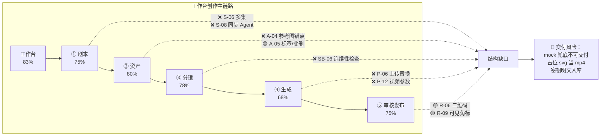
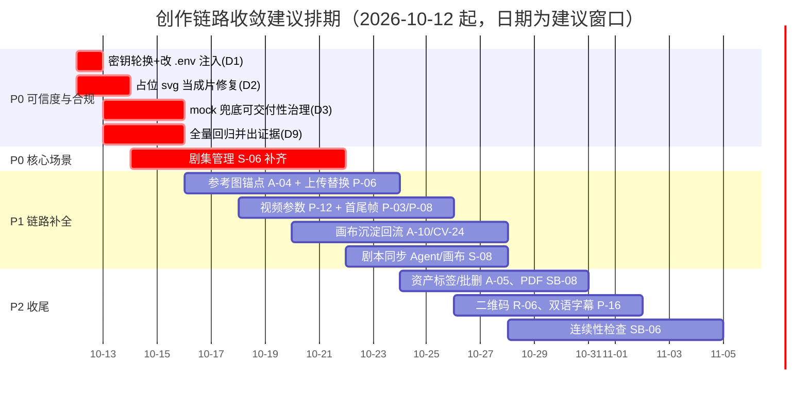

# 漫序 MangaFlow · 创作链路功能核对报告 V1.0

| 项目 | 内容 |
| ---- | ---- |
| 报告类型 | 代码实证核对（PRD V1.1 → 实现对照） |
| 核对范围 | 工作台 → **剧本创作 → 资产管理 → 分镜设计 → 生成内容 → 审核发布** 单用户主链路 |
| 核对基线 | 《漫序 MangaFlow 产品需求文档（PRD）V1.1》§7.2 / 7.3 / 7.4 / 7.5 / 7.6 / 7.7 + 附录 D 决议 |
| 实证方式 | 逐文件代码走查（后端 `backend/app/**`、创作端 `mangaflow-web/src/**`、运行产物 `backend/storage/**`），**不采信文档结论** |
| 核对日期 | 2026-10-12 |
| 状态 | 待项目组确认 |

> **口径声明**：状态判定三态 —— ✅ 已完成（模型 + 接口 + 页面/交互齐备，链路可跑通）；🟡 部分完成（结构在，但核心能力为 mock/占位/仅字段未落地，或缺子项）；❌ 未实现（范围内无实现痕迹）。完成度 =（✅ + 0.5 × 🟡）÷ 范围内功能点。

---

## 1. 核对结论（TL;DR）

1. **链路是通的，而且是"真结构"**：五阶段前端页面（`StudioLayout.vue` 步骤条 ①剧本 ②资产 ③分镜 ④生成 ⑤发布）、对应后端接口、数据模型三层齐备，端到端可演示。**剧本生成走真实 DeepSeek 流式**，审核走真实三级闸门（含视觉机审）。
2. **链路完成度约 75%**（范围内 60 个功能点：✅ 36 / 🟡 18 / ❌ 6）。缺的不是"壳"，是**6 项未落地 + 18 项半落地**。
3. **最要紧的三个问题不在功能，在可信度**：①**密钥明文硬编码入库**（合规红线）；②**占位 `.svg` 会被当作"成片"返回**（播放/导出/分享断裂）；③**图像/视频/TTS 的 mock 兜底产物不可交付**（渠道一降级，"成片"就是假内容）。
4. **代码已走在 10-10 进度报告之前**：3 项高危缺陷代码层已修（含根因注释）、视觉机审已接、Alembic 与 deploy 文件已落库、pgvector 影子列已实现。**该报告 §4/§7 的部分判定已过期，需下修或关闭**（见 §6）。
5. **链路最大结构性缺口**：**剧集管理（S-06）名存实亡** —— 有 `episodes` 表、有 `episode_id` 外键，但**无任何剧集 CRUD 接口、无 UI**，直接卡住"小说批量改编 / MCN 30 集"这一核心场景。

---

## 2. 总览表

| 模块 | 编号段 | 范围内 | ✅ | 🟡 | ❌ | 完成度 | 一句话判断 |
| ---- | ------ | ------ | -- | -- | -- | ------ | ---------- |
| 工作台 Dashboard | D-01~D-06 | 6 | 4 | 2 | 0 | 83% | 可用；统计口径未展全 |
| 剧本创作 Script | S-01~S-10 | 10 | 7 | 1 | 2 | 75% | 生成/编辑/体检/抽取扎实；**多集与 Agent 同步缺失** |
| 资产管理 Assets | A-01~A-10 | 10 | 7 | 2 | 1 | 80% | 生成/锁定/变体/一致性扎实；**参考图锚点缺** |
| 分镜设计 Storyboard | SB-01~SB-09 | 9 | 6 | 2 | 1 | 78% | 拆解/编辑/预警/投递扎实；**连续性检查缺、PDF 缺** |
| 内容生成 Production | P-01~P-17 | 17 | 8 | 7 | 2 | 68% | 队列/通知/合成扎实；**参数配置与首尾帧缺、兜底不可交付** |
| 审核与发布 Publish | R-01~R-09 | 9（R-07 剔除） | 4 | 4 | 0 | 75% | 三级闸门与视觉机审已通；**二维码/隐形水印口径偏差** |
| **合计** | — | **60** | **36** | **18** | **6** | **≈75%** | — |

---

## 3. 逐阶段核对明细

### 3.1 工作台（D-01~D-06）· 83%

| 编号 | 需求摘要 | 结论 | 实证锚点 |
| ---- | -------- | ---- | -------- |
| D-01 | 项目列表（卡片/列表视图） | ✅ | `ProjectListView.vue` + `GET /api/projects`（`projects.py:96`） |
| D-02 | 搜索/筛选/排序 | ✅ | 搜索 300ms 防抖、状态筛选、卡片/列表切换（`ProjectListView.vue`） |
| D-03 | 新建项目入口 | ✅ | `NewProjectDialog.vue`：一句话 / 上传 txt / 粘贴大纲三模式 + 前端解析 |
| D-04 | 今日/本月创作统计 | 🟡 | 后端 `CreationStatsOut` 已含 `projects/images/video_seconds/points_spent`，**但前端仅展示 projects 数**，图片数/视频时长/配额未上屏 |
| D-05 | 公告与模型状态提醒 | ✅ | `announcements.py` + 工作台顶部"模型渠道异常，AI 生成可能降级"横幅 |
| D-06 | 最近编辑置顶（最近 3 个） | 🟡 | Agent 首屏有"最近生成/我的项目"；**项目列表无"最近 3 个编辑置顶"语义** |

### 3.2 模块一：剧本创作（S-01~S-10）· 75%

| 编号 | 需求摘要 | 结论 | 实证锚点 |
| ---- | -------- | ---- | -------- |
| S-01 | 三种输入模式 | ✅ | `PUT /script/input`；txt 上传前端解析（`.txt`，非 `.epub`） |
| S-02 | 元信息配置（RD-01 忠实度档位） | ✅ | `projects.fidelity` |
| S-03 | 结构化剧本流式生成 | ✅ | `POST /script/generate/stream`（`script.py:122`），真实 DeepSeek SSE |
| S-04 | 结构化 JSON 存储 | ✅ | `scripts.content` JSONB + `parse_script_json` / `strip_json_fences` |
| S-05 | 富文本编辑双栏 + 版本回退 | ✅ | `ScriptView.vue`；`POST /versions/{id}/rollback`（`versions.py:153`） |
| **S-06** | **多集/多剧集管理** | **❌ 未实现** | `episodes` 表在（`project.py:63`）、`script/storyboard/output` 均带 `episode_id`，但**无剧集 CRUD 接口、无 UI**；仅导出接口以 `episode_id=0` 占位（`storyboards.py:388`） |
| S-07 | 结构化体检（RD-02 替换评分） | ✅ | `run_health_check()`（`script_service.py:262`）+ `POST /script/health` |
| **S-08** | **一键同步到 Agent / 画布** | **❌ 未实现** | `script.py` 全部 7 个路由中无 send-to-agent / send-to-canvas；ScriptView 仅有"AI 助手优化建议抽屉" |
| S-09 | 失败三路径（重试/换模型/精简） | 🟡 | 离线降级 `build_fallback_script()` 在；换模型 / 精简输入的显式路径未取证 |
| S-10 | 实体自动提取（RD-04/05/06） | ✅ | `rule_extract` + `llm_extract` + `detect_alias_conflicts` + `EntityExtractView.vue`（人工确认后才建资产卡） |

### 3.3 模块二：资产管理（A-01~A-10）· 80%

| 编号 | 需求摘要 | 结论 | 实证锚点 |
| ---- | -------- | ---- | -------- |
| A-01 | 定妆照生成（RD-10 先 1 张主照→派生） | ✅ | `POST /assets/characters/{id}/generate` + `generation_status` 状态机 |
| A-02 | 多套造型变体（RD-14 继承/独立） | ✅ | `asset_variants.inherit_mask` + `variants` 系列接口 |
| A-03 | 场景概念图 + 场景变体（RD-19） | ✅ | `scenes` + `scene variants` |
| **A-04** | **上传参考图作为视觉锚点（图生图）** | **❌ 未实现** | `AssetsView.vue:484` 明确："演示环境：已选择「xx」，**上传替换暂不落库后端**"；素材库 `/media/upload` 存在，但资产页无参考图锚点→图生图链路 |
| A-05 | 资产画廊 + 标签搜索 + 批量删除 | 🟡 | 四类 Tab（角色/场景/道具/风格）+ 单条软删 ✅；**标签搜索、批量删除、分类均无**；语义搜索 `/api/assets/search`（`assets.py:939`）接口在，资产页未接 |
| A-06 | 标准化视觉提示词 | ✅ | `characters/scenes/props.visual_prompt` + 页面可编辑 |
| A-07 | 道具资产（RD-17/18 归属关系） | ✅ | `props.ownership` |
| A-08 | 一致性校验（RD-13 不暴露数字） | ✅ | `consistency_similarity_node` + `POST /assets/consistency` |
| A-09 | 资产锁定（RD-12 面部锁定 + 服饰可切） | ✅ | `face_locked` + `outfit_variant_id` + lock/unlock 接口 |
| A-10 | 双向联动 | 🟡 | **投递画布 ✅**（`deliver-to-canvas`，`storyboards.py:136`）；**「沉淀入资产库」/画布回流 ❌** —— 全仓 `grep sink/沉淀` 在 canvas 侧零命中，**实为单向** |

### 3.4 模块三：分镜设计（SB-01~SB-09）· 78%

| 编号 | 需求摘要 | 结论 | 实证锚点 |
| ---- | -------- | ---- | -------- |
| SB-01 | AI 拆解分镜序列 | ✅ | `decompose_storyboards`（LLM + `_fallback_shots` 降级） |
| SB-02 | 网格/列表 + 拖拽排序 | ✅ | `POST /storyboards/reorder` + `_resequence` |
| SB-03 | 全字段编辑 + 拆分/合并（RD-21 文字级） | ✅ | `PUT /storyboards/{id}`、`split`、`merge` |
| SB-04 | 分镜提示词生成（融合资产+运镜） | ✅ | `build_prompt_locked` + `prompt_locked/prompt_editable` |
| SB-05 | 节奏预警（RD-22 文字化时长预警） | ✅ | `storyboard_warnings`（`storyboard_service.py:698`） |
| **SB-06** | **连续性检查（RD-23）** | **❌ 未实现** | 全仓 `grep continuity/连续性/站位/方位` **零命中**，无任何检查位与算法 |
| SB-07 | 目标总时长 / 镜头密度自动调整 | 🟡 | 时长与预估积分展示在；**自动调整算法未取证** |
| SB-08 | 批量导出 PDF/Excel | 🟡 | **Excel/CSV 已实现**（openpyxl，`episodes/{id}/export`）；**PDF 未实现** |
| SB-09 | 投递到画布（RD-25 ≥3 次引导） | ✅ | `deliver_to_canvas` + `REGEN_SUGGEST_THRESHOLD` 重生成计数引导 |

### 3.5 模块四：内容生成（P-01~P-17）· 68%

| 编号 | 需求摘要 | 结论 | 实证锚点 / 缺口 |
| ---- | -------- | ---- | -------- |
| P-01 | 关键帧批量生成 | ✅ | `generation_service.create_keyframe_tasks`；真实渠道优先，mock 兜底 |
| P-02 | 单张 / 选中批 / 全量批（RD-27 打样） | ✅ | `phase=trial/full` |
| P-03 | 首帧 + 尾帧双关键帧 | 🟡 | `VideoCreateRequest.use_end_frame`、`storyboards.end_frame_url` 字段在，但**仅写入任务 meta（注释原文"Mock 下仅记录于任务 meta"），无尾帧生成能力、无指定尾帧 UI** |
| P-04 | 缩略图嵌入分镜表 | 🟡 | 前端已做，依赖产物可用性；占位产物下显示异常 |
| P-05 | 单张/批量重生成 | ✅ | `regen_count` + 重试接口 |
| **P-06** | **上传自定义图片替换 AI 结果** | **❌ 未实现** | 生成页无上传替换入口；资产页上传替换为演示 stub（同 A-04） |
| P-07 | 视频 4-12s / 24fps | 🟡 | 真实渠道可配；**mock 兜底恒为 `color=c=0x1C2223` 纯色、`_MAX_CLIP_SECONDS=5` 截断**（`video_mock.py:22`），与 4-12s 不符 |
| P-08 | 图生视频 / 首尾帧两模式 | 🟡 | `agnes_video_mode = text/keyframe/reference` 三模式已接（`config.py:106`）；**首尾帧模式同 P-03 未落地** |
| P-09 | 异步队列 + 站内/浏览器双通知 | ✅ | `notifications` 表 + SSE `/api/notifications/stream` + `notification_service.py` |
| P-10 | 任务状态实时展示（RD-29 预估剩余时间） | ✅ | SSE + `tasks.progress` + `estimated_seconds` |
| P-11 | 失败自动重试 3 次 + 死信 | ✅ | 优先级队列 + 指数退避 + `/admin/dead-letters` requeue |
| **P-12** | **视频参数配置（分辨率/帧率/运动幅度）** | **❌ 未实现** | `VideoCreateRequest` **仅 `use_end_frame` 一个字段**（`generation.py:24-31`），无分辨率/帧率/运动幅度；前端亦无该配置项 |
| P-13 | 配音（多角色音色 / 语速语调，RD-31 回写） | 🟡 | `voice(male_01/female_01)/speed/pitch` 齐备、时长回写 ✅；**真实 TTS（百炼）稳定性待验**，曾 404 回落 mock |
| P-14 | BGM 匹配 + 上传（RD-30 平台曲库） | ✅ | `bgm.py` + 前端曲库下拉/音量/上传 |
| P-15 | 自动剪辑合成（RD-32 增量合成） | ✅ | `compose_service.py`：concat → xfade → 字幕 → 水印；增量按 `meta.storyboard_ids` 过滤 |
| P-16 | 自定义字幕样式 + 双语 | 🟡 | 开关 + 字号/颜色/位置 → ASS 烧录 ✅；**双语（双语字幕）未实现** |
| P-17 | 转场特效（淡入淡出/叠化/闪黑） | 🟡 | `transition` 参数已接，但注释明示"**本阶段实现按 fade 处理，其余取值接受**"（`publish.py:44`）→ **仅 fade 一种** |

### 3.6 模块五：审核与发布（R-01~R-09）· 75%

| 编号 | 需求摘要 | 结论 | 实证锚点 / 缺口 |
| ---- | -------- | ---- | -------- |
| R-01 | 视频播放器 | ✅ | `PublishView.vue`（`videoRef`，0.5x-2x） |
| R-02 | 分镜级跳转 | ✅ | `seekToShot()` → `video.currentTime = startSec * ratio` |
| R-03 | 单片段回退重生成（RD-40） | 🟡 | 增量合成（`mode=incremental`）+ 多版本 `is_current` 切换 ✅；**发布页无"该片段一键重生成"直连入口**，需回生成页操作 |
| R-04 | 导出 MP4 720P/1080P/2K | ✅ | `_transcode_film` + `GET /publish/outputs/{id}/download` |
| R-05 | 三比例输出（RD-37） | 🟡 | `_build_scale_filter` 事后裁剪（降级方案）；**前置按比例生成未全面落地** |
| R-06 | 分享链接 + 有效期 + 密码 | 🟡 | `share_token/expires_at/share_password/revoke` ✅；**预览二维码 ❌**（前端仅一句文案"二维码：发布后可在浏览器地址栏直接访问分享链接"，无二维码生成） |
| R-07 | 一键发布三方平台 | ⬜ | RD-39 已移出 MVP，**符合预期，不计入分母** |
| R-08 | 三级闸门合规审核（RD-34/35/36） | ✅ | 闸门一（生成时：词表 + LLM + **视觉机审**）、闸门二（合成前校验 generate 记录，`publish.py:87`）、闸门三（发布前汇总，`publish.py:137`）；`vision_review.review_image` 已接 runner 图像 + 视频首帧 |
| R-09 | 隐形溯源水印 | 🟡 | `compose_service` 用 ffmpeg `drawtext` 低透明度角标烧录 → **本质是可见文字角标，非"不影响观感"的隐形水印**，口径偏差 |

---

## 4. 未实现清单（范围内 6 项 + 1 项单向）

| # | 编号 | 未实现项 | 影响 | 优先级 | 补做要点 |
| - | ---- | -------- | ---- | ------ | -------- |
| 1 | **S-06** | 多集/多剧集管理 | **卡住"小说批量改编 / MCN 30 集"核心场景**（PRD 场景 2）；剧集间资产复用无入口 | **P0** | 补 episodes CRUD + 剧集切换器 + 跨剧集资产复用（含待确认的 RD-09 剧集级资产覆盖） |
| 2 | **S-08** | 剧本一键同步到 Agent / 画布 | 剧本→探索的路径断裂，双引擎联动少一环 | P1 | 补 `POST /script/send-to-agent|canvas`，保留上下文与幂等 |
| 3 | **A-04** | 上传参考图作为视觉锚点（图生图） | 风格还原不可控，MCN 一致性诉求打折 | P1 | 打通 `/media/upload` → 资产参考图字段 → 生成时以参考图入参 |
| 4 | **SB-06** | 连续性检查（站位/方位/服装） | 相邻镜矛盾需人工逐镜核对 | P2 | 按 RD-23"只报高置信度、宁可漏报不误报"做窄而准 |
| 5 | **P-06** | 上传自定义图片替换 AI 结果 | 用户无法用自有素材兜底 | P1 | 生成页补替换入口 + 尺寸/风格适配 |
| 6 | **P-12** | 视频参数配置（分辨率/帧率/运动幅度） | 输出规格不可控 | P1 | 扩展 `VideoCreateRequest` + 前端配置项，参数对后续任务生效 |
| 7 | **A-10 / CV-24** | 画布"sink 沉淀入资产库"（单向） | 画布产物无法回流资产库，双引擎闭环缺一半 | P1 | 补 canvas → asset/storyboard 回流 + 来源标记（RD-47 自动补特征提取） |

---

## 5. 缺陷清单（按严重度）

### 5.1 阻断级（P0，建议本周关闭）

| # | 缺陷 | 证据 | 影响 |
| - | ---- | ---- | ---- |
| **D1** | **密钥明文硬编码入库** | `backend/app/core/config.py` 内 **5 处 `sk-` 明文**（DeepSeek `/ agnes_llm / agnes_image / agnes_video / bailian_tts`），已随仓库提交 | 违反 PRD §8.2「API Key AES-256 加密存储，永不明文展示」；**合规红线 + 资产盗用风险**，应立即轮换密钥并改为 `.env` / KMS 注入 |
| **D2** | **占位 `.svg` 被当作"成片"返回** | `compose_service._poster_film_url()` 在项目无片段时返回 `film_poster_{id}.svg` 作为成片 URL；`backend/storage/outputs/` 实证 **`film_poster_35/39/43/61.svg` 与 `1_v1.mp4` 并存** | `<video>` 无法播放 SVG、导出转码必失败、分享页/下载 404 → **端到端断裂（演示最致命）**。应改为明确失败态或生成真占位 MP4 |
| **D3** | **mock 兜底产物不可交付** | `image_mock` 生成 SVG 占位图；`video_mock` 用 `ffmpeg lavfi` 纯色 `720x1280` **最长 5s**；`tts_mock` 生成 **0.02 振幅近静音 WAV** | 渠道 degraded / TTS 404 时，用户拿到的"图像/视频/配音"是占位内容，却仍按正常流程扣费与发布 → **数据可信度崩坏**。应在兜底时显式标注"演示占位"或阻断交付 |

### 5.2 严重级（P1）

| # | 缺陷 | 证据 / 影响 |
| - | ---- | ----------- |
| D4 | **剧集管理缺失（S-06）** | 有表无接口无 UI；MCN 多集场景不可用 |
| D5 | **资产/生成页上传替换为演示 stub** | `AssetsView.vue:484` 提示"暂不落库后端"（A-04 / P-06） |
| D6 | **视频参数与首尾帧未落地** | `VideoCreateRequest` 仅 1 字段（P-12）；`use_end_frame` 仅记 meta（P-03/P-08） |
| D7 | **画布回流单向** | canvas 侧 `grep sink/沉淀` 零命中（A-10 / CV-24） |
| D8 | **连续性检查缺失** | 全仓零命中（SB-06） |
| D9 | **测试证据链陈旧** | `backend/pytest_full_run.log`（10-09）含多处 **F / E**；现存 **154 个用例**（报告称 123）无最新全量回归证据；单文件 6 例耗时 **183s**（偏慢）。**当前"是否全绿"处于未知状态** |

### 5.3 一般级（P2）

| # | 缺陷 | 证据 |
| - | ---- | ---- |
| D10 | 资产页缺标签搜索 / 批量删除 / 分类（A-05）；语义搜索接口未接 UI | `AssetsView.vue` 无相关实现 |
| D11 | 分镜导出缺 PDF（SB-08）；分享缺二维码（R-06）；字幕缺双语（P-16）；转场仅 fade（P-17） | 见 §3.4/3.6/3.5 |
| D12 | 水印为可见文字角标，非"隐形"（R-09 口径偏差） | `compose_service` drawtext |
| D13 | 创作统计前端仅展示项目数，图片/视频时长/配额未上屏（D-04） | `ProjectListView.fetchStats` 仅取 `projects` |
| D14 | 队列为**进程内 asyncio runner（3 worker）**，非 Celery + Redis | `runner.py:_WORKER_COUNT = 3`；无法水平扩展、重启丢在途任务 |
| D15 | 素材库预览失败、Agent 消息重复渲染等既有体验缺陷 | 10-10 UI 测试报告中低危项，未见修复取证 |

> 说明：**D14 属架构偏离**（PRD §9 / 部署方案要求 Celery + Redis + Flower）。另注：10-10 报告列出的 7 处架构偏离中，**Alembic 迁移、Docker/Nginx 部署文件、pgvector 影子列**三项在代码中**已收敛**（`backend/alembic/versions/*initial_schema_32_tables.py`、`deploy/` 8 个文件、`services/vector_store.py` 幂等影子列 + ivfflat）。

---

## 6. 需修正《项目进度统计分析报告 V1.1》的判定

> 该报告编制于 10-10，其后代码继续推进，**部分结论已过期**，且个别判定偏乐观。建议下修/关闭：

| 编号 | 该报告判定 | 本次实证 | 建议 |
| ---- | ---------- | -------- | ---- |
| S-06 多集管理 | ✅（依据"episodes 表"） | **❌ 有表无接口无 UI** | **下修至 ❌**（"数据模型预留"≠ 功能实现，属**判定虚高**） |
| A-04 参考图上传 | ✅（依据 `/api/media/upload`） | **❌ 资产页上传替换为演示 stub** | **下修至 ❌**（素材库上传 ≠ 资产参考图锚点） |
| P-06 上传替换结果 | ✅（依据 `/api/media/upload`） | **❌ 生成页无入口** | **下修至 ❌** |
| P-12 视频参数配置 | ✅（依据"tasks.meta"） | **❌ schema 无该字段** | **下修至 ❌** |
| SB-06 连续性检查 | 🟡"有检查位" | **❌ 全仓零命中** | **下修至 ❌** |
| A-05 资产画廊 | 🟡（仅提 C-BUG-1） | 🟡 且**额外缺标签搜索/批量删除** | 补记缺口 |
| A-10 双向联动 | ✅ | **🟡 仅单向**（沉淀回流缺） | **下修至 🟡** |
| C-01/C-02/R-08 图像视频机审 | 🟡"非视觉模型" | **✅ 视觉机审已接**（`vision_review.py` + runner） | **上修至 ✅** |
| §2.1 架构偏离 #4/#5/#6 | 未收敛 | **Alembic / deploy / pgvector 已收敛** | **关闭或改注** |
| §4.2 高危缺陷 3 项 | 未修复 | **代码层已修**（`AssetsView` 轮询根因注释、`main.py` storage 绝对路径注释、`UsersView` `points_balance` 根因注释） | **标记待运行时回归确认后关闭** |
| §1.4 回归测试 123 例 | 123 | **154 例** | 更新基线 |

---

## 7. 待办与优先级建议

| 级别 | 事项 | 理由 |
| ---- | ---- | ---- |
| **P0** | ①密钥轮换与 `.env` 化（D1）②占位 svg 当成片修复（D2）③mock 兜底可交付性治理（D3）④全量回归出证据（D9）⑤剧集管理（S-06） | 前三项决定"敢不敢给人看"，第四项决定"当前状态是否已知"，第五项决定"核心场景是否成立" |
| **P1** | 参考图锚点、视频参数/首尾帧、画布沉淀回流、剧本同步 Agent | 补齐链路完整性，消除单向断点 |
| **P2** | 资产标签/批删、PDF 导出、二维码、双语字幕、连续性检查、水印隐形化 | 体验与规范对齐 |

---

## 8. 决策点（需拍板）

| # | 决策点 | 选项 | 建议 |
| - | ------ | ---- | ---- |
| 1 | **水印口径**（R-09） | A. 接受"低透明度可见角标"口径并修订 PRD 措辞；B. 投入做真隐形水印（频域/隐写） | 建议 **A**（MVP 阶段），PRD 补一句口径说明 |
| 2 | **mock 兜底策略**（D3） | A. 渠道不可用时**阻断生成**并提示；B. 保留兜底但产物打"演示占位"强标 | 建议 **B + 扣费豁免**（与 RD-28 失败成本归属一致） |
| 3 | **剧集管理范围**（S-06） | A. 本期补基础剧集 CRUD；B. 连同 RD-09「剧集级资产覆盖」一并做 | 建议 **A 先上**，RD-09 拍板后再迭代 |
| 4 | **队列中间件**（D14） | A. 保持进程内 runner；B. 上 Redis + Celery | 上线前建议 **B**（PRD §9 选型 + 部署文档要求） |
| 5 | **P-12 参数粒度** | A. 分辨率/帧率/运动幅度三参数；B. 只做分辨率 | 建议 **A**（成本极低，schema 扩展即可） |

---

## 附录：核对证据索引

| 类型 | 路径 |
| ---- | ---- |
| PRD 基线 | `项目开发文档/漫序 MangaFlow 产品需求文档（PRD）V1.1.md` |
| 前端五阶段 | `mangaflow-web/src/layouts/StudioLayout.vue`、`views/studio/{ScriptView,EntityExtractView,AssetsView,StoryboardView,ProductionView,PublishView}.vue` |
| 后端链路接口 | `backend/app/api/{script,assets,storyboards,generation,publish,versions}.py` |
| 业务服务 | `backend/app/services/{script_service,asset_service,storyboard_service,generation_service,compose_service,review_service}.py` |
| Provider（真实 + mock） | `backend/app/providers/{image_agnes,video_agnes,video_wan,tts_bailian,vision_review,image_mock,video_mock,tts_mock}.py` |
| 任务执行器 | `backend/app/tasks/runner.py`（进程内 3 worker） |
| 静态挂载（D2 相关） | `backend/app/main.py:176-185`（`/storage` 挂载，绝对路径） |
| 产物实证 | `backend/storage/outputs/`（`1_v1.mp4` 与 `film_poster_*.svg` 并存） |
| 迁移与部署（已收敛） | `backend/alembic/versions/*initial_schema_32_tables.py`、`deploy/`（8 文件） |
| 向量实现（已收敛） | `backend/app/services/vector_store.py`（pgvector 影子列 + ivfflat 幂等自愈） |
| 回归测试 | `backend/tests/`（30 文件 / 154 用例） |
| 历史报告 | `项目开发文档/漫序 MangaFlow 项目进度统计分析报告 V1.1.md`、`test-report/UI测试报告.md` |

---

*本报告为产品与实现核对参考，具体修复排期请结合项目组资源与合规法务要求确认。*

*— 报告结束 —*
