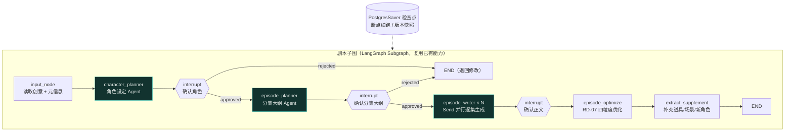
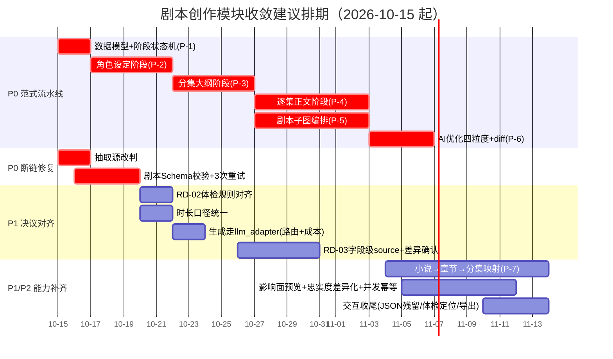

# 漫序 MangaFlow · 剧本创作模块不足评估 V1.1

| 项目 | 内容 |
| ---- | ---- |
| 评估对象 | 剧本创作模块（PRD 功能段 **S-01~S-10** + 架构 §4.2 实体提取 + 评审决议 **RD-01~RD-08**） |
| 评估视角 | AI 漫剧（动态漫/竖屏短剧）**生产可落地性**——不只看"功能有没有"，更看"产出的剧本能不能直接喂给分镜、配音、生成" |
| 评估方式 | 逐文件代码走查（`backend/app/**`、`mangaflow-web/src/**`）+ 决议逐条回溯，**证据带文件与行号** |
| 评估日期 | 2026-10-14 |
| 与既有报告的关系 | 不重复《创作链路功能核对报告 V1.0》（全链路功能完整性）；本报告**只深挖剧本域** |
| 状态 | 待项目组确认 |

**变更记录**

| 版本 | 日期 | 变更内容 |
| ---- | ---- | -------- |
| V1.0 | 2026-10-14 | 初稿：剧本域 10 项不足 + 决议落地缺口 + 修复优先级 |
| V1.1 | 2026-10-14 | **新增 §3.6「范式级缺口」**：按产品方明示的期望范式（**角色设定 → 分集大纲 → 逐集正文 → 用户修改 / AI 优化**）重新校准评估，将其列为**最高优先级 P0**；同步补充 §5.1 范式级工作流、排期与决策点 |

> **口径声明**：本报告的"不足"分三层 —— **① 范式级缺口**（生产流程本身与期望不符，改动最大）；**② 结构性缺陷**（不改则下游必然出错）；**③ 表达力与决议落地缺口**（影响成片质量与成本控制）。所有判断均可在代码中复现。

---

## 1. 结论速览（TL;DR）

> 剧本模块**已经"能用"**：真实 DeepSeek 流式生成、结构化 JSON、三栏编辑器、体检、实体抽取与人工确认、同步 Agent/画布、版本快照均已在位。
>
> **但存在一个此前未单列的"范式级缺口"** —— 产品方期望的剧本生产是**四段式流水线**（创意 → **角色设定** → **分集大纲** → **逐集正文** → 用户修改 / AI 优化），而当前实现是**一次 LLM 调用直接出稿**（三幕大纲 + 3~6 个场次 + 场次级 JSON、单集）。**两者是结构性错位，不是"少几个字段"**。详见 §3.6。

按严重度排序的不足清单：

| # | 级别 | 不足 | 一句话影响 |
| - | ---- | ---- | ---------- |
| **0** | 🔴 **范式** | **剧本生产流水线缺失**：无「角色设定」前置阶段、无「分集大纲」、无「每一集文章」输出、无分阶段确认 | 期望范式**整体未实现**；角色无锁定源、多集场景不成立、产出形态错位 |
| 1 | 🔴 结构 | **实体抽取读错数据源**：从"用户原始输入"抽取，而非"生成后的结构化剧本" | 一句话创意模式下抽取结果必然失真（UI 测试 C-BUG-5 的根因） |
| 2 | 🔴 结构 | **生成结果无 Schema 校验、无重试/修复** | LLM 输出跑偏即静默降级为 `{"raw": 全文}`，下游分镜拿到 0 场景 → 链路静默断裂 |
| 3 | 🔴 结构 | **Studio 剧本生成不走 LangGraph，SSE 中断即丢** | 断网/切页=已生成内容全丢、token 白烧；与 PRD"从检查点续跑"不符 |
| 4 | 🟠 表达力 | **剧本 JSON 字段不足以驱动分镜/配音/字幕**（无动作描写、无对白类型、无情绪/音色、无昼夜内外景、无音效） | 分镜画面靠二次创作、配音无音色依据、字幕无时间轴根基 |
| 5 | 🟠 表达力 | **"场次"与"场景(地点)"概念混淆，且无显式地点映射** | 分镜阶段 RD-24"强绑场景资产"缺上游依据 |
| 6 | 🟠 表达力 | **默认参数口径不自洽**（示例 30s × 3~6 场 = 90~180s vs 项目默认目标 60s） | 体检"时长偏差>20%"必然大面积误报 |
| 7 | 🟠 决议 | **RD-02 体检规则与决议完全不符**（缺"角色出场断层/对白过长/缺动作描写/缺高潮点"） | 决议形同未落地；"缺动作描写"在现有 Schema 下**无法检测** |
| 8 | 🟠 决议 | **RD-03 字段级来源标记未真正落地**（只包一级字段；手动保存压成单一 `source:"user"`） | "用户改过的字段锁定不被 AI 覆盖"**无法实现** |
| 9 | 🟠 决议 | **RD-07 AI 优化四粒度 + diff 接受/拒绝 后端完全缺失** | 前端是 3 项下拉 + 聊天气泡建议，与决议背离 |
| 10 | 🟡 架构 | **剧本生成绕过模型路由中心与统一 LLM 适配层**（直连 `providers.llm`） | 无渠道路由/降级、无成本归因；与 Agent 路径形成两套实现 |

**另有 3 项**：RD-08 影响面预览缺失；小说改编链路（epub 解析/章节切分/长篇分集）缺失且长文本硬截断 4000 字；RD-01 忠实度档位仅作提示词文本、无差异化策略与校验。

---

## 2. 模块现状底座（先明确"评的是什么"）

| 层 | 已具备 |
| -- | ------ |
| 数据模型 | `scripts`（content JSONB / raw_text / fences / health_report / version）+ `episodes`（title/sequence/script_snapshot/status）+ `version_snapshots` + `characters`（name/aliases/description/visual_prompt/…） |
| 后端接口 | 9 个：`GET script`、`PUT script/input`、`POST script/generate/stream`、`PUT script`（保存）、`POST script/health`、`POST script/extract`、`POST script/extract/confirm`、`POST script/send-to-agent`、`POST script/send-to-canvas`；另有 `api/episodes.py` 剧集 CRUD 5 个 |
| 前端页面 | `ScriptView.vue`（1443 行，三栏编辑 + 体检面板 + AI 优化抽屉）、`EntityExtractView.vue`（620 行，人工确认） |
| 已落地决议 | RD-04 抽取须人工确认 ✅、RD-06 冲突标记 ✅、RD-05 低置信标黄 部分 |
| 相邻已补齐 | 剧集 CRUD（`api/episodes.py:59/96/124/182/221`）；版本回退（`api/versions.py:153`） |

> **提示**：《创作链路功能核对报告 V1.0》将 **S-06 多集管理**与 **S-08 同步 Agent/画布**判为 ❌，但截至 2026-10-14 两者**均已在代码中实现**。该报告这两条判定已过期——**以代码为准，不以报告为准**。

---

## 3. 不足明细

### 3.1 结构性缺陷（不改则下游必然出错）

#### 【不足 1】实体抽取读错数据源 —— 本模块最严重的设计缺陷 🔴

| 项 | 内容 |
| -- | ---- |
| 证据 | `services/script_service.py:540` → `raw_text = script.raw_text or ""`；`llm_extract(raw_text)`（:545）、`rule_extract(raw_text)`（:547） |
| 事实 | `script.raw_text` 是**用户原始输入**。一句话模式下它就是"一个赛博朋克风格的少女"这样一句；**生成的完整剧本在 `script.content`**。全仓无任何"把生成剧本写回 raw_text"的代码。 |
| 后果 | 主推场景（US-01 一句话→成片）下，抽取输入是那句创意本身，**不是剧本**。UI 测试 C-BUG-5 的"仅抽出 2 角色/1 场景、其中一个角色名为空"正是此因。 |
| 下游影响 | 抽取失真 → 资产卡缺失/错建 → 分镜实体绑定（RD-24）与一致性校验（A-08）失去对象 → 成片角色一致性崩坏。 |
| 建议 | 短期：抽取源改为"**生成后的结构化剧本**（`content`）+ novel 模式 raw_text 兜底"。**中期：并入 §3.6 的「角色设定阶段」——角色在写作前就已确认入库，抽取降级为"补充道具/场景/新登场角色"**，本缺陷自然消解。 |

#### 【不足 2】生成结果无 Schema 校验、无重试与自动修复 🔴

| 项 | 内容 |
| -- | ---- |
| 证据 | `parse_script_json()`（:199-215）仅做 `json.loads`，失败即 `{"raw": text}`；`schemas/script.py` **只有请求/响应模型，无剧本内容模型**；生成路径无重试（`api/script.py:208-210` 单次尝试） |
| 与 PRD 冲突 | S-03 业务规则："剧本 JSON 必须通过 Schema 校验，校验失败触发模型重试（最多 3 次）"。**当前 0 次重试、无校验**。 |
| 后果 | 模型偶发输出围栏/截断/字段缺失时链路**静默降级**：content 变 `{"raw": ...}` → 下游 `unwrap_scenes` 返回空 → 分镜 0 镜，**根因被层层包裹**。 |
| 建议 | 定义 `ScriptContent` Pydantic 模型；校验失败携错重试 ≤3 次；仍失败则显式提示（禁止静默 raw）。 |

#### 【不足 3】Studio 剧本生成不走 LangGraph，SSE 中断即丢已生成内容 🔴

| 项 | 内容 |
| -- | ---- |
| 证据 | `api/script.py:30` 直接 `from app.providers.llm import chat_stream`；`event_generator()`（:185-221）**只在 done 分支 commit**（:216） |
| 与 PRD/架构冲突 | PRD S-03："生成中断 → 从检查点续跑，已生成内容不丢失"；架构 §6.1.1："三入口共用同一套智能体集群"。实际 Studio 剧本路径**完全绕开图与检查点**；Agent 路径（`agents/script_agent.py`）则走 `llm_adapter` + 图，形成**两套实现**。 |
| 后果 | 长剧本生成期间切页/断网 → `collected` 全丢、token 白烧；两套提示词与产出口径必然漂移（前者文本、后者严格 JSON）。 |
| 建议 | 并入 §3.6 的**剧本子图**（`script` 节点复用 `PostgresSaver` 检查点，天然支持断点续跑）；短期先做增量落库（每 N 秒 flush 一次 content 快照）。 |

#### 【不足 4】小说改编链路缺失 + 长文本硬截断 🟠

| 项 | 内容 |
| -- | ---- |
| 证据 | `build_generate_messages`（:232）`raw_text[:4000]`；`llm_extract`（:487）`[:4000]`；全仓无 `epub` 解析、无章节切分、无"长篇→多集"逻辑 |
| 与 PRD 冲突 | S-01："上传 .txt/.epub，章节解析准确率 ≥90%"；US-02："输出章节列表与角色/场景清单"；S-03："输入过长 → 启用 Deep Agents 长文本解析"。项目已有 `deep_research_agent.py`，**但未接入剧本域**。 |
| 后果 | US-02（小说批量改编）**不成立**——这是 PRD 五大画像之一、三大核心场景之一（场景 2：MCN 30 集）。 |
| 建议 | 见 §3.6：**章节切分恰好是"分集大纲"阶段的天然输入**，两者应合并设计（章节 → 分集映射）。 |

### 3.2 表达力缺陷（漫剧生产视角：剧本是下游唯一事实源）

> PRD S-03 要求剧本含"角色设定/场景描述/分场对话**与动作**"，但当前生成 Schema 只有 `scene_no/title/plot/dialogue/duration_sec`（`script_service.py:45-55`），缺的恰恰是漫剧生产必需的字段。

#### 【不足 5】剧本 Schema 表达力不足，下游五个环节都"缺依据" 🟠

| 缺失字段 | 下游谁在等它 | 现状代偿（会失真） |
| -------- | ------------ | ------------------ |
| **动作/画面描述（action）** | SB-04 分镜提示词、P-01 关键帧 | 分镜只能拿 `plot`（剧情叙述）当画面描述二次创作（`storyboard_service.py:184`），**角色动作、走位、道具使用无上游约束** |
| **对白类型（对白/旁白/独白/画外音）** | P-13 配音音色、P-16 字幕 | 无类型字段；降级时用字符串 `"旁白"` 塞进 `character`（`script_service.py:271`），而"旁白"**不是角色资产** → 配音无音色可映射 |
| **情绪/语气（emotion）** | P-13 语速语调、画面表情 | 无 → 配音全局统一语调；角色表情靠模型猜 |
| **说话人 → 角色资产 ID** | RD-24 分镜强绑资产、A-08 一致性 | 剧本只有角色名，无 ID 引用与出现位置标注 |
| **时间/内外景（日/夜、内/外）** | RD-19 场景变体、A-03 概念图 | 无 → 场景变体在剧本层无出处 |
| **音效/配乐提示（SFX/BGM cue）** | RD-30 BGM 匹配 | 无 → BGM 只能按"项目风格"一刀切 |
| **对白字数/预计语速** | RD-31 配音时长回写、SB-01 ±10% | 无 → TTS 实际时长与 `duration_sec` 频繁冲突 |

**建议**：Schema 升级为"漫剧可拍摄剧本"（补 `action`/`dialogue[].type`/`emotion`/`location`/`time_of_day`/`sfx`）。**属低成本高杠杆改动**，同时改善分镜、配音、一致性、字幕四条链路——该改动与 §3.6 的「逐集正文」阶段应合并实施。

#### 【不足 6】"场次"与"场景(地点)"概念混淆，且无显式地点映射 🟠

| 项 | 内容 |
| -- | ---- |
| 证据 | 剧本 `scenes[]` 实为**场次**（含 plot/dialogue/duration，`scene_no` 递增）；PRD/A-03 的"场景"是**地点资产**（可复用、多次出现合并为一条）。两者同名不同义。 |
| 后果 | ① S-03 业务规则"场景名可复用、同一场景多次出现合并"**无处校验**；② 分镜 `storyboards.scene_id`（RD-24）**缺剧本层映射依据**；③ 场景变体（RD-19）无法从剧本推出场景数。 |
| 建议 | 剧本 Schema 引入两级：场次内加 `location_ref`；独立 `locations[]` 列出可复用地点清单（去重）→ 抽取确认时直接生成地点资产。 |

#### 【不足 7】默认参数口径不自洽，体检必然误报 🟠

| 项 | 内容 |
| -- | ---- |
| 证据 | 生成 prompt 要求"`scenes` 3~6 个""`duration_sec`（示例 30）"（`:51-54`）；注入的默认目标时长 **60 秒**（`:230`）；体检阈值 **20%**（`:374`）。 |
| 推算 | 3~6 场 × 30s = **90~180s**，对 60s 目标偏差 **50%~200%** → 体检**几乎必然**报 error。 |
| 衍生 | 竖屏短剧实际体量 3-5 分钟（`script_agent.py:31` 自己也这么写），与"默认 60s"矛盾。 |
| 建议 | 统一时长口径（默认按体裁给）；体检阈值按 PRD 收紧到 ±10%；对"对白字数÷语速 vs 场次时长"做交叉校验。**在 §3.6 的分集大纲阶段，时长应按"集"规划后再分解到场次，本矛盾自然消解。** |

### 3.3 决议落地缺口（PRD 附录 D 已拍板但未落地）

| 决议 | 要求 | 实际 | 结论 |
| ---- | ---- | ---- | ---- |
| **RD-01** 忠实度档位 | free/outline/faithful **直接影响 prompt 策略与成本** | 仅把 `fidelity` 文本拼进 prompt（`:230`），无策略分支、无校验 | 🟡 半落地 |
| **RD-02** 结构化体检 | 四条：**角色出场断层 / 对白过长 / 缺动作描写 / 缺高潮点** | 实际四条：无场景 / 无对白 / 对白缺角色名 / 时长偏差>20%，**无一条与决议相同**；"缺动作描写"因无 action 字段而**不可检测** | ❌ 未落地 |
| **RD-03** 字段级来源标记 + 差异确认 | 每字段 `{value, source}`；用户改过的字段锁定 | `wrap_content_fields` 只包**一级字段**（`:290-300`）；手动保存把**整篇压成**单一 `source:"user"`（`api/script.py:254`） | ❌ 未落地 |
| **RD-04** 抽取须人工确认才建资产 | ✅ | `extract/confirm` + `EntityExtractView.vue` | ✅ 已落地 |
| **RD-05** 别名归一可视化、可展开可拆分 | 部分 | 低置信标黄 ✅；`detect_alias_conflicts` 仅"名字互相包含"（`:501-522`），无指代消解、合并关系未可视化 | 🟡 半落地 |
| **RD-06** 描述冲突由用户裁决 | ✅ | conflicts 产出 + 确认页 | ✅ 已落地 |
| **RD-07** AI 优化四粒度 + diff 接受/拒绝 | 全局/单场次/单段/单字段；局部 + 预览 diff + 可接受/拒绝；**禁止一键整篇覆盖** | 后端**无 optimize 接口**；前端 3 项下拉 + 聊天气泡，注释自述"**结果仅作建议展示**"（`ScriptView.vue:467`） | ❌ 未落地 |
| **RD-08** 影响面预览 | 修改前提示"影响 N 个资产/M 个分镜" | 仅 `confirm_extract` 在**确认后**写快照 `impact_scope`（`:731`），无修改前预览 | ❌ 未落地 |

> **小结**：剧本域 7 条可执行决议 → 已落地 2、半落地 2、**核心机制未落地 3（RD-02/03/07）**，另 RD-08 缺失。不是"功能没做"，是"**拍板了但没实现**"。

### 3.4 架构一致性缺陷

#### 【不足 8】剧本生成绕过模型路由中心与统一 LLM 适配层 🟡

| 项 | 内容 |
| -- | ---- |
| 证据 | `api/script.py:30` 用 `app.providers.llm.chat_stream`（直连 DeepSeek）；Agent 路径 `agents/script_agent.py` 用 `agents.llm_adapter.llm`（含渠道路由 + token/用量） |
| 后果 | ① **无故障降级**（PL-07/08）；② **无成本归因**（PL-10/25、MA-20）；③ **两套实现**必然漂移 |
| 建议 | 统一走 `llm_adapter`（`agent_name="script"`）。 |

#### 【不足 9】并发与幂等保护不足 🟡

| 项 | 内容 |
| -- | ---- |
| 证据 | `generate/stream` 每次 `script.version += 1`（`api/script.py:214`），无乐观锁、无"生成中"状态位 |
| 后果 | 双开标签页/重复提交可导致版本竞态与内容互相覆盖且无提示 |
| 建议 | 加 `generating` 状态位 + 版本号乐观锁（`WHERE version = ?`）。 |

### 3.5 交互与验收缺陷

| # | 不足 | 证据 | 影响 |
| - | ---- | ---- | ---- |
| 1 | 生成完成后"AI 生成"面板持续展示原始 JSON 全文 | UI 测试 C-BUG-6 | 观感差，用户误以为"输出没解析" |
| 2 | 体检结果不可"一键修复/定位修改" | `ScriptView.vue:526-542` | RD-02 要求"可定位可修改"，当前只到"可定位展示" |
| 3 | 抽取质量强依赖模型渠道健康度 | UI 测试 C-BUG-5 / E-09 | 渠道一降级，抽取与剧本质量同时劣化 |
| 4 | 无剧本导出（文本/Fountain/PDF） | 全仓无该接口 | 编剧协作、法务留档无交付物 |

---

### 3.6 范式级缺口：**角色设定 → 分集大纲 → 逐集正文** 流水线未实现 🔴

> **本节为产品方 2026-10-14 明确的期望范式，也是本次评估的最高优先级。** 经代码核对，该范式在当前产品中**整体缺失**；现有实现是把三步压成一次 LLM 调用的"单次成稿"，与期望存在**结构性错位**。

#### 3.6.1 期望范式 vs 当前实现

**产品方期望的四段式流水线：**


**当前实现的实际流程：**


**结构性差异（4 处错位）：**

| # | 错位 | 期望范式 | 当前实现 | 证据 |
| - | ---- | -------- | -------- | ---- |
| 1 | **角色无前置设定** | 角色情况在**写作之前**由 Agent 明确并人工确认，成为全链路角色事实源 | 角色是**生成剧本之后**用 S-10"抽取"出来的（顺序颠倒），且抽取源还是 `raw_text` | `script_service.py:540`；`characters` 表无 `role_type/age/personality/motivation/arc/relations` 字段 |
| 2 | **无分集概念** | 输出**分集大纲**（N 集，播出单元） | 只有**三幕大纲** `outline[3]`（叙事结构，非播出单元）；`episodes` 表**无 `logline`/`outline` 字段** | `script_service.py:49-55`（要求 outline 恰好 3 项）；`models/project.py` Episode 仅 title/sequence/script_snapshot/status |
| 3 | **产出形态错位** | 输出"**每一集的文章**"（用户可通读、可改） | 输出**场次级结构化 JSON**（plot+dialogue），无"集正文"概念，且**仅单集** | `scripts.content` 结构；`episodes.script_snapshot` 字段闲置 |
| 4 | **无分阶段确认** | 角色 → 大纲 → 正文 各有人工确认点 | 全流程只有"确认剧本"一个 HITL 点（且仅在 Agent 路径的 `script_confirm_node`） | `api/script.py` 9 个路由中无 characters/episodes-plan 相关接口 |

#### 3.6.2 逐步骤 gap 明细

| 步骤 | 期望能力 | 当前状态 | 定级 | 判定依据 |
| ---- | -------- | -------- | ---- | -------- |
| ① 创意输入 | 一句话 / 上传小说 / 大纲 | ✅ 已有 | — | `PUT /script/input`（mode: idea/novel/outline） |
| ② **角色设定** | Agent 生成角色清单（姓名/定位/年龄/性格/外貌/动机/弧光/关系）→ 用户可编辑、增删、单角色重生成 → **确认后入库** | ❌ **未实现** | 🔴 P0 | 无 `characters/generate` 接口；`characters` 无人设字段；现有"角色"来自事后抽取 |
| ③ **分集大纲** | 基于角色设定 + 创意生成 N 集大纲（集标题/一句话/核心事件/出场角色/情绪走向/单集时长）→ 可编辑、增删集、重排 → 确认 | ❌ **未实现** | 🔴 P0 | 无 `episodes/plan` 接口；`episodes` 无 `outline`/`logline` 字段；现有 outline 是三幕而非分集 |
| ④ **逐集正文** | 按"本集大纲 + 角色设定（强约束）"逐集生成**文章体正文** → 支持单集重生成 | ❌ **未实现** | 🔴 P0 | 无 `episodes/{id}/body` 接口；无逐集生成；产出为场次 JSON 而非集文章 |
| ⑤ **用户修改** | 富文本编辑正文 | 🟡 部分 | — | 有编辑器，但面向场次卡片，非"集文章"长文编辑 |
| ⑥ **AI 优化** | 四粒度（全局/单集/单段/单字段）+ diff 预览 + 接受/拒绝（RD-07） | ❌ **未实现** | 🔴 P0 | 无 optimize 接口；前端仅 3 项下拉 + 聊天气泡建议 |
| ⑦ 小说→分集映射 | 上传小说 → 章节切分 → 映射为分集 | ❌ **未实现** | 🟠 P1 | 无 epub 解析、无章节切分；`raw_text[:4000]` 截断 |

#### 3.6.3 根因分析

1. **把"叙事结构"当成了"分集"**：三幕大纲（开端/对抗/结局）是**单集内的叙事节拍**，而产品要的是**播出单元的分集**。两者是不同层级，当前只实现了前者。
2. **把"角色"当成事后产物而非前置设定**：角色在剧本之后被"抽取"，导致角色没有确认源、没有锁定点，一致性约束失去起点。
3. **把"结构化场次 JSON"当成了"每一集文章"**：面向生产的中间数据结构被直接当作交付物呈现给用户，用户看不到"一集剧本"。
4. **单次生成导致无中间确认点**：角色、大纲、正文三者耦合在一次调用里，任一环节不满意都要重生成全篇，也无法分阶段确认与断点续跑。

#### 3.6.4 解决方案总体架构

**核心思路：把"一次大调用"拆成"三段式流水线 + 三个人工确认点"，并用已有的 LangGraph 能力编排成剧本子图。**



> **关键判断：技术能力已全部就绪，缺的只是"编排"。**
> - `interrupt` + `Command(resume)`（MA-08）→ 三个阶段确认点 ✅ 已实现
> - `Send` map-reduce（MA-10）→ 多集并行生成 ✅ 已实现
> - 子图封装（MA-09，`agents/subgraphs.py` 已有审核/一致性子图范例）✅ 已实现
> - `PostgresSaver` 检查点（MA-05）→ 断点续跑 ✅ 已实现
> - 统一 LLM 适配（`agents/llm_adapter.py`）→ 渠道路由 + 用量归因 ✅ 已实现
>
> 也就是说：**§3.6 的落地主要是"编排 + 数据模型 + 前端"三件事，不是从零造轮子。**

#### 3.6.5 数据模型改动

| 对象 | 改动 | 用途 |
| ---- | ---- | ---- |
| `projects` | **新增 `script_phase VARCHAR(30)`** | 阶段状态机：`idea` → `characters` → `outline` → `body`；驱动前端步骤条与后端阶段校验 |
| `characters` | **新增** `role_type`（lead/support/villain/extra）、`age`、`personality`、`motivation`、`arc`、`relations JSONB`（人物关系）、`confirmed_at` | 承载"角色设定卡"；关系数据供一致性与世界观使用（对齐 MA-17） |
| `episodes` | **新增** `logline VARCHAR(200)`、`outline JSONB`（核心事件/情绪走向/出场角色ID/单集时长）、`confirmed_at` | 承载"分集大纲"；`script_snapshot`（已有）可继续存该集正文快照 |
| `scripts` | **复用**（已有 `uk(project_id, episode_id)`）；`content` 升级为"分集正文结构化"，`raw_text` 存该集**文章纯文本** | 每集一行正文，避免新建表造成双份事实源 |
| `version_snapshots` | `stage` 新增取值 `characters_confirmed` / `outline_confirmed` / `body_generated` | 每个阶段确认点落快照，支撑 V-01 回退 |

> 迁移：新增字段全部 `nullable`，存量数据 `script_phase = NULL` 即视为"快速模式"，不破坏现有功能。

#### 3.6.6 新增接口清单（14 个）

| # | 阶段 | 接口 | 说明 |
| - | ---- | ---- | ---- |
| 1 | 角色 | `POST /api/projects/{id}/script/characters/generate` | 生成角色清单（人设卡） |
| 2 | 角色 | `GET  /api/projects/{id}/script/characters` | 读取候选/已确认角色 |
| 3 | 角色 | `PUT  /api/projects/{id}/script/characters` | 批量编辑（增删改） |
| 4 | 角色 | `POST /api/projects/{id}/script/characters/{cid}/regenerate` | 单角色重生成 |
| 5 | 角色 | `POST /api/projects/{id}/script/characters/confirm` | 确认入池（写 `characters`，`phase='outline'`） |
| 6 | 大纲 | `POST /api/projects/{id}/script/episodes/plan` | 生成分集大纲（N 集） |
| 7 | 大纲 | `GET  /api/projects/{id}/script/episodes/plan` | 读取分集大纲 |
| 8 | 大纲 | `PUT  /api/projects/{id}/script/episodes/{eid}/outline` | 编辑单集大纲 |
| 9 | 大纲 | `POST /api/projects/{id}/script/episodes/plan/confirm` | 确认大纲（`phase='body'`） |
| 10 | 正文 | `POST /api/projects/{id}/script/episodes/{eid}/body/generate/stream` | **逐集流式生成正文（SSE）** |
| 11 | 正文 | `PUT  /api/projects/{id}/script/episodes/{eid}/body` | 用户保存修改 |
| 12 | 正文 | `POST /api/projects/{id}/script/episodes/{eid}/body/regenerate` | 单集重生成 |
| 13 | 优化 | `POST /api/projects/{id}/script/episodes/{eid}/optimize` | 生成优化 diff（**不落库**，供预览） |
| 14 | 优化 | `POST /api/projects/{id}/script/episodes/{eid}/optimize/apply` | 接受选中 diff 片段后落库 |

> 沿用与调整：`extract` / `extract/confirm` **降级为"补充道具/场景/新登场角色"**（角色已在阶段 ② 入库）；`health` 升级为**按集体检**；`send-to-agent` / `send-to-canvas` 保留（按集投递）。

#### 3.6.7 Agent / Prompt 设计（3 个新 Agent，均为结构化输出）

| Agent | 输入 | 输出（严格 JSON） |
| ----- | ---- | ---------------- |
| `character_planner` | 创意 + 体裁/风格 + 忠实度档位（RD-01） | `characters[]`：name / role_type / age / personality / appearance / motivation / arc / relations[] |
| `episode_planner` | 创意 + **角色设定（强约束）** + 目标集数 / 单集时长 | `episodes[]`：title / logline / core_event / characters[](角色ID) / emotion_curve / duration_sec |
| `episode_writer` | **本集大纲 + 角色设定（强约束：姓名与人设不得漂移）** | 本集**正文（文章体）** + 结构化 `scenes[]`（含 `action` / `dialogue[].type` / `emotion` / `location` / 时长） |

> **忠实度档位差异化**（兑现 RD-01）：`faithful` 模式在 `character_planner`/`episode_writer` 注入原著约束与校验；`outline` 模式注入大纲约束；`free` 模式放开创意温度。这是 RD-01"直接影响 prompt 策略与成本"的落地位置。

#### 3.6.8 前端改造（ScriptView 升级为四步）

| 步骤 | 页面形态 |
| ---- | -------- |
| ① 创意 | 保留现有输入区（一句话 / 上传小说 / 粘贴大纲） |
| ② **角色设定** | 角色卡网格（头像位 / 姓名 / 定位 / 年龄 / 性格 / 外貌 / 动机 / 弧光 / 关系图）；支持编辑、新增、删除、单角色重生成；底部「确认角色，进入分集大纲」 |
| ③ **分集大纲** | 左侧集列表（可增删 / 重排 / 合并集）+ 右侧本集大纲编辑（核心事件 / 情绪走向 / 出场角色多选 / 单集时长）；底部「确认大纲，开始生成正文」 |
| ④ **分集正文** | 左侧集列表（含生成状态）+ 中间**长文富文本正文编辑** + 右侧「AI 助手（**四粒度 + diff 接受/拒绝**）+ 体检面板」；支持「仅重生成本集」 |
| 通用 | 顶部四步步骤条（与 Studio 五阶段呼应但独立）；保留导出、同步 Agent/画布、版本回退 |

#### 3.6.9 兼容、迁移与范围决策

| 项 | 方案 |
| -- | ---- |
| **快速模式保留** | 保留现有"一句话→直接出稿"（`script_phase=NULL`），标注为**快速模式（跳过角色与分集确认）**；与**精细模式（四段式）**并存，默认精细 |
| 存量数据升级 | 提供"升级为分阶段创作"入口：把现有 `title/logline/outline/scenes` 映射为「抽取角色清单 + 第 1 集大纲 + 第 1 集正文」 |
| 抽取职责调整 | 角色设定阶段产出的角色**直接入库**；S-10 抽取降级为补充（同时消解【不足 1】） |
| 小说改编合并 | `epub 解析 → 章节切分 → 章节映射为分集大纲` 与阶段 ③ 合并设计，一次实现两个需求 |

#### 3.6.10 收益与指标影响

| 维度 | 收益 |
| ---- | ---- |
| **一致性** | 角色在写作前锁定 → 剧本 / 分镜 / 生成三层共享同一角色事实源（RD-24 强绑、A-08 一致性校验的**依据成立**） |
| **成本** | 逐集生成 + 单集重生成 → 改第 3 集不必重烧全篇；阶段确认避免全篇返工（对齐 RD-27 打样思路） |
| **质量** | 三个中间确认点，与 RD-04"须人工确认"精神一致；角色漂移在阶段 ② 即可发现 |
| **指标** | 直接支撑 **M-02 核心闭环完成率**、**M-04 角色一致性投诉率**、**M-05 单集成片耗时** |
| **场景** | 解锁 **US-02 小说批量改编** 与 **场景 2（MCN 30 集）**，与 S-06 剧集管理形成完整链路 |

#### 3.6.11 决策点（需拍板）

| # | 决策点 | 选项 | 建议 |
| - | ------ | ---- | ---- |
| 1 | **是否保留快速模式** | A. 仅精细模式；B. 快速 + 精细并存 | **B**（新手/试水场景需要，默认精细） |
| 2 | **分集正文载体** | A. 复用 `scripts`（按 `episode_id`）；B. 新建 `episode_bodies` 表 | **A**（已有唯一约束，避免双份事实源） |
| 3 | **流程是否逐步确认** | A. 一键串跑全流程；B. 每阶段人工确认 | **B**（符合 RD-04 精神；A 作为"全自动"可选） |
| 4 | **默认集数与单集时长口径** | PRD：集数 1-100、时长 1-60 分钟 | 建议短剧默认 **1 集 / 3 分钟**；长篇默认**按章切分** |
| 5 | **角色设定与 S-10 抽取关系** | A. 两个阶段；B. 合并为一个阶段 | **B**（角色前置设定，抽取降级为补充） |
| 6 | **本范式是否纳入 MVP** | A. 纳入本轮；B. 排到 v1.1 | **A**（它是"剧本创作"的定义本身，不是增强项） |

---

## 4. 不足的传导分析（为什么必须优先修）

```mermaid
flowchart TB
    A0["不足0 无角色前置设定"] --> B0["角色无确认源/无锁定点"]
    A6["不足0 无分集大纲"] --> B6["多集场景不成立 (US-02/场景2)"]
    A1["不足1 抽取源错误"] --> B1["资产卡缺失/错建"]
    A2["不足2 无Schema校验/重试"] --> B2["content={\"raw\":...}"]
    A5["不足5/6 Schema表达力不足"] --> B3["分镜画面靠二次创作<br/>配音无音色依据"]
    B0 --> D["分镜强绑资产失效 (RD-24)"]
    B1 --> D
    B3 --> D
    B2 --> C["分镜拆解 0 镜 / 规则降级"]
    D --> E["角色一致性崩坏 (A-08)"]
    C --> F["M-02 核心闭环完成率 ↓"]
    E --> G["M-04 一致性投诉率 ↑"]
    B6 --> F
    A7["不足7 时长口径不自洽"] --> H["体检误报 → 用户忽略体检"]
    H --> F
    style A0 fill:#2b1a1a,stroke:#F0736F,color:#F5F7F6
    style A1 fill:#2b1a1a,stroke:#F0736F,color:#F5F7F6
    style A2 fill:#2b1a1a,stroke:#F0736F,color:#F5F7F6
    style A6 fill:#2b1a1a,stroke:#F0736F,color:#F5F7F6
    style E fill:#2b1a1a,stroke:#F0736F,color:#F5F7F6
```

**一句话**：剧本是**全链路唯一事实源**。范式级缺口（无角色前置、无分集、产出形态错位）叠加表达力缺口，会被分镜、资产、生成、配音、审核**逐级放大**，最终体现在 M-02（核心闭环完成率 ≥60%）与 M-04（一致性投诉率 ≤5%）。

---

## 5. 严重度分级与修复优先级

### 5.1 范式级工作流（最高优先级，须最先启动）

| # | 工作流 | 编号 | 级别 | 工作量 | 依赖 | 建议负责人 | 建议截止 |
| - | ------ | ---- | ---- | ------ | ---- | ---------- | -------- |
| P-1 | **数据模型 + 阶段状态机**（projects/characters/episodes 扩展 + Alembic 迁移） | §3.6.5 | **P0** | 中 | 无 | 待确认（后端） | 2026-10-17 |
| P-2 | **角色设定阶段**（generate/编辑/重生成/confirm + `character_planner` + 前端角色卡页） | §3.6.2 ② | **P0** | 中高 | P-1 | 待确认（后端+前端） | 2026-10-22 |
| P-3 | **分集大纲阶段**（plan/编辑/重排/confirm + `episode_planner` + 前端集列表） | §3.6.2 ③ | **P0** | 中高 | P-1、P-2 | 待确认（后端+前端） | 2026-10-27 |
| P-4 | **逐集正文阶段**（逐集流式生成 + 单集重生成 + 长文编辑 + `episode_writer`） | §3.6.2 ④ | **P0** | 高 | P-3 | 待确认（后端+前端） | 2026-11-03 |
| P-5 | **剧本子图编排**（三节点 + 三 interrupt 确认点 + Send 并行 + 检查点） | §3.6.4 | **P0** | 中 | P-2~P-4 | 待确认（后端） | 2026-11-03 |
| P-6 | **AI 优化四粒度 + diff 接受/拒绝**（RD-07） | §3.6.2 ⑥ | **P0** | 中高 | P-4 | 待确认（后端+前端） | 2026-11-07 |
| P-7 | 小说→章节切分→分集映射（含 epub、Deep Agents 接入） | §3.6.9 | P1 | 高 | P-3 | 待确认（算法） | 2026-11-14 |

### 5.2 其余不足的修复优先级

| # | 不足 | 级别 | 修复成本 | 建议负责人 | 建议截止 |
| - | ---- | ---- | -------- | ---------- | -------- |
| 1 | 抽取源改判（读 content 而非 raw_text） | P0 | 低 | 待确认（后端） | 2026-10-17 |
| 2 | 剧本 Schema 校验 + 3 次重试/修复 | **P0** | 中 | 待确认（后端） | 2026-10-20 |
| 3 | 剧本 Schema 表达力升级（action/对白类型/情绪/地点/昼夜/音效） | **P0** | 中 | 待确认（产品+后端） | 与 P-4 合并交付 |
| 4 | RD-02 体检规则对齐决议（4 条替换） | P1 | 低 | 待确认（后端） | 2026-10-22 |
| 5 | 时长口径统一（默认目标/prompt/阈值） | P1 | 低 | 待确认（产品） | 2026-10-22 |
| 6 | 剧本生成接入 LangGraph 或增量落库（断点续跑） | P1 | 中高 | 待确认（后端） | 由 P-5 覆盖 |
| 7 | RD-03 字段级来源标记 + 差异确认 | P1 | 中 | 待确认（后端+前端） | 2026-10-31 |
| 8 | 生成改走 `llm_adapter`（渠道路由 + 成本归因） | P1 | 低 | 待确认（后端） | 2026-10-24 |
| 9 | 场次/地点两级 Schema + 地点映射 | P2 | 中 | 待确认（后端） | 与 P-4 合并 |
| 10 | RD-08 影响面预览 | P2 | 中 | 待确认（后端+前端） | 2026-11-07 |
| 11 | RD-01 忠实度差异化策略与校验 | P2 | 低 | 待确认（算法） | 由 P-2/P-4 覆盖 |
| 12 | 并发/幂等保护（状态位 + 乐观锁） | P2 | 低 | 待确认（后端） | 2026-11-07 |
| 13 | JSON 残留展示、体检一键定位、剧本导出 | P3 | 低 | 待确认（前端） | 2026-11-14 |

### 5.3 建议排期（Gantt，启动日待确认）



---

## 6. 建议立即做的 3 件事

1. **【今日拍板】§3.6.11 的 6 个决策点**——尤其"是否保留快速模式""分集正文载体""本范式是否纳入 MVP"。这 6 条决定后续数据模型与接口形态，**越晚拍板返工越大**；建议结论：保留快速模式 + 复用 `scripts` 承载分集正文 + **纳入 MVP**。
2. **【本周启动 P-1 + P-2】先落"数据模型 + 角色设定阶段"**——这是整条流水线的地基，且**能立刻消解两个既有缺陷**：① 角色前置入库后，【不足 1】抽取源问题自然消失；② 角色成为一致性约束起点，RD-24/A-08 的依据成立。同时顺手完成"抽取源改判"（一行调用位置）。
3. **【本周并行】给剧本生成加"校验-重试-显式失败"三道闸，并把生成改走 `llm_adapter`**——两件事成本都低，却分别堵住"静默断链"与"无成本归因"两个长期隐患；`llm_adapter` 同时是 P-5 子图编排的复用前提。

---

## 7. 附录：证据索引

| 结论 | 证据位置 |
| ---- | -------- |
| **【范式】无角色设定接口/字段** | `backend/app/models/asset.py:63-87`（characters 无人设字段）；`api/script.py` 9 路由无 characters 相关 |
| **【范式】无分集大纲字段** | `backend/app/models/project.py` Episode 仅 title/sequence/script_snapshot/status |
| **【范式】outline 为三幕而非分集** | `backend/app/services/script_service.py:49-55`（"outline 恰好 3 项"） |
| **【范式】产出为场次 JSON 非集文章** | `script_service.py:49-55`；`storyboard_service.py:113-133` |
| **【范式】无 optimize 接口** | `backend/app/api/script.py`（9 个路由全清单） |
| **【范式】无剧本子图编排** | 全仓 `grep character_planner/episode_planner/script_subgraph` 零命中 |
| **【范式】可复用能力已就绪** | `agents/subgraphs.py`（子图范例）、`agents/generation_agent.py:196/219`（interrupt/Send）、`agents/llm_adapter.py`、`agents/graph.py`（PostgresSaver） |
| 抽取源为 raw_text | `script_service.py:540,545,547,487` |
| 生成 Schema 字段清单 | `script_service.py:45-55` |
| 长文本截断 4000 字 | `script_service.py:232,487` |
| JSON 解析无校验/无重试 | `script_service.py:199-215`；`api/script.py:203-215` |
| SSE 仅在 done 落库 | `api/script.py:185-221` |
| 直连 providers.llm | `api/script.py:30` |
| 字段级 source 只包一级 | `script_service.py:290-300` |
| 手动保存压成单 source | `api/script.py:254` |
| 体检规则与 RD-02 不符 | `script_service.py:320-384` |
| 时长口径不自洽 | `script_service.py:51-54,230,374` |
| 别名冲突仅"名字互相包含" | `script_service.py:501-522` |
| 前端优化仅建议、3 粒度 | `mangaflow-web/src/views/studio/ScriptView.vue:438,467,1099-1116` |
| 下游依赖 content.scenes | `storyboard_service.py:4,34,113-133,184` |
| "旁白"字符串代偿 | `script_service.py:271`；`storyboard_service.py:120` |
| 剧集 CRUD 已实现 | `backend/app/api/episodes.py:59,96,124,182,221` |
| 版本回退已实现 | `backend/app/api/versions.py:153` |
| RD-01~RD-08 原文 | `项目开发文档/漫序 MangaFlow 产品需求文档（PRD）V1.1.md` 附录 D.1 |
| 上游功能核对 | `项目开发文档/漫序 MangaFlow 创作链路功能核对报告 V1.0.md` §3.2 |

---

*本报告为模块专项评估，具体修复排期请结合项目组资源与合规法务要求确认。*

*— 报告结束 —*
