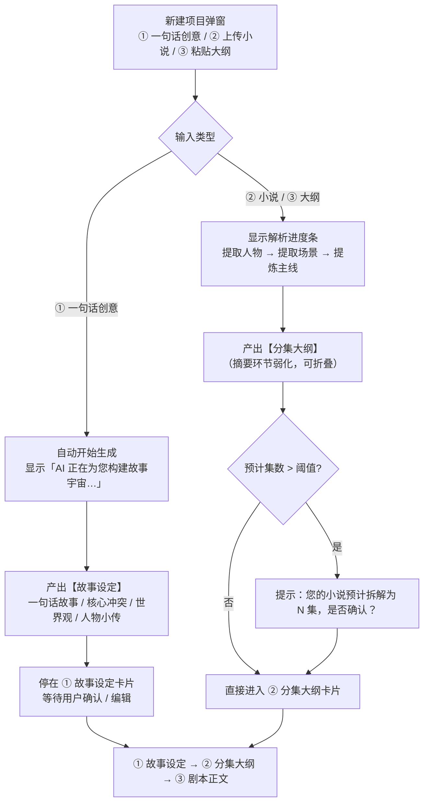
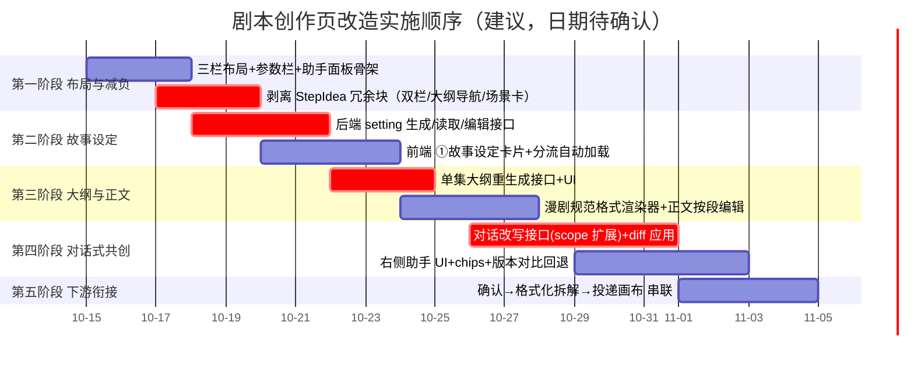

# 漫序 MangaFlow · 剧本创作模块页面与流程改造方案 V1.0

> 对齐目标：参考小云雀的创作范式，把「创意」步骤的冗余展示剥离，重构为**左中右三栏 + 三步定稿 + 对话式共创**。

| 项目 | 内容 |
| ---- | ---- |
| 文档类型 | 改造方案（**未动代码**，待评审确认后实施） |
| 改造对象 | 剧本创作模块（路由 `/projects/:id/script`，`mangaflow-web/src/views/studio/ScriptView.vue` + `components/script/*`） |
| 基线 | 现行实现（2026-10-14 V2.0 复核版）+ 用户 5 步方案（2026-10-14） |
| 编制日期 | 2026-10-14 |
| 状态 | **待决策确认**（见 §11） |

---

## 1. 现状诊断：你说的"多余内容"具体在哪

### 1.1 现行页面结构（`ScriptView.vue` + `StepIdea.vue`）

现行是**单栏纵向 + 顶部四步步骤条**，四个步骤各自独立成页：

```
┌─ 剧本创作 ────────────────────────────────────────────────┐
│ ①创意  ─  ②角色设定  ─  ③分集大纲  ─  ④逐集正文          │ ← el-steps
├───────────────────────────────────────────────────────────┤
│  [精细流程引导条 / 快速模式开关]                          │
│  [版本历史] [导出剧本 ▾]              目标时长 180s       │
│                                                           │
│  ┌─ 左：原始输入 ──────┐  ┌─ 右：AI 生成 ─────────────┐  │ ← 冗余①
│  │ 平凡社畜少女…      │  │ [重新生成]  查看生成原文   │  │   双栏重复
│  └────────────────────┘  └───────────────────────────┘  │
│                                                           │
│  ┌─ 大纲导航 ─┐  ┌─ 场景卡列表 ──────────────────────┐  │ ← 冗余②
│  │ 《雨夜猫天》│  │ 场景1 雨夜拾猫 约30s  [编辑]      │  │   属后续步骤
│  │ 平凡社畜…  │  │ 深夜暴雨，林小满加班回家…         │  │
│  └────────────┘  └───────────────────────────────────┘  │
│                                                           │
│  [体检面板]                                               │
│  [同步 Agent][投递画布]        [确认剧本，进入角色设定]  │
└───────────────────────────────────────────────────────────┘
```

### 1.2 冗余逐块定性（对应你截图 2 的观察）

| # | 现行区块 | 代码位置 | 问题定性 | 处置建议 |
| - | -------- | -------- | -------- | -------- |
| 1 | 左「原始输入」+ 右「AI 生成」双栏 | `StepIdea.vue:1018-1098` | **重复**：输入在新建项目弹窗已填，此处再展示一遍；右栏生成前为空壳 | **合并为单一输入区**（可折叠），生成后只留结果 |
| 2 | 「大纲导航」+「场景卡列表」 | `StepIdea.vue:1114-1167` | **越界**：这是"分集大纲 / 剧本正文"步骤的内容，在"创意"步展示 | **移出创意步**：大纲导航→分集大纲卡片；场景卡→剧本正文卡片 |
| 3 | 引导条 + 工具行 + 体检 + 快速模式开关 | `:895-936, 1169-1228` | **过载**：创意步同时承载 7 类功能 | 工具行（版本/导出）→ 顶部通栏；快速模式开关→新建弹窗或折叠项 |
| 4 | 「AI 助手」抽屉（3 粒度 + 纯建议） | `:1285-1315` | **能力不足**：明示"不会直接改写剧本"，与"对话式共创"相悖 | **升级为右侧常驻对话区**，且支持**直接改写 + 可撤回** |

> **结论**：你的判断成立——创意步骤把"输入回显 + 后续步骤内容 + 全局工具"都堆在了一起。根因是**步骤划分按"数据阶段"而非"用户动作"**：用户的心智是"先看故事设定 → 再定大纲 → 再写正文"，而不是"先进创意页、再进角色页"。

---

## 2. 你的五步方案 vs 现状（差距总表）

| 你的方案 | 现状 | 差距 | 定级 |
| -------- | ---- | ---- | ---- |
| ① 左中右三栏（参数 / 工作区 / 助手） | 单栏纵向 + 顶部步骤条 | 需整体布局重构 | 🔴 大 |
| ① 左侧常驻参数栏（体裁/风格/忠实度/比例/时长） | 参数仅在新建弹窗；`ProjectOut` 已返回全部字段 | **数据现成，纯前端新增** | 🟢 小 |
| ① 中间三卡片：故事设定 / 分集大纲 / 剧本正文 | 四步骤页（创意/角色设定/分集大纲/逐集正文） | 需合并为三卡 + 同屏步骤高亮 | 🟠 中 |
| ① 右侧 AI 对话框 | 有抽屉式"AI 剧本助手"，**仅出建议不改稿** | 需改为常驻 + **可执行修改** | 🔴 大 |
| ② 路径A：自动加载"AI 正在构建故事宇宙…" | 需手动点「开始生成」 | 需自动触发 + 状态文案 | 🟢 小 |
| ② 路径A 产出「**故事设定**」（一句话故事/核心冲突/世界观/人物小传） | ❌ **无该产物**（`plan_characters` 只出角色） | **需新增后端能力** | 🔴 大 |
| ② 路径B：解析进度条 + "预计 N 集，是否确认" | 有小说解析 + 章节列表；集数在 `_default_target_episodes` 内定 | 需进度可视化 + 显式确认 | 🟠 中 |
| ③ 阶段一：确认故事设定（**可编辑**） | ❌ 无 | 需新增 | 🔴 大 |
| ③ 阶段二：**单集**「重新生成」 | ❌ 只有整体 `/episodes/plan` + 单集 `PUT` 编辑 | **需新增单集重生成接口** | 🟠 中 |
| ③ 阶段三：正文符合**漫剧规范格式** | 结构化 `scenes[]`（含 action/dialogue.type）；导出有 txt/Fountain | 需"漫剧格式"渲染视图 | 🟠 中 |
| ④ 对话式共创 + 预设 Chips | ❌ 仅 3 项下拉 + 建议文本 | 需新增对话通道 + chips | 🔴 大 |
| ④ 修改后保留**历史版本**可回退 | ✅ 已有版本快照抽屉 + 回退（`/projects/{id}/snapshots`、`/versions/{id}/rollback`） | 需接进对话流（每次改写自动打点） | 🟢 小 |
| ⑤ 下游格式化拆解（人物→立绘 / 场景→概念图 / 镜头→画布节点） | ✅ 已有 `extract`（人物/场景）+ 分镜拆解 + 投递画布 | 需串成"确认→一键拆解" | 🟢 小 |

**结论：后端已有约 60% 支撑**（角色、分集大纲、正文、优化 diff、版本快照、下游拆解都在），**真正要新增的只有三件**：故事设定产物、单集大纲重生成、可执行改写的对话通道。

---

## 3. 目标页面对齐设计

### 3.1 三栏线框

```
┌ 剧本创作 · 《雨夜猫天》 ──────────[版本历史] [导出 ▾] [⚙]──┐
├──────────┬──────────────────────────────┬─────────────────┤
│ 创作参数 │  ① 故事设定  ─ ② 分集大纲 ─ ③ 剧本正文  │  AI 助手       │
│ (常驻)   │        ▲ 当前步骤高亮            │ (常驻对话)      │
│          │                              │                 │
│ 体裁     │ ┌──────────────────────────┐ │ ┌─────────────┐ │
│  都市    │ │ ① 故事设定         [编辑] │ │ │ 快捷指令    │ │
│ 视觉风格 │ │ 一句话：平凡社畜少女…    │ │ │ ▸ 冲突再强些 │ │
│  日系动漫│ │ 核心冲突：封印契约与…    │ │ │ ▸ 台词口语化 │ │
│ 忠实度   │ │ 世界观：现代都市 × 上古… │ │ │ ▸ 结尾留悬念 │ │
│  自由发挥│ │ 主要人物：               │ │ ├─────────────┤ │
│ 输出比例 │ │  · 林小满｜女主｜24岁…   │ │ │ 对话框      │ │
│  9:16    │ │  · 墨天｜封印神兽｜…     │ │ │ [输入…] [↑] │ │
│ 目标时长 │ └──────────────────────────┘ │ └─────────────┘ │
│  180 秒  │ ┌──────────────────────────┐ │  历史版本:      │
│          │ │ ② 分集大纲   (待生成)    │ │  v3 ▪ v2  v1   │
│ ──────── │ └──────────────────────────┘ │  [回退]         │
│ 预估消耗 │ ┌──────────────────────────┐ │                 │
│  约100积分│ │ ③ 剧本正文   (待生成)    │ │                 │
│          │ └──────────────────────────┘ │                 │
└──────────┴──────────────────────────────┴─────────────────┘
```

### 3.2 左侧参数侧边栏（纯前端，数据现成）

| 展示项 | 数据来源 | 交互 |
| ------ | -------- | ---- |
| 体裁 / 视觉风格 / 忠实度 / 输出比例 / 目标时长 | `GET /api/projects/{id}`（`ProjectOut` 已含 `genre/style/fidelity/aspect_ratio/target_duration`） | 只读展示 + 「修改」跳项目设置 |
| 忠实度语义提示 | 固定文案 | 自由发挥→"AI 可大胆增改反转"；遵循大纲→"AI 按大纲扩写"；严格忠实→"仅做最保守扩写"（对应 RD-01） |
| 预估消耗 | 现有成本估算逻辑（PL-10） | 随目标时长/集数联动 |
| 当前阶段与集数 | `pipeline/state` | 显示"已确认 N 集 / 共 M 集" |

### 3.3 中间主工作区：三步卡片（同屏、当前步高亮）

| 卡片 | 内容 | 主要交互 | 对应后端 |
| ---- | ---- | -------- | -------- |
| **① 故事设定** | 一句话故事、核心冲突、世界观、主要人物小传（人设卡） | 文本框直接编辑；「重新生成」；「下一步：生成分集大纲」 | **需新增**（见 §8） |
| **② 分集大纲** | 集列表（第 1/2/3 集）+ 每集：单集标题、核心剧情点、出场人物、情绪走向、时长 | 单集「重新生成」；「批量重写」；增删集；「下一步：生成剧本正文」 | 已有 `/episodes/plan`（整体）；**需新增单集重生成** |
| **③ 剧本正文** | 按漫剧规范格式渲染的正文，可**按段编辑** | 段落编辑；单集重生成；「确认 → 生成资产」 | 已有 `body/*`；需加"漫剧格式"视图 |

**漫剧规范格式渲染示例**（阶段三的目标形态）：

```
【场景：都市咖啡馆，白天，内景】
【镜头：特写】女主握紧咖啡杯，指节发白。
女主（冷漠）：我们之间没什么好说的。
```

> 现有的 `SceneItem` 已含 `action/location/time_of_day/int_ext/sfx/emotion` 与 `dialogue[].type/emotion`——**渲染所需字段齐全**，只差一个"漫剧格式"渲染器（纯前端 + 可选后端导出格式）。

### 3.4 右侧 AI 对话区（关键体验，能力边界见 §6）

| 元素 | 说明 |
| ---- | ---- |
| 对话框 | 常驻；自然语言指令 → 精准修改**当前聚焦对象**（故事设定 / 某集大纲 / 正文某段） |
| 快捷 Chips | 分三组（见 §6.2），点击即填入指令 |
| 修改回执 | 以 **diff 卡片**呈现（红删绿增）+「采纳 / 拒绝 / 全部采纳」 |
| 历史版本 | 每次采纳自动打版本点；列表可**对比 / 回退**（复用现有快照与回退） |

---

## 4. 分流逻辑（按新建项目的输入类型）



**参数联动（RD-01）**

| 忠实度 | 生成策略 |
| ------ | -------- |
| 自由发挥 `free` | 允许新增反转、支线与配角；温度更高 |
| 遵循大纲 `outline` | 仅在给定大纲内扩写 |
| 严格忠实 `faithful` | 仅做最保守扩写；沿用已有「名单外角色」校验 + 重试 |

**时长/集数联动**：`target_duration=180s` + 竖屏 → 按"单集 60~300s"拆解；现有 `_default_target_episodes` 已按章节/时长推定，只需把推定结果**显式呈现为确认弹窗**。

> ⚠️ 现有能力已覆盖大部分分流逻辑（`inputMode: idea/novel/outline`、小说解析、`_default_target_episodes`），主要工作是**把隐式行为显式化为状态与确认**。

---

## 5. 三阶段定稿：字段与交互映射

| 阶段 | 字段（对应后端） | 交互 | 现状 |
| ---- | ---------------- | ---- | ---- |
| 一 故事设定 | 一句话故事 / 核心冲突 / 世界观 / 人物小传（`role_type/age/personality/appearance/motivation/arc/relations`） | 文本框编辑 + 下一步 | ❌ 一句话/冲突/世界观**需新增**；人物小传字段**已具备** |
| 二 分集大纲 | `title` / `core_event` / `characters[]` / `emotion_curve` / `duration_sec` | 单集重生成 + 批量重写 + 增删集 | 🟠 `logline`/`core_event`/`characters`/`emotion_curve`/`duration_sec` **已具备**；**单集重生成需新增** |
| 三 剧本正文 | `scenes[]`（`action/location/time_of_day/int_ext/sfx/emotion` + `dialogue[].type/emotion/character_id`） | 按段编辑 + 单集重生成 + 确认 | ✅ 字段已具备；需加漫剧格式视图 |

---

## 6. 对话式共创：能力边界与实现方案

> 这是你方案里**竞争力最强、也最需要先定边界**的一块。

### 6.1 三种能力档位（供选择）

| 档位 | 能力 | 工作量 | 说明 |
| ---- | ---- | ------ | ---- |
| **A 建议式**（现状） | 出建议文本，用户手动改 | — | 与你的诉求不符 |
| **B 可执行 + 可撤回**（推荐） | 精准改写目标对象 → **diff 预览 → 采纳/拒绝** → 自动打版本点 | 中高 | **复用已有 `optimize` 四粒度 + `build_field_diffs` + 版本快照**，把作用域从"正文"扩展到"故事设定 / 大纲" |
| C 全功能共创 | 多轮上下文、跨阶段联动改写、自然语言"改完第2集再加强第3集钩子" | 高 | 需多轮会话 + 影响面分析，建议二期 |

### 6.2 预设快捷 Chips（按你的三组归类）

| 组 | Chips |
| -- | ----- |
| **剧情** | 第1集冲突太弱，提前安排反派出场 · 增加男女主的甜蜜互动 · 提高结尾悬念强度 |
| **台词** | 台词太书面了，改得更像日漫那种傲娇语气 · 把男主台词改得更有都市精英感 · 台词更短，适合竖屏快节奏 |
| **节奏** | 180 秒太短，结尾留个大悬念 · 节奏太快了，多加点环境描写 · 单集时长压到 60 秒内 |

> Chips 即"预置 instruction"，直接走同一改写通道——**不需要新协议**。

### 6.3 修正既有交互（重要）

现有抽屉明示"**本助手不会直接改写剧本**"（`StepIdea.vue:1309`）。改造后需改为**直接可应用**，并同步更新该提示文案。

---

## 7. 下游衔接（第五步）：格式化拆解

| 你要的产物 | 现有能力 | 需做 |
| ---------- | -------- | ---- |
| 人物 → 人物立绘 / 多视图 | ✅ `characters` 表 + 定妆照生成（RD-10 先主照后派生） | 「确认正文」时把正文出现的角色**与已确认角色对账**，缺失者提示补建 |
| 场景 → 场景概念图 | ✅ `scenes` 表 + 概念图生成（RD-19 空场景） | 同上，按 `locations` 去重清单对账 |
| 正文按镜头切分 → 画布分镜节点 | ✅ 分镜拆解（SB-01）+ 投递画布（SB-09） | 串联为"确认 → 一键拆解 → 可选投递画布" |

> 这一环**基本现成**，主要是 UI 上把三步串成一个"格式化拆解"确认动作（含影响面预览，RD-08 已有接口）。

---

## 8. 后端补口清单（新增）

| # | 接口 | 说明 | 复用 |
| - | ---- | ---- | ---- |
| 1 | `POST /script/setting/generate` | 生成**故事设定**（一句话/核心冲突/世界观/人物小传） | 复用 `plan_characters` 的角色部分 + 新增设定段；RD-01 走 `build_fidelity_directive` |
| 2 | `GET /script/setting` | 读取故事设定 | — |
| 3 | `PUT /script/setting` | 用户编辑保存（RD-03 `source=user`） | 复用 `wrap_content_fields` |
| 4 | `POST /script/setting/regenerate` | 重生成（可带 instruction） | 同 1 |
| 5 | `POST /script/episodes/{eid}/outline/regenerate` | **单集大纲重生成**（你明确要求） | 复用 `plan_episodes` 的提示词与校验，作用域收窄到 1 集 |
| 6 | `POST /script/episodes/plan/regenerate` | 批量重写（保留已确认集） | 可选 |
| 7 | `POST /script/assist` | **对话式改写**：`{scope: setting/episode_outline/episode_body, target, instruction}` → 返回 diff；`/assist/apply` 应用 | **复用** `optimize_episode_content` + `build_field_diffs` + `/optimize/apply` 机制，作用域扩展 |

**数据模型建议**

| 方案 | 说明 | 迁移成本 | 建议 |
| ---- | ---- | -------- | ---- |
| A. `projects.story_setting JSONB` 新增字段 | 故事设定是项目级、分集之前 | 低（nullable） | **推荐** |
| B. 复用 `scripts.content` 的 `setting` 段 | 塞进剧本行 | 中（语义混淆） | 次选 |
| `script_phase` 取值 | 现为 `idea/characters/outline/body` | — | **保持 `characters` 不变（UI 改称"故事设定"）**，避免迁移；或新增 `setting` 值（需数据迁移） |

---

## 9. 前端改造清单

**新增**

| 组件 | 职责 |
| ---- | ---- |
| `components/script/ParamSidebar.vue` | 左侧常驻参数栏 |
| `components/script/AssistantPanel.vue` | 右侧常驻对话区（含 chips / diff 卡片 / 版本列表） |
| `components/script/StorySettingCard.vue` | ① 故事设定卡片 |
| `components/script/EpisodeOutlineCard.vue` | ② 分集大纲卡片（由现有 `StepEpisodesPlan` 改造） |
| `components/script/ScriptBodyCard.vue` | ③ 剧本正文卡片（含漫剧格式视图，由 `StepEpisodeBody` 改造） |
| `utils/manga-format.ts` | 结构化 `scenes[]` → 漫剧规范文本渲染器 |

**改造**：`ScriptView.vue` → 三栏栅格 + 卡片式步骤（替换 `el-steps`）

**删除/迁移（对应 §1.2 冗余）**

| 区块 | 处置 |
| ---- | ---- |
| `StepIdea` 双栏「原始输入 / AI 生成」 | 合并为单一可折叠输入区 |
| `StepIdea` 「大纲导航」 | 迁入 ② 分集大纲卡片 |
| `StepIdea` 「场景卡列表」 | 迁入 ③ 剧本正文卡片 |
| `StepIdea` 工具行（版本/导出） | 迁到页面顶部通栏 |
| `StepIdea` 「快速模式」开关 | 保留但折叠为次要入口 |
| `StepIdea` AI 助手抽屉 | 升级为右侧常驻 `AssistantPanel` |

---

## 10. 实施顺序与工作量



| 阶段 | 内容 | 是否依赖后端 |
| ---- | ---- | ------------ |
| **P1 布局与减负** | 三栏布局、参数栏、助手面板骨架、**剥离冗余块** | ❌ 纯前端（**可直接开工，先解决你说的冗余问题**） |
| P2 故事设定 | 后端 setting 接口 + 前端卡片 + 分流自动加载 | ✅ 需补口 |
| P3 大纲与正文 | 单集大纲重生成 + 漫剧格式渲染 | ✅ 需补口 |
| P4 对话式共创 | 改写接口 + 助手 UI + chips + 版本对比 | ✅ 需补口 |
| P5 下游衔接 | 格式化拆解串联 | ❌ 基本现成 |

---

## 11. 待确认决策（**阻塞实施，请拍板**）

| # | 决策点 | 选项 | 我的建议 |
| - | ------ | ---- | -------- |
| **D1** | **是否现在开始改造代码？** | A. 直接开工（先 P1 纯前端减负）B. 先评审本方案再动 | **A**（P1 不碰业务逻辑，可先见效） |
| **D2** | 「故事设定」与现行「角色设定」步骤的关系 | A. 合并为一卡（变成 3 步：故事设定/大纲/正文）B. 保留两步（变成 5 步） | **A**（与你方案一致，人物小传本就是故事设定的一部分） |
| **D3** | 对话式共创本期深度 | A. 可执行修改 + diff 采纳 + 版本回退（§6.1-B）B. 先做建议式，二期再做 C. 全功能共创 | **A**（复用现有 optimize/diff/快照，性价比最高） |
| **D4** | `script_phase` 迁移策略 | A. 保持 `characters` 不变，仅 UI 改称"故事设定" B. 新增 `setting` 值（需迁移存量） | **A**（零迁移风险） |
| **D5** | 左侧参数栏是否可编辑 | A. 只读 + 跳转项目设置 B. 就地可改（需回写项目接口） | **A**（本期从简） |

---

## 12. 建议立即做的 3 件事

1. **【拍板 D1~D5】**——尤其 D1（是否开工）与 D2（三卡合并方式），这两条决定后续全部组件结构。
2. **【先做 P1：纯前端减负】**——把「双栏输入/输出」「大纲导航」「场景卡」从创意步剥离，改为三栏布局 + 参数栏 + 助手面板骨架。**这一步不依赖任何后端改动，能立刻消除你截图里看到的冗余**。
3. **【并行补三处后端口】**——`setting/generate|get|put`、`episodes/{eid}/outline/regenerate`、`script/assist`。三者都能复用现有 Agent 与 diff 机制，属"接线"而非"造轮子"。

---

*本方案为改造设计参考，实施前请确认 §11 决策项。*

*— 方案结束 —*
