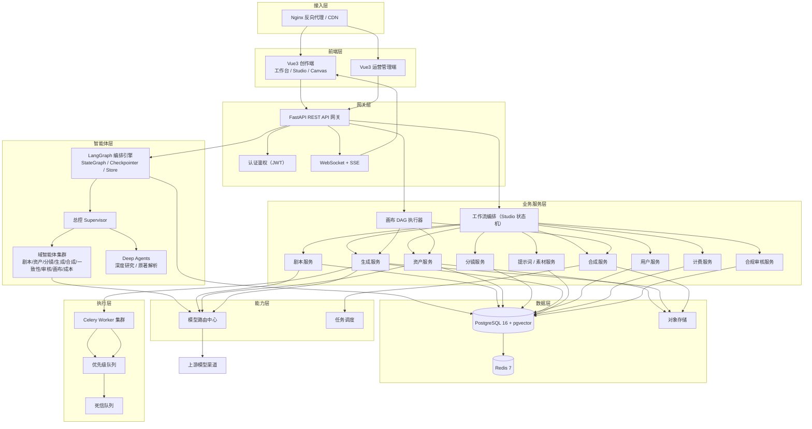
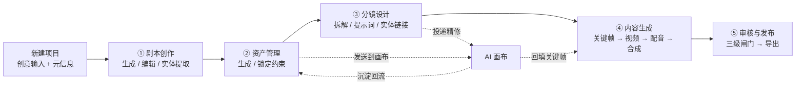
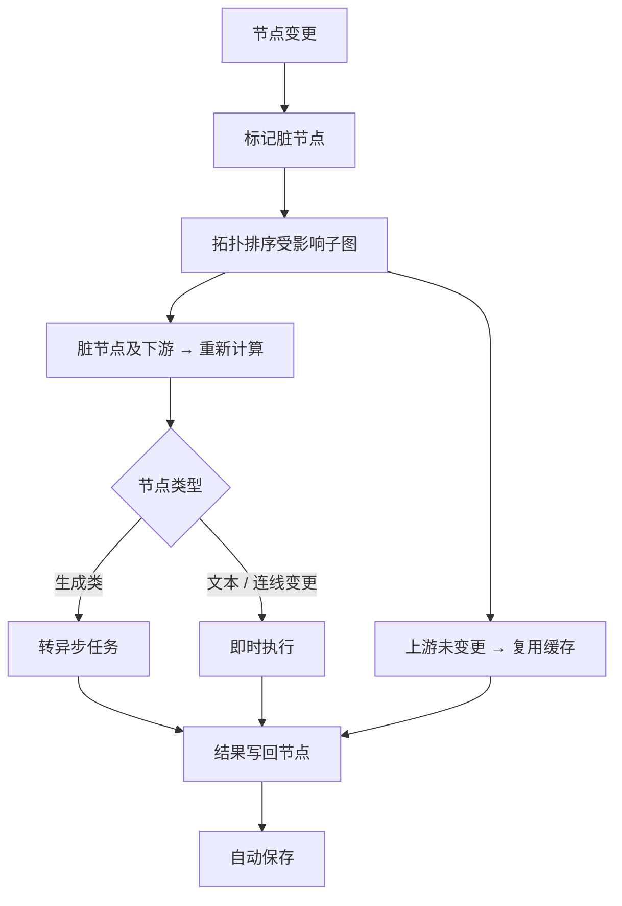
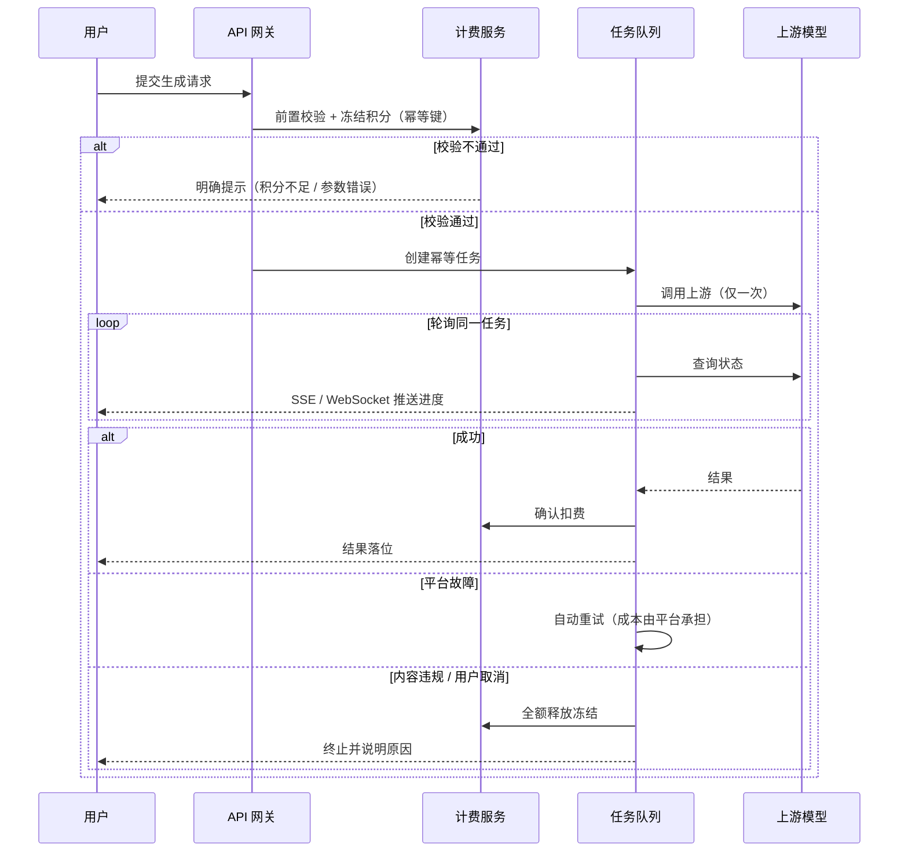
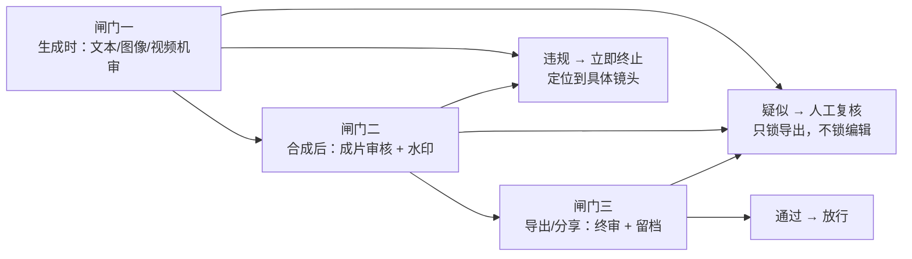
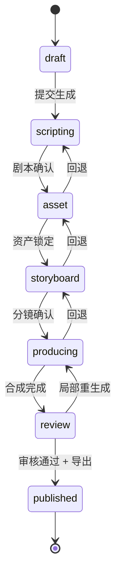
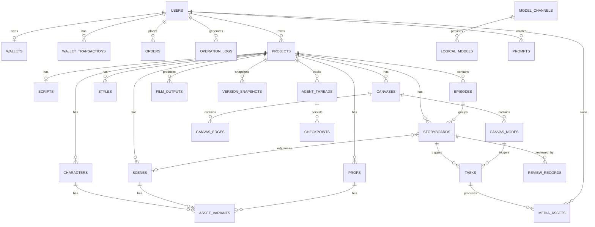

# 漫序 MangaFlow · 项目架构设计与数据库设计文档

| 项目 | 内容 |
| ---- | ---- |
| 产品名称 | 漫序 MangaFlow |
| 文档版本 | V1.1 |
| 文档类型 | 架构设计与数据库设计 |
| 编制日期 | 2026-10-08 |
| 基线文档 | 《漫序 MangaFlow 产品需求文档（PRD）V1.1》、《漫序 MangaFlow 产品设计方案 V1.3》 |
| 状态 | 待评审 |

**说明**：本文档严格基于 PRD V1.1 已定义的功能编号（D/S/A/SB/P/R/CV/PL/C/V/AD/SYS/MA/U）与评审决议（RD-01~RD-57）展开，不引入 PRD 未定义的功能或技术选型。

---

## 1. 架构总览

### 1.1 设计原则

| 原则 | 说明 |
| ---- | ---- |
| 双引擎共享底座 | Studio（流水线）与 Canvas（画布）共用资产 / 提示词 / 模型 / 素材 / 计费 / 审核 / 版本底座 |
| 三框架分层 | LangGraph 编排、LangChain 组件、Deep Agents 深度任务，职责不重叠（RD-53） |
| 模型可插拔 | 渠道层与逻辑模型层分离，换厂商不改业务代码（PL-07 / PL-08 / PL-26~PL-29） |
| 异步优先 | 重任务（视频/合成）全部走队列，前端不阻塞（P-09 / SYS-01） |
| 资金安全 | 幂等 + 对账 + 资损监控为红线，不可裁剪（RD-55） |
| 一致性优先 | 资产强约束贯穿全链路，生成前后双向把关（A-08 / A-09） |

### 1.2 分层结构

| 层 | 名称 | 职责 | 主要构成 |
| -- | ---- | ---- | -------- |
| L1 | 接入层 | 流量入口与静态资源 | Nginx 反向代理 + CDN |
| L2 | 前端层 | 用户界面 | Vue3 创作端（工作台/Studio/Canvas，仓库 `mangaflow-web`）、Vue3 运营管理端（独立仓库 `mangaflow-admin-web`）；两仓共用 `@mangaflow/design` 设计系统（见 §3.1.4，RD-58） |
| L3 | 网关层 | 统一入口与鉴权 | FastAPI REST API、认证鉴权、WebSocket + SSE |
| L4 | 智能体层 | AI 编排与协作 | LangGraph 编排引擎、总控 Supervisor、域智能体集群、Deep Agents |
| L5 | 业务服务层 | 领域服务 | 剧本 / 资产 / 分镜 / 生成 / 合成 / 用户 / 计费 / 审核 / 提示词素材服务、工作流编排、画布 DAG 执行器 |
| L6 | 能力层 | 通用能力 | 模型路由中心、任务调度、合规审核、计费引擎、检查点与长期记忆 |
| L7 | 数据层 | 持久化与存储 | PostgreSQL 16 + pgvector、Redis 7、对象存储 |
| L8 | 执行层 | 异步任务 | Celery Worker 集群、优先级队列、死信队列 |
| L9 | 可观测层 | 监控与追踪 | LangSmith、Prometheus、Grafana、Loki |

### 1.3 技术选型（与 PRD 第 9 章一致）

| 层级 | 选型 |
| ---- | ---- |
| 前端 | Vue 3 + Vite + TypeScript + Element Plus + Pinia |
| 画布引擎 | 自研节点画布内核 |
| 后端 | Python 3.13 + FastAPI + SQLAlchemy 2.0（异步） |
| 数据库 | PostgreSQL 16 + pgvector |
| 缓存 / 队列 | Redis 7.0 + Celery + Flower |
| 多智能体编排 | LangGraph（最新版） |
| 组件层 | LangChain（最小化使用） |
| 深度任务 | Deep Agents |
| 可观测 | LangSmith + Prometheus + Grafana + Loki |
| 视频处理 | FFmpeg 6.0 |
| 对象存储 | 阿里云 OSS / 腾讯云 COS / S3 兼容 |
| 部署 | Docker + Nginx |

---

## 2. 系统架构图

---

## 3. 模块划分

### 3.1 前端模块

> **路由表以《漫序 MangaFlow UI 原型界面描述清单 V2.1》§0.6.1「菜单定稿表」为准**，两侧保持同步。

**3.1.1 全局导航（侧栏 10 项 + 帮助）**

| 分组 | 菜单项 | 路由 | 对应页面 | 覆盖需求 |
| ---- | ------ | ---- | -------- | -------- |
| 创作 | Agent | `/agent` | W-01 工作台（Agent 首屏）/ P-01 | D-03~D-06 · PL-01~PL-06 |
| 项目 | 漫剧项目 | `/projects` | W-02 项目列表 | D-01~D-06 |
| 项目 | AI 画布 | `/canvas` | C-01 画布列表 | CV-01~CV-03 |
| 项目 | 协作 | `/collab`（**禁用路由**） | —— | V-03 / V-04（本期不做） |
| 资产 | 角色与场景 | `/characters` | 跨项目资产总览 | A-01~A-10 |
| 资产 | 素材库 | `/media` | P-03 | PL-16~PL-19 |
| 资产 | 提示词库 | `/prompts` | P-02 | PL-12~PL-15 |
| 账户 | 模型配置 | `/models` | P-04 | PL-07~PL-11 · PL-26~PL-29 |
| 账户 | 计费与配额 | `/billing` | P-05 | PL-20~PL-25 |
| 账户 | 个人中心 | `/profile` | P-06 | U-03~U-06 · V-01 · V-02 |
| 底部 | 帮助 | `/help` | 帮助中心 | —— |

**3.1.2 项目内路由（不进侧栏，由顶栏五阶段步骤条导航）**

| 阶段 | 路由 | 页面 | 覆盖需求 |
| ---- | ---- | ---- | -------- |
| ① 剧本 | `/projects/:id/script` | S-02（含 S-01 弹窗、S-03 子步骤） | S-01~S-10 |
| ② 资产 | `/projects/:id/assets` | S-04（含 S-05 抽屉） | A-01~A-10 |
| ③ 分镜 | `/projects/:id/storyboard` | S-06 | SB-01~SB-09 |
| ④ 生成 | `/projects/:id/production` | S-07 / S-08 | P-01~P-17 |
| ⑤ 发布 | `/projects/:id/publish` | S-09 | R-01~R-09 |

**3.1.3 其他路由**

| 模块 | 路由 | 覆盖需求 |
| ---- | ---- | -------- |
| 官网首页（未登录） | `/` | PL-01 · PL-02 |
| 认证（未登录层） | `/login` `/register` `/forgot-password` | U-01 ~ U-03 |
| 画布编辑器 | `/canvas/:id` | CV-04~CV-25 |
| 分享预览（公开） | `/share/:token` | R-06 |
| 运营管理端 | **独立仓库 `mangaflow-admin-web`，独立端口/域名部署**（RD-58）；本主仓库不再含 `/admin/*` 路由 | AD-01 ~ AD-05 |

### 3.1.4 前端仓库拆分与共享设计系统（RD-58）

为隔离运营后台与 C 端产品的发布节奏与权限边界，前端按仓库拆分为两个独立部署单元：

| 仓库 | 承载 | 部署 | 路由前缀 |
| ---- | ---- | ---- | -------- |
| `mangaflow-web` | 官网门户 + 创作端（工作台 / Studio / Canvas + 资产 / 素材 / 提示词 / 模型 / 计费 / 个人中心 / 帮助） | 主域名（Nginx `location /`，见部署文档 §5.4） | 无（主 SPA） |
| `mangaflow-admin-web` | 运营管理端全部页面（UI 文档 A-01~A-08，对应需求 AD-01~AD-05） | **独立端口 / 域名**（独立 Nginx / TLS 或独立域名，见部署文档 §5.6） | 内部自路由，不挂在主域 `/admin` 下 |

**共享设计系统 `@mangaflow/design`**：将两个仓库共用的设计 token（墨青 `#12B3A6` / 藤紫 `#7C6BF0` / 中性色 / 语义色，详见 UI 文档 §0.7）与通用组件（侧栏、顶栏、卡片、按钮、状态机组件等）抽为独立 npm 包，两仓库以依赖方式引入，作为 UI 单一事实源，避免双仓配色与组件漂移。包内不耦合业务，仅输出 token 变量、基础组件与主题切换工具。

**鉴权边界**：运营管理员与 C 端用户共用同一 auth 服务签发 JWT，靠 `role` 声明区分（`operator` vs `end_user`）；管理端接口在后端按 `role=operator` 做门禁（能力层不变）。管理端保留独立登录页（A-01），不暴露创作端导航。

### 3.2 后端服务模块

| 服务 | 职责 | 覆盖需求 |
| ---- | ---- | -------- |
| 认证服务 | 注册登录、JWT 签发与刷新、权限校验 | U-01 / U-02 / SYS-03 |
| 用户服务 | 用户信息、密码重置、用量统计、导入导出 | U-03 ~ U-06 |
| 剧本服务 | 多模式输入、剧本生成与编辑、结构化解析、实体提取 | S-01 ~ S-10 |
| 资产服务 | 资产生成、变体管理、特征提取、一致性与锁定 | A-01 ~ A-10 |
| 分镜服务 | 分镜拆解、提示词生成、实体链接、时长与节奏 | SB-01 ~ SB-09 |
| 生成服务 | 关键帧、视频、配音生成与任务编排 | P-01 ~ P-14 |
| 合成服务 | 剪辑合成、字幕、转场、成片版本 | P-15 ~ P-17 / R-03 / RD-40 |
| 画布服务 | 画布 CRUD、节点与连线、DAG 增量执行、插件注册 | CV-01 ~ CV-25 |
| 提示词素材服务 | 提示词库、素材库与引用保护 | PL-12 ~ PL-19 |
| 模型路由服务 | 渠道托管、逻辑模型路由、健康检测、降级 | PL-07 ~ PL-11 / PL-26 ~ PL-29 |
| 计费服务 | 配额、积分、冻结与扣减、对账、资损监控 | PL-20 ~ PL-25 / SYS-02 |
| 合规审核服务 | 三级闸门审核、人工队列、违规记录 | R-08 / C-01 ~ C-04 |
| 智能体编排服务 | LangGraph 图执行、检查点、记忆、HITL | MA-01 ~ MA-20 |
| 版本服务 | 版本快照与回退、操作日志 | V-01 / V-02 |
| 运营管理服务 | 用户/审核/模型配置/订单计费/数据看板 | AD-01 ~ AD-05 |

### 3.3 智能体集群（MA-03，11 类）

| 智能体 | 职责 |
| ------ | ---- |
| 总控 Supervisor | 意图识别、任务分派、流程路由、状态汇总（MA-02） |
| 剧本 Agent | 创意→结构化剧本、角色/场景提取、质量体检 |
| 资产 Agent | 定妆照/概念图生成、多造型、特征提取与锁定 |
| 分镜 Agent | 剧本拆解、提示词生成、连续性检查 |
| 生成 Agent | 关键帧/视频/配音编排与任务调度 |
| 合成 Agent | 剪辑合成、字幕、转场 |
| 一致性 Agent（子图） | 跨镜头角色一致性守护 |
| 画布助手 Agent | 画布上下文理解与节点编排 |
| 审核 Agent | 文本/图片/视频三重合规检测 |
| 成本/配额 Agent | 成本估算与配额校验 |
| 深度研究 Agent（Deep Agents） | 原著长文本解析、世界观/人物关系抽取 |

---

## 4. 核心业务流程

### 4.1 全流程（Studio 五阶段）

### 4.2 剧本 → 资产实体提取（S-10 / RD-04 / RD-05 / RD-06）

### 4.3 画布 DAG 增量执行（CV-07 / RD-45）

### 4.4 生成任务与计费（P-11 / RD-28）

### 4.5 审核三级闸门（R-08 / RD-34 / RD-35）

### 4.6 Studio 项目状态机

---

## 5. 数据库设计

### 5.1 设计原则与规范

| 项 | 规范 |
| -- | ---- |
| 数据库 | PostgreSQL 16 |
| 扩展 | `pgvector`（向量检索，RD-15）、`pg_trgm`（模糊搜索） |
| 字符集 | UTF8 |
| 命名 | 表名/字段名小写下划线；外键 `xxx_id` |
| 主键 | `id BIGSERIAL PRIMARY KEY` |
| 时间 | `created_at` / `updated_at` 使用 `TIMESTAMPTZ`，默认 `now()` |
| 软删除 | 项目与资产使用 `deleted_at TIMESTAMPTZ NULL`（引用保护 RD-19 / PL-19） |
| 结构化数据 | 剧本、分镜、画布节点内容使用 `JSONB` |
| 金额与积分 | 积分用 `BIGINT`；金额用 `NUMERIC(12,2)`，**禁止浮点**（RD-55） |
| 幂等 | 资金与生成任务均带唯一幂等键 |
| 枚举 | 使用 `VARCHAR` + `CHECK` 约束（便于扩展） |

### 5.2 实体关系图

### 5.3 表结构明细

> 通用字段（所有业务表）：`id BIGSERIAL PK`、`created_at TIMESTAMPTZ NOT NULL DEFAULT now()`、`updated_at TIMESTAMPTZ NOT NULL DEFAULT now()`（下表中不再重复列出）。

#### 5.3.1 users（用户表）

| 字段 | 类型 | 约束 | 说明 |
| ---- | ---- | ---- | ---- |
| username | VARCHAR(50) | UNIQUE NOT NULL | 用户名 |
| email | VARCHAR(100) | UNIQUE | 邮箱（脱敏存储展示） |
| phone | VARCHAR(20) | UNIQUE | 手机号 |
| password_hash | VARCHAR(255) | NOT NULL | 密码哈希 |
| avatar | VARCHAR(255) | NULL | 头像 URL |
| role | VARCHAR(20) | NOT NULL DEFAULT 'user' | user / admin |
| vip_level | SMALLINT | NOT NULL DEFAULT 0 | 会员等级 |
| status | SMALLINT | NOT NULL DEFAULT 1 | 0 禁用 / 1 正常 |
| last_login_at | TIMESTAMPTZ | NULL | 最近登录 |

**索引**：`uk_users_email(email)`、`uk_users_phone(phone)`、`uk_users_username(username)`、`idx_users_status(status)`

#### 5.3.2 wallets（用户钱包）

| 字段 | 类型 | 约束 | 说明 |
| ---- | ---- | ---- | ---- |
| user_id | BIGINT | UNIQUE NOT NULL FK→users.id | 用户 |
| points_balance | BIGINT | NOT NULL DEFAULT 0 CHECK ≥ 0 | 可用积分 |
| frozen_points | BIGINT | NOT NULL DEFAULT 0 CHECK ≥ 0 | 冻结积分 |
| version | INT | NOT NULL DEFAULT 0 | 乐观锁版本 |

**索引**：`uk_wallets_user(user_id)`

#### 5.3.3 wallet_transactions（积分流水）

| 字段 | 类型 | 约束 | 说明 |
| ---- | ---- | ---- | ---- |
| user_id | BIGINT | NOT NULL FK→users.id | 用户 |
| type | VARCHAR(20) | NOT NULL | freeze / consume / refund / recharge / grant |
| amount | BIGINT | NOT NULL | 变动积分（正负） |
| bear | VARCHAR(20) | NOT NULL DEFAULT 'user' | 成本承担方：user / platform（RD-28） |
| ref_task_id | BIGINT | NULL FK→tasks.id | 关联任务 |
| ref_order_id | BIGINT | NULL FK→orders.id | 关联订单 |
| idempotency_key | VARCHAR(80) | UNIQUE NOT NULL | 幂等键（RD-55） |
| remark | VARCHAR(255) | NULL | 备注 |

**索引**：`uk_wtx_idem(idempotency_key)`、`idx_wtx_user_time(user_id, created_at DESC)`、`idx_wtx_type(type)`

#### 5.3.4 orders（订单）

| 字段 | 类型 | 约束 | 说明 |
| ---- | ---- | ---- | ---- |
| user_id | BIGINT | NOT NULL FK→users.id | 用户 |
| order_no | VARCHAR(50) | UNIQUE NOT NULL | 订单号 |
| product_type | VARCHAR(20) | NOT NULL | points / subscription |
| amount | NUMERIC(12,2) | NOT NULL CHECK ≥ 0 | 金额（元） |
| points | BIGINT | NOT NULL DEFAULT 0 | 兑换积分 |
| pay_channel | VARCHAR(20) | NULL | 支付渠道 |
| status | VARCHAR(20) | NOT NULL DEFAULT 'pending' | pending / paid / closed / refunded |
| paid_at | TIMESTAMPTZ | NULL | 支付时间 |
| invoice_status | VARCHAR(20) | NULL | 发票状态（PL-23） |

**索引**：`uk_orders_no(order_no)`、`idx_orders_user(user_id)`、`idx_orders_status(status)`

#### 5.3.5 operation_logs（操作日志，V-02）

| 字段 | 类型 | 约束 | 说明 |
| ---- | ---- | ---- | ---- |
| user_id | BIGINT | NOT NULL FK→users.id | 操作人 |
| project_id | BIGINT | NULL FK→projects.id | 关联项目 |
| action | VARCHAR(50) | NOT NULL | 操作类型 |
| detail | JSONB | NULL | 操作详情 |
| ip | VARCHAR(50) | NULL | 操作 IP |
| risk_level | VARCHAR(10) | NOT NULL DEFAULT 'normal' | normal / high（RD-56 高危操作） |

**索引**：`idx_oplog_user(user_id)`、`idx_oplog_project(project_id)`、`idx_oplog_action(action)`、`idx_oplog_time(created_at DESC)`

#### 5.3.6 projects（项目）

| 字段 | 类型 | 约束 | 说明 |
| ---- | ---- | ---- | ---- |
| user_id | BIGINT | NOT NULL FK→users.id | 归属用户 |
| title | VARCHAR(100) | NOT NULL | 项目标题 |
| genre | VARCHAR(20) | NULL | 体裁 |
| style | VARCHAR(20) | NULL | 视觉风格 |
| fidelity | VARCHAR(20) | NULL | 忠实度档位：free / outline / faithful（RD-01） |
| status | VARCHAR(20) | NOT NULL DEFAULT 'draft' | draft / scripting / asset / storyboard / producing / review / published |
| aspect_ratio | VARCHAR(10) | NOT NULL DEFAULT '9:16' | 输出比例（RD-37 前置） |
| target_duration | INT | NULL | 目标时长（秒） |
| config | JSONB | NULL | 项目级模型配置（PL-09） |
| cover_url | VARCHAR(255) | NULL | 封面 |
| deleted_at | TIMESTAMPTZ | NULL | 软删除 |

**索引**：`idx_projects_user(user_id, updated_at DESC)`、`idx_projects_status(status)`、`idx_projects_deleted(deleted_at)`

#### 5.3.7 episodes（剧集，S-06）

| 字段 | 类型 | 约束 | 说明 |
| ---- | ---- | ---- | ---- |
| project_id | BIGINT | NOT NULL FK→projects.id | 项目 |
| title | VARCHAR(100) | NOT NULL | 剧集标题 |
| sequence | INT | NOT NULL | 剧集序号 |
| script_snapshot | JSONB | NULL | 该剧集剧本快照 |
| status | VARCHAR(20) | NOT NULL DEFAULT 'draft' | 状态 |

**索引**：`uk_episodes_seq(project_id, sequence)`、`idx_episodes_project(project_id)`

#### 5.3.8 scripts（剧本）

| 字段 | 类型 | 约束 | 说明 |
| ---- | ---- | ---- | ---- |
| project_id | BIGINT | NOT NULL FK→projects.id | 项目 |
| episode_id | BIGINT | NULL FK→episodes.id | 所属剧集 |
| content | JSONB | NOT NULL | 结构化剧本（含字段级 source 标记，RD-03） |
| raw_text | TEXT | NULL | 原始输入文本 |
| fences | JSONB | NULL | 别名归一与冲突记录（RD-05 / RD-06） |
| health_report | JSONB | NULL | 结构化体检结果（RD-02） |
| version | INT | NOT NULL DEFAULT 1 | 版本号 |

**索引**：`uk_scripts_project(project_id, episode_id)`、`idx_scripts_version(project_id, version)`

#### 5.3.9 characters（角色资产）

| 字段 | 类型 | 约束 | 说明 |
| ---- | ---- | ---- | ---- |
| project_id | BIGINT | NOT NULL FK→projects.id | 项目 |
| name | VARCHAR(50) | NOT NULL | 角色名 |
| aliases | JSONB | NULL | 别名/称谓集合（RD-05） |
| description | TEXT | NULL | 角色描述 |
| visual_prompt | TEXT | NOT NULL | 标准化视觉提示词（A-06） |
| feature_vector | JSONB | NULL | 面部特征向量 |
| asset_url | VARCHAR(255) | NULL | 主定妆照 URL |
| **face_locked** | BOOLEAN | NOT NULL DEFAULT false | 面部层锁定（RD-12） |
| **outfit_variant_id** | BIGINT | NULL FK→asset_variants.id | 当前服饰变体（RD-12） |
| generation_status | VARCHAR(20) | NOT NULL DEFAULT 'pending' | pending / generating / done / failed |
| deleted_at | TIMESTAMPTZ | NULL | 软删除 |

**索引**：`idx_characters_project(project_id)`、`uk_characters_name(project_id, name)`、`idx_characters_locked(project_id, face_locked)`

> 注：`face_locked` / `outfit_variant_id` 为实现 RD-12「锁定分两层」的字段拆分；原 PRD A-09 的 `is_locked` 语义由两者共同表达。

#### 5.3.10 scenes（场景资产）

| 字段 | 类型 | 约束 | 说明 |
| ---- | ---- | ---- | ---- |
| project_id | BIGINT | NOT NULL FK→projects.id | 项目 |
| name | VARCHAR(50) | NOT NULL | 场景名 |
| description | TEXT | NULL | 场景描述 |
| visual_prompt | TEXT | NOT NULL | 视觉提示词 |
| asset_url | VARCHAR(255) | NULL | 概念图 URL（**空场景**，RD-19） |
| space_signature | JSONB | NULL | 空间布局签名（用于空间一致性校验，RD-19） |
| is_locked | BOOLEAN | NOT NULL DEFAULT false | 锁定状态 |
| deleted_at | TIMESTAMPTZ | NULL | 软删除 |

**索引**：`idx_scenes_project(project_id)`、`uk_scenes_name(project_id, name)`

#### 5.3.11 props（道具资产，A-07 / RD-17 / RD-18）

| 字段 | 类型 | 约束 | 说明 |
| ---- | ---- | ---- | ---- |
| project_id | BIGINT | NOT NULL FK→projects.id | 项目 |
| name | VARCHAR(50) | NOT NULL | 道具名 |
| category | VARCHAR(30) | NULL | 分类 |
| description | TEXT | NULL | 描述 |
| visual_prompt | TEXT | NOT NULL | 视觉提示词 |
| asset_url | VARCHAR(255) | NULL | 标准图 URL |
| ownership | JSONB | NULL | 归属关系：持有者 / 出现场次 / 换手记录（RD-18） |
| is_locked | BOOLEAN | NOT NULL DEFAULT false | 锁定状态 |
| deleted_at | TIMESTAMPTZ | NULL | 软删除 |

**索引**：`idx_props_project(project_id)`、`idx_props_category(project_id, category)`

#### 5.3.12 styles（风格资产，RD-16）

| 字段 | 类型 | 约束 | 说明 |
| ---- | ---- | ---- | ---- |
| project_id | BIGINT | NOT NULL FK→projects.id | 项目 |
| name | VARCHAR(50) | NOT NULL | 风格名 |
| preset_code | VARCHAR(30) | NULL | 内置预设编码 |
| reference_url | VARCHAR(255) | NULL | 参考图 URL |
| visual_prompt | TEXT | NOT NULL | 风格提示词（全局锚点） |
| is_default | BOOLEAN | NOT NULL DEFAULT false | 是否项目默认风格 |

**索引**：`idx_styles_project(project_id)`、`uk_styles_default(project_id) WHERE is_default`

#### 5.3.13 asset_variants（资产变体，RD-14 / RD-19）

| 字段 | 类型 | 约束 | 说明 |
| ---- | ---- | ---- | ---- |
| owner_type | VARCHAR(20) | NOT NULL | character / scene / prop |
| owner_id | BIGINT | NOT NULL | 归属资产 ID |
| variant_type | VARCHAR(20) | NOT NULL | outfit（造型）/ lighting（光线）/ age / other |
| name | VARCHAR(50) | NOT NULL | 变体名（如"战斗装""夜景"） |
| inherit_mask | JSONB | NOT NULL | **显式继承/独立声明**（RD-14） |
| asset_url | VARCHAR(255) | NULL | 变体图 URL |
| visual_prompt | TEXT | NULL | 变体提示词 |
| is_active | BOOLEAN | NOT NULL DEFAULT true | 是否启用 |

**索引**：`idx_variants_owner(owner_type, owner_id)`、`idx_variants_type(variant_type)`

#### 5.3.14 storyboards（分镜）

| 字段 | 类型 | 约束 | 说明 |
| ---- | ---- | ---- | ---- |
| project_id | BIGINT | NOT NULL FK→projects.id | 项目 |
| episode_id | BIGINT | NULL FK→episodes.id | 所属剧集 |
| script_id | BIGINT | NULL FK→scripts.id | 来源剧本 |
| sequence | INT | NOT NULL | 镜头序号 |
| shot_type | VARCHAR(20) | NULL | 景别 |
| camera_movement | VARCHAR(20) | NULL | 运镜 |
| duration | INT | NOT NULL DEFAULT 5 | 预计时长（秒） |
| **actual_duration** | NUMERIC(6,2) | NULL | 配音回写的实际时长（RD-31） |
| visual_description | TEXT | NULL | 画面描述 |
| dialogue | TEXT | NULL | 对白 / 旁白 |
| scene_id | BIGINT | NULL FK→scenes.id | **强绑场景资产**（RD-24） |
| prompt_locked | TEXT | NULL | 提示词系统锁定层（RD-04 分层） |
| prompt_editable | TEXT | NULL | 提示词用户可编辑层 |
| keyframe_url | VARCHAR(255) | NULL | 关键帧 URL |
| end_frame_url | VARCHAR(255) | NULL | 尾帧 URL |
| video_url | VARCHAR(255) | NULL | 视频片段 URL |
| audio_url | VARCHAR(255) | NULL | 配音 URL |
| status | VARCHAR(20) | NOT NULL DEFAULT 'pending' | pending / generating / done / failed |
| regen_count | INT | NOT NULL DEFAULT 0 | 重生成次数（RD-25 触发画布引导） |

**索引**：`uk_sb_seq(project_id, episode_id, sequence)`、`idx_sb_status(status)`、`idx_sb_scene(scene_id)`、`idx_sb_regen(regen_count)`

#### 5.3.15 storyboard_characters（分镜-角色关联，RD-24 强绑）

| 字段 | 类型 | 约束 | 说明 |
| ---- | ---- | ---- | ---- |
| storyboard_id | BIGINT | NOT NULL FK→storyboards.id ON DELETE CASCADE | 分镜 |
| character_id | BIGINT | NOT NULL FK→characters.id | 角色资产 |
| variant_id | BIGINT | NULL FK→asset_variants.id | 该镜头使用的造型变体 |
| link_confidence | NUMERIC(4,3) | NULL | 实体链接置信度（低置信标黄） |

**索引**：`pk_sb_char(storyboard_id, character_id)`、`idx_sbc_character(character_id)`

> 说明：用关联表而非 `character_ids` JSON 字段，以满足 RD-24「强绑资产 ID + 外键约束 + 引用保护」的要求。

#### 5.3.16 canvases（画布，CV-01 ~ CV-03）

| 字段 | 类型 | 约束 | 说明 |
| ---- | ---- | ---- | ---- |
| project_id | BIGINT | NULL FK→projects.id | 关联项目（可空 = 独立画布） |
| user_id | BIGINT | NOT NULL FK→users.id | 拥有者 |
| title | VARCHAR(100) | NOT NULL | 画布名称 |
| type | VARCHAR(20) | NOT NULL DEFAULT 'standalone' | standalone / studio_linked（CV-23） |
| source_storyboard_id | BIGINT | NULL FK→storyboards.id | 投递来源分镜 |
| viewport | JSONB | NULL | 视口状态（缩放/位移） |
| thumbnail_url | VARCHAR(255) | NULL | 缩略图 |
| deleted_at | TIMESTAMPTZ | NULL | 软删除 |

**索引**：`idx_canvases_user(user_id, updated_at DESC)`、`idx_canvases_project(project_id)`

#### 5.3.17 canvas_nodes（画布节点，CV-04 ~ CV-08）

| 字段 | 类型 | 约束 | 说明 |
| ---- | ---- | ---- | ---- |
| canvas_id | BIGINT | NOT NULL FK→canvases.id ON DELETE CASCADE | 画布 |
| node_type | VARCHAR(20) | NOT NULL | text / image / video / audio / generate / asset_ref / shot / compose / logic / group |
| position_x | DOUBLE PRECISION | NOT NULL DEFAULT 0 | 画布 X 坐标 |
| position_y | DOUBLE PRECISION | NOT NULL DEFAULT 0 | 画布 Y 坐标 |
| size_w | DOUBLE PRECISION | NULL | 宽 |
| size_h | DOUBLE PRECISION | NULL | 高 |
| z_index | INT | NOT NULL DEFAULT 0 | 层级 |
| data | JSONB | NULL | 节点内容（文本/结果 URL） |
| config | JSONB | NULL | 节点配置（模型/参数/资产引用） |
| **is_dirty** | BOOLEAN | NOT NULL DEFAULT false | 脏节点标记（RD-45） |
| **cache_ref** | VARCHAR(255) | NULL | 缓存结果引用（RD-45） |
| loop_config | JSONB | NULL | 逻辑节点循环语义（RD-48） |
| status | VARCHAR(20) | NOT NULL DEFAULT 'idle' | idle / queued / running / done / failed |
| parent_group_id | BIGINT | NULL FK→canvas_nodes.id | 分组父节点 |

**索引**：`idx_cn_canvas(canvas_id)`、`idx_cn_type(node_type)`、`idx_cn_status(status)`、`idx_cn_group(parent_group_id)`

#### 5.3.18 canvas_edges（画布连线）

| 字段 | 类型 | 约束 | 说明 |
| ---- | ---- | ---- | ---- |
| canvas_id | BIGINT | NOT NULL FK→canvases.id ON DELETE CASCADE | 画布 |
| source_node_id | BIGINT | NOT NULL FK→canvas_nodes.id ON DELETE CASCADE | 源节点 |
| target_node_id | BIGINT | NOT NULL FK→canvas_nodes.id ON DELETE CASCADE | 目标节点 |
| source_port | VARCHAR(20) | NULL | 源端口 / 输出类型 |
| target_port | VARCHAR(20) | NULL | 目标端口 / 输入类型 |

**索引**：`idx_ce_canvas(canvas_id)`、`idx_ce_source(source_node_id)`、`idx_ce_target(target_node_id)`
**约束**：`CHECK (source_node_id <> target_node_id)`（自环禁止）；成环检测在应用层实现（RD-48）

#### 5.3.19 canvas_plugins（画布插件，CV-20 ~ CV-22 / RD-46）

| 字段 | 类型 | 约束 | 说明 |
| ---- | ---- | ---- | ---- |
| user_id | BIGINT | NOT NULL FK→users.id | 安装者 |
| plugin_url | VARCHAR(500) | NOT NULL | 插件地址 |
| name | VARCHAR(100) | NOT NULL | 插件名 |
| version | VARCHAR(30) | NULL | 版本 |
| permissions | JSONB | NOT NULL | **权限清单**（读取画布/调用生成等，RD-46） |
| granted | BOOLEAN | NOT NULL DEFAULT false | 用户是否已显式授权 |
| enabled | BOOLEAN | NOT NULL DEFAULT false | 是否启用 |
| reviewed | BOOLEAN | NOT NULL DEFAULT false | 是否通过市场审核 |

**索引**：`uk_plugins_user_url(user_id, plugin_url)`、`idx_plugins_enabled(enabled)`

#### 5.3.20 tasks（生成任务，P-02 ~ P-12 / SYS-01）

| 字段 | 类型 | 约束 | 说明 |
| ---- | ---- | ---- | ---- |
| project_id | BIGINT | NULL FK→projects.id | 项目 |
| storyboard_id | BIGINT | NULL FK→storyboards.id | 关联分镜 |
| canvas_node_id | BIGINT | NULL FK→canvas_nodes.id | 关联画布节点 |
| type | VARCHAR(20) | NOT NULL | image / video / tts / compose / llm / extract |
| **phase** | VARCHAR(20) | NOT NULL DEFAULT 'full' | trial（打样）/ full（全量）/ incremental（增量，RD-27 / RD-32） |
| status | VARCHAR(20) | NOT NULL DEFAULT 'queued' | queued / running / done / failed / canceled |
| provider_task_id | VARCHAR(100) | NULL | 上游任务 ID |
| result_url | VARCHAR(255) | NULL | 结果地址 |
| error_code | VARCHAR(30) | NULL | 错误码（区分平台故障 / 内容违规） |
| error_message | TEXT | NULL | 错误信息 |
| retry_count | INT | NOT NULL DEFAULT 0 | 重试次数 |
| cost_points | BIGINT | NOT NULL DEFAULT 0 | 消耗积分 |
| idempotency_key | VARCHAR(80) | UNIQUE NOT NULL | 幂等键（P-11 / RD-28） |
| estimated_seconds | INT | NULL | 预估剩余秒数（RD-29） |
| progress | SMALLINT | NOT NULL DEFAULT 0 | 进度百分比 |

**索引**：`uk_tasks_idem(idempotency_key)`、`idx_tasks_status(status)`、`idx_tasks_project(project_id)`、`idx_tasks_sb(storyboard_id)`、`idx_tasks_node(canvas_node_id)`

#### 5.3.21 media_assets（媒体素材，PL-16 ~ PL-19）

| 字段 | 类型 | 约束 | 说明 |
| ---- | ---- | ---- | ---- |
| user_id | BIGINT | NOT NULL FK→users.id | 归属用户 |
| project_id | BIGINT | NULL FK→projects.id | 归属项目 |
| media_type | VARCHAR(10) | NOT NULL | image / video / audio / text |
| **source** | VARCHAR(20) | NOT NULL | ai_generated / upload / canvas / studio（RD-47 标记画布产物） |
| url | VARCHAR(255) | NOT NULL | 稳定地址 |
| meta | JSONB | NULL | 尺寸 / 时长 / 来源任务 / 引用关系 |
| deleted_at | TIMESTAMPTZ | NULL | 软删除（引用保护 PL-19） |

**索引**：`idx_ma_user(user_id, created_at DESC)`、`idx_ma_project(project_id)`、`idx_ma_type(media_type)`、`idx_ma_source(source)`

#### 5.3.22 film_outputs（成片版本，RD-40）

| 字段 | 类型 | 约束 | 说明 |
| ---- | ---- | ---- | ---- |
| project_id | BIGINT | NOT NULL FK→projects.id | 项目 |
| episode_id | BIGINT | NULL FK→episodes.id | 剧集 |
| version_no | INT | NOT NULL | 版本号 |
| url | VARCHAR(255) | NOT NULL | 成片地址 |
| resolution | VARCHAR(10) | NOT NULL | 720P / 1080P / 2K |
| aspect_ratio | VARCHAR(10) | NOT NULL | 9:16 / 16:9 / 1:1 |
| duration | INT | NOT NULL | 时长（秒） |
| watermark_id | VARCHAR(64) | NULL | 隐形溯源水印标识（R-09） |
| is_current | BOOLEAN | NOT NULL DEFAULT true | 是否当前版本 |

**索引**：`uk_outputs_ver(project_id, episode_id, version_no)`、`idx_outputs_current(project_id) WHERE is_current`

#### 5.3.23 model_channels（模型渠道，PL-07）

| 字段 | 类型 | 约束 | 说明 |
| ---- | ---- | ---- | ---- |
| protocol | VARCHAR(30) | NOT NULL | 协议类型 |
| base_url | VARCHAR(255) | NOT NULL | 接口地址 |
| api_key_encrypted | VARCHAR(500) | NULL | AES-256 加密 Key |
| owner_user_id | BIGINT | NULL FK→users.id | NULL = 平台渠道；非空 = 用户自有 Key（RD-49） |
| models | JSONB | NULL | 模型目录 |
| health_status | VARCHAR(20) | NOT NULL DEFAULT 'unknown' | unknown / healthy / degraded / down |
| last_check_at | TIMESTAMPTZ | NULL | 最近探测时间 |
| enabled | BOOLEAN | NOT NULL DEFAULT true | 是否启用 |

**索引**：`idx_mc_health(health_status)`、`idx_mc_owner(owner_user_id)`

#### 5.3.24 logical_models（逻辑模型，PL-08 / PL-26 ~ PL-29）

| 字段 | 类型 | 约束 | 说明 |
| ---- | ---- | ---- | ---- |
| capability | VARCHAR(10) | NOT NULL | llm / image / video / tts |
| name | VARCHAR(50) | NOT NULL | 逻辑模型名（业务侧展示） |
| channel_priority | JSONB | NOT NULL | 渠道优先级列表（故障降级顺序） |
| is_default | BOOLEAN | NOT NULL DEFAULT false | 是否官方默认（PL-28） |
| price_per_unit | JSONB | NULL | 计价规则（模型单价 / 参数倍率） |
| scene_desc | TEXT | NULL | 适用场景（PL-27） |
| doc_url | VARCHAR(255) | NULL | 官方文档链接（PL-27） |

**索引**：`uk_lm_cap_name(capability, name)`、`idx_lm_default(capability) WHERE is_default`

#### 5.3.25 prompts（提示词库，PL-12 ~ PL-15）

| 字段 | 类型 | 约束 | 说明 |
| ---- | ---- | ---- | ---- |
| user_id | BIGINT | NULL FK→users.id | NULL = 公共提示词 |
| scope | VARCHAR(10) | NOT NULL DEFAULT 'private' | public / private |
| capability | VARCHAR(20) | NULL | 适用能力（角色定妆 / 分镜画面 / 运镜 / 配音） |
| title | VARCHAR(100) | NOT NULL | 标题 |
| content | TEXT | NOT NULL | 内容 |
| category | VARCHAR(30) | NULL | 分类 |
| tags | JSONB | NULL | 标签 |
| source_ref | VARCHAR(255) | NULL | 外部 JSON 来源标识（PL-15） |

**索引**：`idx_prompts_user(user_id)`、`idx_prompts_scope(scope)`、`idx_prompts_cap(capability)`

#### 5.3.26 announcements（公告，D-05 / AD 内容运营）

| 字段 | 类型 | 约束 | 说明 |
| ---- | ---- | ---- | ---- |
| title | VARCHAR(200) | NOT NULL | 标题 |
| content | TEXT | NOT NULL | 内容 |
| is_pinned | BOOLEAN | NOT NULL DEFAULT false | 是否置顶 |
| status | VARCHAR(20) | NOT NULL DEFAULT 'draft' | draft / published / offline |
| published_at | TIMESTAMPTZ | NULL | 发布时间 |

**索引**：`idx_ann_status(status, is_pinned DESC)`

#### 5.3.27 review_records（审核记录，R-08 / C-01 ~ C-04）

| 字段 | 类型 | 约束 | 说明 |
| ---- | ---- | ---- | ---- |
| project_id | BIGINT | NULL FK→projects.id | 项目 |
| target_type | VARCHAR(20) | NOT NULL | text / image / video / film |
| target_id | BIGINT | NULL | 目标 ID（如 storyboard_id） |
| **gate** | VARCHAR(20) | NOT NULL | generate / compose / publish（**三级闸门**，RD-34） |
| result | VARCHAR(20) | NOT NULL | pass / suspect / violate |
| violation_type | VARCHAR(30) | NULL | 违规类型 |
| manual_status | VARCHAR(20) | NULL | pending / approved / rejected（人工复核） |
| handler_id | BIGINT | NULL FK→users.id | 处理人 |
| suggestion | TEXT | NULL | **可操作建议**（RD-36） |

**索引**：`idx_rr_project(project_id)`、`idx_rr_gate(gate)`、`idx_rr_result(result)`、`idx_rr_manual(manual_status)`

#### 5.3.28 version_snapshots（版本快照，V-01 / RD-08）

| 字段 | 类型 | 约束 | 说明 |
| ---- | ---- | ---- | ---- |
| project_id | BIGINT | NOT NULL FK→projects.id | 项目 |
| stage | VARCHAR(20) | NOT NULL | 阶段 |
| checkpoint_id | VARCHAR(64) | NULL | 对应 LangGraph 检查点 ID（V-01 与 MA-06 同源） |
| summary | JSONB | NULL | 快照摘要（资产数 / 分镜数 / 成片数） |
| impact_scope | JSONB | NULL | 影响面记录（RD-08） |

**索引**：`idx_vs_project(project_id, created_at DESC)`、`idx_vs_stage(stage)`

#### 5.3.29 agent_threads（智能体会话，MA-04 / MA-05）

| 字段 | 类型 | 约束 | 说明 |
| ---- | ---- | ---- | ---- |
| thread_id | VARCHAR(80) | UNIQUE NOT NULL | 会话标识（`project_id` 或 `project_id:stage`） |
| project_id | BIGINT | NULL FK→projects.id | 项目 |
| user_id | BIGINT | NOT NULL FK→users.id | 用户 |
| stage | VARCHAR(20) | NULL | 当前阶段 |
| state | JSONB | NULL | 共享状态快照（State Schema） |

**索引**：`uk_threads_thread(thread_id)`、`idx_threads_project(project_id)`

#### 5.3.30 langgraph_checkpoints / langgraph_checkpoint_writes（检查点，MA-05 / MA-06）

| 表 | 关键字段 | 说明 |
| -- | -------- | ---- |
| langgraph_checkpoints | `thread_id`、`checkpoint_ns`、`checkpoint_id`、`parent_checkpoint_id`、`state JSONB`、`created_at` | 由 LangGraph `PostgresSaver` 自动维护；= 阶段版本快照 |
| langgraph_checkpoint_writes | `thread_id`、`checkpoint_id`、`task_id`、`channel`、`value JSONB` | 节点写入缓冲 |

**索引**：`pk_checkpoints(thread_id, checkpoint_ns, checkpoint_id)`、`idx_cp_thread(thread_id, created_at DESC)`

> 说明：这两张表结构由 LangGraph 框架定义，**不手工改造**，仅在其上建索引以支持 time-travel 查询。

#### 5.3.31 langgraph_store / asset_embeddings（长期记忆，MA-07 / RD-15）

| 表 | 关键字段 | 说明 |
| -- | -------- | ---- |
| langgraph_store | `namespace`、`key`、`value JSONB`、`embedding vector(1024)`、`updated_at` | LangGraph Store 长期记忆（资产特征 / 提示词 / 风格 / 偏好） |
| asset_embeddings | `asset_type`、`asset_id`、`embedding vector(1024)`、`model`、`updated_at` | 资产与参考图特征向量，支撑相似检索与一致性比对 |

**索引**：`uk_store_ns_key(namespace, key)`、`idx_store_embedding USING ivfflat (embedding vector_cosine_ops)`、`idx_ae_asset(asset_type, asset_id)`

### 5.4 主外键关系汇总

| 子表 | 外键字段 | 引用 | 删除策略 |
| ---- | -------- | ---- | -------- |
| wallets | user_id | users.id | CASCADE |
| wallet_transactions | user_id / ref_task_id / ref_order_id | users / tasks / orders | RESTRICT |
| orders | user_id | users.id | RESTRICT |
| operation_logs | user_id / project_id | users / projects | SET NULL（project_id） |
| projects | user_id | users.id | RESTRICT |
| episodes / scripts / characters / scenes / props / styles / storyboards / canvases / film_outputs / version_snapshots | project_id | projects.id | CASCADE |
| asset_variants | owner_id（多态） | characters / scenes / props | 应用层校验 |
| storyboards | episode_id / script_id / scene_id | episodes / scripts / scenes | SET NULL |
| storyboard_characters | storyboard_id / character_id / variant_id | storyboards / characters / asset_variants | CASCADE / RESTRICT |
| canvas_nodes / canvas_edges | canvas_id | canvases.id | CASCADE |
| canvas_edges | source_node_id / target_node_id | canvas_nodes.id | CASCADE |
| canvas_plugins | user_id | users.id | CASCADE |
| tasks | project_id / storyboard_id / canvas_node_id | projects / storyboards / canvas_nodes | SET NULL |
| media_assets | user_id / project_id | users / projects | RESTRICT / SET NULL |
| model_channels | owner_user_id | users.id | SET NULL |
| prompts | user_id | users.id | SET NULL（转为公共） |
| review_records | project_id / handler_id | projects / users | CASCADE / SET NULL |
| agent_threads | project_id / user_id | projects / users | CASCADE |

### 5.5 索引设计说明

| 类别 | 说明 |
| ---- | ---- |
| 唯一索引 | 幂等键（`wtx.idempotency_key`、`tasks.idempotency_key`）、业务唯一（邮箱/手机号/订单号/项目内角色名/分镜序号） |
| 外键索引 | 所有外键字段均建索引，避免 JOIN 与级联删除全表扫描 |
| 高频查询 | 项目列表 `(user_id, updated_at DESC)`、任务状态 `(status)`、审核队列 `(manual_status)` |
| 全文 / 模糊 | 标题类字段可后续建 `pg_trgm` GIN 索引 |
| 向量索引 | `asset_embeddings.embedding` 建 `ivfflat` + `vector_cosine_ops`（RD-15） |
| 部分索引 | `film_outputs` 当前版本、`styles` 默认风格使用 `WHERE` 部分索引，减小索引体积 |
| 软删除 | 软删表建 `deleted_at` 索引，查询默认过滤 `deleted_at IS NULL` |

### 5.6 数据一致性约束（对应决议）

| 决议 | 落库方式 |
| ---- | -------- |
| RD-03 字段级来源标记 | `scripts.content` JSONB 内每个字段带 `{"value":..., "source":"ai|user"}` |
| RD-12 锁定分两层 | `characters.face_locked` + `outfit_variant_id` 双字段 |
| RD-19 场景变体 | `asset_variants.variant_type = 'lighting'` |
| RD-24 分镜强绑资产 | `storyboard_characters` 关联表 + `storyboards.scene_id` 外键 |
| RD-28 失败成本归属 | `wallet_transactions.bear` + `tasks.error_code` 分类 |
| RD-31 配音时长回写 | `storyboards.actual_duration` |
| RD-40 成片版本 | `film_outputs` 表 + `is_current` |
| RD-45 DAG 增量 | `canvas_nodes.is_dirty` + `cache_ref` |
| RD-47 画布产物回流 | `media_assets.source = 'canvas'` + 回流时写入 `asset_embeddings` |
| RD-55 资金三件套 | 幂等键唯一约束 + `bear` 字段 + `wallet_transactions` 全量流水 |

---

## 6. 非功能设计要点（与 PRD 第 8 章对齐）

| 项 | 设计措施 |
| -- | -------- |
| 性能 | 外键与高频查询索引全覆盖；列表分页；静态资源 CDN；SSE 替代轮询 |
| 一致性 | 资产锁定强约束 + 生成后相似度校验；分镜强绑资产 ID |
| 可靠 | 任务幂等 + 失败重试 + 死信队列；检查点支持断点续跑 |
| 安全 | JWT + 越权校验；API Key AES-256 加密；数据按用户隔离；插件沙箱 |
| 可观测 | LangSmith 链路追踪；Prometheus 指标；Loki 日志 |
| 扩展 | 渠道层与逻辑模型层分离，新增模型不改业务；服务与队列水平扩容 |
| 合规 | 三级审核闸门 + 隐形溯源水印；操作审计留痕 |

---

## 7. 附录：模块 → 需求编号映射

| 域 | 表 | 需求编号 |
| -- | -- | -------- |
| 用户与账户 | users / wallets / wallet_transactions / orders / operation_logs | U-01~U-06 / PL-20~PL-25 / V-02 |
| 项目与内容 | projects / episodes / scripts / characters / scenes / props / styles / asset_variants / storyboards / storyboard_characters | D-01~D-06 / S-01~S-10 / A-01~A-10 / SB-01~SB-09 |
| 画布 | canvases / canvas_nodes / canvas_edges / canvas_plugins | CV-01~CV-25 |
| 生成与任务 | tasks / media_assets / film_outputs | P-01~P-17 / R-03 / R-04 / PL-16~PL-19 |
| 平台配置 | model_channels / logical_models / prompts / announcements / review_records | PL-07~PL-15 / PL-26~PL-29 / D-05 / R-08 / C-01~C-04 |
| 智能体 | agent_threads / langgraph_checkpoints / langgraph_checkpoint_writes / langgraph_store / asset_embeddings | MA-01~MA-20 |
| 版本 | version_snapshots | V-01 / RD-08 |

---

*本方案为产品设计参考，具体实施请结合公司合规与法务要求确认。*

*— 文档结束 —*
