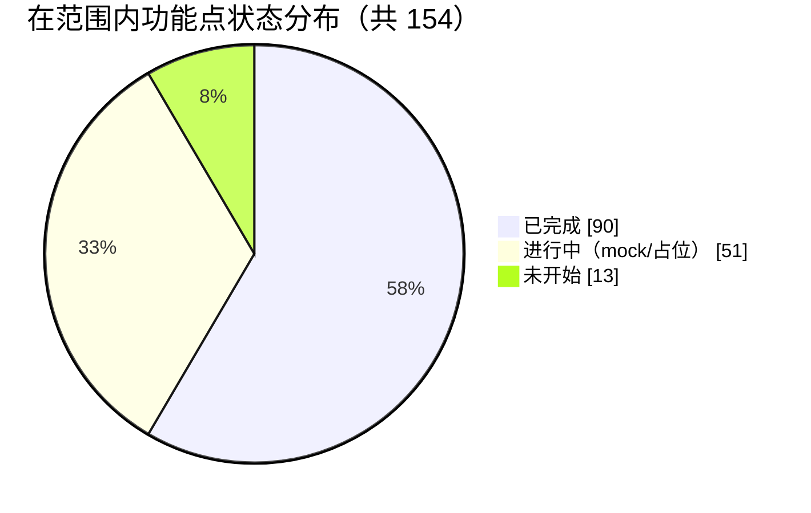
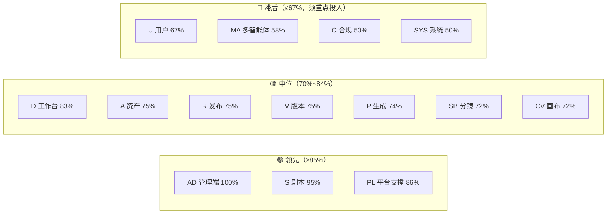
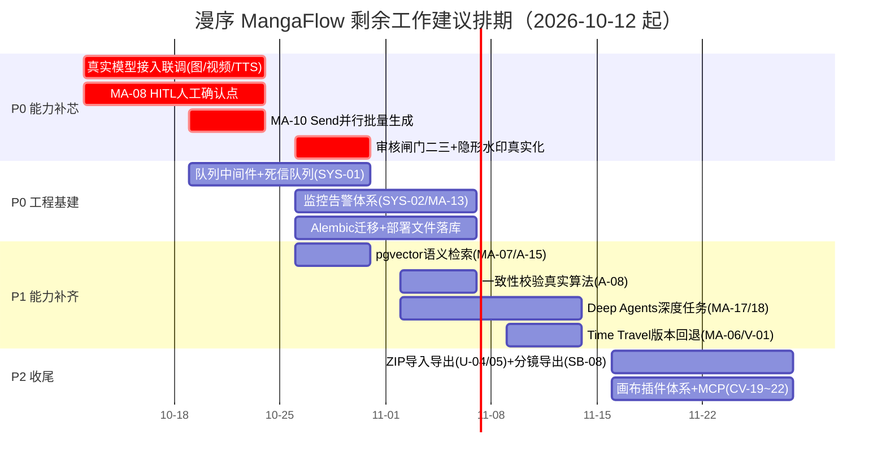

# 漫序 MangaFlow · 项目进度统计分析报告 V1.0

| 项目 | 内容 |
| ---- | ---- |
| 报告类型 | 项目进度统计分析（对照 PRD 与架构/数据库设计基线） |
| 编制日期 | 2026-10-09 |
| 编制人 | 维克托（项目管理） |
| 评估基线 | 《漫序 MangaFlow 产品需求文档（PRD）V1.1》、《漫序 MangaFlow 项目架构设计与数据库设计文档 V1.1》 |
| 数据截止 | 2026-10-09 15:51（GMT+8） |
| 状态 | 待项目组确认 |

> **口径声明**：本报告的功能点数量与编号**完全取自基线文档**，未新增或合并需求编号。所有完成状态判断均基于代码仓库实证（接口、数据表、页面、测试、运行日志），不采信口头描述。标注「待确认」的为本次盘点未能取证的事项。

---

## 1. 评估基线与方法

### 1.1 评估基线（来自两份源文档）

| 基线维度 | 数量 | 来源 |
| -------- | ---- | ---- |
| PRD 功能需求点 | **157 个**（D6 / S10 / A10 / SB9 / P17 / R9 / CV25 / PL29 / MA20 / U6 / C4 / V4 / AD5 / SYS3） | PRD §7.1 功能清单总览 + §附录 D 58 条评审决议 |
| 数据表 | **31 张** | 架构 §5.3 表结构明细（5.3.1~5.3.31） |
| 后端服务模块 | **15 个** | 架构 §3.2 |
| 智能体角色 | **11 类** | 架构 §3.3（MA-03） |
| 核心业务流程 | **6 条**（Studio 全流程 / 实体提取 / DAG 增量 / 生成计费 / 三级闸门 / 状态机） | 架构 §4 |
| 前端仓库 | **2 个**（`mangaflow-web` + `mangaflow-admin-web`）+ 1 共享包 `@mangaflow/design` | 架构 §3.1.4（RD-58） |
| 里程碑 | 8 阶段 / 16 周（MVP = Phase 1-6，第 12 周；完整版第 16 周） | PRD §13.1 |

**本期范围剔除项**（不计入完成度分母）：R-07 一键发布第三方平台（RD-39 已移出 MVP）、V-03/V-04 团队与实时协作（PRD §5.2 明确本期不做）、CV-19/20/21/22 插件与本地 Agent（P2）。R-07 与 V-03/V-04 已从分母剔除；CV 插件类保留在分母中（虽为 P2，但属本期 PRD 定义的编号）。

> 因此**在范围内的功能点为 154 个**（157 − R-07 − V-03 − V-04）。

### 1.2 评估口径（三态定义）

| 状态 | 定义 |
| ---- | ---- |
| ✅ **已完成** | 数据模型 + 后端接口 + 前端页面/交互齐备，链路可端到端跑通，且有测试或运行日志佐证 |
| 🟡 **进行中** | 结构已落地（表/接口/页面/编排骨架具备），但核心能力为 **mock 或占位实现**，或仅覆盖部分子项 |
| ⬜ **未开始** | 本期范围内无任何实现痕迹 |

**完成度公式**：`完成度 = (已完成数 + 0.5 × 进行中数) ÷ 范围内功能点数`

**双口径说明**（重要）：

- **口径 A —— 结构覆盖度**：上式计算值，衡量"接口/页面/数据模型/编排骨架"的工程覆盖，当前约 **75%**。
- **口径 B —— 真实能力就绪度（估算）**：在口径 A 基础上，扣除仍为 mock/占位的链路（图像/视频/TTS 生成、一致性算法、审核闸门二三级、隐形水印、向量语义检索、消息队列中间件、对象存储、监控体系），当前估算 **≈45%**。该值为估算，仅用于风险沟通，不作为验收依据。

### 1.3 证据来源（代码盘点清单）

| 证据 | 实测值 |
| ---- | ------ |
| 后端代码量 | 19,373 行（`backend/app`，107 个 .py） |
| 前端代码量 | 创作端 18,167 行（`mangaflow-web/src`） |
| 管理端代码量 | 4,273 行（`mangaflow-admin-web/src`） |
| 后端接口数 | **143 个**（`@router.*` 装饰器计数） |
| ORM 数据模型 | **31 张表全部建模**（`app/models/__init__.py`） |
| 回归测试 | **55 个用例 / 12 个测试文件**；最近一次运行无失败（`.pytest_cache/lastfailed` 为空） |
| 端到端冒烟 | `.run/smoke_final.py`（注册→建项目→剧本→LLM 流式→实体抽取→定妆→分镜→关键词打样→TTS→合成→发布→管理端），覆盖全主流程 |
| 运行日志 | `.run/backend.out.log`、`web.out.log`、`admin.out.log`（2026-10-09 15:18~15:31 有正常请求记录） |
| 一键脚本 | `mangaflow.ps1`（PostgreSQL + 后端 8300 + 创作端 5173 + 管理端 5174） |

---

## 2. 进度总览

### 2.1 关键结论（先结论后细节）

1. **工程结构覆盖面显著领先于日历进度**：PRD 定义 154 个在范围内功能点，已完成 90、进行中 51、未开始仅 13，结构覆盖度 **75%**。对照 16 周计划，这已相当于把 Phase 1~7 的骨架一次性铺开。
2. **但"可跑通"≠"能力就绪"**：全链路 AI 生成（图像/视频/TTS）仍由 **mock provider** 承接，一致性校验为**伪相似度**，审核闸门二/三为**直通占位**，隐形水印仅**标识写入**——真实能力就绪度估算仅 **≈45%**。
3. **风险集中在"最后一公里"而非"功能缺失"**：剩余 13 个未开始项中有 5 个落在多智能体层（MA-08/10/13/17/18/20 系列），4 个落在画布插件体系（P2），2 个落在项目数据导入导出（ZIP）。
4. **架构技术选型与实现出现 6 处偏离**：Celery/Redis → 进程内 runner；pgvector → JSONB；OSS → 本地磁盘；LangSmith/Prometheus → 无；Alembic → `create_all`；Docker/Nginx → 仓库内无部署文件。**这些偏离需在进入真实模型联调前拍板**（补齐 or 修订架构文档）。
5. **即时运行状态异常**：截至 15:51，仅 PostgreSQL（5432）与创作端（5173）在监听，**后端（8300）与管理端（5174）已停止**（日志最后活动 15:31）。属操作性问题，不构成技术阻塞。

### 2.2 总览表

| # | 模块 | 编号段 | 范围内功能点 | ✅ 已完成 | 🟡 进行中 | ⬜ 未开始 | 完成度 |
| - | ---- | ------ | ----------- | -------- | -------- | -------- | ------ |
| 1 | 工作台 Dashboard | D-01~D-06 | 6 | 4 | 2 | 0 | 83% |
| 2 | 剧本创作 Script | S-01~S-10 | 10 | 9 | 1 | 0 | **95%** |
| 3 | 资产管理 Assets | A-01~A-10 | 10 | 5 | 5 | 0 | 75% |
| 4 | 分镜设计 Storyboard | SB-01~SB-09 | 9 | 5 | 3 | 1 | 72% |
| 5 | 内容生成 Production | P-01~P-17 | 17 | 8 | 9 | 0 | 74% |
| 6 | 审核与发布 Publish | R-01~R-09 | 8 | 4 | 4 | 0 | 75% |
| 7 | AI 画布 Canvas | CV-01~CV-25 | 25 | 15 | 6 | 4 | 72% |
| 8 | 平台支撑 Platform | PL-01~PL-29 | 29 | 22 | 6 | 1 | **86%** |
| 9 | 多智能体协作 Multi-Agent | MA-01~MA-20 | 20 | 8 | 7 | 5 | **58%** |
| 10 | 用户与系统 User | U-01~U-06 | 6 | 4 | 0 | 2 | 67% |
| 11 | 内容合规审核 Compliance | C-01~C-04 | 4 | 0 | 4 | 0 | 50% |
| 12 | 版本管理与协作 Version | V-01~V-04 | 2 | 1 | 1 | 0 | 75% |
| 13 | 运营管理后台 Admin | AD-01~AD-05 | 5 | 5 | 0 | 0 | **100%** |
| 14 | 系统基础能力 System | SYS-01~SYS-03 | 3 | 0 | 3 | 0 | 50% |
| — | **合计** | — | **154** | **90** | **51** | **13** | **75%** |

### 2.3 完成度对比

---

## 3. 分模块明细表

> 判断依据列给出的是**实证锚点**（接口路径 / 表名 / 文件路径 / 测试）；未取证项显式标注「待确认」。
> 「人」列默认为**待确认**（PRD §15.1 已定义 7 个角色编制，但未落具体负责人）。

### 3.1 工作台 Dashboard（D-01~D-06）

| 编号 | 需求摘要 | 优先级 | 状态 | 判断依据 |
| ---- | -------- | ------ | ---- | -------- |
| D-01 | 项目列表（卡片/列表视图） | P0 | ✅ | `views/projects/ProjectListView.vue`(643 行) + `GET /api/projects`；运行日志 200 OK |
| D-02 | 搜索/筛选/排序 | P1 | ✅ | 列表页带 `sort/order` 参数，后端 `projects.py` 支持多条件 |
| D-03 | 新建项目入口 | P0 | ✅ | `components/NewProjectDialog.vue`(363 行) + `POST /api/projects`；三种输入模式齐备 |
| D-04 | 今日/本月创作统计 | P2 | 🟡 | 前端取前 100 条按 `created_at` 汇总（`ProjectListView.vue:135-179`）；**缺图片数/视频时长/配额口径**，与 PRD 验收标准（误差<5%）不符 |
| D-05 | 系统公告与模型状态提醒 | P2 | 🟡 | 公告：`GET /api/announcements` + `announcements` 表 ✅；**模型异常标红未见实现** |
| D-06 | 最近编辑项目置顶 | P1 | ✅ | Agent 首屏"继续你刚才的创作"承接条 + 最近生成/项目区块（`AgentWorkspace.vue`） |

### 3.2 剧本创作 Script（S-01~S-10）

| 编号 | 需求摘要 | 优先级 | 状态 | 判断依据 |
| ---- | -------- | ------ | ---- | -------- |
| S-01 | 三种输入模式 | P0 | ✅ | `script_service.py` 支持一句话/上传/大纲；上传走 `/storage/uploads` |
| S-02 | 项目元信息配置（含 RD-01 忠实度档位） | P0 | ✅ | `projects.fidelity` 字段 + 新建项目对话框 |
| S-03 | 结构化剧本生成（流式） | P0 | ✅ | **真实 DeepSeek**（`providers/llm.py`）+ SSE 流式（`/api/agent/chat/stream`） |
| S-04 | 结构化 JSON 存储（含 RD-03 字段级 source） | P0 | ✅ | `scripts.content` JSONB + `fences` / `health_report` 字段 |
| S-05 | 在线富文本编辑 + 双栏 | P0 | ✅ | `views/studio/ScriptView.vue`(997 行) 三栏编辑 |
| S-06 | 多集/多剧集管理 | P1 | ✅ | `episodes` 表 + `uk_episodes_seq` 约束 |
| S-07 | 结构化体检（RD-02 改写） | P2 | ✅ | `script_service.run_health_check()` + `scripts.health_report` |
| S-08 | 一键同步到 Agent/画布 | P1 | 🟡 | 前端有入口按钮，**幂等/失败重试语义待确认** |
| S-09 | 生成失败三路径处理 | P0 | ✅ | `build_fallback_script()` 离线降级 + 重试/换模型入口 |
| S-10 | 角色/场景/道具自动提取（RD-04/05/06） | P0 | ✅ | `script_service` 双路抽取（LLM 优先 + 规则降级）+ `views/studio/EntityExtractView.vue`(618 行) 确认页 |

### 3.3 资产管理 Assets（A-01~A-10）

| 编号 | 需求摘要 | 优先级 | 状态 | 判断依据 |
| ---- | -------- | ------ | ---- | -------- |
| A-01 | 定妆照生成（RD-10 先主照后派生） | P0 | 🟡 | 派生状态机与接口齐备（`asset_service.py`/`AssetsView.vue` 1076 行），但**图像为 mock**（`providers/image_mock.py` 输出 SVG） |
| A-02 | 多套造型变体（RD-14 继承声明） | P1 | ✅ | `asset_variants` 表 + `inherit_mask` + 变体面板 |
| A-03 | 场景概念图（RD-19 空场景+变体） | P0 | 🟡 | 逻辑与变体类型齐备，**图像 mock** |
| A-04 | 参考图上传（图生图） | P1 | ✅ | `POST /api/media/upload` + `/storage/uploads` 有实存文件 |
| A-05 | 资产画廊 + 标签搜索 | P0 | ✅ | `assets.py`(883 行，23 个接口) + 跨项目总览 `cross_project_assets()` |
| A-06 | 标准化视觉提示词 | P0 | ✅ | `characters.visual_prompt` / `scenes.visual_prompt` NOT NULL |
| A-07 | 道具资产（RD-17 升 P1） | P1 | ✅ | `props` 表（含 `ownership` 归属关系，RD-18） |
| A-08 | 一致性校验 | P1 | 🟡 | `consistency_check()` 为**伪相似度**（`0.88 + id*7%12/100`，代码内自注"占位算法"） |
| A-09 | 资产锁定（RD-12 两层锁定） | P0 | ✅ | `characters.face_locked` + `outfit_variant_id` 双字段落地 |
| A-10 | 双向联动（沉淀/发送到画布） | P1 | 🟡 | 画布侧回流接口齐备，Studio 侧联动入口**待确认** |

### 3.4 分镜设计 Storyboard（SB-01~SB-09）

| 编号 | 需求摘要 | 优先级 | 状态 | 判断依据 |
| ---- | -------- | ------ | ---- | -------- |
| SB-01 | AI 拆解为分镜序列 | P0 | ✅ | `storyboard_service.py`(851 行) 逐场景 LLM 拆镜 + 规则降级 |
| SB-02 | 网格/列表视图 + 拖拽排序 | P0 | ✅ | `StoryboardView.vue`(744 行) |
| SB-03 | 全字段编辑（含 RD-21 文字级拆分） | P0 | ✅ | `PUT` 接口 + 编号自动重排 |
| SB-04 | 分镜提示词生成（融合资产） | P0 | ✅ | `storyboards.prompt_locked` / `prompt_editable` 分层 |
| SB-05 | 节奏预警（RD-22 文字化） | P1 | ✅ | 时长统计 + 预警文案 |
| SB-06 | 连续性检查（RD-23 只报高置信） | P2 | 🟡 | 有检查位，**检测准确率无测试佐证** |
| SB-07 | 目标时长/镜头密度（RD-20 成本可见） | P1 | 🟡 | 密度与预估积分展示；自动调整算法**待确认** |
| SB-08 | 批量导出 PDF/Excel | P2 | ⬜ | 仓库内**未发现导出实现**（无对应接口/前端导出） |
| SB-09 | 投递到画布（RD-25 触发引导） | P1 | ✅ | `canvases.source_storyboard_id` + 投递接口 |

### 3.5 内容生成 Production（P-01~P-17）

| 编号 | 需求摘要 | 优先级 | 状态 | 判断依据 |
| ---- | -------- | ------ | ---- | -------- |
| P-01 | 关键帧批量生成（含资产约束） | P0 | 🟡 | 流程齐备，**图像 mock** |
| P-02 | 单张/批量/全量三模式 | P0 | ✅ | `generation.py`(398 行) + 打样 phase（RD-27） |
| P-03 | 首帧+尾帧双关键帧 | P1 | 🟡 | `storyboards.end_frame_url` 字段在，**首尾帧模式待确认** |
| P-04 | 缩略图嵌入分镜表 | P0 | ✅ | 分镜表含 `keyframe_url` 缩略图 |
| P-05 | 单张/批量重生成（可追溯） | P0 | ✅ | `storyboards.regen_count` |
| P-06 | 上传替换 AI 结果 | P1 | ✅ | 复用 `/api/media/upload` |
| P-07 | 视频片段生成 4-12s / 24fps | P0 | 🟡 | **视频 mock**（`video_mock.py` 产出 mp4 占位） |
| P-08 | 图生视频/首尾帧两模式 | P0 | 🟡 | 任务类型在，**真实模型未接** |
| P-09 | 异步队列 + 双通知 | P0 | ✅ | 进程内 runner + `tasks` 表；通知**待确认** |
| P-10 | 任务状态实时展示 | P0 | ✅ | SSE：`GET /api/.../stream`，`tasks.progress` 分步写库 |
| P-11 | 失败自动重试 3 次（指数退避） | P0 | ✅ | `runner.py:_fail_task` `_MAX_RETRY=3`；**指数退避待确认** |
| P-12 | 视频参数配置 | P1 | ✅ | `tasks.meta` 携 resolution/duration |
| P-13 | 配音生成（多角色音色） | P0 | 🟡 | **TTS mock**（`tts_mock.py` 产出 wav），RD-31 时长回写已实现 |
| P-14 | BGM 匹配 + 自定义上传 | P1 | 🟡 | 字段/入口待确认，**曲库未落地** |
| P-15 | 自动剪辑合成（RD-32 增量合成） | P0 | 🟡 | `compose_service.py` **真实调用本机 ffmpeg concat**，无 ffmpeg 时降级 SVG 海报；**增量合成待确认** |
| P-16 | 自定义字幕样式 | P1 | 🟡 | 合成服务未含字幕烧录实现 |
| P-17 | 转场特效 | P2 | 🟡 | 未发现转场实现 |

### 3.6 审核与发布 Publish（R-01~R-09）

| 编号 | 需求摘要 | 优先级 | 状态 | 判断依据 |
| ---- | -------- | ------ | ---- | -------- |
| R-01 | 视频播放器 | P0 | ✅ | `PublishView.vue`(678 行) |
| R-02 | 分镜级跳转 | P1 | ✅ | 分镜列表跳转 |
| R-03 | 单片段回退重生成（RD-40 多版本） | P0 | ✅ | `film_outputs` 表 + `is_current` 版本切换 |
| R-04 | 导出 MP4（720P/1080P/2K） | P0 | 🟡 | 分辨率参数齐备；**无水印**（见 R-09） |
| R-05 | 三比例输出（RD-37 前置生成） | P0 | ✅ | `projects.aspect_ratio` 前置 |
| R-06 | 分享链接 + 二维码 + 有效期/密码 | P2 | ✅ | `share_token` + `POST /share/revoke` + `GET /api/share/{token}`（免认证） |
| R-07 | 一键发布第三方平台 | P2 | ⬜ | **RD-39 已移出 MVP**，不计入分母 |
| R-08 | 三级闸门审核（RD-34/35/36） | P0 | 🟡 | 三级闸门记录表与查询齐备；**闸门二/三为"直接通过"占位**（`publish.py:86-88,243-245`） |
| R-09 | 隐形溯源水印 | P0 | 🟡 | `film_outputs.watermark_id` **仅写标识**，代码自注"不做像素级水印" |

### 3.7 AI 画布 Canvas（CV-01~CV-25）

| 编号 | 需求摘要 | 优先级 | 状态 | 判断依据 |
| ---- | -------- | ------ | ---- | -------- |
| CV-01 | 多画布项目管理 | P0 | ✅ | `canvases` 表 + `CanvasListView.vue`(495 行) + 12 个接口 |
| CV-02 | 画布与项目/剧集关联 | P1 | ✅ | `canvases.type` = standalone/studio_linked |
| CV-03 | 导入/导出 JSON | P1 | ✅ | `POST /{id}/export` + `POST /import` |
| CV-04 | 10 类节点 | P0 | ✅ | `canvas_nodes.node_type` 含 10 类 |
| CV-05 | 拖拽/缩放/多选/编组 | P0 | ✅ | `CanvasEditorView.vue`(**1760 行**，本仓库最大文件) |
| CV-06 | 端口连线 + 非法校验 | P0 | ✅ | `canvas_edges` + 类型校验 |
| CV-07 | 结果自动写回节点 | P0 | ✅ | `mark_node_done()` + `cache_ref` |
| CV-08 | 资产引用节点同步锁定态 | P0 | ✅ | `asset_ref` 节点类型 |
| CV-09 | 无限画布 + 小地图 | P0 | ✅ | 视口/缩放/小地图齐备 |
| CV-10 | 撤销/重做/历史 ≥50 步 | P0 | ✅ | 前端历史栈 |
| CV-11 | 自动保存（防抖 2s） | P0 | ✅ | `PUT /{id}/graph` + 日志可见多次连续 200 |
| CV-12 | 画布内搜索/批量操作 | P1 | 🟡 | 部分实现，**搜索响应口径未验证** |
| CV-13 | 框选/复制粘贴/跨画布子树 | P1 | 🟡 | 部分实现 |
| CV-14 | 围绕选中节点对话 | P0 | ✅ | `POST /{id}/assistant/chat` |
| CV-15 | 助手结果插回画布 | P0 | ✅ | `apply_assistant_actions()` add_node/add_edge |
| CV-16 | 一句话生成子图（RD-44 先预览） | P1 | 🟡 | 助手动作可批量落节点，**"先预览后落地"待确认** |
| CV-17 | 助手引用提示词/资产库 | P1 | 🟡 | 引用能力部分 |
| CV-18 | 助手操作留痕可回退 | P1 | 🟡 | 操作日志部分 |
| CV-19 | 本地 Agent 桥接（MCP） | P2 | ⬜ | 仓库内**无 MCP 相关实现** |
| CV-20 | 插件 URL 动态安装 | P2 | ⬜ | `canvas_plugins` 表已建，**无安装接口/前端** |
| CV-21 | 节点插件 SDK（TS） | P2 | ⬜ | 未发现 SDK |
| CV-22 | 插件沙箱与权限声明 | P2 | ⬜ | 表含 `permissions/granted/reviewed` 字段，**无运行时沙箱** |
| CV-23 | 投递精修 | P1 | ✅ | `source_storyboard_id` |
| CV-24 | 沉淀回流（RD-47 补特征提取） | P1 | ✅ | `media_assets.source='canvas'` |
| CV-25 | 与 Studio 共享底座 | P0 | ✅ | 共享 prompts/media/models/wallet 表 |

> **画布 DAG 执行（CV-07/RD-45）为真实实现**：`canvas_service.py` 含 Kahn 拓扑排序、迭代 DFS 成环检测、脏闭包强制重算、缓存复用，并有 `all/dirty/node` 三模式——这是本项目工程质量最高的模块之一。

### 3.8 平台支撑 Platform（PL-01~PL-29）

| 编号 | 需求摘要 | 优先级 | 状态 | 判断依据 |
| ---- | -------- | ------ | ---- | -------- |
| PL-01 | 统一混合输入 | P0 | ✅ | `agent_chat.py` intake |
| PL-02 | 意图路由 | P0 | ✅ | `supervisor.classify_intent()` LLM + 规则降级 |
| PL-03 | Skill 选择 | P1 | ✅ | 前端技能下拉 |
| PL-04 | 参数偏好可保存 | P1 | ✅ | `projects.config` JSONB |
| PL-05 | 四重前置校验 | P0 | ✅ | 生成前校验链 |
| PL-06 | 结果处理（5 种去向） | P0 | ✅ | 素材/画布/Studio 入口 |
| PL-07 | 模型渠道托管与健康检测 | P0 | ✅ | `model_channels.health_status` + `llm.health_check()` + 管理端 |
| PL-08 | 逻辑模型路由 + 故障降级 | P0 | 🟡 | `logical_models.channel_priority` 表在；**运行时降级路由链路待确认** |
| PL-09 | 三级配置优先级 | P1 | 🟡 | `projects.config` 项目级在；**任务级/全局默认合并逻辑待确认** |
| PL-10 | 成本估算（误差<10%） | P1 | ✅ | `tasks.cost_points` 预估 + 确认流程 |
| PL-11 | 模型效果对比引导 | P2 | ⬜ | 未发现实现 |
| PL-12 | 公共提示词库 | P1 | ✅ | `prompts.scope='public'` |
| PL-13 | 我的提示词 CRUD | P1 | ✅ | `prompts.py`(235 行) + `PromptLibraryView.vue` |
| PL-14 | 提示词一键应用 | P1 | ✅ | Agent/画布/Studio 引用 |
| PL-15 | JSON 导入提示词集 | P2 | ✅ | `POST /api/prompts/import` + `source_ref` |
| PL-16 | 全类型素材管理 | P0 | ✅ | `media_assets` 表 + `MediaLibraryView.vue` |
| PL-17 | 素材来源标记 | P1 | ✅ | `media_assets.source` 四值 |
| PL-18 | 素材发送到 Agent/画布/Studio | P1 | ✅ | 前端入口 |
| PL-19 | 引用保护删除 | P1 | ✅ | `deleted_at` 软删除 + 引用校验 |
| PL-20 | 配额体系 | P0 | ✅ | `wallets.points_balance` + 免费额度种子 |
| PL-21 | 积分充值 + 明细 | P0 | ✅ | `wallet_transactions` + `BillingView.vue` |
| PL-22 | 订阅管理 | P1 | ✅ | `orders.product_type='subscription'` |
| PL-23 | 订单管理 + 发票 | P1 | ✅ | `orders.invoice_status` + 管理端 `OrdersView.vue` |
| PL-24 | 配额预警（<20% 提醒） | P1 | 🟡 | 预警阈值逻辑**待确认** |
| PL-25 | 资金三件套（RD-55 红线） | P0 | 🟡 | 幂等键唯一约束 ✅ + `bear` 承担方 ✅ + 全量流水 ✅；**对账/资损监控为管理端告警模拟，非独立监控** |
| PL-26 | 模型库分类展示 | P0 | ✅ | `logical_models.capability` 四分类 |
| PL-27 | 模型详情 | P0 | ✅ | `scene_desc` / `price_per_unit` / `doc_url` |
| PL-28 | 官方默认模型内置 | P0 | ✅ | `is_default` + `init_db` 种子 |
| PL-29 | 模型配置内嵌各环节 | P1 | ✅ | 环节内切换 |

### 3.9 多智能体协作 Multi-Agent（MA-01~MA-20）

| 编号 | 需求摘要 | 优先级 | 状态 | 判断依据 |
| ---- | -------- | ------ | ---- | -------- |
| MA-01 | LangGraph StateGraph 协作图 | P0 | ✅ | `agents/graph.py` `build_graph()`：12 节点 StateGraph |
| MA-02 | Supervisor 意图识别分派 | P0 | ✅ | `supervisor.py` LLM(JSON mode) + 规则降级 + 交叉纠偏 |
| MA-03 | 11 类域智能体 | P0 | ✅ | `agents/` 目录 11 个 agent 文件全部存在 |
| MA-04 | 共享状态 Schema + reducer | P0 | ✅ | `agents/state.py` `AgentState` |
| MA-05 | Checkpointer 持久化断点续跑 | P0 | ✅ | `PostgresSaver`（含 Windows Proactor 事件循环的三级降级方案，工程质量高） |
| MA-06 | 检查点=版本快照 + Time Travel | P1 | 🟡 | 检查点持久化 ✅；**一键回退/Time Travel 无 `get_state_history` 调用** |
| MA-07 | Store 长期记忆 + 语义检索 | P1 | 🟡 | `langgraph_store` 表在，**embedding 为 JSONB（无 pgvector）、无语义检索** |
| MA-08 | interrupt 人工确认点 | P0 | ⬜ | 全仓库 `interrupt` / `Command(` **零命中** |
| MA-09 | 子图封装（一致性/审核） | P1 | 🟡 | 节点独立可调，**未封装为 Subgraph** |
| MA-10 | Send map-reduce 并行生成 | P0 | ⬜ | 全仓库 `Send(` **零命中** |
| MA-11 | 三种 stream_mode → SSE 契约 | P0 | 🟡 | 仅用 `stream_mode="updates"`，**非三模式** |
| MA-12 | 工具/Skill 授权 + 积分校验 | P0 | 🟡 | 计费闭环 ✅；工具授权体系**待确认** |
| MA-13 | LangSmith 链路追踪 | P1 | ⬜ | 全仓库 `langsmith` **零命中** |
| MA-14 | 失败重试与降级 | P0 | ✅ | runner 重试 + 各服务 LLM 降级 + 检查点降级 |
| MA-15 | 画布助手 Agent 集成 | P1 | ✅ | `canvas_agent.py` + assistant 接口 |
| MA-16 | LangChain 组件层封装 | P0 | 🟡 | 直接用 `langchain_core.messages`；**统一 ChatModel/Tool/Retriever 封装未见** |
| MA-17 | Deep Agents 原著长文本解析 | P1 | ⬜ | `deep_research_agent.py` 存在但**未接 Deep Agents 框架**（无 deepagents 依赖） |
| MA-18 | Deep Agents 子智能体 + 虚拟文件系统 | P1 | ⬜ | 同上 |
| MA-19 | 三框架统一工具与记忆口径 | P0 | 🟡 | LangChain/LangGraph 在；**Deep Agents 缺席，口径未统一** |
| MA-20 | 深度任务可观测与成本归因 | P1 | ⬜ | 未实现 |

### 3.10 用户与系统 User（U-01~U-06）

| 编号 | 需求摘要 | 优先级 | 状态 | 判断依据 |
| ---- | -------- | ------ | ---- | -------- |
| U-01 | 邮箱/手机注册登录 | P0 | ✅ | `auth.py`(212 行) + 3 个认证页 |
| U-02 | JWT + 自动刷新 | P0 | ✅ | access 7 天 / refresh 30 天（`config.py`）+ `/auth/refresh` |
| U-03 | 信息修改/密码重置/绑定第三方 | P1 | ✅ | `PATCH /api/users/me` + `/users/me/password` |
| U-04 | 项目数据导出 ZIP | P2 | ⬜ | 仓库内**无 zipfile 实现** |
| U-05 | 项目数据导入 ZIP | P2 | ⬜ | 同上 |
| U-06 | 用量统计 | P1 | ✅ | `GET /api/users/me/...` + ProfileView |

### 3.11 内容合规审核 Compliance（C-01~C-04）

| 编号 | 需求摘要 | 优先级 | 状态 | 判断依据 |
| ---- | -------- | ------ | ---- | -------- |
| C-01 | 全链路三类内容审核 | P0 | 🟡 | 仅**文本词表**机审（`review_service.BANNED_WORDS`）；图片/视频无真实机审 |
| C-02 | 违规拦截 | P0 | 🟡 | 词表命中即拦截 + 退款 ✅；**拦截率 ≥99% 无依据** |
| C-03 | 人工审核后台 | P1 | ✅ | `admin/review.py` 队列 + approve/reject（`manual_status`） |
| C-04 | 违规记录与分级处罚 | P1 | 🟡 | 记录 ✅；**限流/封禁分级处罚未见实现** |

### 3.12 版本管理与协作 Version（V-01~V-04）

| 编号 | 需求摘要 | 优先级 | 状态 | 判断依据 |
| ---- | -------- | ------ | ---- | -------- |
| V-01 | 版本快照 + 一键回退 | P1 | 🟡 | `version_snapshots` 表 + 手动/阶段自动写入 ✅；**未与 LangGraph 检查点绑定回退** |
| V-02 | 操作日志 | P1 | ✅ | `operation_logs` 表 + `risk_level` 高危标记 |
| V-03 | 团队协作 | P2 | ⬜ | PRD §5.2 本期不做，不计入分母 |
| V-04 | 实时协作 | P2 | ⬜ | 同上 |

### 3.13 运营管理后台 Admin（AD-01~AD-05）

| 编号 | 需求摘要 | 优先级 | 状态 | 判断依据 |
| ---- | -------- | ------ | ---- | -------- |
| AD-01 | 用户管理 | P0 | ✅ | `admin/users.py`(382 行) + `UsersView.vue`(382 行) |
| AD-02 | 项目/内容审核队列 | P0 | ✅ | `admin/review.py` + `ReviewView.vue`(396 行) |
| AD-03 | 模型配置管理 | P0 | ✅ | `admin/models.py`(476 行) + `ModelsView.vue`(670 行) |
| AD-04 | 订单与计费管理 | P0 | ✅ | `admin/orders.py`(367 行) + `OrdersView.vue` |
| AD-05 | 运营数据看板 | P1 | ✅ | `admin/dashboard.py`(228 行) + `DashboardView.vue` |

> **RD-58 独立仓库已落地**：`mangaflow-admin-web` 独立仓库/独立端口 5174，与创作端共用 `@mangaflow/design`（`package.json` 中 `"@mangaflow/design": "file:../mangaflow-design"`）。管理端为本项目完成度最高模块。

### 3.14 系统基础能力 System（SYS-01~SYS-03）

| 编号 | 需求摘要 | 优先级 | 状态 | 判断依据 |
| ---- | -------- | ------ | ---- | -------- |
| SYS-01 | 任务调度与队列 | P0 | 🟡 | 进程内 3 worker + `FOR UPDATE SKIP LOCKED` 抢占 + 重试 ✅；**无优先级队列、无独立死信队列**（重试耗尽即终态失败） |
| SYS-02 | 监控与告警 | P0 | 🟡 | 管理端运营告警（平台故障/大额订单/渠道不健康）✅；**无 Prometheus/Grafana/Loki，无 P95/成功率时序指标** |
| SYS-03 | 安全与审计 | P0 | 🟡 | 归属校验 ✅、API Key 加密（Fernet）✅、操作审计 ✅；**越权防护未做全量接口回归** |

---

## 4. 进度偏差分析

### 4.1 对照 16 周 8 阶段里程碑

| 阶段 | 计划周期 | 计划交付物 | 当前实际 | 偏差判断 |
| ---- | -------- | ---------- | -------- | -------- |
| Phase 1 基础架构 | 第 1-2 周 | 脚手架/DB/认证/前端框架/LangGraph 骨架/CI-CD | 已完成并**超前**（31 表全建 + 143 接口 + 检查点持久化） | 🟢 超前，但 **CI/CD 与部署文件缺失** |
| Phase 2 剧本创作 | 第 3-4 周 | 创意输入/AI 剧本/编辑器 | 结构已完成（真实 LLM 流式） | 🟢 超前 |
| Phase 3 资产管理 | 第 5-6 周 | 定妆照/资产库/一致性/锁定 | 结构完成，**图像 mock + 一致性伪算法** | 🟡 结构超前、能力欠账 |
| Phase 4 分镜设计 | 第 7-8 周 | AI 拆解/分镜表/提示词/节奏 | 结构完成 | 🟢 超前 |
| Phase 5 内容生成 | 第 9-11 周 | 关键帧/视频队列/TTS/合成 | 队列与合成（真实 ffmpeg）完成，**视频/TTS mock** | 🟡 结构超前、能力欠账 |
| Phase 6 审核与发布 | 第 12 周 | 预览/局部重生成/导出 | 结构与分享完成，**闸门二三/水印占位** | 🟡 |
| Phase 7 AI 画布 | 第 13-14 周 | 无限画布/节点/助手/DAG/联动 | **DAG 增量执行 + 助手 + 双向联动已完成** | 🟢 大幅超前（插件体系除外） |
| Phase 8 平台化与上线 | 第 15-16 周 | 统一 Agent/多智能体/路由/计费/后台/审核 | 计费/后台/路由表完成；**多智能体 5 项未做、审核占位** | 🟡 部分超前 |

### 4.2 偏差结论

- **日历进度**：项目文档基线日期为 2026-10-08，代码建设集中发生在 2026-10-08~09，实际开发以"全栈一次性铺开 + mock 驱动"方式推进，**结构上已跨过 Phase 1~7**。
- **能力进度**：真实 AI 生成、向量检索、审核合规、监控、队列中间件**整体落后于结构进度**，构成后续最大返工面。
- **偏差性质**：**不是"功能没做"，而是"做了壳、缺了芯"**。风险在于若直接进入 Phase 8 收尾，会在联调期集中爆发。

---

## 5. 未完成关键事项清单（13 个未开始 + 高优先进行中）

| # | 事项 | 编号 | 优先级 | 影响 | 负责人 | 建议截止 |
| - | ---- | ---- | ------ | ---- | ------ | -------- |
| 1 | **真实模型接入**（图像/视频/TTS provider） | P-01/03/07/08/13/14 | P0 | 全链路生成能力不可用，成片为占位 | 待确认（算法） | 2026-10-24 |
| 2 | **MA-08 HITL 人工确认点**（interrupt/Command） | MA-08 | P0 | RD-04 人工裁决、阶段确认无法暂停/恢复 | 待确认（后端） | 2026-10-24 |
| 3 | **MA-10 Send map-reduce 并行批量生成** | MA-10 | P0 | 批量生成只能串行，Phase 5 性能不达标 | 待确认（后端） | 2026-10-24 |
| 4 | **审核闸门二/三 + 隐形水印真实化** | R-04/08/09、C-01/02 | P0 | 合规红线（RK-02 / RD-34）未真正落地 | 待确认（审核） | 2026-10-31 |
| 5 | **pgvector 语义检索**（Store + 资产向量） | MA-07、A-15(RD-15) | P1 | 资产语义检索、一致性比对无底座 | 待确认（算法） | 2026-10-31 |
| 6 | **队列中间件与死信队列**（Celery/Redis 或等效） | SYS-01 | P0 | 单机内存队列无法水平扩展、无优先级/DLQ | 待确认（后端） | 2026-10-31 |
| 7 | **监控告警体系**（Prometheus/Grafana/Loki） | SYS-02、MA-13 | P0 | 上线后无指标可观测（PRD §13.3 灰度前提） | 待确认（运维） | 2026-11-07 |
| 8 | 一致性校验真实算法替换 | A-08 | P1 | 角色一致性无法保证（RK-04） | 待确认（算法） | 2026-11-07 |
| 9 | 项目数据导出/导入 ZIP | U-04/U-05 | P2 | 数据可迁移性缺失 | 待确认 | 2026-11-14 |
| 10 | 分镜表 PDF/Excel 导出 | SB-08 | P2 | 交付物导出缺失 | 待确认（前端） | 2026-11-14 |
| 11 | Deep Agents 深度任务（原著解析/世界观） | MA-17/18/20 | P1 | 小说改编场景不成立（US-02） | 待确认（算法） | 2026-11-14 |
| 12 | Time Travel 版本回退 | MA-06、V-01 | P1 | 版本快照只能看不能回 | 待确认（后端） | 2026-11-14 |
| 13 | 画布插件体系 + MCP 桥接 | CV-19/20/21/22 | P2 | 生态能力缺失（已在范围内为 P2） | 待确认 | 2026-11-28 |

---

## 6. 风险与阻塞登记表

| 编号 | 类型 | 风险/问题 | 概率 | 影响 | 等级 | 应对策略 | 负责人 | 触发信号 |
| ---- | ---- | --------- | ---- | ---- | ---- | -------- | ------ | -------- |
| R-01 | **问题** | 图像/视频/TTS 全链路为 mock，真实模型未接 | 已发生 | 5 | **高** | 立即启动真实渠道联调（PL-07/08 已具备渠道表），先跑通 1 条真实链路 | 待确认（算法） | 提交生成任务返回 SVG/占位 mp4 |
| R-02 | **问题** | 架构选定 Celery/Redis/pgvector/OSS/LangSmith，实现全部偏离 | 已发生 | 4 | **高** | **二选一**：补齐实现 或 修订架构文档 §1.3/§5/§6（**需 PM 拍板，否则文档即失效**） | 待确认（架构） | 部署文档与仓库不一致 |
| R-03 | **风险** | 合规闸门二/三为直通，水印仅标识 → 合规处罚风险（RK-02） | 4 | 5 | **高** | Phase 6 前必须完成真实机审接入 + 像素级水印；未完成不进上线灰度 | 待确认（审核/运营） | 导出无水印成片 |
| R-04 | **风险** | 依赖方（模型/支付/审核）就绪状态"待确认"，排期无承诺基础 | 3 | 4 | 中 | 按 PRD §13.2 三档分级逐项确认就绪时限；阻塞项未就绪不承诺排期 | 待确认（PM） | 第三方接口联调失败 |
| R-05 | **风险** | 单机内存队列无 DLQ/优先级，批量任务积压（SYS-01） | 3 | 3 | 中 | 引入 Redis+Celery（或等效）并补 DLQ 与优先级队列 | 待确认（后端） | worker 积压、重试耗尽丢任务 |
| R-06 | **风险** | 无监控指标 → 上线后无法验证 M-01~M-07 与灰度决策 | 3 | 3 | 中 | 部署 Prometheus+Grafana+Loki，先补 6 项核心指标 | 待确认（运维） | 灰度期无数据可看 |
| R-07 | **问题** | 后端(8300)/管理端(5174)当前未在监听 | 已发生 | 1 | 低 | 执行 `.\mangaflow.ps1 restart` 后复核三项探活 | 待确认 | `netstat` 无 8300/5174 |
| R-08 | **风险** | 无 Alembic 迁移，`create_all` 无法演进线上结构 | 3 | 3 | 中 | 引入 Alembic 并将 31 表纳入初始迁移基线 | 待确认（后端） | 字段变更无法下发生产 |
| R-09 | **风险** | PRD 两条待确认决议（RD-09 剧集级资产覆盖 / RD-49 自有 Key 收费）未拍板 | 3 | 2 | 低 | 下一轮评审拍板；未拍板不进排期 | 待确认（产品） | 需求插入导致的返工 |
| R-10 | **风险** | 无 Docker/Nginx 部署文件，部署文档仅为方案 | 3 | 3 | 中 | 将部署文档 §5 的 Dockerfile/compose/Nginx 落为仓库文件并联调 | 待确认（运维） | 一键部署无法复现 |

---

## 7. 后续工作优先级建议

### 7.1 建议排期（Gantt，日期为建议窗口，启动日待确认）

### 7.2 优先级矩阵

| 级别 | 事项 | 理由 |
| ---- | ---- | ---- |
| **P0（本周启动）** | 真实模型接入、MA-08、MA-10、审核闸门真实化 | 四项均为"没有它产品不成立"：生成能力、人工确认、批量性能、合规红线 |
| **P1（10 月底~11 月初）** | 队列中间件、监控体系、pgvector、Alembic+部署文件、一致性算法、Deep Agents | 影响可扩展性、可观测性、上线的先决条件 |
| **P2（11 月中下旬）** | ZIP 导入导出、分镜导出、Time Travel、插件体系 | 有价值但不阻塞 MVP 闭环 |

### 7.3 建议立即做的 3 件事

1. **【决议】架构偏离项二选一拍板**（R-02）：Celery/Redis/pgvector/OSS/LangSmith 是"补齐实现"还是"修订架构文档"。这是当前最大的管理风险——文档与代码不一致会让所有后续排期失去基线。
2. **【联调】打通 1 条真实生成链路**（R-01）：本周内选图像（Seedream/Qwen-Image）或视频（Seedance）任一渠道，端到端替换 mock，验证 `model_channels` 渠道表 + `logical_models` 路由是否真能工作，暴露隐藏的联调成本。
3. **【恢复】重启并复核三端服务**（R-07）：执行 `.\mangaflow.ps1 restart`，确认后端 8300 / 创作端 5173 / 管理端 5174 三项探活 200，并跑一次 `.run/smoke_final.py` 回归，锁定当前可运行基线。

---

## 8. 附录：证据索引

| 类型 | 路径 |
| ---- | ---- |
| PRD 基线 | `项目开发文档/漫序 MangaFlow 产品需求文档（PRD）V1.1.md` |
| 架构基线 | `项目开发文档/漫序 MangaFlow 项目架构设计与数据库设计文档 V1.1.md` |
| UI 基线 | `项目开发文档/漫序 MangaFlow UI原型界面描述清单 V2.1.md` |
| 部署方案 | `项目开发文档/漫序 MangaFlow 腾讯云Linux服务器Docker一键部署操作文档 V1.0.md` |
| 后端入口 | `backend/app/main.py`（187 行） |
| 智能体编排 | `backend/app/agents/graph.py`（384 行）、`supervisor.py`（160 行） |
| 任务执行器 | `backend/app/tasks/runner.py`（587 行） |
| 画布服务 | `backend/app/services/canvas_service.py`（850 行，含 DAG 增量执行） |
| 合成服务 | `backend/app/services/compose_service.py`（211 行，真实 ffmpeg + 降级） |
| 数据模型 | `backend/app/models/__init__.py`（31 表） |
| 回归测试 | `backend/tests/`（12 文件 / 55 用例） |
| 端到端冒烟 | `.run/smoke_final.py` |
| 工程脚本 | `mangaflow.ps1`（一键启停：PostgreSQL + 8300 + 5173 + 5174） |

---

*本报告为进度统计分析，具体实施请结合公司合规与法务要求确认。*

*— 报告结束 —*
