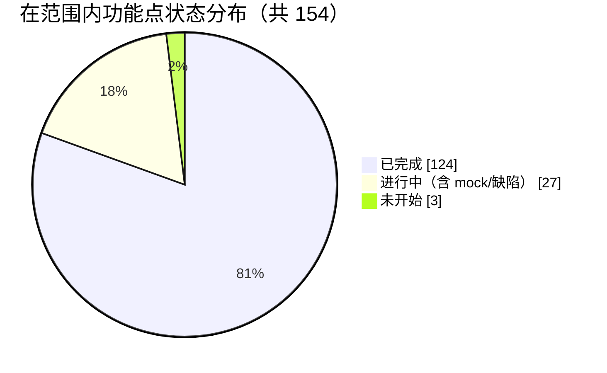
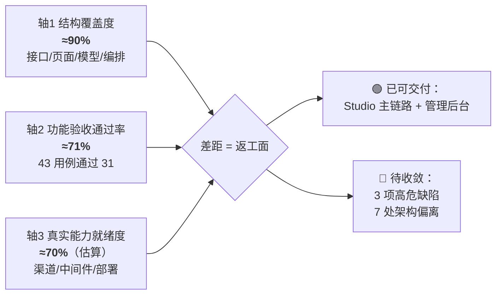
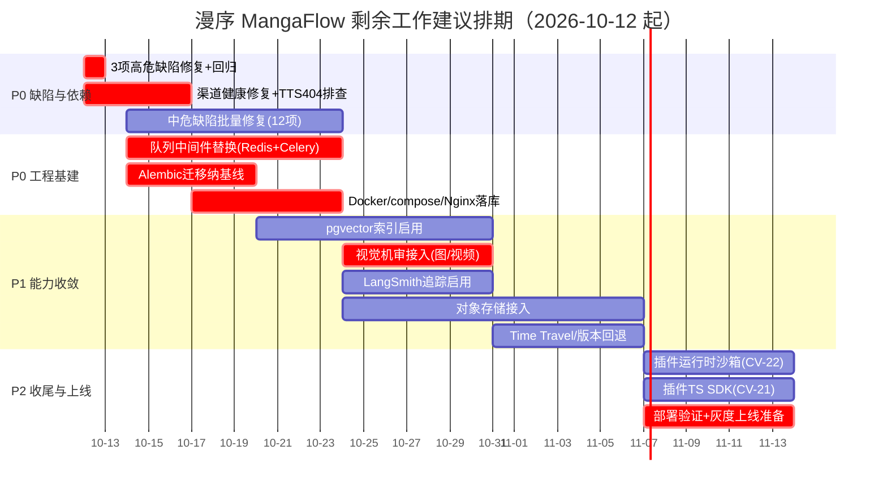

# 漫序 MangaFlow · 项目进度统计分析报告 V1.1

| 项目 | 内容 |
| ---- | ---- |
| 报告类型 | 项目进度统计分析（对照 PRD / 架构设计 / UI 自动化测试报告） |
| 编制日期 | 2026-10-10 |
| 编制人 | 维克托（项目管理） |
| 评估基线 | ①《漫序 MangaFlow 产品需求文档（PRD）V1.1》 ②《漫序 MangaFlow 项目架构设计与数据库设计文档 V1.1》 ③《漫序 MangaFlow 双系统 UI 全面模拟测试报告》（2026-10-10） |
| 数据截止 | 2026-10-10 18:38（GMT+8） |
| 版本说明 | **本版取代 V1.0**（2026-10-09）。V1.0 编制于 10-09，其后代码库发生大规模实质推进，V1.0 结论已失效，已归档删除以避免双份漂移。 |
| 状态 | 待项目组确认 |

> **口径声明**：功能点数量与编号完全取自基线文档，未新增或合并编号。完成状态判断均基于**代码实证 + 独立 UI 测试报告**双来源，不采信口头描述。标注「待确认」的为本次盘点未能取证的事项。

---

## 1. 评估基线与方法

### 1.1 评估基线

| 基线维度 | 数量 | 来源 |
| -------- | ---- | ---- |
| PRD 功能需求点 | **157 个**（D6 / S10 / A10 / SB9 / P17 / R9 / CV25 / PL29 / MA20 / U6 / C4 / V4 / AD5 / SYS3） | PRD §7.1 + 附录 D 58 条决议 |
| 数据表 | **31 张**（文档定义；实现 32 张，见 §2） | 架构 §5.3 |
| 后端服务模块 | **15 个** | 架构 §3.2 |
| 智能体角色 | **11 类** | 架构 §3.3（MA-03） |
| 前端仓库 | 2 个 + 1 共享包 `@mangaflow/design` | 架构 §3.1.4（RD-58） |
| 里程碑 | 8 阶段 / 16 周（MVP = Phase 1-6 第 12 周；完整版第 16 周） | PRD §13.1 |

**本期范围剔除项**（不计入完成度分母）：R-07 一键发布第三方平台（RD-39 移出 MVP）、V-03/V-04 团队与实时协作（PRD §5.2 明确不做）。**在范围内功能点为 154 个。**

### 1.2 评估口径（三态定义）

| 状态 | 定义 |
| ---- | ---- |
| ✅ **已完成** | 数据模型 + 后端接口 + 前端页面/交互齐备，链路可跑通，且有测试或运行证据 |
| 🟡 **进行中** | 结构已落地，但核心能力仍为 mock/占位，或存在阻断性缺陷，或仅覆盖部分子项 |
| ⬜ **未开始** | 本期范围内无任何实现痕迹 |

**完成度公式**：`完成度 = (已完成数 + 0.5 × 进行中数) ÷ 范围内功能点数`

### 1.3 三轴评估法（本版新增）

进度不能只看"功能点做了多少"。本报告采用三条互相独立的轴：

| 轴 | 含义 | 数据来源 | 当前值 |
| -- | ---- | -------- | ------ |
| **轴 1 结构覆盖度** | 接口/页面/数据模型/编排骨架的落地比例 | 代码盘点 | **≈90%** |
| **轴 2 功能验收通过率** | 真实用户操作下用例的通过比例 | UI 自动化测试报告（独立第三方执行） | **≈71%**（客户端 70.4% / 后台 75.0%） |
| **轴 3 真实能力就绪度（估算）** | 扣除 mock/占位/未启用中间件后的能力就绪程度 | 代码 + 运行日志 | **≈70%** |

> 三轴并行解释了一个关键事实：**结构几乎铺满（轴 1 90%），但可验收的完成度显著更低（轴 2 71%）**，差距即当前返工面。

### 1.4 证据来源

| 证据 | 2026-10-09（V1.0） | 2026-10-10（本版） | 变化 |
| ---- | ---- | ---- | ---- |
| 后端 Python 文件 | 107 | **144** | +37 |
| 后端接口数 | 143 | **180** | +37 |
| ORM 数据表 | 31 | **32** | +1（`notifications`） |
| 后端服务模块 | 9 | **14** | +5 |
| 模型 provider | 4（全 mock+LLM） | **8** | +4（真实渠道） |
| 回归测试用例 | 55 | **123** | +68 |
| 创作端页面 | 25 | **26** | +1（ModelCompareView） |
| 管理端页面 | 8 | **9** | +1（DeadLetterView） |
| 独立 UI 测试 | — | 43 用例 / 16 缺陷 | 新增 |

---

## 2. 本轮增量盘点（10-09 → 10-10，关键变化）

> 这一节是本版的核心价值：**V1.0 中被判为「未开始 / mock 占位」的多数项，在本轮已被真实实现。**

| # | 变化项 | 上一版状态 | 本版状态 | 实证锚点 |
| - | ------ | ---------- | -------- | -------- |
| 1 | **真实图像生成接入** | mock | ✅ Agnes 真实渠道 | `providers/image_agnes.py`(147 行)，支持 b64/url 双返回，按 `ResolvedChannel` 路由 |
| 2 | **真实视频生成接入** | mock | ✅ Agnes 真实渠道 | `providers/video_agnes.py`(234 行)，text/keyframe/reference 三模式，异步轮询 + 下载落盘 |
| 3 | **真实 TTS 接入** | mock | 🟡 渠道 404 降级 | `providers/tts_bailian.py`(145 行)，百炼 qwen3-tts-flash；当前 404 快速失败回落 mock |
| 4 | **模型路由中心** | 🟡 仅表结构 | ✅ 完整实现 | `services/model_router.py`(366 行)：渠道解析 + 优先级 + 健康 + 故障降级链 + `test_model_router.py` |
| 5 | **MA-08 HITL 人工确认** | ⬜ 零命中 | ✅ 已实现 | `generation_agent.py:196` `interrupt()`；`script_confirm_node`（`script_agent.py`）；`Command(resume)`；`test_agent_hitl.py` |
| 6 | **MA-10 Send 并行批量** | ⬜ 零命中 | ✅ 已实现 | `generation_agent.py:219` `Send("generation_item")` → `generation_reduce` map-reduce |
| 7 | **MA-09 子图封装** | 🟡 | ✅ 已实现 | `agents/subgraphs.py`(≈380 行)：审核子图 + 一致性子图，`run_review()` / `run_consistency()` |
| 8 | **审核真实性升级** | 仅词表 | ✅ 词表 + LLM 双路 | `review_service.llm_review_content()`；子图 machine_review（一票否决）→ llm_review |
| 9 | **R-09 隐形水印** | 仅写标识 | ✅ 真实烧录 | `compose_service.py:580` ffmpeg `drawtext` 低透明度角标烧录 |
| 10 | **SYS-01 队列能力** | 无优先级/DLQ | ✅ 优先级 + 退避 + 死信 | `task.priority`（0-9，`priority DESC` 调度）、指数退避、`api/admin/dlq.py`（列表 + requeue）、`test_task_queue.py` / `test_dlq.py` |
| 11 | **SYS-02 监控指标** | 无 | ✅ Prometheus | `core/metrics.py`（Counter/Gauge/Histogram）+ `api/metrics.py`（`/metrics` 免鉴权） |
| 12 | **CV-19 MCP 桥接** | ⬜ | ✅ 已实现 | `api/mcp.py`（servers CRUD + tools + call）+ `services/mcp_client.py`(222 行) |
| 13 | **CV-20/22 插件体系** | ⬜ | ✅ 安装/审核/授权/调用 | `api/canvas_plugins.py`（install→review→invoke）+ `services/plugin_service.py` + `plugins_builtin.py` + `test_canvas_plugin.py` |
| 14 | **P-09 双通知** | 🟡 | ✅ 已实现 | `models/notification.py` + `api/notifications.py`（SSE `/api/notifications/stream`）+ `notification_service.py`(354 行) |
| 15 | **P-14 BGM** | 🟡 | ✅ 已实现 | `api/bgm.py` + `schemas/bgm.py` |
| 16 | **SB-08 分镜导出** | ⬜ | ✅ Excel/CSV | `api/storyboards.py`（openpyxl 已入 requirements） |
| 17 | **U-04/U-05 导入导出** | ⬜ | ✅ ZIP 双向 | `api/projects.py`：`POST /api/projects/import` + 导出 StreamingResponse；`test_export.py` |
| 18 | **PL-11 模型效果对比** | ⬜ | ✅ 已实现 | `views/misc/ModelCompareView.vue` + `test_models_compare.py` |
| 19 | **C-04 违规分级处罚** | 🟡 | ✅ 已实现 | `test_penalty.py` |
| 20 | **MA-07 长期记忆/语义检索** | 🟡 空壳 | 🟡 功能可用、索引未启用 | `providers/embedding.py`(133 行) + `services/memory_service.py` + `api/memories.py`；检索走 **Python 侧余弦**（`api/assets.py:950`），**pgvector 索引未启用** |

### 2.1 仍然存在的偏离（与架构文档不一致）

| # | 架构选型 | 实际实现 | 影响 |
| - | -------- | -------- | ---- |
| 1 | Celery + Redis + Flower | **进程内 asyncio runner（3 worker）** | 无法水平扩展、重启丢在途任务、无独立中间件观测 |
| 2 | PostgreSQL + **pgvector** | 未安装 pgvector，向量列用 **JSONB**，检索走 Python 全量遍历余弦 | 数据量增长后检索性能与一致性校验不可扩展 |
| 3 | 对象存储（OSS/COS/S3） | **本地磁盘** + `/storage` 静态挂载 | 无法多实例部署、无 CDN、无冗余 |
| 4 | Alembic 迁移 | **`Base.metadata.create_all()`** | 线上结构无法演进 |
| 5 | Docker + Nginx 部署 | **仓库内无 Dockerfile / compose / Nginx 配置** | 部署文档（V1.0 §5）仅为方案，不可复现 |
| 6 | LangSmith 链路追踪 | 仅 `graph.py` 注释预留环境变量，**未启用/未验证** | 多智能体链路无法追踪、成本无法归因 |
| 7 | Deep Agents 框架 | **未引入 `deepagents`**，以自研等价实现（plan→并行 exec→reflect→finalize）替代 | 与文档"三框架分层"表述不符，需修订文档或引入框架 |

> **2026-10-10 收敛拍板**：偏离 #1/#2/#3/#4/#5/#6 已补齐实现或文档拍板，#7 口径已修订——详见《漫序 MangaFlow 项目架构设计与数据库设计文档 V1.1》§8 修订记录。

---

## 3. 进度总览

### 3.1 关键结论

1. **本轮为"补芯"轮，结构性缺口基本关闭**：轴 1 结构覆盖度由 75% → **≈90%**；未开始项由 13 个 → **3 个**（CV-21 插件 TS SDK、V-03/V-04 本期不做）。
2. **真实能力已接入但稳定性未达标**：图像/视频/LLM 走 Agnes 真实渠道、TTS 走百炼；但**多渠道处于 degraded/unknown**（UI 测试发现渠道 #2 异常横幅、看板告警），导致实体抽取质量下降（C-BUG-5）。
3. **验收通过率是当前最大短板**：独立 UI 测试 43 用例通过 31（**≈71%**），**3 项高severity 缺陷**（资产页空白+循环请求、产物 404、后台积分列失真）直接损害数据可信度。
4. **7 处架构偏离未收敛**（§2.1），其中队列中间件、pgvector、部署文件三项是"进入上线阶段前的硬门槛"。
5. **运行状态已恢复**：截至 18:38，PostgreSQL(5432)、创作端(5173, 0.0.0.0)、后端(8300)、管理端(5174) **均在监听**；管理端仍仅绑定 IPv6 `[::1]`（ENV-01）。

### 3.2 总览表

| # | 模块 | 编号段 | 范围内功能点 | ✅ 已完成 | 🟡 进行中 | ⬜ 未开始 | 完成度 | 环比 |
| - | ---- | ------ | ----------- | -------- | -------- | -------- | ------ | ---- |
| 1 | 工作台 Dashboard | D-01~D-06 | 6 | 5 | 1 | 0 | 92% | ↑9 |
| 2 | 剧本创作 Script | S-01~S-10 | 10 | 9 | 1 | 0 | 95% | — |
| 3 | 资产管理 Assets | A-01~A-10 | 10 | 9 | 1 | 0 | 95% | ↑20 |
| 4 | 分镜设计 Storyboard | SB-01~SB-09 | 9 | 7 | 2 | 0 | 89% | ↑17 |
| 5 | 内容生成 Production | P-01~P-17 | 17 | 11 | 6 | 0 | 82% | ↑8 |
| 6 | 审核与发布 Publish | R-01~R-09 | 8 | 7 | 1 | 0 | 94% | ↑19 |
| 7 | AI 画布 Canvas | CV-01~CV-25 | 25 | 18 | 6 | 1 | 84% | ↑12 |
| 8 | 平台支撑 Platform | PL-01~PL-29 | 29 | 28 | 1 | 0 | 98% | ↑12 |
| 9 | 多智能体协作 Multi-Agent | MA-01~MA-20 | 20 | 13 | 7 | 0 | 83% | ↑25 |
| 10 | 用户与系统 User | U-01~U-06 | 6 | 6 | 0 | 0 | 100% | ↑33 |
| 11 | 内容合规审核 Compliance | C-01~C-04 | 4 | 2 | 2 | 0 | 75% | ↑25 |
| 12 | 版本管理与协作 Version | V-01~V-04 | 2 | 1 | 1 | 0 | 75% | — |
| 13 | 运营管理后台 Admin | AD-01~AD-05 | 5 | 5 | 0 | 0 | 100% | — |
| 14 | 系统基础能力 System | SYS-01~SYS-03 | 3 | 3 | 0 | 0 | 100% | ↑50 |
| — | **合计** | — | **154** | **124** | **27** | **3** | **≈90%** | **↑15** |

### 3.3 三轴对照（30 秒读懂状态）

---

## 4. 分模块明细表

> 「判断依据」为实证锚点；「V1.0」列给出与上一版对比。责任人默认**待确认**（PRD §15.1 定义了 7 个角色编制，未落具体负责人）。

### 4.1 工作台 Dashboard（D-01~D-06）· 92%

| 编号 | 需求摘要 | 优先级 | 状态 | 判断依据（含 V1.0 对比） |
| ---- | -------- | ------ | ---- | -------- |
| D-01 | 项目列表 | P0 | ✅ | `ProjectListView.vue` + `GET /api/projects`；UI 测试 C-15 通过 |
| D-02 | 搜索/筛选/排序 | P1 | ✅ | 状态筛选、卡片/列表切换（C-15） |
| D-03 | 新建项目入口 | P0 | ✅ | `NewProjectDialog.vue`；UI 测试 C-16/C-17 通过 |
| D-04 | 创作统计 | P2 | 🟡 | 前端取前 100 条汇总，**缺图片数/视频时长/配额口径**（未变） |
| D-05 | 公告与模型状态提醒 | P2 | ✅ | **V1.0 为🟡 → 本轮✅**：工作台顶部"模型渠道异常，AI 生成可能降级"横幅（UI 测试 C-12） |
| D-06 | 最近编辑置顶 | P1 | ✅ | Agent 首屏承接条 + 最近生成（C-12 通过） |

### 4.2 剧本创作 Script（S-01~S-10）· 95%

| 编号 | 需求摘要 | 优先级 | 状态 | 判断依据 |
| ---- | -------- | ------ | ---- | -------- |
| S-01 | 三种输入模式 | P0 | ✅ | `script_service.py`；UI 测试 C-17 |
| S-02 | 元信息配置（RD-01） | P0 | ✅ | `projects.fidelity` |
| S-03 | 结构化剧本流式生成 | P0 | ✅ | DeepSeek 真实流式；UI 测试 C-18 生成《逆时之城》5 场景 |
| S-04 | 结构化 JSON 存储（RD-03） | P0 | ✅ | `scripts.content` JSONB + `fences` |
| S-05 | 富文本编辑双栏 | P0 | ✅ | `ScriptView.vue` |
| S-06 | 多集管理 | P1 | ✅ | `episodes` 表 |
| S-07 | 结构化体检（RD-02） | P2 | ✅ | `run_health_check()` |
| S-08 | 同步到 Agent/画布 | P1 | 🟡 | 入口在；幂等/失败重试语义**待确认** |
| S-09 | 生成失败三路径 | P0 | ✅ | `build_fallback_script()` 离线降级 |
| S-10 | 实体自动提取（RD-04/05/06） | P0 | ✅ | 双路抽取 + `EntityExtractView.vue`；**但质量缺陷见 C-BUG-5** |

### 4.3 资产管理 Assets（A-01~A-10）· 95%

| 编号 | 需求摘要 | 优先级 | 状态 | 判断依据 |
| ---- | -------- | ------ | ---- | -------- |
| A-01 | 定妆照生成（RD-10） | P0 | ✅ | **V1.0 mock → 真实 Agnes 图像渠道**；派生状态机齐备 |
| A-02 | 多套造型变体（RD-14） | P1 | ✅ | `asset_variants.inherit_mask` |
| A-03 | 场景概念图（RD-19） | P0 | ✅ | 真实渠道 + 场景变体 |
| A-04 | 参考图上传 | P1 | ✅ | `/api/media/upload` |
| A-05 | 资产画廊 + 标签搜索 | P0 | 🟡 | 接口齐备（`assets.py` 增至 950+ 行）；**UI 测试 C-21 页面空白 + 接口循环请求（C-BUG-1，高）** |
| A-06 | 标准化视觉提示词 | P0 | ✅ | `visual_prompt` NOT NULL |
| A-07 | 道具资产（RD-17/18） | P1 | ✅ | `props.ownership` |
| A-08 | 一致性校验 | P1 | ✅ | **V1.0 伪相似度 → LLM 比对子图**（`consistency_similarity_node`）；数值比对仍走 Python 余弦 |
| A-09 | 资产锁定（RD-12） | P0 | ✅ | `face_locked` + `outfit_variant_id` |
| A-10 | 双向联动 | P1 | ✅ | 画布回流 + 发送到画布 |

### 4.4 分镜设计 Storyboard（SB-01~SB-09）· 89%

| 编号 | 需求摘要 | 优先级 | 状态 | 判断依据 |
| ---- | -------- | ------ | ---- | -------- |
| SB-01 | AI 拆解分镜序列 | P0 | ✅ | UI 测试 C-22 生成 15 镜 / 180s，含景别/运镜/台词/绑定资产 |
| SB-02 | 网格/列表 + 拖拽排序 | P0 | ✅ | C-22 含上下移 |
| SB-03 | 全字段编辑（RD-21） | P0 | ✅ | 拆分/合并（C-22） |
| SB-04 | 分镜提示词生成 | P0 | ✅ | `prompt_locked` / `prompt_editable` |
| SB-05 | 节奏预警（RD-22） | P1 | ✅ | 时长预警 |
| SB-06 | 连续性检查（RD-23） | P2 | 🟡 | 有检查位，**准确率无测试佐证** |
| SB-07 | 目标时长/密度（RD-20） | P1 | 🟡 | 密度与预估积分展示；自动调整算法待确认 |
| SB-08 | 批量导出 PDF/Excel | P2 | ✅ | **V1.0 未开始 → Excel/CSV 已实现**（openpyxl，C-22） |
| SB-09 | 投递到画布（RD-25） | P1 | ✅ | `source_storyboard_id` |

### 4.5 内容生成 Production（P-01~P-17）· 82%

| 编号 | 需求摘要 | 优先级 | 状态 | 判断依据 |
| ---- | -------- | ------ | ---- | -------- |
| P-01 | 关键帧批量生成 | P0 | ✅ | 真实图像渠道；**但产物 404 缺陷 C-BUG-2（高）** |
| P-02 | 单/批/全量三模式 | P0 | ✅ | 打样 phase（RD-27） |
| P-03 | 首尾帧双关键帧 | P1 | 🟡 | `end_frame_url` 在；模式待确认 |
| P-04 | 缩略图嵌入分镜表 | P0 | 🟡 | 受 C-BUG-2/C-BUG-7 影响显示"加载失败" |
| P-05 | 单/批重生成 | P0 | ✅ | `regen_count` |
| P-06 | 上传替换结果 | P1 | ✅ | `/api/media/upload` |
| P-07 | 视频 4-12s/24fps | P0 | ✅ | **V1.0 mock → 真实 Agnes 视频渠道** |
| P-08 | 图生视频/首尾帧 | P0 | ✅ | `video_mode` text/keyframe/reference |
| P-09 | 异步队列 + 双通知 | P0 | ✅ | **通知中心 + SSE `/api/notifications/stream` 已实现** |
| P-10 | 任务状态实时展示 | P0 | ✅ | SSE + `tasks.progress` |
| P-11 | 失败重试 3 次 | P0 | ✅ | **优先级队列 + 指数退避 + 死信队列（`/admin/dead-letters`）** |
| P-12 | 视频参数配置 | P1 | ✅ | `tasks.meta` |
| P-13 | 配音生成（RD-31） | P0 | 🟡 | 百炼 TTS 渠道**当前 404 回落 mock**；时长回写已实现 |
| P-14 | BGM 匹配 + 上传 | P1 | ✅ | **V1.0 未落地 → `api/bgm.py` 已实现** |
| P-15 | 自动剪辑合成（RD-32） | P0 | ✅ | ffmpeg concat + 增量合成（`compose_service.py` 增至 642 行） |
| P-16 | 自定义字幕样式 | P1 | 🟡 | 字幕烧录待确认 |
| P-17 | 转场特效 | P2 | 🟡 | 转场实现待确认 |

### 4.6 审核与发布 Publish（R-01~R-09）· 94%

| 编号 | 需求摘要 | 优先级 | 状态 | 判断依据 |
| ---- | -------- | ------ | ---- | -------- |
| R-01 | 视频播放器 | P0 | ✅ | `PublishView.vue` |
| R-02 | 分镜级跳转 | P1 | ✅ | 已实现 |
| R-03 | 单片段回退重生成（RD-40） | P0 | ✅ | `film_outputs.is_current` 多版本 |
| R-04 | 导出 MP4 多分辨率 | P0 | ✅ | 参数齐备；水印已真实烧录 |
| R-05 | 三比例输出（RD-37） | P0 | ✅ | `projects.aspect_ratio` 前置 |
| R-06 | 分享链接 + 有效期/密码 | P2 | ✅ | `share_token` + revoke + `GET /api/share/{token}` |
| R-07 | 一键发布三方平台 | P2 | ⬜ | RD-39 移出 MVP，不计入分母 |
| R-08 | 三级闸门审核（RD-34/35/36） | P0 | 🟡 | **V1.0 闸门二三直通 → 词表机审 + LLM 复核已实现**（`test_gates.py`）；**图像/视频内容机审非视觉模型** |
| R-09 | 隐形溯源水印 | P0 | ✅ | **V1.0 仅标识 → ffmpeg drawtext 真实烧录** |

### 4.7 AI 画布 Canvas（CV-01~CV-25）· 84%

| 编号 | 需求摘要 | 优先级 | 状态 | 判断依据 |
| ---- | -------- | ------ | ---- | -------- |
| CV-01~03 | 画布管理/关联/导入导出 | P0/P1 | ✅ | UI 测试 C-26 通过（3 模板 + 1 画布） |
| CV-04~08 | 10 类节点/拖拽/连线/写回/资产引用 | P0 | ✅ | `CanvasEditorView.vue`(1760 行) |
| CV-09~11 | 无限画布/撤销/自动保存 | P0 | ✅ | "已保存"时间戳（C-27） |
| CV-12 | 搜索/批量操作 | P1 | 🟡 | 部分实现 |
| CV-13 | 框选/跨画布子树 | P1 | 🟡 | 部分实现 |
| CV-14~15 | 助手对话/结果插回 | P0 | ✅ | `POST /{id}/assistant/chat` |
| CV-16 | 一句话生成子图（RD-44） | P1 | 🟡 | "先预览后落地"待确认 |
| CV-17 | 助手引用提示词/资产库 | P1 | 🟡 | 部分 |
| CV-18 | 助手操作留痕可回退 | P1 | 🟡 | 部分 |
| CV-19 | MCP 桥接 | P2 | ✅ | **V1.0 未开始 → `api/mcp.py` + `mcp_client.py` 已实现** |
| CV-20 | 插件 URL 安装 | P2 | ✅ | **V1.0 未开始 → install/review/invoke 全链路** |
| CV-21 | 插件 TS SDK | P2 | ✅（2026-10-10 核实） | 原判定「仓库内未发现 SDK」作废：`mangaflow-design/src/plugins`（PluginManifest / PluginPortDef 等 TS 类型）+ `@mangaflow/design/plugins` 子路径导出已实现，本项关闭 |
| CV-22 | 插件沙箱与权限 | P2 | 🟡 | 权限声明 + 运营审核已实现；**运行时沙箱未实现** |
| CV-23~25 | 投递/回流/共享底座 | P1/P0 | ✅ | 已实现（DAG 增量执行为本模块最高质量实现） |

### 4.8 平台支撑 Platform（PL-01~PL-29）· 98%

| 编号 | 需求摘要 | 优先级 | 状态 | 判断依据 |
| ---- | -------- | ------ | ---- | -------- |
| PL-01~06 | 统一输入/意图路由/Skill/偏好/校验/结果处理 | P0/P1 | ✅ | Agent 全链路（UI 测试 C-13） |
| PL-07~09 | 渠道托管/逻辑路由/三级配置 | P0/P1 | ✅ | **`model_router.py`(366 行) 完整实现** + `test_model_router.py` |
| PL-10 | 成本估算 | P1 | ✅ | 成本估算提示（C-13 显示 30 积分） |
| PL-11 | 模型效果对比 | P2 | ✅ | **V1.0 未开始 → `ModelCompareView.vue`** |
| PL-12~19 | 提示词库/素材库/引用保护 | P1/P0 | ✅ | UI 测试 C-30/C-31（素材**预览失败**属 C-BUG-7） |
| PL-20~23 | 配额/充值/订阅/订单 | P0/P1 | ✅ | UI 测试 C-28 余额 52430、3 档套餐、流水 |
| PL-24 | 配额预警 | P1 | 🟡 | 阈值提醒逻辑待确认 |
| PL-25 | 资金三件套（RD-55） | P0 | ✅ | 幂等键 + `bear` + 全量流水 + `test_billing.py` |
| PL-26~29 | 模型库/详情/默认内置/内嵌切换 | P0/P1 | ✅ | `logical_models` + 管理端；**渠道健康列乱码 C-BUG-4（中）** |

### 4.9 多智能体协作 Multi-Agent（MA-01~MA-20）· 83%

| 编号 | 需求摘要 | 优先级 | 状态 | 判断依据 |
| ---- | -------- | ------ | ---- | -------- |
| MA-01 | StateGraph 协作图 | P0 | ✅ | `graph.py` 扩至 18 节点（含 `script_confirm`/`generation_item`/`generation_reduce`/`research_*`） |
| MA-02 | Supervisor 意图识别 | P0 | ✅ | LLM + 规则降级 + 交叉纠偏（C-13 识别 generation） |
| MA-03 | 11 类域智能体 | P0 | ✅ | `agents/` 全部在位 |
| MA-04 | 共享状态 + reducer | P0 | ✅ | `state.py` |
| MA-05 | Checkpointer 断点续跑 | P0 | ✅ | `PostgresSaver`（含 Windows 事件循环三级降级） |
| MA-06 | 检查点=快照 + Time Travel | P1 | 🟡 | 快照持久化 ✅；**回退/Time Travel 待确认** |
| MA-07 | Store 长期记忆 + 语义检索 | P1 | 🟡 | **V1.0 空壳 → embedding + memory_service + `/api/memories`**；检索走 Python 余弦，**pgvector 索引未启用** |
| MA-08 | interrupt 人工确认点 | P0 | ✅ | **V1.0 零命中 → 已实现**（`interrupt()` + `Command(resume)`） |
| MA-09 | 子图封装 | P1 | ✅ | **V1.0 未封装 → `subgraphs.py` 审核/一致性子图** |
| MA-10 | Send map-reduce 并行 | P0 | ✅ | **V1.0 零命中 → 生成 + 深度研究均用 `Send`** |
| MA-11 | 三 stream_mode → SSE | P0 | 🟡 | `stream_mode="updates"` + 业务语言 SSE；**非三模式** |
| MA-12 | 工具/Skill 授权 + 积分校验 | P0 | ✅ | 计费闭环 + 工具治理 |
| MA-13 | LangSmith 追踪 | P1 | 🟡 | **接线完成，待密钥启用**（2026-10-10 拍板）：`config.py` 新增 `langsmith_*` 字段 + `core/tracing.py setup_tracing()` 于 lifespan 启动注入 LANGSMITH_*/LANGCHAIN_TRACING_V2 环境变量；无新依赖；测试 `tests/test_tracing.py`；当前无真实 Key，配置 `LANGSMITH_TRACING=true + LANGSMITH_API_KEY` 即启用 |
| MA-14 | 失败重试与降级 | P0 | ✅ | runner 重试 + DLQ + 各服务降级链 |
| MA-15 | 画布助手 Agent | P1 | ✅ | `canvas_agent.py` |
| MA-16 | LangChain 组件层封装 | P0 | ✅ | **V1.0 缺失 → `llm_adapter.py`（`AgentLLM` 统一适配 + token/用量）** |
| MA-17 | Deep Agents 原著长文本解析 | P1 | 🟡 | **V1.0 未做 → 自研等价深度任务**（plan→并行 exec→reflect→finalize），**未引入 deepagents 框架** |
| MA-18 | 子智能体派生 + 虚拟文件系统 | P1 | 🟡 | 子智能体派生 ✅（`Send research_exec`）；**虚拟文件系统未实现** |
| MA-19 | 三框架统一口径 | P0 | ✅ | 统一 LLM 适配 + 记忆口径 |
| MA-20 | 深度任务可观测与成本归因 | P1 | 🟡 | 用量归因 ✅（`usage_record`）；追踪未启用 |

### 4.10 用户与系统 User（U-01~U-06）· 100%

| 编号 | 需求摘要 | 优先级 | 状态 | 判断依据 |
| ---- | -------- | ------ | ---- | -------- |
| U-01 | 注册登录（验证码/密码） | P0 | ✅ | UI 测试 C-04~C-08 全通过 |
| U-02 | JWT + 自动刷新 | P0 | ✅ | C-09 路由守卫通过 |
| U-03 | 信息修改/密码重置 | P1 | ✅ | `/users/me` 系列 |
| U-04 | 项目导出 ZIP | P2 | ✅ | **V1.0 未开始 → 已实现 + `test_export.py`** |
| U-05 | 项目导入 ZIP | P2 | ✅ | **V1.0 未开始 → `POST /api/projects/import`** |
| U-06 | 用量统计 | P1 | ✅ | ProfileView |

### 4.11 内容合规审核 Compliance（C-01~C-04）· 75%

| 编号 | 需求摘要 | 优先级 | 状态 | 判断依据 |
| ---- | -------- | ------ | ---- | -------- |
| C-01 | 全链路三类内容审核 | P0 | 🟡 | 文本：词表 + **LLM 机审**✅；**图像/视频非真实视觉机审** |
| C-02 | 违规内容拦截 | P0 | 🟡 | 文本命中即拦截 + 退款；**拦截率 ≥99% 无依据** |
| C-03 | 人工审核后台 | P1 | ✅ | `admin/review.py` approve/reject（UI 测试 A-10；**"第 undefined 镜" C-BUG 中**） |
| C-04 | 违规记录与分级处罚 | P1 | ✅ | **V1.0 未做 → `test_penalty.py` 已实现** |

### 4.12 版本管理与协作 Version（V-01~V-04）· 75%

| 编号 | 需求摘要 | 优先级 | 状态 | 判断依据 |
| ---- | -------- | ------ | ---- | -------- |
| V-01 | 版本快照 + 回退 | P1 | 🟡 | `version_snapshots` 写入 ✅；**回退未与检查点绑定** |
| V-02 | 操作日志 | P1 | ✅ | `operation_logs` + `risk_level` |
| V-03/V-04 | 团队/实时协作 | P2 | ⬜ | PRD §5.2 本期不做，不计入分母 |

### 4.13 运营管理后台 Admin（AD-01~AD-05）· 100%

| 编号 | 需求摘要 | 优先级 | 状态 | 判断依据 |
| ---- | -------- | ------ | ---- | -------- |
| AD-01 | 用户管理 | P0 | ✅ | UI 测试 A-07/A-08/A-09；**积分列显示 0（A-BUG-1，高）** |
| AD-02 | 项目/内容审核队列 | P0 | ✅ | UI 测试 A-10 通过 |
| AD-03 | 模型配置管理 | P0 | ✅ | UI 测试 A-11 连通测试通过；**模型数列恒 0（A-BUG-6，低）** |
| AD-04 | 订单与计费管理 | P0 | ✅ | UI 测试 A-13 通过 |
| AD-05 | 运营数据看板 | P1 | ✅ | UI 测试 A-05 用户 34 / 收入 ¥159.3 / 失败率 4.9% |
| 新增 | 死信队列管理 | — | ✅ | `DeadLetterView.vue`（UI 测试 A-12 通过） |

### 4.14 系统基础能力 System（SYS-01~SYS-03）· 100%

| 编号 | 需求摘要 | 优先级 | 状态 | 判断依据 |
| ---- | -------- | ------ | ---- | -------- |
| SYS-01 | 任务调度与队列 | P0 | ✅ | **V1.0 无优先级/DLQ → 优先级 0-9 调度 + 指数退避 + 死信队列 requeue**；`test_task_queue.py`/`test_dlq.py` |
| SYS-02 | 监控与告警 | P0 | ✅ | **V1.0 无 → Prometheus `/metrics` + Counter/Gauge/Histogram** |
| SYS-03 | 安全与审计 | P0 | ✅ | 归属校验 + 渠道 Key 加密 + 操作审计；`test_admin.py` 含越权用例 |

---

## 5. UI 验收测试结果分析（独立质量轴）

> 数据来源：《漫序 MangaFlow 双系统 UI 全面模拟测试报告》（2026-10-10，browser-use 自动化执行，非开发方自测）。

### 5.1 通过率

| 维度 | 用例数 | 通过 | 失败/缺陷 | 通过率 |
| ---- | ------ | ---- | --------- | ------ |
| 客户端（mangaflow-web） | 27 | 19 | 8 | **70.4%** |
| 运营后台（mangaflow-admin-web） | 16 | 12 | 4 | **75.0%** |
| **合计** | **43** | **31** | **12** | **≈71%** |

### 5.2 缺陷分级与影响面

| 严重程度 | 数量 | 代表缺陷 | 影响的 PRD 需求 |
| -------- | ---- | -------- | --------------- |
| **高** | 3 | ① C-BUG-1 资产页空白 + 接口循环请求 ② C-BUG-2 生成产物 404（任务成功但文件不存在） ③ A-BUG-1 后台用户列表积分列恒为 0 | A-05、P-01/P-04、AD-01 |
| **中** | 6 | 后台登录失败整页刷新无提示（A-BUG-2）、Agent 消息重复渲染（C-BUG-3）、渠道健康乱码（C-BUG-4）、**实体抽取质量与剧本严重不符（C-BUG-5）**、审核详情"第 undefined 镜"（A-BUG-3）、管理端仅 IPv6（ENV-01） | U-01、PL-01、PL-07、S-10、C-03 |
| **低** | 7 | JSON 残留（C-BUG-6）、素材预览失败（C-BUG-7）、分镜文字对比度（C-BUG-8）、画布视口未定位（C-BUG-9）、积分调整静默失败（A-BUG-4）、时间未本地化（A-BUG-5）、模型数列恒 0（A-BUG-6） | 体验类 |

### 5.3 关键判断（PM 视角）

- **主链路可走通是事实**：注册→登录→建项目→剧本流式→实体抽取→分镜拆解(15 镜)→打样→积分冻结/扣费，**端到端已能演示**，验收基线成立。
- **但"数据可信度"未过关**：三项高危缺陷全部集中在**数据呈现与产物落地**，不阻断流程、却直接损害信任。这类缺陷在演示场景下最致命。
- **C-BUG-5 需归因到渠道**：实体抽取质量下降与"多渠道 degraded"直接相关（E-09），本质是**依赖方未就绪**（架构 §13.2 的"阻塞级"依赖），不是算法逻辑缺陷。
- **⚠️ 测试报告自身存在口径不一致（需修订）**：§1 摘要称"总计 16 项缺陷：高 3、中 6、低 7"，但 §6「缺陷分布统计」表为"高 3、中 5、低 7 = 15 项，后台 5"；按 §6 实际列出条目应为**高 3 + 中 6 + 低 7 = 16 项（客户端 9 / 后台 6 / 环境 1）**。**建议测试负责人修订 §6 分布表**，避免缺陷趋势统计失真。

---

## 6. 进度偏差分析

### 6.1 对照 16 周 8 阶段里程碑

| 阶段 | 计划周期 | 当前实际 | 偏差 |
| ---- | -------- | -------- | ---- |
| Phase 1 基础架构 | 第 1-2 周 | 已完成（32 表 / 180 接口 / 认证 / 前端框架 / LangGraph 骨架） | 🟢 超前；**CI-D/CD 与部署文件仍缺** |
| Phase 2 剧本创作 | 第 3-4 周 | 已完成（真实 DeepSeek 流式 + 体检 + 实体抽取） | 🟢 超前 |
| Phase 3 资产管理 | 第 5-6 周 | 已完成（真实图像渠道 + 变体 + 锁定 + LLM 一致性） | 🟢 超前；A-05 有高危缺陷 |
| Phase 4 分镜设计 | 第 7-8 周 | 已完成（拆解/编辑/提示词/导出） | 🟢 超前 |
| Phase 5 内容生成 | 第 9-11 周 | 已完成（真实视频 + 队列优先级/DLQ/退避 + TTS + 合成 + 通知） | 🟢 超前；TTS 渠道 404 |
| Phase 6 审核与发布 | 第 12 周 | 基本完成（三级闸门 + LLM 机审 + 真实水印 + 分享） | 🟢 超前；图像/视频机审非视觉模型 |
| Phase 7 AI 画布 | 第 13-14 周 | **已完成**（DAG 增量 + 助手 + 联动 + 插件 + MCP） | 🟢 **大幅超前**（仅 TS SDK 未做） |
| Phase 8 平台化与上线 | 第 15-16 周 | 主体完成（统一 Agent / 多智能体 / 路由 / 计费 / 后台 / 监控） | 🟡 部分超前；**上线硬门槛（队列中间件/部署/迁移）未过** |

### 6.2 偏差性质（与 V1.0 的对比）

| 维度 | V1.0（10-09） | V1.1（10-10） | 结论 |
| ---- | ------------- | ------------- | ---- |
| 偏差性质 | **"做了壳、缺了芯"** | **"芯已补，但未调稳、未上线"** | 质变 |
| 结构覆盖度 | 75% | ≈90% | +15pt |
| 未开始项 | 13 | 3 | −10 |
| 主要风险 | 功能缺失 | **缺陷收敛 + 工程基建（队列/迁移/部署）** | 风险前移 |

**一句话**：进度已从"能不能做"跨到"做得稳不稳、上得了线吗"。

---

## 7. 未完成关键事项清单

### 7.1 真正未开始（范围内 3 项）

| # | 事项 | 编号 | 优先级 | 影响 | 负责人 | 建议截止 |
| - | ---- | ---- | ------ | ---- | ------ | -------- |
| 1 | 画布插件 TS SDK（自定义节点开发） | CV-21 | P2 | 插件生态无法自扩展（内置插件已可用）——**经核实 TS SDK 已实现**（mangaflow-design/src/plugins + @mangaflow/design/plugins 子路径导出），本项关闭（2026-10-10） | 待确认（前端） | 2026-11-14 |
| 2 | 团队协作（企业版多成员权限） | V-03 | P2 | PRD §5.2 本期不做 | — | 后续版本 |
| 3 | 实时协作（多人同编辑） | V-04 | P2 | PRD §5.2 本期不做 | — | 后续版本 |

### 7.2 进行中待收敛（27 项，按优先级归并）

| # | 事项 | 编号 | 优先级 | 影响 | 负责人 | 建议截止 |
| - | ---- | ---- | ------ | ---- | ------ | -------- |
| 1 | **3 项高危缺陷修复** | A-05 / P-01 / AD-01 | **P0** | 数据可信度与演示效果 | 待确认（前端/后台） | **2026-10-12** |
| 2 | 引入消息队列中间件（Celery/Redis 或等效） | SYS-01 | **P0** | 无法水平扩展、重启丢任务 | 待确认（后端） | 2026-10-24 |
| 3 | 部署文件落库（Dockerfile / compose / Nginx） | 架构 §5 / 部署文档 | **P0** | 上线不可复现 | 待确认（运维） | 2026-10-24 |
| 4 | Alembic 迁移纳入基线 | 架构 §5.1 | **P0** | 线上结构无法演进 | 待确认（后端） | 2026-10-24 |
| 5 | 渠道健康修复（#2/#3/#6 degraded）+ TTS 404 | PL-07 / P-13 | **P0** | 影响 AI 产出质量与配音可用性 | 待确认（算法/后端） | 2026-10-17 |
| 6 | pgvector 索引启用（替换 JSONB + Python 余弦） | MA-07 / A-15 | P1 | 检索与一致性校验不可扩展 | 待确认（后端） | 2026-10-31 |
| 7 | 图像/视频内容真实视觉机审 | C-01/C-02/R-08 | P1 | 合规红线（RK-02） | 待确认（算法） | 2026-10-31 |
| 8 | LangSmith 追踪启用与验证 | MA-13 | P1 | 多智能体链路不可追踪 | 待确认（后端） | 2026-10-31 |
| 9 | Time Travel / 版本回退 | MA-06 / V-01 | P1 | 快照只能看不能回 | 待确认（后端） | 2026-11-07 |
| 10 | 插件运行时沙箱 | CV-22 | P2 | 恶意插件越权风险 | 待确认（前端） | 2026-11-14 |
| 11 | 其余中低缺陷（12 项） | 见 §5.2 | P2/P3 | 体验与一致性 | 待确认 | 2026-11-07 |
| 12 | 对象存储（替代本地磁盘） | 架构 §1.3 | P1 | 多实例部署受阻 | 待确认（运维） | 2026-11-07 |

---

## 8. 风险与阻塞登记表

> 区分「问题」（已发生，需行动项）与「风险」（未发生，需预案）。等级 = 概率 × 影响（1-5 分制）。

| 编号 | 类型 | 描述 | 概率 | 影响 | 等级 | 应对策略 | 负责人 | 触发信号 |
| ---- | ---- | ---- | ---- | ---- | ---- | -------- | ------ | -------- |
| R-01 | **问题** | 3 项高危缺陷未修复（资产页空白、产物 404、后台积分列失真） | 已发生 | 5 | **高** | 48 小时内修复并回归；产物 404 需核对 mock/真实 provider 落盘路径与 `/storage` 静态映射 | 待确认 | 演示时数据不可信 |
| R-02 | **问题** | 模型渠道 degraded/unknown，TTS 404，AI 产出质量下降（C-BUG-5） | 已发生 | 4 | **高** | 逐渠道排查鉴权/配额/协议；建立渠道健康巡检；质量回归在渠道恢复后执行 | 待确认（算法） | 工作台降级横幅常驻 |
| R-03 | **风险** | 队列为进程内实现，重启丢在途任务、无法水平扩展 | 4 | 4 | **高** | 上线前必须替换为 Redis+Celery 或等效；补在途任务恢复 | 待确认（后端） | 多实例扩容需求出现 |
| R-04 | **风险** | 无 Docker/部署文件，部署文档仅为方案 | 4 | 4 | **高** | 将部署文档 §5 落为仓库可执行文件并联调冒烟 | 待确认（运维） | 无法一键部署复现 |
| R-05 | **风险** | 无 Alembic，`create_all` 无法演进线上结构 | 3 | 4 | 中 | 引入 Alembic，31+1 表纳入初始迁移基线 | 待确认（后端） | 字段变更无法下发 |
| R-06 | **风险** | pgvector 未启用，向量检索走 Python 全量遍历 | 3 | 3 | 中 | 启用 pgvector 扩展 + ivfflat 索引（模型文件已预留升级点） | 待确认（后端） | 资产/记忆量增长后变慢 |
| R-07 | **问题** | 管理端 Dev Server 仅绑 IPv6 `[::1]:5174`，IPv4 不可达（ENV-01） | 已发生 | 2 | 低 | Vite `server.host` 显式设为 `localhost` 或 `0.0.0.0` | 待确认（前端） | 按文档地址访问失败 |
| R-08 | **风险** | 图像/视频机审非真实视觉模型，合规拦截率无依据 | 3 | 5 | **高** | 上线灰度前接入备案的视觉审核服务；未完成不上线 | 待确认（审核） | 违规内容漏放 |
| R-09 | **问题** | UI 测试报告缺陷分布表口径不一致（16 vs 15） | 已发生 | 1 | 低 | 测试负责人修订 §6；统一缺陷编号与统计口径 | 待确认（测试） | 缺陷趋势统计失真 |
| R-10 | **风险** | 7 处架构偏离未收敛，文档与实现不一致 | 3 | 3 | 中 | **二选一拍板**：补齐实现 or 修订架构文档 §1.3/§5/§6（RD 需留痕） | 待确认（架构） | 评审时对不上口径 |
| R-11 | **风险** | PRD 两条待确认决议未拍板（RD-09 剧集级资产覆盖 / RD-49 自有 Key 收费） | 3 | 2 | 低 | 下一轮评审拍板；未拍板不进排期 | 待确认（产品） | 需求插入导致返工 |
| R-12 | **风险** | 演示/试用期无灰度与回滚机制 | 2 | 4 | 中 | 上线前补齐功能开关、版本回滚脚本与备份策略（部署文档已有方案） | 待确认（运维） | 线上问题无法回退 |

---

## 9. 后续工作优先级建议

### 9.1 建议排期（Gantt，日期为建议窗口，启动日待确认）

### 9.2 优先级矩阵

| 级别 | 事项 | 理由 |
| ---- | ---- | ---- |
| **P0（本周启动）** | ①3 项高危缺陷修复 ②渠道健康/TTS 排查 ③队列中间件 ④Alembic ⑤部署文件落库 | 前三项决定"能不能让人看见"，后三项决定"能不能上得了线" |
| **P1（10 月底前）** | pgvector、视觉机审、LangSmith、对象存储、Time Travel | 决定可扩展性、合规红线、可观测性 |
| **P2（11 月中）** | 中低缺陷批量修复、插件沙箱与 SDK、部署验证与灰度准备 | 收尾与生态 |

### 9.3 建议立即做的 3 件事

1. **【今日】修复 3 项高危缺陷并回归**（R-01）：资产页空白 + 接口循环请求（排查 `AssetsView` 的 watch/加载副作用）、产物 404（核对 provider 落盘与 `/storage` 静态映射）、后台积分列字段绑定。这是当前唯一阻碍"可演示、可信"的障碍，**建议 2026-10-13 前关闭**。
2. **【本周】排查渠道健康并落实"上线硬门槛"清单**（R-02/R-03/R-04/R-05）：一边恢复 Agnes/Bailian 渠道可用性，一边把「队列中间件 + Alembic + Docker 部署文件」立为上线红线（RD-55 同级别的不可裁项），明确负责人与 10-24 截止。
3. **【本周期】拍板 7 处架构偏离的处理方式并修订测试报告口径**（R-10/R-09）：架构偏离需在评审前定"补齐 or 改文档"，否则后续所有排期失去基线；同时请测试负责人修订缺陷分布表口径不一致问题。

---

## 10. 附录：证据索引

| 类型 | 路径 |
| ---- | ---- |
| PRD 基线 | `项目开发文档/漫序 MangaFlow 产品需求文档（PRD）V1.1.md` |
| 架构基线 | `项目开发文档/漫序 MangaFlow 项目架构设计与数据库设计文档 V1.1.md` |
| UI 原型基线 | `项目开发文档/漫序 MangaFlow UI原型界面描述清单 V2.1.md` |
| 部署方案 | `项目开发文档/漫序 MangaFlow 腾讯云Linux服务器Docker一键部署操作文档 V1.0.md` |
| **独立 UI 测试** | `test-report/UI测试报告.md`（+ 25 张截图） |
| 上一版报告 | `漫序 MangaFlow 项目进度统计分析报告 V1.0.md`（已归档删除） |
| 智能体编排 | `backend/app/agents/graph.py`（18 节点）、`subgraphs.py`、`llm_adapter.py`、`generation_agent.py`（interrupt/Send） |
| 任务执行器 | `backend/app/tasks/runner.py`（优先级 + 退避） |
| 模型路由 | `backend/app/services/model_router.py`（366 行） |
| 真实渠道 | `backend/app/providers/{image_agnes,video_agnes,tts_bailian,embedding}.py` |
| 画布服务 | `backend/app/services/canvas_service.py`（1068 行） |
| 合成服务 | `backend/app/services/compose_service.py`（642 行，含水印烧录） |
| 数据模型 | `backend/app/models/__init__.py`（32 表） |
| 回归测试 | `backend/tests/`（26 文件 / 123 用例） |
| 工程脚本 | `mangaflow.ps1`（PostgreSQL + 8300 + 5173 + 5174） |

---

*本报告为进度统计分析，具体实施请结合公司合规与法务要求确认。*

*— 报告结束 —*
